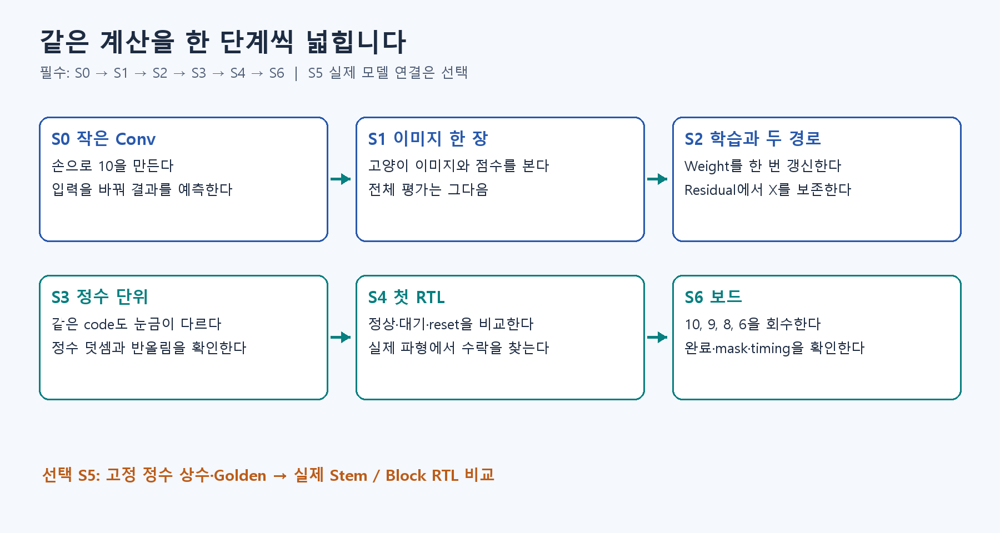

# 처음부터 따라가는 학습 경로

목표는 작은 Conv를 손으로 계산하고 같은 결과를 RTL과 ZedBoard에서 확인하는 것입니다.



필수 경로는 **S0 → S1 → S2 → S3 → S4 → S6**입니다. S5 실제 모델 연결은 선택입니다. 단계마다 예측 → 실행 → 값 변경 → 이유 설명을 마친 뒤 이동합니다.

처음에는 Python만으로 S0을 시작하세요. 로컬 실행은 저장소 최상위에서 합니다. Python이 없거나 설치가 어렵다면 [Colab](https://colab.research.google.com/github/tsi03048/resnet20-accel/blob/main/notebooks/E1_E2_resnet20_reference.ipynb)을 사용하세요.

```bash
python -m exercises.conv_walkthrough
python -m exercises.step_up conv
```

| 단계 | 이번에 할 수 있게 되는 것 | 준비 |
| --- | --- | --- |
| [S0](learning/S0.md) | 작은 Conv를 손과 코드로 계산하기 | Python만 |
| [S1](learning/S1.md) | 실제 이미지 한 장과 분류 점수 보기 | 단계별 문서 확인 |
| [S2](learning/S2.md) | 학습 한 번과 Residual 두 경로 따라가기 | Python만 |
| [S3](learning/S3.md) | 정수 code의 눈금과 반올림 확인하기 | 단계별 문서 확인 |
| [S4](learning/S4.md) | 대기와 수락을 실제 RTL 파형에서 찾기 | 단계별 문서 확인 |
| [S5](learning/S5.md) | 선택: 작은 Conv에서 실제 모델 Stem으로 넓히기 | 단계별 문서 확인 |
| [S6](learning/S6.md) | ZedBoard에서 네 결과를 확인하기 | 단계별 문서 확인 |

## 길을 잃었을 때

S5를 선택했다면 [실제 정수 Stem RTL 실습](stem_e2b_rtl.md)으로 이어갑니다. 같은 sample 0의 완료 5작업에서 누산·출력 code를 각각 81,920개 비교해 통과했습니다. Residual·전체 CNN RTL·보드는 후속 과제입니다.

첫 계산은 S0, 클래스 점수는 S1, 학습·Residual은 S2, Scale·RNE는 S3, 대기·파형은 S4로 돌아갑니다. 개념 전체를 미리 읽을 필요는 없습니다.

실행 결과와 한 문장 설명을 [작은 제출 기록](learning/worksheet.md)에 남깁니다. [현재 기준과 진행 상태](project_status.md), [개념 자료](fundamentals/README.md), [심화 자료](notion_map.md)는 필요할 때만 엽니다.
