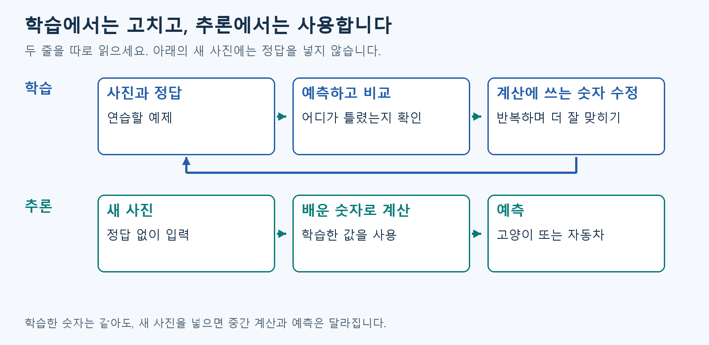
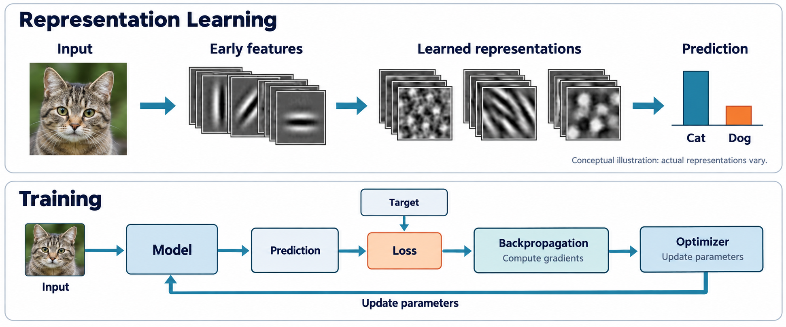

# A0. 모델·학습·추론

## 모델은 답을 내는 계산 방법입니다

앞에서 사진이 숫자 계산을 거쳐 답이 된다는 큰 흐름을 봤습니다. 여기서는 **무엇이 바뀌고, 무엇을 가져다 쓰는지** 구분합니다.

| 단계 | 하는 일 | 계산에 쓰는 숫자 |
| --- | --- | --- |
| 학습 | 예측을 정답과 비교하며 계산 방법을 조정 | 반복해서 고침 |
| 추론 | 새 입력의 답을 계산 | 학습이 끝난 값을 사용 |

예를 들어 여러 사진으로 학습한 뒤 새 자동차 사진을 넣으면, 배운 숫자는 그대로 쓰지만 입력과 계산 결과는 달라집니다.

딥러닝 모델은 계산을 여러 단계로 이어 붙입니다. 사진에서는 앞 단계가 작은 무늬를, 뒤 단계가 그 조합을 구별하도록 배울 수 있습니다. 단계가 깊게 이어진다는 뜻에서 ‘딥’이라고 부릅니다.

이 프로젝트는 이미 학습된 숫자를 가져와 답을 내는 계산을 만듭니다. 먼저 다음 장에서 **사진을 어떤 숫자로 받는지** 보겠습니다.

## 그림으로 이어 보기

두 줄을 따로 읽으며 학습에서만 값을 고치는 부분을 찾으세요.

## 다음 개념

[A1. 사진을 숫자로 읽기](A1.md)

복습·관련 실습 찾기

[학습 목차](../basic_track.md) · 이론을 읽은 뒤 [실습 S1](../learning/S1.md)

선택 보충: 상세 수식·이전 기록 (첫 읽기에서는 건너뜁니다)

> 2026-10-28 로컬 백업의 학습자료입니다. 본문의 ResNet-56 등 과거 프로젝트 예시는 당시 기록이며, 현재 구현 기준은 [프로젝트 README](../../README.md)의 ResNet-20·ZedBoard입니다.

> 공통 기초 A0 · Rev3.0 · 의미 설명 → 용어 → 수학적 의미 순서로 읽는다.

> <b>Deep Learning은 여러 Layer로 구성된 Neural Network를 이용해, 문제 해결에 필요한 표현과 판단 방법을 데이터로부터 학습하는 방법이다.</b>
> 
> 사진을 분류하는 문제라면, 사람이 고양이의 모든 특징을 규칙으로 작성하는 대신 사진과 정답을 이용해 Model을 학습시킨다. 이 장에서는 <b>왜 이런 방법이 필요한지, 무엇을 학습하는지, 학습 결과를 어떻게 사용하는지</b>를 알아본다.

# 1. 어떤 문제를 해결하려는가?

고양이는 털 색과 자세가 다양하고, 귀가 가려지거나 조명과 배경이 달라질 수 있다.

‘귀가 뾰족하면 고양이’처럼 사람이 직접 규칙을 작성하면 예외가 계속 생긴다. 어려운 점은 <b>어떤 정보를 보고, 그 정보를 어떻게 조합해야 하는지</b>를 완전한 규칙으로 표현하는 것이다.

Deep Learning에서는 예시 데이터를 이용해, 입력에서 필요한 정보를 추출하고 예측하는 방법을 함께 학습한다.

| 접근 | 사람이 준비하는 것 | 컴퓨터가 하는 것 |
| --- | --- | --- |
| 규칙 기반 | 사람이 작성한 판단 규칙 | 규칙을 입력에 적용 |
| Supervised Learning | 예시 입력과 정답, Model 구조와 학습 방법 | 예측이 좋아지도록 Parameter 조정 |

## 용어와 수학적 의미

- <b>Model</b>: 입력을 받아 예측을 만드는 함수.
- <b>Parameter(파라미터)</b>: Model 안에서 학습으로 조정하는 수치.
- <b>Supervised Learning(지도학습)</b>: 입력과 정답의 쌍을 이용하는 학습 방식.

$$
\hat y=f_\theta(x)
$$

입력 $x$를 Model $f_\theta$에 넣으면 예측 $\hat y$가 나온다. $\theta$는 Model의 Parameter 전체를 나타낸다.

이 장은 Supervised Learning을 예로 설명한다. 모든 Deep Learning에 사람이 붙인 정답이 필요한 것은 아니며, 사람은 데이터·Model 구조·학습 목표와 방법을 설계한다.

# 2. Neural Network는 어떻게 계산하는가?

Neural Network는 작은 계산 단위를 연결한 Model이다. 생물학적 뉴런의 신호 전달에서 영감을 받아 이를 수학적 계산으로 단순화했다.

기본 계산은 간단하다. <b>각 입력에 Weight를 곱하고, 모두 더한 뒤 Bias를 더한다.</b> 여기에 Activation Function을 적용해 다음 계산에 전달할 값을 만든다.

Weight가 달라지면 같은 입력도 결과에 다르게 반영된다. 학습에서는 이런 수치들을 조정한다.

## 용어와 수학적 의미

| 용어 | 의미 |
| --- | --- |
| <b>Weight</b>, $w$ | 입력에 곱하는 계수 |
| <b>Bias</b>, $b$ | 가중합에 더하는 값 |
| <b>Activation Function(활성화 함수)</b>, $\sigma$ | 가중합을 비선형적으로 변환하는 함수 |
| <b>Activation</b>, $a$ | Activation Function을 거쳐 나온 값 |

$$
z=\sum_i w_ix_i+b,\qquad a=\sigma(z)
$$

Weight와 Bias는 대표적인 Parameter다. 이러한 계산을 수행하는 기본 단위를 <b>Artificial Neuron</b>이라고 한다.

대표적인 Activation Function인 ReLU는 음수를 0으로 바꾼다.

$$
\operatorname{ReLU}(z)=\max(0,z)
$$

인공 뉴런은 실제 뉴런의 전기·화학적 동작을 그대로 재현한 것은 아니다. [D2L: 신경망의 생물학적 영감](https://en.d2l.ai/chapter_introduction/index.html)

# 3. 무엇을 학습하는가? — Representation Learning

사진은 처음에는 밝기와 색을 나타내는 픽셀 숫자다. 이 숫자에 ‘고양이’라는 의미가 직접 적혀 있지는 않다.

Neural Network는 입력을 여러 단계로 변환해 <b>판단에 유용한 정보가 드러나는 숫자 표현</b>을 만든다. 이 중간 표현을 Representation이라고 한다.

위: Representation Learning의 흐름. 아래: Training의 반복 과정. 이해를 위한 AI 생성 개념도로, 실제 학습된 Model의 내부를 측정한 시각화는 아니다.

그림 위쪽은 다음과 같은 흐름을 나타낸다.

> <b>Input → Early Features → Learned Representations → Prediction</b>

초기 Layer에서는 경계와 무늬에 대한 반응이 나타날 수 있다. 뒤의 Layer에서는 앞의 반응을 조합해 분류에 유용한 표현을 만든다.

<b>Deep Learning은 마지막 판단 방법뿐 아니라, 판단에 필요한 정보를 어떻게 추출하고 조합할지도 함께 학습한다.</b>

## 용어와 수학적 의미

- <b>Feature</b>: 판단에 활용할 수 있는 속성이나 패턴.
- <b>Representation</b>: 입력이나 중간 정보를 숫자들의 형태로 나타낸 것.
- <b>Representation Learning</b>: 문제에 유용한 Representation을 만드는 변환 자체를 학습하는 것.

$$
h=\phi_\theta(x)
$$

입력 $x$를 학습 가능한 변환 $\phi_\theta$에 통과시켜 중간 Representation $h$를 만든다.

그림은 개념적인 예시다. 특정 Layer나 뉴런이 반드시 사람이 이름 붙일 수 있는 특징 하나를 담당하는 것은 아니다. [LeCun·Bengio·Hinton, Deep learning](https://www.nature.com/articles/nature14539)

# 4. 왜 여러 Layer를 쌓는가?

한 Layer의 출력은 다음 Layer의 입력이 된다. 다음 Layer는 앞에서 얻은 정보를 다시 조합해 새로운 Representation을 만든다.

작은 경계의 반응을 조합해 형태에 반응하고, 여러 형태의 관계를 조합해 물체를 구분하는 데 사용할 수 있다.

<b>여러 Layer를 쌓는 것은 작은 변환을 차례로 연결해 복잡한 변환을 구성하는 것이다.</b> Deep이라는 이름은 이런 계산의 깊이에서 나온다.

## 용어와 수학적 의미

- <b>Layer</b>: 입력을 한 단계 변환하는 계산들의 묶음.
- <b>Hidden Layer</b>: 입력과 최종 출력 사이의 중간 Layer.
- <b>Depth</b>: 계산 단계가 얼마나 깊게 연결되어 있는지를 나타내는 개념.

$$
h^{(0)}=x,\qquad
h^{(\ell)}
=
\sigma_\ell\!\left(W^{(\ell)}h^{(\ell-1)}+b^{(\ell)}\right)
$$

$\ell$번째 Layer는 앞 Layer의 출력 $h^{(\ell-1)}$을 새로운 표현 $h^{(\ell)}$으로 변환한다.

중간의 비선형 Activation Function이 있어야, 가중합만 반복할 때보다 복잡한 관계를 표현할 수 있다.

Layer가 많다고 항상 성능이 좋아지는 것은 아니다. 학습이 어려워지거나 Overfitting이 발생할 수 있고, 계산과 메모리 사용량도 증가한다. ResNet은 깊은 구조의 학습을 돕는 Residual Connection을 사용하는 Model이다.

# 5. Training은 어떻게 이루어지는가?

처음부터 유용한 Weight를 알고 시작하는 것은 아니다. 현재 Parameter로 예측한 뒤 정답과 비교하고, 예측이 좋아지도록 Parameter를 수정한다.

그림 아래쪽의 Training 과정은 다음 순서다.

1. <b>Forward Pass</b>: 입력을 Model에 통과시켜 Prediction을 계산한다.
2. <b>Loss 계산</b>: Prediction이 Target에 얼마나 부합하는지 평가한다.
3. <b>Backpropagation</b>: 각 Parameter에 대한 Loss의 Gradient를 계산한다.
4. <b>Optimizer의 갱신</b>: Gradient 등을 이용해 Parameter를 수정한다.

## 용어와 수학적 의미

| 용어 | 역할 |
| --- | --- |
| <b>Target</b> | 학습에서 맞히려는 정답 또는 목표값 |
| <b>Loss</b> | 예측이 학습 목표에 부합하지 않는 정도를 나타내는 값 |
| <b>Gradient(기울기)</b> | 각 Parameter에 대한 Loss의 변화율을 모은 것 |
| <b>Backpropagation(역전파)</b> | 연쇄법칙으로 Gradient를 계산하는 방법 |
| <b>Optimizer</b> | Parameter를 실제로 수정하는 알고리즘 |
| <b>Learning Rate</b>, $\eta$ | 수정하는 보폭을 조절하는 값 |

$$
\mathcal L(\theta)
=
\frac1N\sum_{n=1}^{N}
\ell\!\left(f_\theta(x_n),y_n\right)
$$

$N$개 예시의 Prediction과 Target $y_n$을 비교해 평균 Loss를 구한다.

기본적인 최적화 방법인 Gradient Descent는 다음과 같이 Parameter를 수정한다.

$$
\theta\leftarrow\theta-\eta\nabla_\theta\mathcal L
$$

<b>Backpropagation은 Gradient를 계산하고, Optimizer는 그 정보를 이용해 Parameter를 수정한다.</b> 한 번의 수정이 모든 예시의 예측을 개선한다는 뜻은 아니다.

# 6. Training과 Inference는 어떻게 다른가?

Training으로 얻은 결과의 중요한 부분은 조정된 Weight와 Bias 등 Parameter에 남는다. Model을 실행하려면 Model 구조와 필요한 상태도 함께 있어야 한다.

학습한 Model에 새로운 입력을 넣어 결과를 계산하는 과정을 Inference라고 한다.

| 구분 | 목적 | Parameter |
| --- | --- | --- |
| <b>Training</b> | 데이터에서 유용한 표현과 예측 방법을 학습 | 반복해서 수정 |
| <b>Inference</b> | 학습한 Model로 입력의 결과 계산 | 일반적으로 고정 |

$$
\hat y=f_{\theta^\star}(x_{\text{new}})
$$

학습한 Parameter $\theta^\star$를 사용해 새로운 입력의 Prediction을 계산한다. 일반적인 Neural Network는 새 입력마다 모든 학습 사진과 일일이 비교하는 대신, 학습된 변환을 적용한다.

## 잘 배웠다는 것은 무엇인가?

학습 데이터에서 성능이 좋아도 새로운 데이터에서 실패할 수 있다.

고양이 사진에는 소파가 많고 개 사진에는 풀밭이 많았다면, Model은 동물의 형태보다 배경에 의존할 수 있다. 이런 Model은 다른 배경의 사진에서 쉽게 틀릴 수 있다.

- <b>Generalization(일반화)</b>: 학습에 사용하지 않은 데이터에서도 잘 작동하는 성질.
- <b>Overfitting(과적합)</b>: 학습 데이터에 지나치게 맞춰져 새로운 데이터에서 성능이 떨어지는 현상.

따라서 Training Data와 별도로 Validation Data와 Test Data를 두고, 새로운 데이터에서의 성능과 실제 오류를 확인한다.

# 7. 우리 가속기 프로젝트와 어떻게 연결되는가?

우리 프로젝트에서 <b>ResNet-56은 Neural Network 구조</b>, <b>CIFAR-10은 이미지와 정답이 담긴 Dataset</b>이다.

학습한 Model은 이미지를 받아 여러 Layer를 계산하고, 최종적으로 10개 Class에 대한 점수를 만든다.

> <b>Input Image → 여러 Layer의 계산 → Class별 점수 → 분류 결과</b>

가속기는 이 <b>Inference 과정의 계산과 데이터 이동을 효율적으로 실행하는 하드웨어</b>다. 분류 정확도와 실행 효율을 함께 검증한다.

CIFAR-10 이미지 한 장은 $32\times32\times3$의 숫자로 표현되며, 출력은 10개 Class에 대한 Logit이다. 구체적인 Tensor Shape와 수치 표현은 다음 장에서 살펴본다.

| 다음에 배울 개념 | 확인할 내용 |
| --- | --- |
| <b>Tensor</b> | 입력과 중간 Representation을 어떤 숫자 배열로 담는가 |
| <b>CNN / Convolution</b> | 이미지의 공간적 패턴을 어떤 계산으로 처리하는가 |
| <b>Quantization</b> | 수치를 적은 비트로 어떻게 표현하는가 |
| <b>Accelerator Architecture</b> | 계산과 데이터 이동을 어떻게 배치하고 실행하는가 |

CNN은 이미지의 공간적 패턴을 처리하는 구조로, Transformer는 Token 사이의 관계를 결합하는 구조로 별도 장에서 확장한다. 둘 모두 Representation을 변환하고, Training으로 Parameter를 조정한다는 기반을 공유한다.

보드는 아직 미정이다. 특정 FPGA 자원과 모듈 입출력은 공통 원리와 CNN을 이해한 뒤 별도 구현 파트에서 정의한다.

## 다음 장 안내

| 장 | 이 장과의 연결 |
| --- | --- |
| [A1](A1.md) | Tensor로 입력·중간 Representation·출력을 표현 |
| [A2](A2.md) | Neuron·Weight·Activation의 계산 |
| A3. Layer·Graph | 작은 변환을 연결하는 전체 구조 |
| A4. Loss·Gradient·Optimizer | Parameter를 학습하는 과정 |
| A5. Generalization·평가 | 새 입력에서도 잘 작동하는지 확인 |
| [A6](A6.md) | Quantization과 정수 연산 |
| [A7](A7.md) | Activation Function·Normalization·Residual Connection |

# 8. 의미를 확인하는 질문

- 사람이 사진 분류 규칙을 모두 직접 작성하기 어려운 이유는 무엇인가?
- Neural Network가 ‘학습한다’고 할 때 주로 무엇이 달라지는가?
- 여러 Layer는 입력을 어떤 방향으로 바꿔 가려는 것인가?
- Backpropagation과 Optimizer의 역할은 어떻게 다른가?
- Training Data를 잘 맞혔어도 새로운 사진에서 틀릴 수 있는 이유는 무엇인가?

답의 핵심

사진의 변형과 예외가 많아 완전한 규칙을 작성하기 어렵다. Training에서는 Weight와 Bias 등 Parameter를 조정한다. 여러 Layer는 앞의 Representation을 조합해 판단에 유용한 Representation을 만든다. Backpropagation은 Gradient를 계산하고, Optimizer는 이를 이용해 Parameter를 수정한다. 배경 같은 우연한 단서에 의존하면 새로운 데이터에서 실패할 수 있다.

