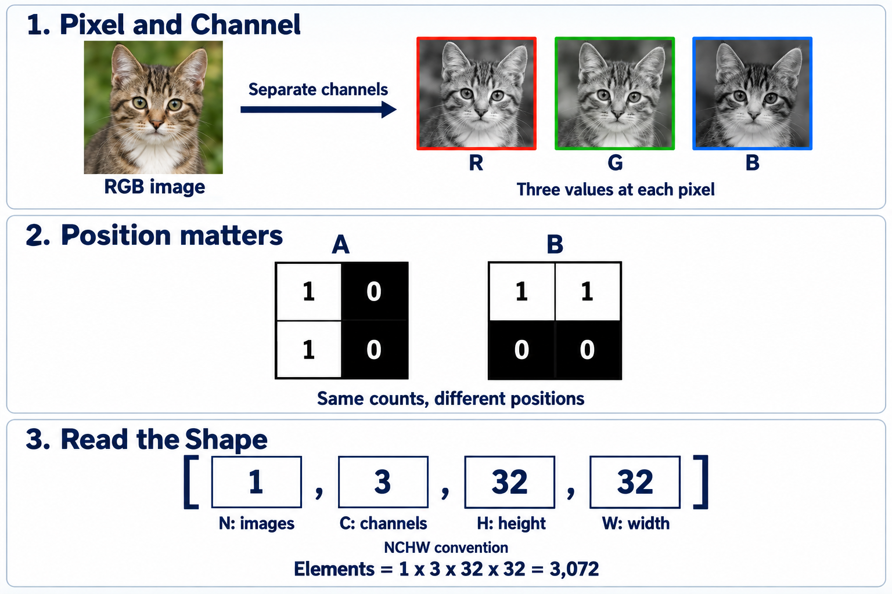

# 📦 A1. 이미지를 숫자로 표현하기 — Tensor와 Shape의 의미

모델이 받는 입력부터 보겠습니다.

## 사진을 숫자로 읽는다는 뜻

**사진은 작은 점의 모음이고, 각 점의 색을 숫자로 저장합니다.** 이 점이 Pixel입니다. RGB 사진은 한 점마다 빨강·초록·파랑 값이 하나씩 있습니다.

- Tensor: 숫자를 줄·칸 등으로 나란히 담은 배열. 이런 숫자 묶음을 텐서라고 부릅니다.
- Shape: 각 방향으로 숫자가 몇 개씩 있는지 적은 것.
- Channel: 같은 위치의 값을 종류별로 나눈 것. 입력 사진에서는 R·G·B입니다.

`[1,3,32,32]`는 **사진 1장, 색 3종류, 세로 32칸, 가로 32칸**입니다. 숫자 개수는 1×3×32×32=3072개입니다.

모델 중간의 16 Channel은 색 16종류라는 뜻이 아닙니다. 서로 다른 계산에서 얻은 반응 16묶음입니다.

그림의 NCHW는 **사진 수(N)·채널 수(C)·세로(H)·가로(W)** 순서입니다. 각각처럼 크기를 세는 방향을 축이라고 합니다. 먼저 네 숫자를 말로 읽어 보세요. 숫자를 저장한 위치인 메모리 주소는 뒤의 회로 편에서 다룹니다.

## 다음 개념

[A2. 곱하는 값과 기본값](A2.md)

복습·관련 실습 찾기

[학습 목차](../basic_track.md) · 이론을 읽은 뒤 [실습 S0](../learning/S0.md)

수식·세부 설명과 기존 기록

> 2026-10-28 로컬 백업의 학습자료입니다. 본문의 ResNet-56 등 과거 프로젝트 예시는 당시 기록이며, 현재 구현 기준은 [프로젝트 README](../../README.md)의 ResNet-20·ZedBoard입니다.

> 공통 기초 A1 · Rev3.0 · 의미 설명 → 용어 → 수식 순서로 읽는다.

> <b>Neural Network가 계산하는 것은 숫자다. 하지만 이미지에서는 숫자의 값뿐 아니라, 그 값의 위치와 역할도 정보다.</b>
> 
> Tensor는 이 숫자들을 여러 Axis로 구분해 담는 배열이고, Shape는 각 Axis의 크기를 나타낸다. A0에서 배운 Representation이 실제로 어떤 형태로 입력되고 전달되는지 알아보자.

Pixel과 Channel, 위치 정보, NCHW Shape 읽기. 이해를 위한 AI 생성 개념도로, Channel 영상은 실제 수치 분해 결과를 측정한 시각화가 아니다.

# 1. 사진을 어떻게 숫자로 나타내는가?

디지털 이미지는 작은 위치 단위인 Pixel로 구성된다. 일반적인 RGB 이미지에서는 각 Pixel의 색을 빨강·초록·파랑에 해당하는 세 값으로 표현한다.

각 Channel을 8-bit로 표현한다면 값의 범위는 0부터 255까지다.

| RGB 값 | 나타내는 색 |
| --- | --- |
| (255, 0, 0) | 빨강 |
| (0, 255, 0) | 초록 |
| (0, 0, 255) | 파랑 |
| (0, 0, 0) | 검정 |
| (255, 255, 255) | 흰색 |

이 숫자는 우선 <b>각 위치의 색 정보</b>를 나타낸다. 고양이를 구분하는 능력은 이 숫자를 입력받는 Model의 구조와 학습된 Parameter에서 나온다.

## 용어

- <b>Pixel</b>: 이미지의 한 위치에 해당하는 화소.
- <b>Channel</b>: 같은 위치에서 서로 다른 종류의 값을 구분하는 Axis. RGB 이미지에서는 R·G·B가 각각 하나의 Channel이다.
- <b>Grayscale Image</b>: 각 Pixel을 하나의 밝기 값으로 표현하는 이미지.

## 수학적 의미

RGB 이미지의 한 위치를 다음과 같이 나타낼 수 있다.

$$
X[h,w,:]
=
\bigl(R_{h,w},G_{h,w},B_{h,w}\bigr)
$$

$h$는 세로 위치, $w$는 가로 위치다. 코드 표기에서 콜론(:)은 그 위치의 모든 Channel을 선택한다는 뜻이다. 여기서는 Axis 순서를 HWC로 적었다.

> 그림 위쪽: RGB 이미지를 Channel별로 나누면, 같은 위치에 대응하는 R·G·B 값의 배열을 얻는다. 그림의 Channel 영상은 구조를 설명하기 위한 개념도다.

# 2. 왜 숫자의 위치도 중요한가?

그림 가운데의 두 이미지를 보자. 0은 어둡고 1은 밝은 Pixel이다.

이미지 A는 왼쪽이 밝고, 이미지 B는 위쪽이 밝다. 두 이미지 모두 1이 두 개, 0이 두 개지만 무늬는 다르다.

<b>숫자의 종류와 개수가 같아도, 어느 위치에 배치되었는지에 따라 다른 이미지가 된다.</b>

따라서 Model에 데이터를 전달할 때는 각 값이 어느 위치에 해당하는지도 유지해야 한다.

## 용어

- <b>Axis(축)</b>: 배열에서 값을 구분하는 방향 또는 기준.
- <b>Index</b>: 특정 Axis에서 위치를 지정하는 번호.
- <b>Spatial Information</b>: 이미지의 위치와 이웃 관계에 관한 정보.

## 수학적 의미

$$
A=
\begin{bmatrix}
1&0\\
1&0
\end{bmatrix},
\qquad
B=
\begin{bmatrix}
1&1\\
0&0
\end{bmatrix}
$$

두 배열의 값의 구성은 같지만, 위치별 값이 다르므로 $A\neq B$다.

배열을 한 줄로 펼치는 것 자체가 반드시 정보를 없애는 것은 아니다. <b>원래 위치로 되돌리는 규칙이 유지되는지</b>가 중요하다.

# 3. Tensor와 Shape는 무엇인가?

이미지의 숫자 하나를 찾으려면 ‘어느 위치인가’와 ‘어느 Channel인가’를 알아야 한다. 여러 이미지를 함께 처리한다면 ‘어느 이미지인가’도 필요하다.

Tensor는 이런 기준들을 Axis로 구분해 데이터를 담는다.

이 장에서는 Deep Learning 프로그램에서 사용하는 <b>다차원 숫자 배열</b>이라는 의미로 Tensor를 이해하면 된다.

## 용어

| 용어 | 의미 |
| --- | --- |
| <b>Tensor</b> | 여러 Axis를 가질 수 있는 숫자 배열 |
| <b>Shape</b> | 각 Axis의 크기를 순서대로 나타낸 것 |
| <b>Element</b> | 배열에 들어 있는 값 하나 |
| <b>Scalar</b> | Axis가 없는 값 하나 |
| <b>Vector</b> | Axis가 하나인 배열 |
| <b>Matrix</b> | Axis가 두 개인 배열 |

Scalar·Vector·Matrix도 이 맥락에서는 Tensor에 포함된다.

## 수학적 의미

실수 값을 담는 Tensor를 다음과 같이 표현할 수 있다.

$$
X\in\mathbb R^{d_1\times d_2\times\cdots\times d_k}
$$

$$
\operatorname{Shape}(X)=(d_1,d_2,\ldots,d_k)
$$

Axis가 $k$개이고, 각 Axis의 크기가 $d_1,\ldots,d_k$라는 뜻이다.

Element 개수는 각 Axis의 크기를 곱해 구한다.

$$
\#\operatorname{Elements}(X)=\prod_{i=1}^{k}d_i
$$

Shape는 배열의 크기를 알려준다. <b>각 Axis가 무엇을 의미하는지는 별도의 규약으로 정해야 한다.</b>

# 4. 이미지 Tensor의 Shape는 어떻게 읽는가?

여러 이미지를 함께 다루는 묶음을 Batch라고 한다. 각 이미지의 크기가 같다면 Batch Axis를 추가해 하나의 Tensor로 표현할 수 있다.

이 장에서는 이미지 Tensor의 Axis 순서를 <b>NCHW</b>로 사용한다.

| 기호 | 의미 | CIFAR-10 이미지 한 장의 예 |
| --- | --- | --- |
| <b>N</b> | Batch Size: 이미지 개수 | 1 |
| <b>C</b> | Channel 개수 | 3 |
| <b>H</b> | Height: 세로 크기 | 32 |
| <b>W</b> | Width: 가로 크기 | 32 |

따라서 Shape \[1, 3, 32, 32\]는 다음과 같이 읽는다.

> <b>이미지 1장, Channel 3개, 각 Channel의 크기 32×32</b>

그림 아래쪽은 이 Shape를 읽는 방법을 보여준다. CIFAR-10의 이미지는 32×32 컬러 이미지다. [CIFAR 공식 자료](https://cave.cs.toronto.edu/kriz/cifar.html)

## 용어

- <b>Batch</b>: 함께 처리하는 여러 입력의 묶음.
- <b>Batch Size</b>: Batch에 포함된 입력 개수.
- <b>NCHW</b>: Batch·Channel·Height·Width 순서의 Axis 표기.

## 수학적 의미

$$
X\in\mathbb R^{N\times C\times H\times W}
$$

$$
X[n,c,h,w]
$$

이 값은 ‘$n$번째 이미지의 $c$번째 Channel에서, 세로 $h$, 가로 $w$ 위치의 값’이다. Index는 보통 0부터 시작한다.

이미지 한 장의 Element 개수는 다음과 같다.

$$
1\times3\times32\times32=3{,}072
$$

이미지 네 장을 묶으면 Shape는 \[4, 3, 32, 32\]가 된다. 여러 이미지를 하나의 큰 사진으로 합친다는 뜻은 아니다.

# 5. Model 내부의 Channel도 RGB인가?

입력 이미지의 Channel 3개는 R·G·B를 의미한다. 하지만 CNN 내부에서 Channel이 16개가 되었다면, 이것은 색이 16개가 되었다는 뜻이 아니다.

중간 Layer는 학습된 계산으로 입력을 변환한다. 그 결과 각 위치에서 여러 종류의 반응값이 나온다.

<b>입력 Channel은 색 정보를 담지만, 중간 Channel은 학습된 Representation을 담는다.</b>

예를 들어 어떤 Channel은 특정 방향의 경계에 크게 반응하도록 학습될 수 있다. 다만 모든 Channel에 사람이 이해할 수 있는 특징 이름을 붙일 수 있는 것은 아니다.

## 용어

- <b>Feature Map</b>: CNN에서 위치별 반응을 담은 배열. 여기서는 출력 Channel 하나의 2차원 배열을 가리킨다.
- <b>Activation Tensor</b>: Layer의 출력값들을 담은 Tensor.

Feature Map은 문헌에 따라 여러 Channel을 묶은 출력 전체를 뜻하기도 하므로, Shape를 함께 확인한다.

## 수학적 의미

$$
F\in\mathbb R^{N\times C_{\text{out}}\times H'\times W'}
$$

예를 들어 Shape가 \[1, 16, 32, 32\]라면, 이미지 한 장에 대응하는 <b>32×32 크기의 Feature Map이 16개</b> 있다는 뜻이다.

$$
F[0,c,:,:]
$$

이는 첫 번째 이미지에 대응하는 $c$번째 Channel의 공간적 반응 전체를 선택한다.

# 6. 입력·중간값·출력은 어떻게 다른가?

Tensor는 데이터를 담는 형식이다. <b>그 안의 숫자가 무엇을 의미하는지는 Model의 어느 단계인지에 따라 달라진다.</b>

| 단계 | 예시 Shape | 값의 의미 |
| --- | --- | --- |
| <b>Input</b> | \[1, 3, 32, 32\] | Pixel의 색 정보 또는 전처리된 입력값 |
| <b>Intermediate Activation</b> | \[1, 16, 32, 32\] | 학습된 변환이 만든 위치별 반응 |
| <b>Classification Output</b> | \[1, 10\] | 10개 Class에 대한 점수 |

중간 Shape는 설명을 위한 예시이며, ResNet-56 전체의 Layer 사양을 나타내는 것은 아니다.

분류 출력에는 높이와 너비 Axis가 없다. 앞선 계산들이 공간 정보를 결합해 이미지 전체에 대한 Class별 점수로 바꾸었기 때문이다.

## 용어

- <b>Class</b>: 분류할 종류 또는 범주.
- <b>Logit</b>: 확률로 변환하기 전의 Class별 점수.
- <b>Label</b>: 입력에 대응하는 정답. 정수 Class Index로 표현할 수 있다.

## 수학적 의미

$$
Z\in\mathbb R^{N\times K}
$$

$N$은 이미지 개수, $K$는 Class 개수다. CIFAR-10에서는 $K=10$이다.

이미지마다 가장 높은 점수의 Class를 고르는 예측은 다음과 같다.

$$
\hat y_n=\arg\max_k Z[n,k]
$$

$\arg\max$는 가장 큰 점수 자체가 아니라, <b>그 점수가 있는 Class Index</b>를 반환한다.

# 7. Shape가 같으면 같은 데이터인가?

Shape가 같더라도 값의 의미나 해석 방식이 다를 수 있다.

예를 들어 송신 측이 R Channel 전체를 먼저 보내는데, 수신 측이 한 Pixel의 R·G·B가 차례로 온다고 해석하면 숫자가 다른 위치와 Channel에 배정된다.

따라서 데이터를 연결할 때는 <b>크기, Axis의 의미, 값의 해석 방식</b>을 함께 맞춰야 한다.

## 용어

| 용어 | 확인할 내용 |
| --- | --- |
| <b>Axis Order</b> | NCHW·NHWC처럼 논리적 Axis를 어떤 순서로 나타내는가 |
| <b>Data Type</b>, <b>dtype</b> | Element 하나를 어떤 수치 형식으로 표현하는가 |
| <b>Memory Layout</b> | 값들이 메모리에 어떻게 배치되는가 |
| <b>Stride</b> | Index를 한 칸 이동할 때 저장 위치가 얼마나 이동하는가 |

여기서 Stride는 배열의 메모리 접근 간격을 뜻한다. Convolution의 이동 간격을 뜻하는 Stride와는 문맥이 다르다.

## 수학적 의미

같은 이미지 Batch를 다른 Axis 순서로 표현하면 Shape도 달라진다.

$$
X_{\text{NCHW}}:\;(N,C,H,W)
$$

$$
X_{\text{NHWC}}:\;(N,H,W,C)
$$

올바르게 Axis를 재배열했다면 대응하는 값은 다음 관계를 가진다.

$$
X_{\text{NCHW}}[n,c,h,w]
=
X_{\text{NHWC}}[n,h,w,c]
$$

표현 순서는 달라도 같은 이미지 정보를 나타낼 수 있다. 다만 실제 Memory Layout은 Shape만으로 확정되지 않는다.

# 8. 숫자 개수와 저장 용량은 어떻게 다른가?

Shape는 Element 개수를 알려주지만, 저장 용량까지 결정하지는 않는다. Element 하나를 몇 Byte로 표현하는지도 알아야 한다.

같은 \[1, 3, 32, 32\] Tensor라도 FP32로 저장하면 Element당 4 Byte, INT8로 저장하면 Element당 1 Byte를 사용한다.

## 용어

- <b>FP32</b>: 32-bit 부동소수점 형식.
- <b>INT8</b>: 8-bit 부호 있는 정수 형식.
- <b>Storage Size</b>: 데이터를 저장하는 데 필요한 용량.

## 수학적 의미

$$
\text{Storage Bytes}
=
\text{Element Count}\times\text{Bytes per Element}
$$

$$
\begin{aligned}
\text{FP32}&:\;3{,}072\times4=12{,}288\ \text{Bytes}\\
\text{INT8}&:\;3{,}072\times1=3{,}072\ \text{Bytes}
\end{aligned}
$$

이는 Element 데이터만 계산한 값이며, Padding·정렬·추가 정보는 제외한다.

INT8로 저장할 때는 실수 값을 정수로 어떻게 대응시킬지도 정해야 한다. 이 수치적 의미는 [A6](A6.md)에서 연결한다.

# 9. 의미를 확인하는 질문

1. 0과 1의 개수가 같아도 왜 서로 다른 이미지가 될 수 있는가?
2. \[4, 3, 32, 32\]의 각 숫자는 무엇을 뜻하는가?
3. 입력의 Channel 3개와 중간값의 Channel 16개는 의미가 어떻게 다른가?
4. Shape가 같아도 연결할 두 모듈이 데이터를 다르게 해석할 수 있는 이유는 무엇인가?
5. Element 개수가 같아도 저장 용량이 달라지는 이유는 무엇인가?

답의 핵심

값의 위치도 정보이기 때문이다. NCHW에서 각 숫자는 이미지 개수·Channel 개수·높이·너비를 나타낸다. 입력 Channel은 RGB이고, 중간 Channel은 학습된 반응을 담는다. 데이터 연결에는 Shape 외에도 Axis 의미와 저장·전달 규약이 필요하다. 저장 용량은 Element당 Byte 수에 따라서도 달라진다.

# 다음 장으로

이제 Neural Network에 전달되는 숫자가 무엇을 뜻하고, 어떤 구조로 담기는지 살펴봤다.

[A2](A2.md)에서는 이 숫자에 <b>왜 Weight를 곱하고 Bias를 더하는지</b>, 그리고 그 결과에 <b>왜 Activation Function을 적용하는지</b>를 의미부터 설명한다.

보충자료 작성 메모 · 학습 중 건너뛰어도 됩니다

> <b>추후 연결할 보충자료 — Convolution은 왜 Channel별 반응을 만드는가?</b>
> 
> 여기서는 중간값의 의미와 Shape를 읽는 데 집중한다. Filter가 입력 Channel을 어떻게 결합하고 출력 Channel을 만드는지는 Convolution의 목적과 함께 별도로 설명한다. 보충자료 링크는 추후 추가한다.

> <b>추후 연결할 보충자료 — 공간적 반응은 어떻게 Class별 점수가 되는가?</b>
> 
> Global Average Pooling과 Linear Layer가 각각 무엇을 요약하고 결합하는지 설명한다. Shape가 바뀌는 이유를 이해한 뒤 해당 연산의 수식을 연결한다. 보충자료 링크는 추후 추가한다.

> <b>추후 연결할 보충자료 — Axis Order와 Memory Layout</b>
> 
> Reshape와 Transpose의 차이, Stride와 주소 계산, 가속기의 데이터 전달 순서를 작은 배열 예제로 설명한다. 보충자료 링크는 추후 추가한다.

