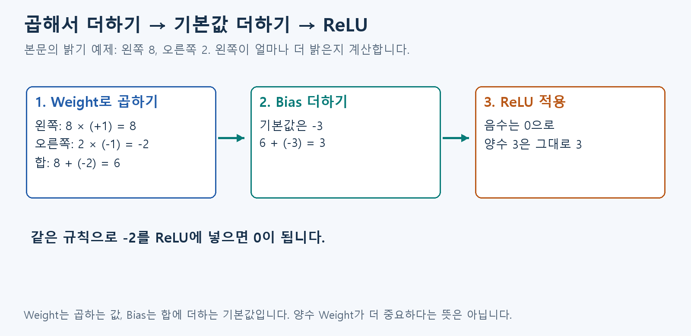
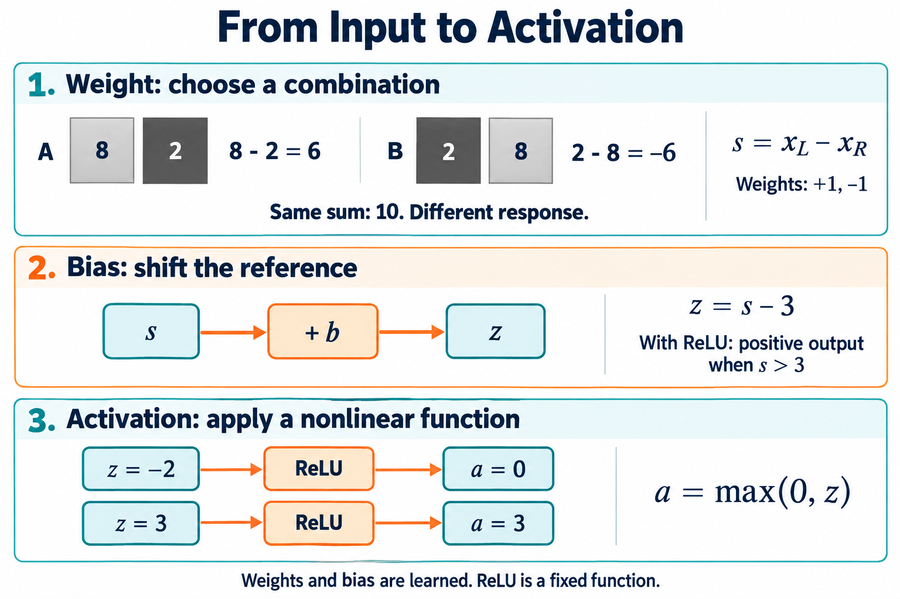

# A2. 곱하는 값과 기본값

A1에서 읽은 숫자에 어떤 계산을 하는지 봅니다.

## 곱하기·더하기·결과 바꾸기

**입력에 숫자를 곱하고 → 더하고 → 결과를 한 번 더 바꾸는 계산**입니다.

### 1. Weight: 입력에 곱하는 숫자

입력 하나를 얼마나, 어떤 부호로 반영할지 정합니다. 입력이 3이라고 해 봅시다.

| Weight | 하는 계산 | 반영되는 값 |
| --- | --- | --- |
| +2 | 3을 2배 해서 더하기 | +6 |
| +0.5 | 3의 절반을 더하기 | +1.5 |
| -2 | 3을 2배 해서 빼기 | -6 |
| 0 | 반영하지 않기 | 0 |

**+2와 -2는 모두 2배입니다. 양수 입력이라면 +2는 더하고, -2는 뺍니다.** 음수 입력에도 같은 곱셈 규칙을 적용합니다. 양수 Weight가 늘 ‘더 중요하다’는 뜻은 아닙니다.

밝기 두 개가 왼쪽 8, 오른쪽 2일 때, 둘을 더하면 10입니다. ‘어느 쪽이 밝은가’를 보고 싶으면 왼쪽에 +1, 오른쪽에 -1을 곱합니다. **8-2=6이므로 왼쪽이 6만큼 밝습니다.**

### 2. Bias: 마지막에 더하는 기본값

Weight를 곱한 값들을 모두 더한 뒤, Bias를 더합니다. 합이 6이고 Bias가 -3이면 결과는 3입니다.

위 밝기 예제에서 3을 빼면 ‘왼쪽이 3보다 더 밝을 때 반응하기’ 같은 기준을 만들 수 있습니다. Bias의 기본 역할은 **곱해서 더한 합에 일정한 값을 더하는 것**입니다.

### 3. 활성화 함수(Activation Function): 계산한 결과를 바꾸는 규칙

대표적인 ReLU는 **음수는 0, 양수는 그대로** 둡니다. -2→0, 3→3입니다.

ReLU는 ‘0보다 작으면 끄기’라는 규칙입니다. 곱하고 더하기 사이에 이런 규칙을 넣으면, 입력에 따라 반응하는 부분이 달라집니다. 그래야 여러 계산 단계를 쌓아 더 복잡한 관계를 배울 수 있습니다.

### 4. 세 개를 이어 보면

**입력 2 × Weight 3 + Bias(-1) = 5 → ReLU → 5**

이 값을 다음 계산의 입력으로 넘깁니다. Weight·Bias는 학습으로 조정하고, 입력과 출력은 사진마다 새로 계산합니다.

x는 입력, w는 Weight, b는 Bias를 짧게 쓴 이름입니다. 수식은 위 계산을 짧게 적은 것입니다: `z = w×x+b`, `출력 = ReLU(z)`. z는 ReLU 전의 중간값 이름일 뿐입니다.

## 그림으로 이어 보기

왼쪽 8·오른쪽 2에 곱하는 값부터 시작해, 기본값 -3과 ReLU를 순서대로 따라가세요.

## 다음 개념

[A3. 계산 단계 이어 붙이기](A3.md)

복습·관련 실습 찾기

[학습 목차](../basic_track.md) · 이론을 읽은 뒤 [실습 S0](../learning/S0.md)

이전 상세 그림·추가 용어 — 필요할 때 펼치기

여러 활성화 함수와 추가 기호를 함께 담은 상세 그림입니다. 첫 학습은 본문의 세 단계 예제로 충분합니다.

선택 보충: 상세 수식·이전 기록 (첫 읽기에서는 건너뜁니다)

> 2026-10-28 로컬 백업의 학습자료입니다. 본문의 ResNet-56 등 과거 프로젝트 예시는 당시 기록이며, 현재 구현 기준은 [프로젝트 README](../../README.md)의 ResNet-20·ZedBoard입니다.

> 공통 기초 A2 · Rev3.0 · 의미 설명 → 용어 → 수식 순서로 읽는다.

> <b>Neural Network는 입력을 그대로 전달하는 대신, 입력들을 조합하고 변환해 새로운 Representation을 만든다.</b>
> 
> 이 장에서는 ‘왼쪽이 오른쪽보다 얼마나 밝은가’를 계산하는 작은 예제로 Weight·Bias·Activation Function의 역할을 살펴본다. 수치는 설명을 위한 예시이며, 실제 Model에서 추출한 값은 아니다.

| 요소 | 역할 |
| --- | --- |
| <b>Weight</b> | 어떤 입력을 어떤 비율과 방향으로 조합할지 결정 |
| <b>Bias</b> | 조합 결과의 기준 위치를 이동 |
| <b>Activation Function</b> | 비선형 변환을 적용해 복잡한 관계를 표현하도록 함 |

Weight의 입력 조합, Bias의 기준 이동, ReLU의 비선형 변환. 이해를 위한 AI 생성 개념도이며, 실제 Model의 내부를 측정한 시각화는 아니다.

# 1. Weight — 입력을 왜 서로 다르게 반영하는가?

두 위치의 밝기를 입력으로 받는다고 생각하자.

| 입력 | 왼쪽 밝기 | 오른쪽 밝기 | 단순 합 |
| --- | --- | --- | --- |
| A | 8 | 2 | 10 |
| B | 2 | 8 | 10 |

두 값을 더하기만 하면 A와 B의 결과가 같다. 하지만 우리가 보고 싶은 것은 전체 밝기가 아니라 <b>어느 쪽이 더 밝은지</b>다.

왼쪽 값은 더하고 오른쪽 값은 빼면, A에서는 양수, B에서는 음수가 나온다. 이렇게 입력마다 곱하는 계수를 다르게 하면 서로 다른 관계를 드러낼 수 있다.

<b>Weight를 사용하는 이유는 입력들을 목적에 맞는 비율과 방향으로 조합하기 위해서다.</b>

Weight는 단순한 ‘중요도 표시’가 아니다. 입력들을 더하거나 빼고, 크기를 조절해 어떤 조합에 반응할지를 정하는 값이다.

## 용어

- <b>Weight</b>, $w_i$: 각 입력에 곱하는 계수.
- <b>Weighted Sum</b>: 입력과 Weight의 곱을 더한 값.
- <b>Input</b>, $x_i$: 현재 계산에 들어오는 값. 원래 데이터일 수도 있고, 이전 Layer의 출력일 수도 있다.

## 수학적 의미

$$
s=\sum_i w_ix_i
$$

이 예제에서는 왼쪽과 오른쪽에 각각 $+1$, $-1$을 곱한다.

$$
s=1\cdot x_L+(-1)\cdot x_R=x_L-x_R
$$

$$
s_A=8-2=6,\qquad s_B=2-8=-6
$$

다른 입력을 고정했을 때, 양의 Weight에 연결된 입력이 증가하면 Weighted Sum은 증가하고 음의 Weight라면 감소한다. 실제 기여량은 Weight 하나가 아니라 <b>입력과 Weight의 곱</b>이다.

# 2. Bias — 왜 기준을 따로 움직여야 하는가?

왼쪽이 조금만 밝아도 반응하게 할 수도 있지만, 차이가 충분히 클 때만 반응하게 하고 싶을 수도 있다.

Weight가 ‘왼쪽과 오른쪽의 차이’를 계산하도록 정해져 있다면, 그 차이에서 3을 빼보자. 이제 두 밝기의 차이가 3보다 커야 결과가 양수가 된다.

<b>Bias를 사용하는 이유는 입력을 조합하는 방식과 별개로, 그 결과의 기준을 이동할 수 있게 하기 위해서다.</b>

한 입력만 있는 직선으로 생각하면 더 쉽다. Weight는 기울기를 바꾸고, Bias는 직선의 높이를 바꾼다. Bias가 없는 단일 Weighted Sum은 입력이 모두 0일 때 항상 0이지만, Bias가 있으면 기준값을 따로 설정할 수 있다.

## 용어

- <b>Bias</b>, $b$: Weighted Sum에 더하는, 현재 입력값과 무관한 Parameter.
- <b>Pre-activation</b>, $z$: Activation Function을 적용하기 전의 값.

## 수학적 의미

$$
z=\sum_i w_ix_i+b=s+b
$$

밝기 차이 예제에서 $b=-3$으로 두면 다음과 같다.

$$
z=x_L-x_R-3
$$

$$
z>0
\quad\Longleftrightarrow\quad
x_L-x_R>3
$$

뒤에서 사용할 ReLU와 결합하면 ‘밝기 차이가 3을 넘을 때 양의 출력이 나온다’고 해석할 수 있다.

Bias의 일반적인 정의는 <b>입력과 무관하게 더하는 항</b>이다. 항상 임계값 그 자체를 뜻하는 것은 아니며, Model 구조에 따라 Bias를 생략하기도 한다.

# 3. Activation Function — 왜 곱하고 더하는 것만으로는 부족한가?

Weight와 Bias를 이용하면 입력의 조합 방식과 기준을 바꿀 수 있다. 하지만 <b>이 계산만 여러 번 연결하면 전체를 다시 하나의 같은 형태의 계산으로 합칠 수 있다.</b>

예를 들어 다음 두 단계를 보자.

$$
u=2x+1,\qquad y=3u-4
$$

앞의 결과를 뒤 식에 넣으면 다음과 같다.

$$
y=3(2x+1)-4=6x-1
$$

계산은 두 단계였지만, 입력과 출력의 관계는 여전히 하나의 직선이다.

Activation Function은 중간에 비선형 변환을 넣어 이 한계를 벗어나게 한다. 여러 반응을 조합했을 때 하나의 직선이나 평면으로 표현할 수 없는 관계도 만들 수 있게 된다.

<b>비선형 Activation Function을 사용하는 핵심 이유는, 여러 Layer를 연결해 복잡한 비선형 관계를 표현하기 위해서다.</b>

## 용어

- <b>Affine Transformation</b>: $Wx+b$ 형태의 변환. 엄밀히는 Bias가 없는 Linear Transformation과 구분한다.
- <b>Activation Function</b>, $\sigma$: 이 장에서는 Pre-activation에 적용하는 비선형 함수.
- <b>Activation</b>, $a$: Activation Function을 거쳐 나온 값.

## 수학적 의미

$$
a=\sigma(z)=\sigma(Wx+b)
$$

중간 비선형 변환이 없다면 두 Affine Transformation도 하나로 합쳐진다.

$$
W_2(W_1x+b_1)+b_2
=
(W_2W_1)x+(W_2b_1+b_2)
$$

# 4. ReLU — 비선형 변환을 어떻게 적용하는가?

이 장에서는 Activation Function의 예로 ReLU를 사용한다.

ReLU는 입력이 음수이면 0을 내보내고, 양수이면 그 값을 그대로 내보낸다. 구간에 따라 계산 방식이 달라지므로 전체 함수는 비선형이다.

밝기 차이 예제에서는 Bias를 반영한 결과가 양수일 때만 그 크기가 출력된다.

## 용어

- <b>ReLU — Rectified Linear Unit</b>: 음수를 0으로 바꾸는 Activation Function.
- <b>Element-wise Operation</b>: Tensor의 각 Element에 개별적으로 적용하는 연산.

## 수학적 의미

$$
a=\operatorname{ReLU}(z)=\max(0,z)
$$

| Pre-activation $z$ | Activation $a$ |
| --- | --- |
| −2 | 0 |
| 0 | 0 |
| 2 | 2 |
| 5 | 5 |

ReLU는 0과 1만 출력하는 스위치가 아니다. 출력 5는 이 계산 경로의 반응 크기이며, 확률을 뜻하지 않는다.

또한 ReLU에서 음수를 0으로 만든다고 해서 ‘모든 음수는 쓸모없는 정보’라는 뜻은 아니다. 다른 Weight를 가진 계산 경로가 반대 방향의 차이에 반응할 수 있다.

# 5. 세 요소를 하나의 계산으로 연결하기

이제 앞의 역할을 한 번에 연결해보자.

1. <b>Weight</b>로 왼쪽과 오른쪽의 밝기 차이를 계산한다.
2. <b>Bias</b>로 양의 반응이 시작되는 기준을 옮긴다.
3. <b>ReLU</b>로 기준을 넘은 양의 값만 출력한다.

이처럼 여러 입력에서 출력 하나를 만드는 기본 계산 단위를 Artificial Neuron으로 볼 수 있다.

## 용어

- <b>Artificial Neuron</b>: 여러 입력을 받아 Weighted Sum과 Bias, Activation Function으로 출력값을 만드는 기본 계산 단위.
- <b>Parameter</b>: 이 예제에서 학습으로 조정하는 Weight와 Bias.

## 수학적 의미

$$
a=\operatorname{ReLU}(x_L-x_R-3)
$$

| 입력 | Weighted Sum $s$ | Bias 포함 $z=s-3$ | ReLU 출력 $a$ |
| --- | --- | --- | --- |
| A: (8, 2) | 6 | 3 | 3 |
| B: (2, 8) | −6 | −9 | 0 |
| C: (5, 4) | 1 | −2 | 0 |

A는 왼쪽이 충분히 밝아서 양의 출력이 나온다. C도 왼쪽이 더 밝지만, 차이가 설정한 기준보다 작아서 출력은 0이다.

이 계산은 단순한 밝기 차이에 반응하는 예제다. 이 반응 하나만으로 고양이를 구분할 수 있다는 뜻은 아니다.

# 6. Layer — 같은 입력을 여러 방식으로 보는 이유

하나의 계산은 입력의 한 가지 조합만 만든다. 여러 조합을 동시에 얻으려면 서로 다른 Weight와 Bias를 가진 계산들을 나란히 둘 수 있다.

예를 들어 같은 두 입력으로 한 계산은 ‘왼쪽이 더 밝은가’를 보고, 다른 계산은 ‘오른쪽이 더 밝은가’를 보게 만들 수 있다.

<b>Layer는 입력을 여러 기준으로 변환해, 다음 계산에 사용할 새로운 Representation을 만든다.</b>

## 용어

- <b>Layer</b>: 입력을 한 단계 변환하는 계산들의 묶음.
- <b>Fully Connected Layer / Dense Layer</b>: 각 출력이 모든 입력과 연결되는 Layer.
- <b>Weight Matrix</b>, $W$: 여러 출력의 Weight를 모은 행렬.
- <b>Bias Vector</b>, $b$: 각 출력에 더할 Bias를 모은 벡터.

## 수학적 의미

$$
z=Wx+b,\qquad a=\sigma(z)
$$

입력이 $d$개이고 출력이 $m$개라면 다음과 같다.

$$
x\in\mathbb R^d,\quad
W\in\mathbb R^{m\times d},\quad
b\in\mathbb R^m,\quad
a\in\mathbb R^m
$$

밝기 비교를 양방향으로 수행하는 예시는 다음과 같다.

$$
W=
\begin{bmatrix}
1&-1\\
-1&1
\end{bmatrix},
\qquad
b=
\begin{bmatrix}
-3\\
-3
\end{bmatrix}
$$

입력 $x=(8,2)^\mathsf T$를 넣으면 다음 결과를 얻는다.

$$
z=
\begin{bmatrix}
3\\
-9
\end{bmatrix},
\qquad
a=
\begin{bmatrix}
3\\
0
\end{bmatrix}
$$

첫 출력은 왼쪽이 더 밝은 방향, 둘째 출력은 오른쪽이 더 밝은 방향에 반응한다.

입력도 숫자 두 개이고 출력도 숫자 두 개지만, <b>출력은 원래 밝기가 아니라 두 비교 기준에 대한 반응</b>이다. Shape가 같아도 Representation의 의미는 달라질 수 있다.

모든 Layer가 Fully Connected Layer인 것은 아니다. Activation Function만 적용하는 Layer처럼 학습할 Parameter가 없는 Layer도 있다.

# 7. 무엇이 학습되고, 무엇이 매번 계산되는가?

앞의 예제에서는 의미를 설명하기 위해 Weight와 Bias를 사람이 정했다.

실제 Training에서는 Loss를 줄이도록 Weight와 Bias를 조정한다. 반면 일반적인 고정 Model의 Inference에서는 Parameter를 유지하고, 입력에 따라 Activation을 새로 계산한다.

## 용어

| 구분 | 해당하는 값 | 역할 |
| --- | --- | --- |
| <b>Input</b> | $x$ | 현재 처리할 데이터 |
| <b>Parameter</b> | $W,b$ | 학습된 변환 방식 |
| <b>Pre-activation</b> | $z$ | Activation Function 적용 전 결과 |
| <b>Activation</b> | $a$ | 다음 계산에 전달할 결과 |

이 예제의 ReLU에는 학습할 Parameter가 없다. Model이 정한 함수에 입력값을 넣어 계산한다.

## 수학적 의미

$$
a^{(n)}=\operatorname{ReLU}\!\left(Wx^{(n)}+b\right)
$$

서로 다른 Sample $x^{(n)}$에 같은 $W,b$를 적용해 서로 다른 Activation $a^{(n)}$을 얻는다.

# 8. 가속기에서는 어떤 계산으로 이어지는가?

가속기는 이 수식을 실제 연산과 데이터 이동으로 실행한다.

입력과 Weight를 읽어 곱하고 누적한 뒤, Bias를 반영하고 Activation Function을 적용한다. 결과는 다음 Layer의 입력으로 전달한다.

## 용어

- <b>MAC — Multiply-Accumulate</b>: 곱한 값을 누적해서 더하는 계산.
- <b>Partial Sum</b>: 여러 곱을 누적하는 도중의 중간 합.
- <b>Accumulator</b>: 누적 계산 결과를 유지하는 저장소 또는 계산 장치.

## 수학적 의미

$$
p_0=0,\qquad
p_{k+1}=p_k+w_kx_k
$$

입력 $d$개를 모두 반영한 뒤 다음을 계산한다.

$$
z=p_d+b,\qquad a=\max(0,z)
$$

이는 계산 순서의 한 예다. Bias를 누산의 초기값으로 넣는 구현도 가능하다.

수학적으로 Neuron이 여러 개 있다고 해서 물리적인 계산기를 각각 하나씩 만들어야 하는 것은 아니다. 같은 계산기를 시간에 따라 재사용할 수 있다.

# 9. 의미를 확인하는 질문

1. 두 입력을 더하는 것과 빼는 것은 어떤 정보를 다르게 드러내는가?
2. Weight가 입력의 ‘중요도’만을 뜻한다고 보기 어려운 이유는 무엇인가?
3. Weight를 유지하고 Bias만 바꾸면 무엇이 달라지는가?
4. Affine Transformation만 여러 번 연결하면 어떤 한계가 있는가?
5. ReLU 출력이 3이라는 것은 확률 300%라는 뜻인가?
6. 같은 입력에서 여러 출력을 만들면 어떤 점이 유용한가?

답의 핵심

합과 차이는 서로 다른 관계를 드러낸다. Weight는 입력을 조합하는 비율과 방향을 정하며, Bias는 그 조합 결과의 기준을 이동한다. Affine Transformation만 합성하면 하나의 Affine Transformation으로 합쳐진다. 비선형 Activation Function은 이 한계를 벗어나게 한다. ReLU 출력은 반응값이며 확률이 아니다. 여러 출력은 입력을 서로 다른 기준으로 변환한 Representation을 제공한다.

# 다음 장으로

이제 입력에서 새로운 반응을 만드는 기본 계산을 살펴봤다.

[A3](A3.md)에서는 이런 Layer들을 어떤 순서로 연결하는지, 중간 결과가 다음 입력으로 어떻게 전달되는지, 분기와 합류가 있는 Model은 어떻게 읽는지 알아본다.

# 참고자료

- [Dive into Deep Learning — Multilayer Perceptrons](https://d2l.ai/chapter_multilayer-perceptrons/mlp.html): Hidden Layer, Affine Transformation의 합성, 비선형 Activation Function과 ReLU 설명. 본문의 밝기 비교와 수치 계산은 이해를 돕기 위한 교육용 예시다.

보충자료 작성 메모 · 학습 중 건너뛰어도 됩니다

> <b>추후 연결할 보충자료 — 비선형성이 표현 능력을 어떻게 바꾸는가?</b>
> 
> 직선 하나로 구분하기 어려운 XOR 예제와, 여러 ReLU 반응을 조합해 꺾인 함수를 만드는 그림을 연결한다. 보충자료 링크는 추후 추가한다.

> <b>추후 연결할 보충자료 — 왜 ReLU를 쓰며, 다른 Activation Function과는 무엇이 다른가?</b>
> 
> Sigmoid·Tanh·GELU 등의 출력 특성과 Gradient를 비교하고, ReLU의 장점과 한계를 설명한다. 보충자료 링크는 추후 추가한다.

> <b>추후 연결할 보충자료 — Weight와 Bias는 어떻게 학습되는가?</b>
> 
> A4의 Loss·Gradient·Backpropagation·Optimizer와 연결해, Parameter 하나의 변화가 출력과 Loss에 미치는 영향을 설명한다. 보충자료 링크는 추후 추가한다.

> <b>추후 연결할 보충자료 — 수식을 실제 가속기 연산으로 옮기기</b>
> 
> MAC 재사용과 병렬 처리, Partial Sum 저장, Accumulator의 Bit Width를 연결한다. 실수 계산과 Quantized 계산의 차이는 A6와 함께 설명한다. 보충자료 링크는 추후 추가한다.

