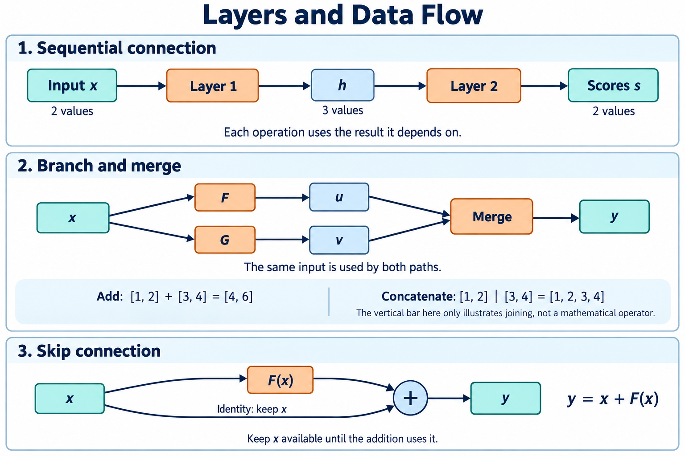

# 🔗 A3. Layer를 연결해 판단하기 — 데이터 흐름과 분기·합류의 의미

## 층(Layer)은 계산 한 단계입니다

**앞 단계의 출력이 다음 단계의 입력이 됩니다.** 사진에서 작은 무늬를 찾고, 그 무늬들을 조합해 더 큰 특징을 만들고, 마지막에 고양이·자동차 같은 정답 후보별 점수를 냅니다. 이 후보 종류를 클래스(Class)라고 합니다.

곱셈을 하는 층들은 보통 각자 학습한 Weight를 씁니다. ReLU처럼 Weight 없이 규칙만 적용하는 층도 있습니다. Layer가 20개라고 회로를 20벌 만들어야 하는 것은 아닙니다. 같은 계산기를 여러 번 사용할 수도 있습니다.

- 순차 연결: 앞 결과를 다음 단계로 넘깁니다.
- 분기: 같은 값을 두 경로에서 씁니다.
- 합류: 두 경로의 결과를 모읍니다. Add라면 같은 위치끼리 더합니다.

다음 단계가 기대하는 크기와 앞 단계 출력 크기가 맞아야 합니다. 더할 때는 숫자의 단위도 맞아야 합니다. 1m와 1cm를 그냥 2라고 더할 수 없는 것과 같습니다. 숫자 눈금은 A6에서 다룹니다.

**화살표는 값이 어디로 가는지 보여줍니다.** 회로에서는 그 값이 언제 준비되고 언제까지 필요한지도 확인합니다.

그림에서 Sequential은 차례대로 연결, Branch는 갈라짐, Merge는 모임입니다. Skip은 중간 계산을 건너가는 길이고, Concat은 숫자 묶음을 이어 붙이는 일입니다. Add는 같은 위치끼리 더하는 일이므로 Concat과 다릅니다.

화살표를 따라 숫자가 어디로 가는지 봅니다. 갈라짐·모임·이어 붙이기의 뜻은 위 설명과 같습니다. AI 생성 개념도입니다.

개념을 읽은 뒤 [확인 실습 S1](../learning/S1.md)에서 계산해 봅니다.

수식·세부 설명과 기존 기록

> 2026-10-28 로컬 백업의 학습자료입니다. 본문의 ResNet-56 등 과거 프로젝트 예시는 당시 기록이며, 현재 구현 기준은 [프로젝트 README](../../README.md)의 ResNet-20·ZedBoard입니다.

> 공통 기초 A3 · Rev3.0 · 의미 설명 → 용어 → 수식 순서로 읽는다.

> <b>Model은 여러 계산이 연결된 구조다. 앞의 계산이 만든 Tensor를 뒤의 계산이 사용하면서, 입력을 최종 출력으로 변환한다.</b>
> 
> 연결은 한 줄로 이어질 수도 있고, 여러 경로로 나뉘었다가 다시 합쳐질 수도 있다.

| 구조 | 의미 |
| --- | --- |
| <b>Sequential Connection</b> | 앞의 출력을 다음 계산의 입력으로 사용 |
| <b>Branch</b> | 같은 데이터를 여러 계산 경로에서 사용 |
| <b>Merge</b> | 여러 경로의 결과를 정해진 연산으로 결합 |

Sequential Connection, Branch와 Merge, Skip Connection의 데이터 흐름. 이해를 위한 AI 생성 개념도다. Concat 예시의 세로선은 이어 붙이기를 나타내는 그림 표기다.

그림의 화살표는 <b>어떤 값이 어떤 계산에 필요한지</b>를 나타낸다.

# 1. Layer를 연결한다는 것은 무엇인가?

[A2](A2.md)에서는 Weight·Bias·Activation Function으로 입력에서 새로운 반응을 만드는 방법을 배웠다.

다음 Layer는 이 반응들을 입력으로 받아 다시 조합한다. 이 과정을 반복해 마지막에는 문제에서 요구하는 출력을 만든다.

이미지 분류라면 중간 Representation을 여러 번 변환한 뒤, 최종적으로 Class별 점수를 만든다.

<b>Layer 연결의 의미는 앞에서 만든 Representation을 다음 계산의 재료로 사용하는 것이다.</b> 각 Layer가 독립적으로 정답을 하나씩 맞히는 과정은 아니다.

## 용어

- <b>Sequential Connection</b>: 앞 계산의 출력이 다음 계산의 입력으로 이어지는 연결.
- <b>Intermediate Tensor</b>: 계산 사이에서 전달되는 중간 Tensor.
- <b>Forward Pass</b>: 입력에서 출력 방향으로 필요한 계산을 수행하는 과정.

## 수학적 의미

$$
h=L_1(x),\qquad s=L_2(h)
$$

두 Layer를 연결한 전체 Model은 다음과 같다.

$$
s=L_2(L_1(x))
$$

첫 Layer의 결과 $h$가 둘째 Layer의 입력이다. 이것은 함수의 합성이다.

# 2. 연결을 따라가면 어떤 값이 만들어지는가?

입력 숫자 두 개로 중간 반응 세 개를 만들고, 이를 두 Class의 점수로 바꾸는 작은 예제를 보자.

아래 수치와 Parameter는 흐름을 설명하기 위해 정한 교육용 예시다.

| 단계 | 값 | 의미 |
| --- | --- | --- |
| Input $x$ | \[2, 3\] | 입력 Feature 두 개 |
| Intermediate Activation $h$ | \[0, 3.5, 1\] | 첫 Layer가 만든 반응 세 개 |
| Output $s$ | \[2.5, −1.5\] | Class A·B의 점수 |

중간값 세 개는 Class 세 개를 뜻하지 않는다. 다음 Layer가 사용할 Representation이다.

마지막 점수의 첫 위치가 Class A, 둘째 위치가 Class B라고 정했다면, 더 높은 점수를 가진 Class A를 예측한다.

## 용어

- <b>Hidden Representation</b>: 최종 출력 이전에 Model 내부에서 만들어진 표현.
- <b>Logit</b>: 확률로 변환하기 전의 분류 점수.
- <b>argmax</b>: 가장 큰 값이 있는 위치를 반환하는 연산.

## 수학적 의미

첫 Layer에서 다음 반응을 만든다고 하자.

$$
h=
\begin{bmatrix}
\operatorname{ReLU}(0.5x_1-x_2+1)\\
\operatorname{ReLU}(x_1+0.5x_2)\\
\operatorname{ReLU}(-x_1+x_2)
\end{bmatrix}
=
\begin{bmatrix}
0\\3.5\\1
\end{bmatrix}
$$

둘째 Layer는 이를 Class별 점수로 조합한다.

$$
s_A=h_1+h_2-h_3=2.5
$$

$$
s_B=h_1-h_2+2h_3=-1.5
$$

$$
\hat y=\arg\max_k s_k
$$

여기서는 마지막 점수에 ReLU를 적용하지 않는다. Logit은 음수여도 되며, 확률처럼 합이 1일 필요도 없다.

# 3. Computational Graph — 화살표는 무엇을 알려주는가?

계산의 연결 관계를 그린 것이 Computational Graph다.

어떤 계산이 어떤 Tensor를 만들고, 다른 계산이 그 Tensor를 사용하는지 보여준다. 따라서 화살표는 데이터 전달 방향과 함께 <b>계산의 의존성</b>을 나타낸다.

예를 들어 $h$를 만드는 계산을 수행하지 않았다면, $h$를 사용하는 계산도 그 값을 구할 수 없다.

## 용어

- <b>Computational Graph</b>: 연산과 데이터 사이의 의존성을 나타내는 구조.
- <b>Node</b>: Graph의 구성 요소. 그림에 따라 연산 또는 Tensor를 나타낸다.
- <b>Edge</b>: Node 사이의 연결.
- <b>Producer</b>: 특정 Tensor를 만드는 연산.
- <b>Consumer</b>: 그 Tensor를 사용하는 연산.
- <b>Dependency</b>: 어떤 계산이 다른 계산의 결과를 필요로 하는 관계.

## 수학적 의미

$$
h=L_1(x),\qquad s=L_2(h)
$$

여기서 $L_1$은 $h$의 Producer이고, $L_2$는 Consumer다.

$$
L_1 \rightarrow h \rightarrow L_2
$$

이 연결은 $L_2$가 사용할 $h$의 값이 준비되어야 함을 뜻한다.

그림의 블록 하나가 물리 회로 하나를 뜻하는 것은 아니다. 같은 계산도 Layer 단위로 묶거나, 행렬곱·Bias·ReLU로 나누어 그릴 수 있다.

# 4. Shape — 연결할 수 있다는 것을 어떻게 확인하는가?

다음 Layer는 이전 Layer가 만든 값의 개수와 Axis 의미에 맞게 설계되어야 한다.

중간 반응이 세 개라면, 이를 입력으로 받는 Fully Connected Layer도 입력 Feature 세 개에 대응하는 Weight를 가져야 한다.

<b>Shape를 확인하는 이유는 연산이 요구하는 입력 구조와 실제 Tensor의 구조가 맞는지 확인하기 위해서다.</b>

다만 Shape가 같다는 사실만으로 데이터의 의미까지 같은 것은 아니다.

## 용어

- <b>Input Shape / Output Shape</b>: 연산이 받거나 만드는 Tensor의 Shape.
- <b>Feature Dimension</b>: 입력이나 Representation을 구성하는 Feature 개수.
- <b>Shape Compatibility</b>: 해당 연산의 규칙에 맞게 Shape가 대응하는 성질.

## 수학적 의미

A2와 동일하게, 한 Sample은 열벡터로 적고 Weight Matrix는 \[출력 Feature 수, 입력 Feature 수\]로 정의한다.

$$
x\in\mathbb R^2,\qquad
W_1\in\mathbb R^{3\times2},\qquad
b_1\in\mathbb R^3
$$

$$
h=\operatorname{ReLU}(W_1x+b_1)\in\mathbb R^3
$$

$$
W_2\in\mathbb R^{2\times3},\qquad
b_2\in\mathbb R^2
$$

$$
s=W_2h+b_2\in\mathbb R^2
$$

Batch Axis까지 포함하면 다음과 같이 읽을 수 있다.

| Tensor | Batch를 포함한 Shape | 역할 |
| --- | --- | --- |
| Input | \[N, 2\] | Sample마다 입력 Feature 두 개 |
| Intermediate Activation | \[N, 3\] | Sample마다 중간 반응 세 개 |
| Output | \[N, 2\] | Sample마다 Class 점수 두 개 |

Input과 Output의 Shape는 같지만 의미는 다르다.

# 5. Branch — 같은 데이터를 왜 여러 경로에서 사용하는가?

한 입력에서 서로 다른 변환 결과를 얻거나, 이전 표현을 유지하면서 새로운 표현을 만들고 싶을 수 있다.

이때 같은 Tensor를 여러 계산 경로에서 사용한다. 이것이 Branch다.

<b>Branch의 의미는 하나의 데이터가 여러 Consumer에 사용된다는 것이다.</b>

예를 들어 같은 입력에 서로 다른 변환 $F$와 $G$를 적용하면, 두 종류의 Representation을 얻을 수 있다.

## 용어

- <b>Branch</b>: 계산 경로가 나뉘는 구조 또는 나뉜 경로.
- <b>Fan-out</b>: 하나의 결과가 여러 Consumer로 연결되는 관계.
- <b>Parallel Paths</b>: Graph에서 나란히 존재하는 계산 경로.

## 수학적 의미

$$
u=F(x),\qquad v=G(x)
$$

두 계산 모두 같은 $x$를 사용한다.

여기서 Branch는 조건에 따라 한 경로만 선택하는 if 분기를 뜻하지 않는다. 이 예제에서는 두 경로를 모두 계산한다.

또한 Graph에 두 경로가 있다고 해서 하드웨어가 반드시 동시에 실행해야 하는 것은 아니다. 같은 계산 자원으로 순서대로 실행할 수도 있다.

# 6. Merge — 여러 결과를 어떻게 합치는가?

분기한 결과를 함께 사용하려면 결합 방법을 정해야 한다.

대표적인 방법은 <b>Add</b>와 <b>Concatenate</b>다. 두 연산은 결과의 의미와 Shape가 다르다.

- <b>Add</b>는 대응하는 위치의 값을 더해 하나의 반응으로 결합한다.
- <b>Concatenate</b>는 정한 Axis를 따라 값들을 이어 붙여, 뒤의 계산이 함께 사용할 수 있게 한다.

## 용어

- <b>Merge</b>: 여러 입력 경로를 하나의 결과로 결합하는 구조.
- <b>Element-wise Add</b>: 대응하는 Element끼리 더하는 연산.
- <b>Concatenate / Concat</b>: 지정한 Axis를 따라 배열을 이어 붙이는 연산.

## 수학적 의미

두 벡터가 다음과 같다고 하자.

$$
u=[1,2],\qquad v=[3,4]
$$

Add는 다음 결과를 만든다.

$$
y=u+v=[4,6]
$$

Concatenate는 다음 결과를 만든다.

$$
y=\operatorname{Concat}(u,v)=[1,2,3,4]
$$

이미지 Tensor를 Channel Axis로 결합하는 경우는 다음과 같다.

| 연산 | 입력 Shape | 출력 Shape |
| --- | --- | --- |
| Add | 두 입력 모두 \[N, C, H, W\] | \[N, C, H, W\] |
| Channel Concat | \[N, C₁, H, W\], \[N, C₂, H, W\] | \[N, C₁+C₂, H, W\] |

이 장의 Add는 Shape와 Axis 대응이 같은 Tensor끼리 수행한다. Concat은 이어 붙이는 Axis 외의 크기가 같아야 한다.

<b>합류점이 있다는 사실만으로는 계산을 알 수 없다. Add인지 Concat인지, 어느 Axis를 기준으로 하는지까지 확인해야 한다.</b>

# 7. Skip Connection — 이전 값을 왜 다시 더하는가?

ResNet에서는 입력을 변환하는 경로와, 입력을 우회해서 전달하는 경로를 함께 사용한다.

변환 경로가 $F(x)$를 만들고, 우회 경로가 원래 $x$를 전달하면 합류점에서 둘을 더한다.

이 구조에서는 변환 경로가 처음부터 전체 출력을 만드는 대신, <b>입력에 더할 변화를 표현하는 역할</b>을 할 수 있다.

## 용어

- <b>Skip Connection / Shortcut</b>: 하나 이상의 계산 단계를 우회하는 연결.
- <b>Identity Mapping</b>: 입력을 그대로 출력하는 변환.
- <b>Residual Connection</b>: 여기서는 변환 경로의 결과와 Shortcut을 더하는 연결.

## 수학적 의미

Shape가 같은 Identity Shortcut의 기본 형태는 다음과 같다.

$$
y=x+F(x)
$$

예를 들어 다음과 같다.

$$
x=[1,2,3],\qquad F(x)=[0,-1,2]
$$

$$
y=[1,1,5]
$$

만약 $F(x)=0$이면 결과는 $y=x$가 된다.

여기서 $F(x)$는 학습되는 변환의 출력이다. 정답과 예측을 비교한 Loss를 뜻하지 않는다.

실제 ResNet Block에는 추가 연산이 있으며, Shape가 바뀌는 구간에서는 Shortcut도 대응하도록 구성해야 한다.

# 8. 데이터 흐름 — 먼저 사용한 값을 바로 지워도 되는가?

Skip Connection에서는 변환 경로가 입력을 읽은 뒤에도 원래 입력이 필요하다. 마지막 Add가 그 값을 다시 사용하기 때문이다.

따라서 $F(x)$를 계산했다고 해서 $x$의 저장 공간을 바로 덮어쓰면 안 된다.

<b>데이터 보관 여부는 한 번 사용했는지가 아니라, 앞으로 다시 사용할 Consumer가 남아 있는지로 판단한다.</b>

## 용어

- <b>Tensor Lifetime</b>: Tensor 값이 필요한 Consumer들에 의해 사용될 때까지 유효하게 유지되어야 하는 기간.
- <b>Buffer</b>: 계산에 필요한 데이터를 보관하는 공간.
- <b>Synchronization</b>: 합류점에서 서로 대응하는 데이터가 준비되도록 맞추는 것.

## 수학적 의미

$$
u=F(x),\qquad y=x+u
$$

$u$를 만드는 계산과 $y$를 만드는 계산이 모두 $x$를 사용한다.

| 데이터 | Consumer | 필요한 시점 |
| --- | --- | --- |
| $x$ | $F$, 마지막 Add | 두 Consumer가 필요한 값을 사용할 때까지 |
| $u$ | 마지막 Add | 대응하는 $x$와 더할 때까지 |
| $y$ | 다음 연산 | 다음 Consumer가 사용할 때까지 |

Add에서는 같은 Sample·Channel·위치에 대응하는 값끼리 만나야 한다.

Tensor 전체를 별도 메모리에 복사해야 한다는 뜻은 아니다. 일부 값씩 보관하고 처리할 수도 있다. 구체적인 보관·전달 방법은 하드웨어 설계에서 결정한다.

# 9. Model Graph와 하드웨어 실행은 어떻게 다른가?

Model Graph는 <b>무엇을 계산하며 어떤 데이터가 필요한지</b>를 정한다.

하드웨어는 <b>언제, 어느 계산기로, 어떤 저장 공간을 이용해 실행할지</b>를 정한다.

| Model의 요구 | 하드웨어의 실행 선택 |
| --- | --- |
| $h$를 계산해 다음 Layer에 사용 | 메모리에 저장하거나 다음 계산기로 전달 |
| 두 Branch를 계산 | 계산기를 공유해 순서대로 실행하거나 병렬 실행 |
| $x+F(x)$ 수행 | 두 값의 보관 장소와 도착 시점 조정 |
| 여러 Layer 실행 | 같은 MAC 자원을 여러 Layer에 재사용 가능 |

## 용어

- <b>Scheduling</b>: 의존성과 자원을 고려해 실행 순서를 정하는 것.
- <b>Resource Sharing</b>: 여러 연산이 같은 계산 자원을 재사용하는 방식.
- <b>Data Movement</b>: 계산기와 저장 공간 사이에서 데이터를 이동하는 것.

## 수학적 의미

$$
s=L_2(L_1(x))
$$

어떤 하드웨어 배치를 선택하더라도, 이 Model이 정한 계산 관계와 수치 규약을 만족해야 한다.

Graph의 화살표 하나가 외부 메모리 전송 한 번을 뜻하지는 않는다. 인접 연산 사이에서 값을 직접 전달하는 구현도 가능하다.

# 10. 의미를 확인하는 질문

1. Layer를 연결한다는 것은 데이터 관점에서 무엇을 뜻하는가?
2. Graph의 화살표가 단순한 실행 순서보다 더 많은 정보를 주는 이유는 무엇인가?
3. Branch가 있으면 반드시 두 계산기를 동시에 사용해야 하는가?
4. Add와 Concat은 결과의 의미와 Shape가 어떻게 다른가?
5. Skip Connection에서 변환을 마친 뒤에도 원래 입력이 필요한 이유는 무엇인가?
6. 입력과 출력의 Shape가 같으면 두 Tensor를 서로 바꿔 사용해도 되는가?

답의 핵심

앞 계산의 출력이 뒤 계산의 입력이 된다. 화살표는 데이터 의존성을 나타낸다. Branch는 여러 Consumer가 존재한다는 뜻이며, 동시 실행 여부는 구현 선택이다. Add는 대응하는 값을 더하고, Concat은 지정한 Axis를 따라 이어 붙인다. Skip Connection의 원래 입력은 마지막 Add에서도 필요하다. Shape가 같아도 값의 역할과 의미는 다를 수 있다.

# 다음 장으로

지금까지는 Parameter가 정해진 상태에서 입력을 출력으로 바꾸는 Forward Pass를 살펴봤다.

[A4](A4.md)에서는 <b>좋은 출력을 만들도록 Parameter를 어떻게 조정하는지</b>, Loss·Gradient·Backpropagation·Optimizer를 연결해 설명한다.

# 참고자료

- [Dive into Deep Learning — Forward Propagation, Backward Propagation, and Computational Graphs](https://d2l.ai/chapter_multilayer-perceptrons/backprop.html): Forward Pass와 계산 의존성을 나타내는 Computational Graph.
- [Deep Residual Learning for Image Recognition](https://arxiv.org/abs/1512.03385): Residual Connection의 원 논문. 실제 ResNet-56 Block의 연산 순서와 Shortcut은 추후 보충자료에서 구현 코드와 함께 확인한다.
- 본문의 두 Layer Model과 수치 예제는 흐름을 설명하기 위해 구성한 교육용 예시다.

보충자료 작성 메모 · 학습 중 건너뛰어도 됩니다

> <b>추후 연결할 보충자료 — Batch 계산과 Weight Matrix의 Axis</b>
> 
> 열벡터 수식과 Batch를 행으로 쌓는 구현 표기를 연결하고, 프레임워크에서 Weight를 저장하는 순서와 Transpose의 의미를 설명한다. 보충자료 링크는 추후 추가한다.

> <b>추후 연결할 보충자료 — Residual Connection은 왜 깊은 Model의 학습을 돕는가?</b>
> 
> Gradient가 흐르는 경로, Identity Shortcut과 Projection Shortcut, 실제 ResNet-56 Block의 연산 순서를 A7·CNN 장과 연결한다. 보충자료 링크는 추후 추가한다.

> <b>추후 연결할 보충자료 — Buffer와 Tensor Lifetime</b>
> 
> SRAM·FIFO·Buffer 재사용과 Pipeline 실행을 예로 들어, 원래 값을 언제까지 보관하고 어느 시점에 공간을 재사용할 수 있는지 설명한다. 보충자료 링크는 추후 추가한다.

> <b>추후 연결할 보충자료 — Graph를 실제 실행 순서로 바꾸기</b>
> 
> MAC 자원 재사용, 병렬 처리, 연산 연결과 중간값 저장을 비교한다. 실행 순서 변경에 따른 반올림 차이와 중간 Tensor 검증도 함께 다룬다. 보충자료 링크는 추후 추가한다.

