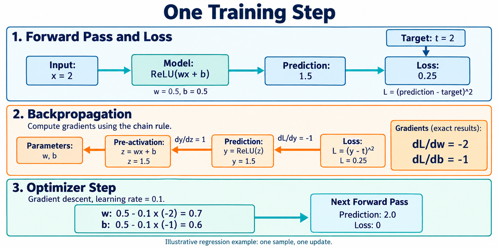

# 🎓 A4. 예측을 개선하는 방법 — Loss·Gradient·Backpropagation·Optimizer

> 2026-10-28 로컬 백업의 학습자료입니다. 본문의 ResNet-56 등 과거 프로젝트 예시는 당시 기록이며, 현재 구현 기준은 [프로젝트 README](../../README.md)의 ResNet-20·ZedBoard입니다.

> 공통 기초 A4 · Rev3.0 · 의미 설명 → 용어 → 수식 순서로 읽는다.

> <b>Training은 현재 Model로 예측하고, 목표와 비교한 뒤, 더 나은 예측을 만들도록 Parameter를 반복해서 조정하는 과정이다.</b>
> 
> [A3](A3.md)에서는 Parameter가 정해진 상태에서 입력을 출력으로 바꾸는 Forward Pass를 살펴봤다. 이제는 그 Parameter를 어떻게 정하는지 알아본다.

| 개념 | 담당하는 역할 |
| --- | --- |
| <b>Loss</b> | 현재 예측이 학습 목표에 얼마나 부합하지 않는지 수치화 |
| <b>Gradient</b> | Parameter를 조금 바꾸면 Loss가 어떻게 변하는지 나타냄 |
| <b>Backpropagation</b> | 계산의 연결 관계를 이용해 Gradient를 계산 |
| <b>Optimizer</b> | Gradient 등을 이용해 Parameter를 실제로 갱신 |

이 네 역할을 구분하면 Training의 흐름을 이해할 수 있다.

한 Neuron의 Forward Pass와 Loss 계산, Backpropagation, Optimizer Step. 설명을 위한 AI 생성 개념도이며, 한 번의 갱신으로 목표에 도달하는 것은 이 수치 예제의 결과다. 실제 CIFAR-10 학습 실험 결과가 아니다.

# 1. Training — 무엇을 바꾸어 예측을 개선하는가?

Model의 계산 구조를 만들었다고 해서 좋은 예측이 나오는 것은 아니다. 같은 구조에서도 Weight와 Bias가 다르면 결과가 달라진다.

Training에서는 예시 입력과 목표를 이용해 Parameter를 조정한다. 이 장에서는 Weight와 Bias를 학습하는 값으로 설명한다.

Model이 바뀌면 같은 입력에서도 다른 예측이 나온다. 이 변화를 반복해 여러 데이터에서 유용한 예측을 만드는 것이 목표다.

## 용어

- <b>Training</b>: 학습 목표에 맞게 Parameter를 조정하는 과정.
- <b>Parameter</b>, $\theta$: Weight와 Bias 등 학습으로 조정하는 값.
- <b>Target</b>, $t$: 해당 입력에서 원하는 정답 또는 목표값.
- <b>Supervised Learning</b>: 입력과 Target의 쌍을 이용하는 학습 방식.

## 수학적 의미

$$
\hat y=f_\theta(x)
$$

입력 $x$는 그대로 두고 Parameter $\theta$를 바꾸면 예측 $\hat y$가 달라질 수 있다.

이 장에서는 다음의 작은 Model을 사용한다.

$$
z=wx+b,\qquad \hat y=\operatorname{ReLU}(z)
$$

| 항목 | 예제의 값 |
| --- | --- |
| Input $x$ | 2 |
| Target $t$ | 2 |
| Weight $w$ | 0.5 |
| Bias $b$ | 0.5 |

현재 예측은 다음과 같다.

$$
z=0.5\times2+0.5=1.5,\qquad \hat y=1.5
$$

이 예제는 숫자 하나를 맞추는 <b>Regression</b> 문제다. CIFAR-10 분류와 동일한 문제는 아니지만, 학습 계산을 따라가기 위해 사용한다.

# 2. Loss — 예측을 왜 숫자로 평가하는가?

예측이 ‘맞았다’ 또는 ‘틀렸다’는 사실만으로는 Parameter를 어떻게 바꿀지 충분히 알기 어렵다.

학습에서는 예측을 목표와 비교하는 계산 규칙을 정한다. 이 규칙이 Loss Function이고, 계산 결과가 Loss다.

<b>Loss를 사용하는 이유는 학습 목표를 Parameter 조정에 사용할 수 있는 수치적 기준으로 표현하기 위해서다.</b>

어떤 Loss를 선택하는지는 어떤 문제를 풀고 싶은지와 연결된다.

## 용어

- <b>Loss Function</b>: 예측과 Target을 이용해 학습 목표에 대한 평가값을 계산하는 함수.
- <b>Loss</b>, $L$: Loss Function이 계산한 값.
- <b>Squared Error</b>: 예측과 목표의 차이를 제곱한 값.

## 수학적 의미

이 예제에서는 Squared Error를 사용한다.

$$
L=(\hat y-t)^2
$$

$$
L=(1.5-2)^2=0.25
$$

| Prediction | Target | Loss |
| --- | --- | --- |
| 1.5 | 2 | 0.25 |
| 1.8 | 2 | 0.04 |
| 2 | 2 | 0 |

이 Loss에서는 예측이 목표에 가까워질수록 값이 작아진다.

하지만 <b>Loss가 0.25라는 사실만으로 </b><b>$w$</b><b>와 </b><b>$b$</b><b>를 각각 어느 방향으로 바꿀지는 알 수 없다.</b> 그 정보를 주는 것이 Gradient다.

# 3. Gradient — 무엇을 어느 방향으로 바꿀지 어떻게 아는가?

현재 Weight를 아주 조금 늘렸을 때 Loss가 줄어든다면, 그 지점 근처에서는 Weight를 늘리는 것이 도움이 된다는 단서를 얻는다.

다른 값은 그대로 두고 $w$만 바꿔보자.

| Weight $w$ | Prediction | Loss |
| --- | --- | --- |
| 0.50 | 1.50 | 0.2500 |
| 0.51 | 1.52 | 0.2304 |

이 예제에서는 Weight가 조금 증가하자 Loss가 감소했다.

Gradient는 이런 <b>작은 변화에 대한 Loss의 변화율</b>을 Parameter별로 나타낸 것이다.

## 용어

- <b>Partial Derivative(편미분)</b>: 다른 변수를 고정하고 특정 변수 하나를 바꿀 때의 변화율.
- <b>Gradient(기울기)</b>: 각 Parameter에 대한 Partial Derivative를 모은 것.
- <b>Local Information</b>: 현재 값 주변에서 성립하는 변화 정보.

## 수학적 의미

$$
\frac{\partial L}{\partial w}
$$

이는 다른 값을 고정하고 $w$를 아주 조금 바꿀 때 Loss가 어떻게 변하는지를 나타낸다.

$$
\nabla_\theta L=
\begin{bmatrix}
\frac{\partial L}{\partial w}\\
\frac{\partial L}{\partial b}
\end{bmatrix}
$$

| 특정 Parameter에 대한 미분값 | 현재 지점 근처에서의 의미 |
| --- | --- |
| 양수 | Parameter를 조금 늘리면 Loss가 증가하는 방향 |
| 음수 | Parameter를 조금 늘리면 Loss가 감소하는 방향 |
| 0 | 1차 변화율이 0 |

Gradient는 현재 지점 주변의 정보다. 음수라고 해서 Parameter를 끝없이 늘리라는 뜻은 아니다. 또한 Gradient가 0이라는 사실만으로 좋은 해답에 도달했다고 판단할 수는 없다.

> <b>추후 연결할 보충자료 — 미분값은 어떻게 변화 방향을 알려주는가?</b>
> 
> Loss 곡선의 기울기와 작은 Parameter 변화, 수치적으로 변화율을 확인하는 Gradient Checking을 연결한다. 보충자료 링크는 추후 추가한다.

# 4. Backpropagation — 수많은 Parameter의 Gradient를 어떻게 계산하는가?

Parameter를 하나씩 바꿔가며 Loss를 다시 계산하는 방법은 큰 Neural Network에서 비효율적이다.

대신 계산의 연결 관계를 이용한다.

- Prediction이 바뀌면 Loss가 얼마나 변하는가?
- Pre-activation이 바뀌면 Prediction이 얼마나 변하는가?
- Weight가 바뀌면 Pre-activation이 얼마나 변하는가?

이 변화율들을 연결하면 Weight가 최종 Loss에 미치는 영향을 계산할 수 있다.

<b>Backpropagation은 Computational Graph를 거슬러, 각 연산의 변화율을 연결해 Gradient를 계산하는 방법이다.</b>

## 용어

- <b>Chain Rule(연쇄법칙)</b>: 합성된 함수의 변화율을 각 단계의 변화율로 연결하는 규칙.
- <b>Backpropagation(역전파)</b>: Chain Rule을 Graph의 역방향으로 적용해 Gradient를 계산하는 방법.
- <b>Backward Pass</b>: Gradient를 계산하는 역방향 계산 과정.

## 수학적 의미

이 예제의 계산 관계는 다음과 같다.

$$
w,b\ \longrightarrow\ z\ \longrightarrow\ \hat y\ \longrightarrow\ L
$$

Weight에 대한 미분은 세 단계의 변화율을 곱해 구한다.

$$
\frac{\partial L}{\partial w}
=
\frac{\partial L}{\partial \hat y}
\frac{\partial \hat y}{\partial z}
\frac{\partial z}{\partial w}
$$

현재 값에서 각 항은 다음과 같다.

| 관계 | 미분값 | 의미 |
| --- | --- | --- |
| Prediction → Loss | $2(\hat y-t)=-1$ | Prediction을 조금 높이면 Loss가 감소 |
| Pre-activation → Prediction | $1$ | 현재 $z>0$에서 ReLU는 값을 그대로 전달 |
| Weight → Pre-activation | $x=2$ | Weight의 변화가 입력 2에 곱해져 반영 |
| Bias → Pre-activation | $1$ | Bias의 변화가 그대로 반영 |

따라서 다음 Gradient를 얻는다.

$$
\frac{\partial L}{\partial w}=(-1)\times1\times2=-2
$$

$$
\frac{\partial L}{\partial b}=(-1)\times1\times1=-1
$$

Backpropagation이 계산한 결과는 Gradient다. <b>Parameter의 실제 수정은 다음 단계인 Optimizer가 수행한다.</b>

> <b>추후 연결할 보충자료 — Activation과 분기 구조에서 Gradient는 어떻게 흐르는가?</b>
> 
> ReLU의 음수 구간과 0에서의 처리, 여러 경로에서 온 Gradient의 합산, Vanishing Gradient와 Exploding Gradient를 설명한다. 보충자료 링크는 추후 추가한다.

# 5. Optimizer — Gradient를 실제 갱신으로 어떻게 바꾸는가?

Gradient를 구했다면 Parameter를 얼마만큼 수정할지 정해야 한다.

가장 기본적인 Gradient Descent는 Gradient의 반대 방향으로 이동한다. Learning Rate는 이동 폭을 조절한다.

<b>Optimizer의 역할은 Gradient와 갱신 규칙을 이용해 새로운 Parameter 값을 만드는 것이다.</b>

## 용어

- <b>Optimizer</b>: Parameter를 갱신하는 알고리즘.
- <b>Gradient Descent</b>: Gradient의 반대 방향으로 이동하는 기본적인 최적화 방법.
- <b>Learning Rate</b>, $\eta$: 갱신 폭을 조절하는 계수.
- <b>Optimizer Step</b>: Parameter를 한 번 갱신하는 동작.

## 수학적 의미

$$
\theta_{\text{new}}=\theta-\eta\nabla_\theta L
$$

Learning Rate를 $0.1$로 두면 다음과 같다.

| Parameter | 현재 값 | Gradient | 갱신 후 |
| --- | --- | --- | --- |
| $w$ | 0.5 | −2 | $0.5-0.1(-2)=0.7$ |
| $b$ | 0.5 | −1 | $0.5-0.1(-1)=0.6$ |

두 Gradient는 모두 <b>갱신 전의 같은 Parameter 상태</b>에서 계산한 값이다.

새 Parameter로 다시 예측하면 다음과 같다.

$$
\hat y_{\text{new}}
=
\operatorname{ReLU}(0.7\times2+0.6)=2
$$

$$
L_{\text{new}}=(2-2)^2=0
$$

이 예제에서는 한 번에 목표에 도달했지만, 일반적인 Training은 여러 데이터에서 반복해야 한다. Learning Rate가 너무 크면 Loss가 오히려 증가할 수 있으며, 매 Step의 Loss 감소가 보장되는 것도 아니다.

> <b>추후 연결할 보충자료 — SGD·Momentum·Adam은 무엇이 다른가?</b>
> 
> Mini-batch Gradient를 사용하는 SGD, 과거 변화 정보를 이용하는 Momentum, 추가 상태를 유지하는 Adam의 갱신 방식을 비교한다. 보충자료 링크는 추후 추가한다.

# 6. Training Loop — 한 번의 학습은 어떤 순서인가?

지금까지의 과정을 연결하면 하나의 Training Step이 된다.

1. <b>Forward Pass</b>: 현재 Parameter로 Prediction을 계산한다.
2. <b>Loss 계산</b>: Prediction과 Target을 비교한다.
3. <b>Backward Pass</b>: Backpropagation으로 Gradient를 계산한다.
4. <b>Optimizer Step</b>: Parameter를 갱신한다.
5. 다음 입력 묶음에서 이 과정을 반복한다.

Target은 Loss를 계산할 때 사용한다. 일반적인 이미지 분류 Model이 Prediction을 만들기 위해 정답을 입력받아야 하는 것은 아니다.

## 용어

- <b>Training Loop</b>: 예측·Loss·Gradient 계산·갱신을 반복하는 절차.
- <b>Mini-batch</b>: Training Data에서 나눈 작은 Sample 묶음.
- <b>Epoch</b>: Training Data 전체를 한 차례 사용하는 단위.

## 수학적 의미

Mini-batch $B$의 평균 Loss를 사용한다면 다음과 같다.

$$
L_B(\theta)
=
\frac1{|B|}
\sum_{n\in B}
\ell\bigl(f_\theta(x_n),t_n\bigr)
$$

$$
\theta_{k+1}
=
\theta_k-\eta\nabla_\theta L_B(\theta_k)
$$

여기서 $k$는 갱신 횟수다. 이 식은 기본적인 Mini-batch Gradient Descent 갱신을 나타낸다.

예를 들어 데이터 100개를 Batch Size 20으로 나누고, 각 Batch마다 한 번 갱신하면 한 Epoch에 5번의 Optimizer Step을 수행한다.

여러 Sample의 Gradient를 종합하는 이유는 한 Sample만을 위한 갱신을 피하고, 더 넓은 데이터에서의 학습 목표를 반영하기 위해서다. 그래도 새로운 데이터에서의 성능은 별도로 평가해야 한다.

# 7. Classification에서는 어떤 Loss를 사용하는가?

앞의 예제는 목표 숫자와 예측 숫자를 비교했다.

CIFAR-10에서는 열 Class 중 하나를 고르므로, Model은 열 개의 Logit을 만들고 Target은 정답 Class를 가리킨다.

Target의 Class Index가 3이라고 해서 숫자 3.0에 가까운 출력을 만들라는 뜻은 아니다. <b>Class Index는 정답 Class에 해당하는 Logit 위치를 가리킨다.</b> 예를 들어 0부터 세는 규약에서 Index 3은 네 번째 위치다.

분류에서 자주 사용하는 Cross-Entropy는 정답 Class에 부여한 확률이 낮을수록 큰 Loss를 준다.

## 용어

- <b>Softmax</b>: Logit들을 양수이며 합이 1인 값으로 변환하는 함수.
- <b>Cross-Entropy Loss</b>: 기본적인 단일 정답 분류에서 정답 Class에 부여한 확률을 평가하는 Loss.
- <b>Accuracy</b>: 최종 선택이 정답과 일치한 비율.

## 수학적 의미

Class별 Logit이 $s_k$라면 Softmax는 다음과 같다.

$$
p_k=\frac{e^{s_k}}{\sum_j e^{s_j}}
$$

지수 함수로 양수 값을 만들고 전체 합으로 나누어 합이 1이 되도록 한다.

정답 Class Index가 $t$일 때, 기본적인 한 Sample의 Cross-Entropy는 다음과 같다.

$$
L=-\ln p_t
$$

| 정답 Class의 확률 $p_t$ | Loss 근삿값 |
| --- | --- |
| 0.1 | 2.303 |
| 0.6 | 0.511 |
| 0.9 | 0.105 |

정답을 선택한 경우에도 Class별 점수 상태에 따라 Loss는 달라질 수 있다. 따라서 Accuracy와 Loss는 역할이 다르다.

Training에서는 보통 argmax로 고른 Class Index만으로 Loss를 계산하지 않는다. <b>선택 전 Logit을 이용해 학습 신호를 만든다.</b>

> <b>추후 연결할 보충자료 — Softmax와 Cross-Entropy는 왜 함께 사용하는가?</b>
> 
> 지수·로그의 역할, Logit에 대한 Gradient, 수치 안정성과 실제 Loss 함수의 입력 규약을 설명한다. 위 식은 Class Weight와 Label Smoothing이 없는 기본 경우이며, 구현에서 Softmax를 별도로 적용해야 하는지는 사용하는 Loss의 규약과 함께 확인한다. 보충자료 링크는 추후 추가한다.

# 8. Training과 Inference에서는 무엇이 다른가?

Training은 Parameter를 찾는 과정이고, 일반적인 고정 Model의 Inference는 학습된 Parameter를 사용해 결과를 계산하는 과정이다.

<b>Inference에서도 입력부터 출력까지 필요한 Forward Pass는 수행한다.</b> 마지막 Layer만 계산하는 것이 아니다.

## 용어

- <b>Inference</b>: 준비된 Model로 입력의 Prediction을 계산하는 과정.
- <b>Model State</b>: Parameter 외에 Model 실행에 필요한 상태.
- <b>Checkpoint</b>: Model의 Parameter와 필요한 상태 등을 저장한 파일.

| 항목 | Training | 일반적인 고정 Model의 Inference |
| --- | --- | --- |
| Forward Pass | 수행 | 수행 |
| Target | Loss 계산에 사용 | Prediction 생성에는 불필요 |
| Backpropagation | Gradient 계산 | Prediction 생성에는 불필요 |
| Optimizer | Parameter 갱신 | 일반적으로 실행하지 않음 |
| Intermediate Tensor | 후속 Forward·Backward 계산에 사용 | 후속 Forward 계산에 사용 |

## 수학적 의미

$$
\text{Training}:\quad
\theta_k\rightarrow\theta_{k+1}
$$

$$
\text{Inference}:\quad
\hat y=f_{\theta^\star}(x)
$$

Inference에서는 학습된 Parameter $\theta^\star$와 필요한 Model State를 사용한다.

> <b>추후 연결할 보충자료 — 학습된 Model을 추론용으로 준비하기</b>
> 
> Checkpoint에 필요한 값, BatchNorm·Dropout의 Training/Inference 동작 차이, 평가 모드와 Gradient 기록 설정의 차이를 설명한다. 보충자료 링크는 추후 추가한다.

# 9. 가속기 프로젝트에서는 어디까지 실행하는가?

이 프로젝트에서는 학습된 ResNet-56을 준비하고, 가속기가 그 Model의 Inference를 수행하는 흐름을 우선 다룬다.

따라서 가속기에 필요한 것은 Weight뿐 아니라 <b>Model 구조, 필요한 Model State, 입력 전처리, 숫자 표현 규약</b>이다.

| 학습 이후 준비할 것 | 목적 |
| --- | --- |
| Model 구조와 Parameter | 학습된 계산 재현 |
| 필요한 Model State | 각 연산의 Inference 동작 재현 |
| 입력 전처리·Class 순서 | 입력과 출력의 의미 일치 |
| 중간 Tensor의 기준값 | 가속기 계산의 오류 위치 확인 |
| Quantization 규약 | 실수 계산을 정수 계산으로 옮길 때의 의미 유지 |

학습 과정의 Loss와 Gradient는 Parameter를 얻는 데 사용한다. 가속기에서 Prediction을 만드는 데는 학습된 Model의 Forward 계산을 구현한다.

# 10. 의미를 확인하는 질문

1. Loss가 크다는 사실만으로 모든 Weight를 늘리면 되는가?
2. Gradient가 음수라는 것은 어떤 작은 변화가 유리하다는 뜻인가?
3. Backpropagation과 Optimizer는 각각 무엇을 하는가?
4. $w=0.5$, Gradient가 $-2$, Learning Rate가 $0.1$이면 새 Weight는 얼마인가?
5. Classification에서 Target의 Class Index를 실수 목표값처럼 맞추면 안 되는 이유는 무엇인가?
6. Inference에서 정답 없이 Prediction을 만들 수 있는 이유는 무엇인가?

답의 핵심

Loss는 평가 기준이고, Parameter별 수정 방향은 Gradient로 확인한다. 음의 미분값은 현재 지점 근처에서 해당 Parameter를 조금 늘리면 Loss가 감소하는 방향임을 뜻한다. Backpropagation은 Gradient를 계산하고 Optimizer는 Parameter를 갱신한다. 새 Weight는 0.7이다. Class Index는 정답 위치를 가리키는 식별자이며 수치적 목표 크기가 아니다. Inference의 Forward Pass는 입력과 준비된 Model 데이터로 Prediction을 계산한다.

# 다음 장으로

Training Loss가 낮아졌다고 해서 처음 보는 데이터에서도 잘 작동한다고 단정할 수는 없다.

[A5](A5.md)에서는 Training·Validation·Test Data를 구분하고, <b>학습 자료에 익숙해진 것과 새로운 데이터에도 적용할 수 있게 된 것을 어떻게 구별하는지</b> 알아본다.

# 참고자료

- [Dive into Deep Learning — Forward Propagation, Backward Propagation, and Computational Graphs](https://d2l.ai/chapter_multilayer-perceptrons/backprop.html): Forward Pass, Chain Rule을 이용한 Backpropagation과 중간값을 사용하는 이유.
- [PyTorch — CrossEntropyLoss](https://docs.pytorch.org/docs/stable/generated/torch.nn.CrossEntropyLoss.html): Logit과 Target 입력 규약. 구현 세부 사항은 추후 보충자료에서 연결한다.
- [PyTorch — Module.eval](https://docs.pytorch.org/docs/stable/generated/torch.nn.Module.html#torch.nn.Module.eval): Training/Evaluation 모드 구분. 세부 동작은 추후 보충자료에서 연결한다.
- 한 Neuron의 수치 예제와 갱신 전후 비교는 학습 메커니즘을 설명하기 위한 교육용 예시이며, CIFAR-10 학습 실험 결과가 아니다.
