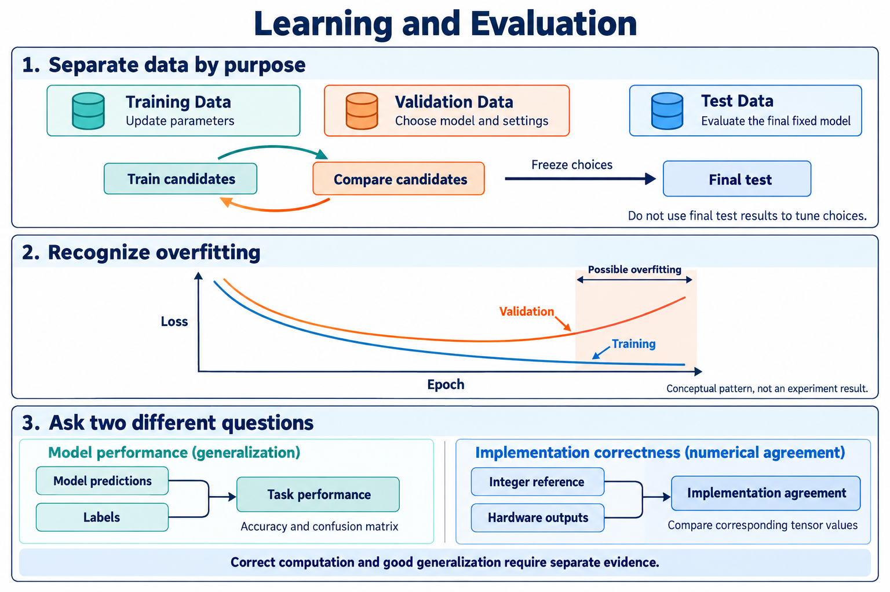

# 📊 A5. 새로운 데이터에서도 잘 작동하는가 — 데이터 분리와 Model 평가

> 2026-10-28 로컬 백업의 학습자료입니다. 본문의 ResNet-56 등 과거 프로젝트 예시는 당시 기록이며, 현재 구현 기준은 [프로젝트 README](../../README.md)의 ResNet-20·ZedBoard입니다.

> 공통 기초 A5 · Rev3.0 · 의미 설명 → 용어 → 수식 순서로 읽는다.

> <b>Training Data를 잘 맞힌다는 사실만으로, 새로운 데이터에서도 잘 작동한다고 결론 내릴 수는 없다.</b>
> 
> Model을 평가하려면 학습에 사용한 데이터와 별도의 데이터를 구분하고, 무엇을 선택하는 데 사용했는지도 확인해야 한다.

| 데이터 | 담당하는 역할 |
| --- | --- |
| <b>Training Data</b> | Parameter 학습 |
| <b>Validation Data</b> | Model과 설정 선택 |
| <b>Test Data</b> | 선택을 마친 Model의 최종 성능 평가 |

이 장에서는 이 구분이 필요한 이유와, 평가 결과를 올바르게 읽는 방법을 알아본다.

데이터의 세 역할, Overfitting을 의심할 수 있는 Learning Curve, Model 성능과 구현 일치의 구분. AI 생성 교육용 개념도이며, 그래프는 프로젝트 실험 결과가 아니다.

# 1. Generalization — 왜 새로운 데이터로 평가하는가?

고양이 Training Image가 대부분 실내에서 촬영되었다고 생각해보자. Model이 동물의 형태보다 실내 배경에 의존한다면, Training Data는 잘 맞히면서 야외 고양이 사진에서는 틀릴 수 있다.

우리가 원하는 것은 특정 사진들을 다시 맞히는 능력에 그치지 않는다. <b>학습에 사용하지 않은 입력에도 유용한 예측을 만드는 능력</b>이 필요하다.

그래서 Training Data와 별도로 보관한 데이터에서 성능을 확인한다.

## 용어

- <b>Generalization(일반화)</b>: 학습하지 않은 데이터에서도 잘 작동하는 성질.
- <b>Data Distribution</b>: 어떤 종류와 조건의 데이터가 얼마나 나타나는지를 나타내는 분포.
- <b>Distribution Shift</b>: 학습·평가·실제 사용 사이에서 데이터 분포가 달라지는 현상.

## 수학적 의미

Model이 적용될 데이터 분포를 $P$라고 하면, 그 분포에서의 평균적인 Loss는 다음과 같이 표현한다.

$$
R(\theta)
=
\mathbb E_{(x,t)\sim P}
\left[\ell(f_\theta(x),t)\right]
$$

이는 해당 분포에서 만나는 입력들에 대한 평균 Loss라는 뜻이다. 실제로는 가능한 모든 데이터를 확인할 수 없으므로, 별도의 평가 Sample로 추정한다.

$$
\hat R_D(\theta)
=
\frac1{|D|}
\sum_{(x,t)\in D}
\ell(f_\theta(x),t)
$$

평가 데이터가 대표하는 환경도 중요하다. CIFAR-10에서 좋은 결과를 얻었다고 해서 다른 카메라·조명·환경에서도 같은 성능이 보장되는 것은 아니다.

# 2. Training·Validation·Test Data — 왜 세 역할을 구분하는가?

학습 과정에서는 Weight 외에도 선택할 것이 많다. Learning Rate, Model 구조, 학습을 멈출 시점, 사용할 Checkpoint 등을 비교하게 된다.

이 선택에 사용하는 데이터가 Validation Data다.

Test Data는 이런 선택을 마친 뒤, 고정한 Model과 평가 조건으로 성능을 확인하는 데 사용한다.

## 용어

| 용어 | 답하려는 질문 | 사용 방식 |
| --- | --- | --- |
| <b>Training Data</b> | 어떤 Parameter를 학습할까? | Loss와 Gradient로 Parameter 갱신 |
| <b>Validation Data</b> | 어떤 후보를 선택할까? | Model·Checkpoint·설정 비교 |
| <b>Test Data</b> | 선택한 Model의 성능은 어느 정도인가? | 고정한 조건에서 최종 평가 |
| <b>Hyperparameter</b> | 학습과 Model 구성을 어떻게 정할까? | Learning Rate 등 개발자가 선택하는 설정 |

Validation에서는 보통 Backpropagation으로 Weight를 갱신하지 않는다. 하지만 결과를 보고 후보를 선택하므로 <b>개발 결정에 영향을 준 데이터</b>다.

## 수학적 의미

Training에서는 다음과 같은 목표로 Parameter를 찾는다.

$$
\theta^\star
\approx
\arg\min_\theta L_{\text{train}}(\theta)
$$

학습 과정에서 얻은 여러 후보 $\theta^{(1)},\theta^{(2)},\ldots$ 중에서는 Validation 결과를 이용해 하나를 선택할 수 있다.

$$
j^\star
=
\arg\min_j L_{\text{val}}\!\left(\theta^{(j)}\right)
$$

그다음 선택한 Model의 Test 성능을 평가한다.

$$
L_{\text{test}}\!\left(\theta^{(j^\star)}\right)
$$

위 식은 Validation Loss로 선택하는 예시다. 실제로는 사용할 선택 지표를 미리 정한다.

<b>Test 결과를 보고 설정을 반복해서 고르면, Test Data도 사실상 Validation 역할을 하게 된다.</b>

# 3. Overfitting — 학습을 더 했는데 왜 평가 결과가 나빠지는가?

Training을 계속하면 Model이 Training Data의 유용한 패턴뿐 아니라, 그 데이터에만 있는 우연한 특징에도 맞춰질 수 있다.

이때 Training Loss는 계속 줄지만 Validation Loss는 더 이상 좋아지지 않거나 증가할 수 있다.

<b>Overfitting은 Training Data에 잘 맞는 정도가 새로운 데이터의 성능으로 이어지지 않는 현상이다.</b>

## 용어

- <b>Overfitting(과적합)</b>: Training Data에 과도하게 맞춰져 새로운 데이터에서 성능이 떨어지는 현상.
- <b>Learning Curve</b>: 학습 진행에 따른 Loss나 Accuracy의 변화를 나타낸 그래프.
- <b>Early Stopping</b>: Validation 결과를 기준으로 학습을 멈추거나 이전 Checkpoint를 선택하는 방법.

## 수학적 의미

다음은 설명을 위한 가상 결과다.

| Checkpoint | Training Loss | Validation Loss |
| --- | --- | --- |
| A | 0.40 | 0.45 |
| B | 0.20 | 0.30 |
| C | 0.08 | 0.42 |

B에서 C로 진행하면 다음과 같다.

$$
L_{\text{train}}\downarrow,
\qquad
L_{\text{val}}\uparrow
$$

Training Loss만 보면 C가 좋지만, Validation Loss를 기준으로는 B를 선택한다.

이런 추세는 Overfitting을 의심할 단서다. 한 번의 작은 변동만으로 확정하지 않고, 데이터 수와 평가 조건도 함께 확인한다.

# 4. Data Leakage — 파일을 나누기만 하면 충분한가?

파일이나 Index를 나눴더라도 평가 정보가 학습과 선택 과정에 들어갈 수 있다.

예를 들어 거의 같은 사진이 두 Split에 들어 있거나, Test Data까지 사용해 입력 정규화 통계를 계산하면 평가의 독립성이 훼손될 수 있다.

<b>데이터 분리의 목적은 이름을 다르게 붙이는 것이 아니라, 평가에 남겨둔 정보를 개발 과정에서 미리 사용하지 않는 것이다.</b>

## 용어

- <b>Data Split</b>: 데이터를 목적별로 나누는 것.
- <b>Data Leakage</b>: 평가에서 사용하지 말아야 할 정보가 학습이나 개발 결정에 들어가는 문제.
- <b>Stratified Split</b>: Class 비율을 고려해 나누는 방법.

## 수학적 의미

기본적으로 Split 사이에 같은 Sample이 겹치지 않도록 한다.

$$
D_{\text{train}}\cap D_{\text{val}}=\varnothing
$$

$$
D_{\text{train}}\cap D_{\text{test}}=\varnothing,
\qquad
D_{\text{val}}\cap D_{\text{test}}=\varnothing
$$

하지만 Index가 다르다는 것만으로 충분하지는 않다. 중복 이미지나 같은 원본에서 나온 변형 이미지의 관계도 확인해야 한다.

CIFAR-10의 공식 데이터는 Training 50,000장과 Test 10,000장이다. 새로 학습한다면 공식 Training Data에서 다음과 같이 나눌 수 있다.

| 역할 | 분할 예시 |
| --- | --- |
| Training | 45,000장 |
| Validation | 5,000장 |
| Test | 공식 Test 10,000장 |

45,000/5,000은 제안 예시이며 프로젝트에서 확정한 분할은 아니다.

이미 공식 Training 50,000장 전체로 학습한 외부 Checkpoint라면, 그중 5,000장을 나중에 떼어도 ‘학습하지 않은 Validation Data’가 되지는 않는다.

# 5. 평가 조건 — 왜 같은 사진도 다른 입력이 될 수 있는가?

같은 사진이라도 RGB 순서, Pixel 범위, 정규화, Axis Order가 다르면 Model에 들어가는 숫자는 달라진다.

따라서 평가에서는 <b>Model이 학습할 때 기대한 입력 규약</b>을 맞춰야 한다. 소프트웨어와 가속기를 비교할 때도 같은 의미의 입력이 전달되어야 한다.

## 용어

- <b>Preprocessing</b>: 원본 데이터를 Model이 기대하는 입력 표현으로 바꾸는 과정.
- <b>Input Normalization</b>: 입력을 정한 수치 기준으로 변환하는 것.
- <b>Data Augmentation</b>: 정답 의미를 유지하는 변환으로 학습 데이터의 변화를 넓히는 방법.

## 수학적 의미

RGB Channel별 입력 정규화의 한 예는 다음과 같다.

$$
u=\frac{p}{255},
\qquad
v=\frac{u-\mu_c}{\sigma_c}
$$

$p$는 원본 Pixel 값이고, $\mu_c,\sigma_c$는 해당 Channel의 평균과 표준편차다.

설명용으로 $p=255,\mu_c=0.5,\sigma_c=0.25$라면 다음과 같다.

$$
u=1,\qquad v=2
$$

원본 값 255가 Model에는 2로 들어간다. 실제 상수와 변환 순서는 선택한 Checkpoint의 규약을 따른다.

통계를 새로 추정한다면 Training Split에서 정하고 Validation·Test에는 같은 값을 적용한다.

학습용 무작위 Augmentation과 평가용 Preprocessing은 역할이 다르다. 초기 구현 비교에서는 고정한 평가 입력을 사용해 차이의 원인을 구분한다.

# 6. Accuracy — 얼마나 맞혔는지 어떻게 계산하는가?

분류에서는 가장 높은 Logit의 Class를 예측으로 선택하고 정답과 비교할 수 있다.

Accuracy는 전체 평가 Sample 중 맞힌 비율이다. 결과를 보고할 때는 비율과 함께 <b>몇 장을 평가했는지</b>도 남겨야 한다.

## 용어

- <b>Top-1 Prediction</b>: 점수가 가장 높은 Class 하나를 선택한 예측.
- <b>Accuracy</b>: 정답과 일치한 예측의 비율.
- <b>Percentage Point, %p</b>: 두 퍼센트 값의 차이를 나타내는 단위.

## 수학적 의미

$$
\hat y_n=\arg\max_k s_{n,k}
$$

$$
\mathrm{Accuracy}
=
\frac1N
\sum_{n=1}^{N}
\mathbf1[\hat y_n=t_n]\times100\%
$$

$\mathbf1[\cdot]$는 조건이 참이면 1, 거짓이면 0이다.

20장 중 17장을 맞혔다면 다음과 같다.

$$
\mathrm{Accuracy}=\frac{17}{20}\times100\%=85\%
$$

Batch 크기가 다르면 Batch별 Accuracy를 단순 평균하지 않고, 맞힌 개수와 전체 개수를 합산한다.

$$
\mathrm{Accuracy}
=
\frac{\sum_b \mathrm{Correct}_b}
{\sum_b N_b}\times100\%
$$

예를 들어 첫 Batch에서 4장 중 3장, 다음 Batch에서 1장 중 0장을 맞혔다면 전체 Accuracy는 $3/5=60\%$다.

또한 93.2%에서 92.8%로 변했다면 <b>0.4%p 감소</b>라고 표현한다. 위 숫자들은 계산 예시이며 프로젝트 실측값은 아니다.

# 7. Confusion Matrix — 무엇을 틀리는지도 확인하기

전체 Accuracy만으로는 어떤 Class를 혼동하는지 알기 어렵다.

Confusion Matrix는 정답 Class별로 어떤 Class를 예측했는지 센다. 이를 통해 특정 Class에 오류가 집중되는지 확인할 수 있다.

## 용어

- <b>Confusion Matrix</b>: 정답과 예측 Class의 조합별 Sample 수를 나타내는 표.
- <b>Per-class Recall</b>: 실제 해당 Class인 Sample 중 올바르게 분류한 비율.

## 수학적 의미

행을 정답, 열을 예측으로 정한 예시다.

| 정답 / 예측 | Cat | Dog | 합계 |
| --- | --- | --- | --- |
| Cat | 7 | 3 | 10 |
| Dog | 2 | 8 | 10 |
| 합계 | 9 | 11 | 20 |

대각선이 정답이므로 전체 Accuracy는 다음과 같다.

$$
\frac{7+8}{20}\times100\%=75\%
$$

Cat의 Recall은 다음과 같다.

$$
\mathrm{Recall}_{\text{Cat}}
=
\frac{7}{7+3}=70\%
$$

Cat 10장 중 3장은 Dog로 잘못 예측했다. 실제 CIFAR-10에서는 열 Class를 포함하는 $10\times10$ 표를 사용한다.

# 8. 가속기 평가 — Model 성능과 계산 정확성을 구분하기

Model이 분류를 잘하는지와, 하드웨어가 정한 계산을 구현했는지는 다른 질문이다.

하드웨어가 소프트웨어와 같은 값을 계산해도 Model 자체의 예측이 틀릴 수 있다. 반대로 최종 Class가 같아도 중간 계산은 잘못되었을 수 있다.

## 용어

- <b>Reference Model</b>: 비교 기준으로 사용하는 소프트웨어 Model.
- <b>Numerical Error</b>: 대응하는 출력값 사이의 수치 차이.
- <b>Bit-exact Agreement</b>: 정한 표현에서 비트 단위로 결과가 일치하는 것.

| 평가 질문 | 비교 대상 |
| --- | --- |
| 기준 Model이 잘 분류하는가? | FP32 Prediction과 정답 |
| Quantization이 성능에 어떤 영향을 주었는가? | FP32와 Integer Model의 평가 결과 |
| 하드웨어가 Integer 계산을 구현했는가? | Integer Reference와 Hardware Tensor |

## 수학적 의미

같은 입력에 대한 기준 출력과 하드웨어 출력을 각각 $y_{\text{ref}}$, $y_{\text{hw}}$라고 하자.

$$
E_{\max}
=
\max_i
\left|y_{\text{hw},i}-y_{\text{ref},i}\right|
$$

이는 대응하는 Element들의 최대 절대 오차다.

동일한 정수 연산·누산·반올림·포화 규약을 구현한다면 Bit-exact 비교를 목표로 할 수 있다. 부동소수점이나 근사 계산에서는 별도로 정의한 오차 기준을 사용한다.

<b>최종 argmax가 같다는 사실만으로 Tensor 값도 정확하다고 판단하지 않는다.</b> 중간 Tensor를 비교하면 처음 차이가 발생한 구간을 찾을 수 있다.

# 9. 우리 프로젝트에서는 무엇을 고정하고 기록할까?

재현 가능한 평가를 위해서는 Model 이름뿐 아니라 실제 Checkpoint와 입력 조건을 기록해야 한다.

| 항목 | 기록할 내용 |
| --- | --- |
| Model | 코드 버전, 구조, Checkpoint 식별자 |
| Data | Split Index, 평가 Sample 목록과 장수 |
| Preprocessing | RGB, 값의 범위, 정규화, Axis Order |
| Evaluation | 평가 모드, Class 순서, 지표 계산 방법 |
| Quantization | Scale·Zero-point, 반올림·포화·누산 규약 |
| Result | Correct 수, Accuracy, Confusion Matrix, 수치 비교 결과 |

평가 순서는 다음과 같이 잡을 수 있다.

1. 기준 Model과 입력 규약을 정하고 소프트웨어 평가를 재현한다.
2. 개발용 Sample과 중간 Tensor 기준값을 준비한다.
3. Validation Data로 Model·Quantization 설정을 선택한다.
4. 같은 입력과 Parameter로 Integer Reference와 하드웨어를 비교한다.
5. 선택을 마친 Model과 규약을 고정하고 Test 결과를 보고한다.

Test 정확도를 보고 설정을 고르는 것과, 고정된 계산의 구현 일치를 재확인하는 것은 구분한다. 개발용 디버깅 Sample은 별도로 두는 편이 명확하다.

현재 우선 대상은 <b>ResNet-56·CIFAR-10</b>이다. 실제 Split, Calibration Sample 수, 정확도 허용 저하와 수치 오차 기준은 추후 정한다.

# 10. 의미를 확인하는 질문

1. Training Accuracy가 100%여도 새로운 데이터에서 실패할 수 있는 이유는 무엇인가?
2. Validation에서 Backpropagation을 하지 않아도 Test와 역할이 다른 이유는 무엇인가?
3. 이미 학습에 사용한 데이터를 나중에 떼어내면 독립적인 Validation Data가 되는가?
4. Training Loss는 감소하지만 Validation Loss는 증가한다면 무엇을 의심할 수 있는가?
5. 전체 Accuracy 외에 Confusion Matrix를 보는 이유는 무엇인가?
6. 하드웨어와 Integer Reference가 일치하면 Quantization에 따른 Accuracy 저하도 없다고 할 수 있는가?

답의 핵심

Training Data에만 맞춰졌거나 사용 환경의 분포가 다를 수 있다. Validation 결과는 Model과 설정 선택에 영향을 준다. 이미 학습한 Sample을 나중에 분리해도 학습 이력은 사라지지 않는다. Training·Validation 추세 차이는 Overfitting을 의심할 단서다. Confusion Matrix는 Class별 오류 양상을 보여준다. Integer 계산의 구현 일치와 FP32 대비 Model 성능 변화는 별도로 평가해야 한다.

# 다음 장으로

[A6](A6.md)에서는 <b>같은 정보를 더 적은 Bit로 표현할 때 무엇을 얻고 무엇을 잃는지</b>, FP32·INT8과 Quantization의 의미를 살펴본다.

# 참고자료

- [CIFAR-10 공식 자료](https://cave.cs.toronto.edu/kriz/cifar.html): 이미지 크기와 공식 Training/Test 분할, 파일 형식.
- [Dive into Deep Learning — Generalization in Deep Learning](https://d2l.ai/chapter_multilayer-perceptrons/generalization-deep.html): 학습 자료 적합과 Generalization의 차이.
- [scikit-learn — Common pitfalls](https://scikit-learn.org/stable/common_pitfalls.html): Data Leakage와 전처리 통계의 분리 원칙.
- [Torchvision — Normalize](https://docs.pytorch.org/vision/stable/generated/torchvision.transforms.Normalize.html): Channel별 평균·표준편차를 사용하는 변환.
- [ONNX Runtime — Quantization](https://onnxruntime.ai/docs/performance/model-optimizations/quantization.html): Calibration과 Quantization 검증의 배경. 프로젝트 도구 채택을 확정한 것은 아니다.
- 본문의 Learning Curve·Loss·Accuracy·Confusion Matrix·정규화 수치는 교육용 예시다. 프로젝트 실험 결과나 합격 기준이 아니다.

보충자료 작성 메모 · 학습 중 건너뛰어도 됩니다

> <b>추후 연결할 보충자료 — Overfitting을 어떻게 줄이는가?</b>
> 
> Data Augmentation, Weight Decay, Dropout, Early Stopping의 목적과 차이를 설명한다. Training과 Validation의 연산 모드·입력 조건이 다를 때 Learning Curve를 어떻게 비교하는지도 연결한다. 보충자료 링크는 추후 추가한다.

> <b>추후 연결할 보충자료 — 신뢰할 수 있는 Split 만들기</b>
> 
> 중복 검사, Class 비율 유지, 같은 대상·촬영 묶음을 함께 나누는 Group Split, 분할 Index 저장과 외부 Checkpoint의 학습 이력 확인을 설명한다. 보충자료 링크는 추후 추가한다.

> <b>추후 연결할 보충자료 — 이미지 파일에서 평가 Tensor까지</b>
> 
> CIFAR 파일의 Label·Pixel 구분, RGB와 Axis Order, 입력 정규화와 BatchNorm의 차이, 학습용 Augmentation과 평가 입력 생성 과정을 연결한다. 보충자료 링크는 추후 추가한다.

> <b>추후 연결할 보충자료 — 어떤 평가 지표를 선택해야 하는가?</b>
> 
> Precision·Recall·F1, Class Imbalance, Sample 수에 따른 불확실성과 Confidence Interval을 설명한다. 보충자료 링크는 추후 추가한다.

> <b>추후 연결할 보충자료 — Model 평가와 하드웨어 검증 연결하기</b>
> 
> FP32→Integer 변환의 영향, 중간 Tensor 비교, 반올림·포화·누산 오차와 합격 기준을 설명한다. Quantization의 Calibration 자료도 개발에 사용되는 데이터라는 점을 A6와 연결한다. 보충자료 링크는 추후 추가한다.

