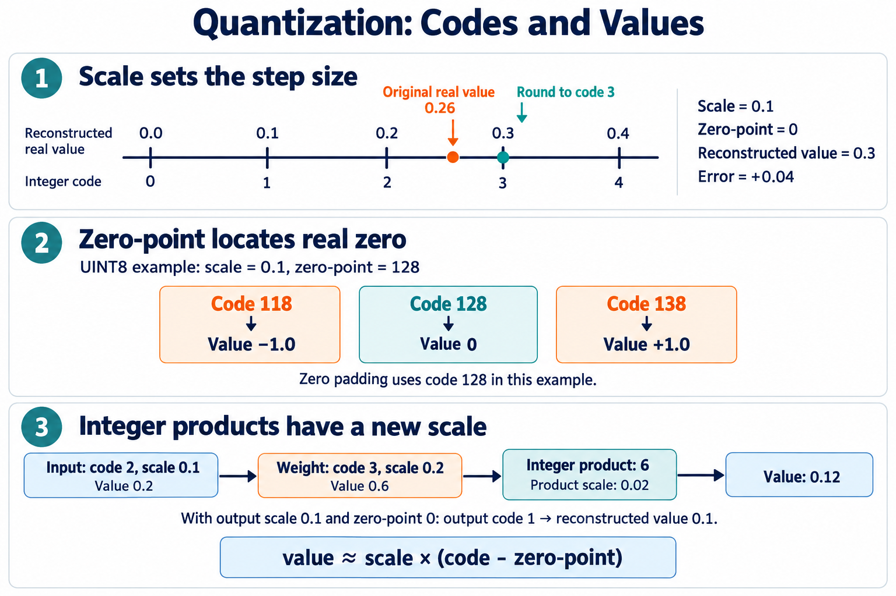

# 📏 A6. 적은 Bit로 숫자 표현하기 — FP32·INT8과 Quantization

> 2026-10-28 로컬 백업의 학습자료입니다. 본문의 ResNet-56 등 과거 프로젝트 예시는 당시 기록이며, 현재 구현 기준은 [프로젝트 README](../../README.md)의 ResNet-20·ZedBoard입니다.

> 공통 기초 A6 · Rev3.0 · 의미 설명 → 용어 → 수식 순서로 읽는다.

> <b>Quantization은 많은 가능한 값을 제한된 표현값에 대응시켜, 저장·전달·계산 비용을 줄이는 방법이다.</b>
> 
> 핵심은 소수점을 단순히 버리는 것이 아니라, <b>정수 코드가 어떤 실제 값을 나타내는지 정하는 것</b>이다.

| 개념 | 역할 |
| --- | --- |
| <b>FP32 / INT8</b> | 값을 저장하고 해석하는 수치 형식 |
| <b>Quantization</b> | 값을 제한된 표현값에 대응시키는 과정 |
| <b>Scale</b> | 정수 코드 한 칸이 나타내는 실제 값의 간격 |
| <b>Zero-point</b> | 실제 값 0에 대응하는 정수 코드 |

이 장에서는 일정한 간격의 눈금을 사용하는 Uniform Affine Quantization을 설명한다. 다른 Quantization 방식도 있다.

Scale의 눈금, Zero-point의 영점 위치, 정수 곱의 단위 변화. AI 생성 교육용 개념도다. 세 번째 패널의 Input과 Weight는 곱셈의 두 피연산자이며, 순차 변환 관계가 아니다. 정확한 관계는 본문 수식으로 설명한다.

# 1. FP32와 INT8 — 무엇이 다른가?

FP32는 32-bit Floating Point 형식이다. 지수를 이용해 값의 크기에 따라 표현 간격을 바꾸면서 넓은 범위의 값을 나타낸다.

INT8은 8-bit Signed Integer 형식이다. 코드 자체로 나타내는 값은 −128부터 127까지의 정수다.

INT8 코드로 0.5 같은 값을 나타내려면, 코드에 별도의 해석 규칙을 붙여야 한다.

## 용어

- <b>FP32</b>: 32-bit Floating Point 형식.
- <b>INT8</b>: 8-bit Signed Integer 형식.
- <b>UINT8</b>: 8-bit Unsigned Integer 형식. 범위는 0부터 255다.
- <b>Quantized Code</b>, $q$: Quantization 이후 저장하는 정수 코드.

| 항목 | FP32 | INT8 |
| --- | --- | --- |
| Element당 저장 크기 | 4 Byte | 1 Byte |
| 표현 방식 | 부호·지수·유효숫자를 이용 | 정수 코드 |
| 소수 표현 | 표현 가능한 값으로 근사 | Scale 등의 대응 규칙 필요 |
| 표현 간격 | 값의 크기에 따라 달라짐 | 이 장의 방식에서는 Scale로 일정하게 정함 |

FP32도 모든 실수를 정확하게 저장하는 것은 아니다.

## 수학적 의미

Element 1,000개를 저장하는 데이터 배열 자체의 용량은 다음과 같다.

$$
\text{FP32}: 1{,}000\times4=4{,}000\ \text{Bytes}
$$

$$
\text{INT8}: 1{,}000\times1=1{,}000\ \text{Bytes}
$$

Scale 등의 추가 정보는 제외한 계산이다.

<b>저장량이 1/4이 된다고 전체 실행 속도가 반드시 4배가 되는 것은 아니다.</b> 실제 효과는 연산기와 메모리, 데이터 이동, 변환 비용에 따라 달라진다.

# 2. Quantization과 Scale — 정수로 소수를 어떻게 나타내는가?

정수 코드 2와 3 사이에는 다른 정수 코드가 없다. 하지만 코드 한 칸이 실제 값 0.1을 뜻한다고 정하면, 코드 2는 0.2, 코드 3은 0.3을 나타낼 수 있다.

이 눈금 한 칸의 크기가 Scale이다.

<b>Scale을 사용하는 이유는 정수 코드의 간격을 Model이 사용하는 값의 단위에 대응시키기 위해서다.</b>

같은 코드라도 Scale이 다르면 나타내는 값이 달라진다.

## 용어

- <b>Quantization</b>: 값을 유한한 표현값에 대응시키는 과정.
- <b>Scale</b>, $s>0$: 인접한 코드가 나타내는 값 사이의 간격.
- <b>Dequantization</b>: 코드와 대응 규칙으로 근삿값을 계산하는 과정.

## 수학적 의미

우선 실제 값 0이 코드 0에 대응한다고 하자.

$$
q=\operatorname{round}\left(\frac{r}{s}\right)
$$

$$
\hat r=sq
$$

$r$은 변환 전 값, $q$는 코드, $\hat r$은 코드가 나타내는 근삿값이다. 여기서는 코드 범위를 벗어나지 않는 경우를 먼저 본다.

$r=0.26,\ s=0.1$이라면 다음과 같다.

$$
q=\operatorname{round}(2.6)=3
$$

$$
\hat r=0.1\times3=0.3
$$

$$
\hat r-r=0.04
$$

원래 값 0.26을 표현 가능한 값 0.3으로 근사했다. Dequantization을 해도 원래 값이 정확히 복구되는 것은 아니다.

# 3. Scale을 작게 하면 항상 좋은가?

Scale을 작게 하면 눈금이 촘촘해진다. 가까운 값들을 더 세밀하게 구분할 수 있지만, 같은 코드 개수로 나타내는 전체 범위는 좁아진다.

<b>Scale 선택은 표현 간격과 표현 범위 사이의 선택이다.</b>

## 용어

- <b>Resolution</b>: 표현값 사이의 간격 또는 값을 구분하는 세밀함.
- <b>Representable Range</b>: 코드가 나타낼 수 있는 값의 범위.
- <b>Rounding Error</b>: 눈금 사이의 값을 반올림하면서 생기는 오차.
- <b>Clipping / Saturation</b>: 코드 범위를 벗어난 값을 끝점으로 제한하는 것.

## 수학적 의미

INT8 전체 범위를 사용하고 Zero-point가 0이라면 다음과 같다.

| Scale | 표현 범위 | 표현 간격 |
| --- | --- | --- |
| 0.1 | −12.8 \~ 12.7 | 0.1 |
| 0.01 | −1.28 \~ 1.27 | 0.01 |

Scale 0.1에서 값 20을 나타내려면 코드 200이 필요하지만, INT8의 최대 코드는 127이다.

$$
q=\operatorname{clip}(200,-128,127)=127
$$

$$
\hat r=0.1\times127=12.7
$$

이 경우는 단순한 반올림 오차보다 큰 범위 제한 오차가 발생한다.

Clipping은 Overflow와 다르다. 범위를 벗어난 값을 끝점으로 제한하는 것과, 좁은 Bit 폭에서 값이 넘쳐 다른 값이 되는 것은 구분해야 한다.

# 4. Zero-point — 왜 실제 0의 코드 위치를 옮기는가?

정수 코드의 범위와 Model 값의 범위가 같은 위치에 있을 필요는 없다.

예를 들어 UINT8의 코드 범위는 0\~255지만, 음수와 양수를 함께 나타내고 싶을 수 있다. 실제 값 0을 코드 128에 대응시키면 그보다 작은 코드는 음수, 큰 코드는 양수를 나타낼 수 있다.

<b>Zero-point를 사용하는 이유는 실제 값의 원점과 정수 코드의 원점을 맞추고, 제한된 코드 범위를 필요한 값의 구간에 배치하기 위해서다.</b>

## 용어

- <b>Zero-point</b>, $z_0$: 실제 값 0에 대응하는 정수 코드.
- <b>Symmetric Quantization</b>: 이 장에서는 Signed 코드의 Zero-point를 0으로 두고 0을 중심으로 범위를 정하는 방식.
- <b>Asymmetric Quantization</b>: Zero-point를 조정할 수 있게 해 표현 구간을 배치하는 방식.

Signed·Unsigned 여부만으로 Symmetric·Asymmetric이 결정되는 것은 아니다.

## 수학적 의미

일반적인 대응 관계는 다음과 같다.

$$
\hat r=s(q-z_0)
$$

코드로 변환할 때는 다음을 사용한다.

$$
q=
\operatorname{clip}
\left(
\operatorname{round}\left(\frac{r}{s}\right)+z_0,\,
q_{\min},q_{\max}
\right)
$$

이 관계는 Affine Quantization의 기본 표현이다. [ONNX Runtime 공식 문서](https://onnxruntime.ai/docs/performance/model-optimizations/quantization.html)

UINT8, $s=0.1,\ z_0=128$인 예시를 보자.

| 코드 $q$ | 나타내는 값 $s(q-z_0)$ |
| --- | --- |
| 118 | −1.0 |
| 128 | 0 |
| 138 | 1.0 |

이 규약에서 <b>실제 값 0으로 Padding하려면 코드 128을 넣어야 한다.</b> 코드 0을 넣으면 −12.8을 입력하는 셈이다.

Zero-point는 Model의 Bias와 다르다. Bias는 학습되는 변환의 항이고, Zero-point는 코드의 해석 기준이다.

# 5. 정수 곱셈 — 왜 결과의 Scale도 바뀌는가?

입력 코드가 한 칸당 0.1, Weight 코드가 한 칸당 0.2를 나타낸다고 하자.

두 코드를 곱하면 결과 한 칸은 $0.1\times0.2=0.02$를 나타낸다.

<b>코드를 곱할 때는 그 코드가 가진 단위도 함께 곱해진다.</b>

## 용어

- <b>Input Scale</b>, $s_x$: 입력 코드의 단위.
- <b>Weight Scale</b>, $s_w$: Weight 코드의 단위.
- <b>Centered Integer</b>: 코드에서 Zero-point를 뺀 값.

## 수학적 의미

$$
\hat x=s_x(q_x-z_x),
\qquad
\hat w=s_w(q_w-z_w)
$$

$$
\hat x\hat w
=
s_xs_w(q_x-z_x)(q_w-z_w)
$$

두 Zero-point가 0인 예시에서는 다음과 같다.

| 항목 | 코드 | Scale | 나타내는 값 |
| --- | --- | --- | --- |
| Input | 2 | 0.1 | 0.2 |
| Weight | 3 | 0.2 | 0.6 |

$$
q_xq_w=2\times3=6
$$

$$
s_xs_w=0.1\times0.2=0.02
$$

$$
\hat x\hat w=6\times0.02=0.12
$$

정수 곱 6을 입력 Scale 0.1로 해석하면 틀린 값이 된다.

# 6. Accumulation — 왜 입력보다 넓은 Bit가 필요한가?

입력과 Weight가 각각 INT8 범위에 들어가더라도, 곱과 여러 곱의 합은 INT8 범위를 쉽게 벗어난다.

코드 100과 100을 곱하면 10,000이고, 이 곱을 열 번 더하면 100,000이다.

<b>입력·곱·누산·출력은 서로 다른 범위를 가지므로, 필요한 Bit 폭도 따로 정해야 한다.</b>

## 용어

- <b>Accumulator</b>: 누적 합을 유지하는 저장소 또는 계산 장치.
- <b>Accumulation Width</b>: 누산 결과를 표현하는 Bit 폭.
- <b>Quantized Bias</b>: 누산 결과와 같은 단위로 표현한 Bias.

## 수학적 의미

입력 Scale과 Weight Scale이 해당 누산 안에서 일정하다고 하자.

$$
\mathrm{acc}
=
\sum_i(q_{x,i}-z_x)(q_{w,i}-z_w)+q_b
$$

Bias도 누산 단위에 맞춘다.

$$
q_b\approx
\operatorname{round}
\left(\frac{b}{s_xs_w}\right)
$$

누산값이 나타내는 실제 값은 다음과 같다.

$$
\hat u=s_xs_w\cdot\mathrm{acc}
$$

INT8 입력·Weight에 INT32 누산을 사용하는 규약이 있지만, 모든 설정에서 Overflow가 없다는 뜻은 아니다. 실제 항 개수와 코드 범위, Bias를 함께 확인해야 한다. [LiteRT INT8 규약](https://ai.google.dev/edge/litert/models/quantization_spec)

# 7. Requantization — 왜 출력을 다시 코드로 바꾸는가?

누산값은 입력 Scale과 Weight Scale을 곱한 단위를 가진다. 하지만 다음 Layer가 사용할 출력 Scale은 다를 수 있다.

따라서 누산 결과를 다음 Layer의 눈금에 맞춰 변환해야 한다.

<b>Requantization의 목적은 넓게 누산한 결과를, 정해진 출력 단위와 코드 범위로 옮기는 것이다.</b>

## 용어

- <b>Requantization</b>: 계산 결과를 출력 Quantization 규약에 맞춰 다시 코드화하는 과정.
- <b>Output Scale / Zero-point</b>, $s_y,z_y$: 출력 코드의 해석 기준.
- <b>Rescaling Factor</b>, $M$: 누산 단위와 출력 단위의 비율.

## 수학적 의미

$$
M=\frac{s_xs_w}{s_y}
$$

$$
q_y=
\operatorname{clip}
\left(
\operatorname{round}(M\cdot\mathrm{acc})+z_y,\,
q_{y,\min},q_{y,\max}
\right)
$$

앞의 예시에서 $\mathrm{acc}=6,\ s_xs_w=0.02$이고, 출력 규약이 $s_y=0.1,\ z_y=0$이면 다음과 같다.

$$
M=0.2,\qquad q_y=\operatorname{round}(0.2\times6)=1
$$

$$
\hat y=0.1\times1=0.1
$$

누산값의 의미는 0.12였지만 출력 눈금에 맞추며 0.1로 근사했다.

이 수식이 매번 FP32 계산을 해야 한다는 뜻은 아니다. 변환 계수를 정수 Multiplier와 Shift 등으로 구현할 수 있다.

# 8. Add와 ReLU — Shape 외에 무엇을 맞춰야 하는가?

A3의 Residual Add에서는 대응하는 위치의 값을 더했다. Quantized Tensor에서는 Shape뿐 아니라 <b>수치 단위도 맞아야 한다.</b>

두 코드가 모두 10이어도 Scale이 다르면 서로 다른 값을 뜻한다.

## 용어

- <b>Scale Alignment</b>: 함께 계산할 값들을 호환되는 수치 단위로 맞추는 과정.
- <b>Quantized Add</b>: 각 입력의 Scale·Zero-point와 출력 규약을 반영하는 덧셈.

## 수학적 의미

Zero-point가 모두 0이라고 하자.

| 경로 | 코드 | Scale | 나타내는 값 |
| --- | --- | --- | --- |
| A | 10 | 0.1 | 1 |
| B | 10 | 0.2 | 2 |

실제 합은 다음과 같다.

$$
1+2=3
$$

출력 Scale이 0.1이면 출력 코드는 30이어야 한다. 코드를 그대로 더한 20은 그 규약에서 2를 뜻하므로 틀리다.

ReLU도 실제 값 0을 기준으로 적용해야 한다. 동일한 Scale·Zero-point를 유지하는 경우에는 다음과 같다.

$$
q_{\text{ReLU}}=\max(q,z_0)
$$

Zero-point가 128인 규약이라면 코드 128이 ReLU의 기준이다.

# 9. Scale은 Tensor마다 하나만 사용하는가?

Tensor 전체가 하나의 Scale을 공유할 수도 있고, 지정한 Axis의 묶음마다 다른 Scale을 사용할 수도 있다.

예를 들어 출력 Channel마다 Weight 범위가 다르면, 모두를 하나의 큰 범위에 맞출 때 작은 값들의 차이가 많이 사라질 수 있다.

## 용어

- <b>Per-tensor Quantization</b>: Tensor 전체에 하나의 Quantization 규약을 사용.
- <b>Per-axis / Per-channel Quantization</b>: 지정한 Axis의 각 묶음에 별도의 규약을 사용.

## 수학적 의미

출력 Channel $c$별 Weight Scale을 사용한다면 다음과 같이 적을 수 있다.

$$
\hat w_{c,i}
=
s_{w,c}(q_{w,c,i}-z_{w,c})
$$

해당 Channel의 누산 단위와 출력 변환 계수도 이에 맞춰진다.

$$
s_{\text{acc},c}=s_xs_{w,c}
$$

Scale 배열의 순서도 Weight의 Channel 순서와 맞아야 한다. 실제 지원 Axis와 Zero-point 조건은 사용하는 연산 규약을 따른다. [LiteRT의 Per-axis 정의](https://ai.google.dev/edge/litert/models/quantization_spec)

# 10. Calibration·PTQ·QAT — Quantized Model은 어떻게 준비하는가?

Scale을 정하려면 Model 값의 범위를 알아야 한다. Weight는 저장된 값을 확인할 수 있지만, Activation 범위는 입력에 따라 달라진다.

대표 입력을 실행해 Activation 범위 등을 관찰하는 절차가 Calibration이다.

## 용어

| 용어 | 역할 |
| --- | --- |
| <b>PTQ — Post-Training Quantization</b> | 이미 학습한 Model을 Quantized 표현으로 변환 |
| <b>Calibration</b> | 대표 입력으로 값의 분포 등을 관찰해 Quantization 규약 결정 |
| <b>QAT — Quantization-Aware Training</b> | 학습 중 Quantization 효과를 반영해 Parameter가 적응하도록 함 |

Calibration은 PTQ와 같은 수준의 대안이 아니라, Model 준비에 사용하는 절차다. 모든 PTQ가 같은 Calibration 방식을 사용하는 것은 아니다. [ONNX Runtime의 Quantization 설명](https://onnxruntime.ai/docs/performance/model-optimizations/quantization.html)

## 수학적 의미

Calibration으로 관찰한 범위를 $[r_{\min},r_{\max}]$라고 할 때, 기본적인 눈금 선택의 출발점은 다음과 같다.

$$
s\approx
\frac{r_{\max}-r_{\min}}
{q_{\max}-q_{\min}}
$$

실제 선택에는 Zero-point의 정수화, 0의 표현, Outlier와 Clipping 정책 등이 함께 반영된다.

Calibration도 Model 준비에 영향을 주는 과정이다. 정답 Label을 사용하지 않더라도 최종 Test Data와 분리해서 계획한다.

# 11. 우리 프로젝트에서는 무엇을 정해야 하는가?

‘INT8을 사용한다’는 말만으로 같은 계산이 정의되지는 않는다.

소프트웨어와 하드웨어가 같은 결과를 만들려면 다음 규약을 함께 정해야 한다.

| 항목 | 확인할 내용 |
| --- | --- |
| 코드 형식 | INT8·UINT8, 실제 사용하는 코드 범위 |
| Scale·Zero-point | 값과 적용 Axis, Channel 순서 |
| 곱·누산 | 중심화 뺄셈과 곱·누산의 Bit 폭 |
| Bias | 저장 단위와 Bit 폭, 더하는 위치 |
| Requantization | Multiplier·Shift, 반올림·포화 규칙 |
| Add·ReLU | Scale 정합과 연산 순서 |
| 검증 | Integer Reference와 비교할 Tensor와 합격 기준 |

우선 <b>FP32 기준 평가 → Quantized Reference 준비 → 정확도 변화 확인 → 하드웨어 수치 비교</b> 순서로 진행할 수 있다.

Weight 저장 크기만 줄였다고 모든 Activation과 연산이 INT8이 된 것은 아니다. 어떤 값과 연산을 Quantize했는지도 기록한다.

현재 우선 대상은 ResNet-56·CIFAR-10이며, 정수 Bit 폭과 Scale·RNE 규칙은 현재 E2-B v1을 따른다. 허용 정확도 저하는 팀 결정 사항이다.

# 12. 의미를 확인하는 질문

1. 코드 3만 받으면 실제 값이 0.3인지 0.6인지 알 수 있는가?
2. Scale을 작게 하면 표현 간격과 범위는 어떻게 바뀌는가?
3. Zero-point가 128인 규약에서 실제 0으로 Padding하려면 어떤 코드를 넣는가?
4. Zero-point와 Model의 Bias는 어떻게 다른가?
5. Input Scale 0.1, Weight Scale 0.2에서 정수 곱 6은 어떤 값을 뜻하는가?
6. 두 Residual 경로의 Shape가 같으면 코드도 바로 더할 수 있는가?

답의 핵심

코드의 의미에는 Scale·Zero-point가 필요하다. Scale을 작게 하면 눈금은 촘촘해지고 동일한 코드 범위의 표현 구간은 좁아진다. Padding 코드는 128이다. Zero-point는 코드의 해석 기준이고 Bias는 Model 변환의 항이다. 정수 곱 6은 $6\times0.1\times0.2=0.12$를 뜻한다. Residual Add에는 Shape뿐 아니라 수치 단위 정합도 필요하다.

# 다음 장으로

[A7](A7.md)에서는 Activation Function·Normalization·Residual Connection이 각각 어떤 문제를 해결하는지, 실제 Model Block에서 어떻게 연결되는지 살펴본다.

# 참고자료

- [ONNX Runtime — Quantization](https://onnxruntime.ai/docs/performance/model-optimizations/quantization.html): Affine Quantization, Zero-point와 Calibration의 배경.
- [LiteRT 8-bit quantization specification](https://ai.google.dev/edge/litert/models/quantization_spec): 실제 코드 범위·Per-axis·Bias 규약의 사례. 프로젝트 채택 사양은 아니다.
- [Jacob et al. — Quantization and Training of Neural Networks for Efficient Integer-Arithmetic-Only Inference](https://arxiv.org/abs/1712.05877): 정수 추론과 Quantization 효과를 반영한 학습.
- 관련 논문 정리: [관련 Notion 문서](https://app.notion.com/p/407f0c4baec981d1857ef2f2be15a093)
- 본문의 값·범위·저장량·연산 예시는 교육용 계산이며 실제 정확도·속도·자원 측정 결과가 아니다.

보충자료 작성 메모 · 학습 중 건너뛰어도 됩니다

> <b>추후 연결할 보충자료 — Bit 패턴은 어떻게 숫자가 되는가?</b>
> 
> FP32의 지수·유효숫자, INT8의 2의 보수, Signed·Unsigned 해석과 형 변환을 설명한다. 보충자료 링크는 추후 추가한다.

> <b>추후 연결할 보충자료 — 표현 범위를 어떻게 선택하는가?</b>
> 
> 값의 분포와 Outlier, Min–Max·Percentile 등의 범위 선택, 반올림 오차와 Clipping 오차의 균형을 설명한다. 보충자료 링크는 추후 추가한다.

> <b>추후 연결할 보충자료 — 필요한 Accumulator 폭 계산하기</b>
> 
> Zero-point 뺄셈 이후의 범위, 곱과 누산의 최대 범위, Bias 폭과 Signed 연산을 예제로 계산한다. 보충자료 링크는 추후 추가한다.

> <b>추후 연결할 보충자료 — Requantization을 정수 회로로 구현하기</b>
> 
> Multiplier·Shift, 중간 Bit 폭, 음수와 정확한 중간값의 반올림, Saturation 순서를 설명한다. Shift 하나만으로 모든 Scale 비율을 정확히 나타낼 수 있는 것은 아니라는 점도 연결한다. 보충자료 링크는 추후 추가한다.

> <b>추후 연결할 보충자료 — Quantized ResNet Block</b>
> 
> 두 경로의 Scale 정합, Residual Add, ReLU와 Requantization의 적용 순서, 실제 ResNet-56 Block의 규약을 연결한다. 보충자료 링크는 추후 추가한다.

> <b>추후 연결할 보충자료 — PTQ에서 QAT로 넘어가는 기준</b>
> 
> 대표 Calibration Sample 선정, 범위 선택, Fake Quantization과 QAT의 학습 방식, Validation 결과를 이용한 설정 비교를 설명한다. 보충자료 링크는 추후 추가한다.

