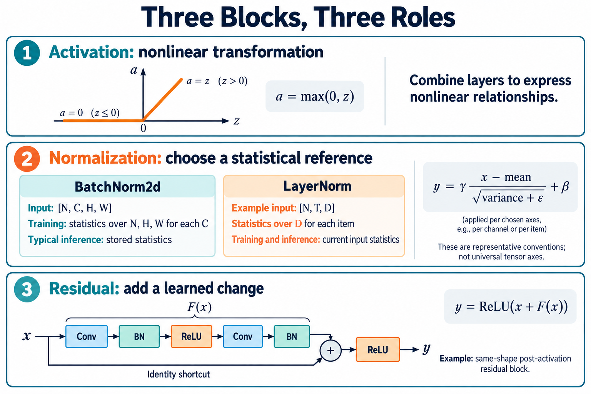

# 🧩 A7. 깊은 Model을 돕는 블록 — Activation·Normalization·Residual Connection

## 깊은 모델을 돕는 세 가지 장치

- **Activation:** 중간값을 꺾어 여러 층이 복잡한 관계를 표현하게 합니다. ReLU가 대표적입니다.
- **Normalization:** 학습 중 값의 기준을 맞추도록 돕습니다. BatchNorm은 추론 때 고정된 통계를 사용하며 Conv 계산에 합칠 수 있습니다.
- **Residual:** 입력을 따로 보관했다가 계산 결과에 더합니다.

Residual은 **‘처음부터 전부 새로 만들기’ 대신 ‘기존 값에 필요한 변화 더하기’**로 생각하면 쉽습니다.

우리 Block은 `입력 X → Conv1 → ReLU → Conv2`로 변화를 만들고, `X`를 다시 더한 뒤 ReLU를 적용합니다. Conv2 바로 뒤에서 음수를 지우면 더할 변화가 달라집니다.

모든 모델의 순서가 같은 것은 아닙니다. 여기서는 현재 ResNet-20의 순서를 이해하면 됩니다.

개념을 읽은 뒤 [확인 실습 S2](../learning/S2.md)에서 계산해 봅니다.

수식·세부 설명과 기존 기록

> 2026-10-28 로컬 백업의 학습자료입니다. 본문의 ResNet-56 등 과거 프로젝트 예시는 당시 기록이며, 현재 구현 기준은 [프로젝트 README](../../README.md)의 ResNet-20·ZedBoard입니다.

> 공통 기초 A7 · Rev3.0 · 의미 설명 → 용어 → 수식 순서로 읽는다.

> <b>깊은 Neural Network는 학습 가능한 변환뿐 아니라, 비선형성을 만들고 값의 기준을 조정하며 이전 표현을 전달하는 블록들을 함께 사용한다.</b>
> 
> 이 블록들은 서로 다른 역할을 한다.

| 블록 | 사용하는 이유 |
| --- | --- |
| <b>Activation Function</b> | 여러 Layer가 복잡한 비선형 관계를 표현하도록 함 |
| <b>Normalization</b> | 값의 중심과 퍼짐을 정해진 통계 기준으로 조정해 학습을 도움 |
| <b>Residual Connection</b> | 이전 표현을 직접 전달하면서 학습한 변화를 더하도록 함 |

이 장에서는 각 블록이 필요한 이유를 구분하고, 실제 Model 안에서 어떻게 연결되는지 살펴본다.

세 블록의 역할, BN·LN의 대표 통계 범위, 같은 Shape의 Post-activation Residual Block. AI 생성 교육용 개념도이며, 실제 ResNet-56 전체 구조나 확정된 RTL 사양을 나타내는 그림은 아니다.

# 1. Activation Function — 왜 비선형 변환이 필요한가?

Weight와 Bias를 이용한 Affine Transformation만 여러 번 연결하면 전체를 하나의 Affine Transformation으로 합칠 수 있다.

따라서 Layer를 깊게 쌓아도, 그 방식만으로는 복잡한 비선형 관계를 표현할 수 없다.

Activation Function은 중간에 비선형 변환을 넣어 이 한계를 벗어나게 한다.

<b>핵심 목적은 단순히 값을 작게 만들거나 음수를 없애는 것이 아니라, Model의 표현 능력을 확장하는 것이다.</b>

## 용어

- <b>Activation Function</b>: 중간값에 적용하는 함수. 이 장에서는 비선형 함수를 다룬다.
- <b>ReLU</b>: 음수는 0으로 바꾸고 양수는 그대로 전달하는 함수.
- <b>Element-wise Operation</b>: 각 Element에 독립적으로 적용하는 연산.

## 수학적 의미

$$
a=\operatorname{ReLU}(z)=\max(0,z)
$$

| 입력 $z$ | 출력 $a$ |
| --- | --- |
| −2 | 0 |
| 0 | 0 |
| 3 | 3 |

음수 구간에서는 출력이 일정하고, 양수 구간에서는 입력에 따라 증가한다. 각 구간은 단순하지만 전체 함수는 비선형이다.

ReLU는 음수가 무조건 쓸모없다고 판단하는 연산이 아니다. 학습은 이 변환을 포함한 전체 Model이 유용한 출력을 만들도록 Parameter를 조정한다.

# 2. Normalization — 왜 값의 기준을 조정하는가?

Layer마다 만들어지는 값의 중심과 크기는 다를 수 있다. 이러한 수치적 조건은 다음 계산과 Parameter 갱신에 영향을 준다.

Normalization은 정해진 묶음의 통계로 값을 변환해, 학습을 더 다루기 쉬운 형태로 만드는 데 사용한다.

예를 들어 평균을 빼면 값의 중심을 옮길 수 있고, 표준편차에 해당하는 크기로 나누면 퍼짐의 크기를 조정할 수 있다.

<b>Normalization의 목적은 값들을 일정한 통계 기준으로 표현하면서, Model이 학습하기 좋은 변환 구조를 제공하는 것이다.</b>

효과는 구조와 설정에 따라 달라진다. 모든 Model에서 성능 향상을 보장하는 것은 아니다.

## 용어

- <b>Mean</b>, $\mu$: 값들의 평균.
- <b>Variance</b>, $v$: 평균에서 얼마나 퍼져 있는지를 나타내는 값.
- <b>Standard Deviation</b>: 분산의 제곱근.
- <b>Normalization</b>: 선택한 통계 기준으로 값을 변환하는 과정.
- <b>Affine Parameters</b>, $\gamma,\beta$: 변환 후 크기와 기준을 조절하는 계수.

## 수학적 의미

값 $m$개를 하나의 묶음으로 본다면 다음과 같다.

$$
\mu=\frac1m\sum_{i=1}^{m}x_i
$$

$$
v=\frac1m\sum_{i=1}^{m}(x_i-\mu)^2
$$

$$
\tilde x_i=\frac{x_i-\mu}{\sqrt{v+\epsilon}},
\qquad
y_i=\gamma_i\tilde x_i+\beta_i
$$

$\epsilon>0$은 분산이 작거나 0일 때 나눗셈을 안정시키기 위해 사용한다. $\gamma,\beta$가 공유되는 범위는 Normalization 종류에 따라 다르다.

예를 들어 \[2, 4\]에서는 평균이 3, 위 정의의 분산이 1이다.

$$
\tilde x=
\left[
\frac{-1}{\sqrt{1+\epsilon}},
\frac{1}{\sqrt{1+\epsilon}}
\right]
\approx[-1,1]
$$

작은 $\epsilon$을 가정하고 $\gamma=2,\beta=0.5$를 적용하면 결과는 약 \[−1.5, 2.5\]다.

<b>최종 출력이 반드시 평균 0·분산 1인 것은 아니다.</b> $\epsilon$과 학습한 $\gamma,\beta$, 사용하는 통계에 따라 달라진다.

# 3. BatchNorm과 LayerNorm — 무엇을 한 묶음으로 보는가?

평균과 분산을 사용하는 수식이 비슷해도, <b>어떤 값들을 모아 통계를 계산하는지</b>가 다르면 다른 연산이다.

BatchNorm과 LayerNorm을 구분할 때는 통계를 구하는 Axis와, Inference에서 통계를 가져오는 방식을 확인한다.

## 용어

- <b>BatchNorm / BN</b>: 지정한 Feature 또는 Channel별로 Batch 등의 값을 모아 정규화하는 방식.
- <b>LayerNorm / LN</b>: 각 항목에서 지정한 Feature Axis들의 값을 모아 정규화하는 방식.
- <b>Normalization Axes</b>: 평균과 분산을 계산하는 Axis들.

| 대표적인 사용 | 입력 Shape | 통계 계산 범위 |
| --- | --- | --- |
| CNN의 BatchNorm2d | \[N, C, H, W\] | 각 Channel에서 N·H·W를 모음 |
| 마지막 Feature Axis에 적용한 LayerNorm | \[N, T, D\] | 각 Sample·Token에서 D를 모음 |

LayerNorm이 항상 마지막 Axis 하나만 사용한다는 뜻은 아니다. 실제로 지정한 Axis 범위를 확인해야 한다. [PyTorch LayerNorm 정의](https://docs.pytorch.org/docs/2.14/generated/torch.nn.LayerNorm.html)

## 수학적 의미

BatchNorm2d의 Training 평균은 Channel $c$마다 다음과 같이 구한다.

$$
\mu_c=
\frac1{NHW}\sum_{n,h,w}X[n,c,h,w]
$$

마지막 Feature Axis에 적용한 LayerNorm의 평균은 다음과 같다.

$$
\mu_{n,t}=
\frac1D\sum_d X[n,t,d]
$$

첫 번째는 <b>같은 Channel의 여러 Sample과 위치</b>, 두 번째는 <b>한 Sample·Token의 여러 Feature</b>를 기준으로 삼는다.

$T,D$와 Token의 구체적인 의미는 Transformer 장에서 확장한다.

# 4. Training과 Inference — 같은 통계를 사용하는가?

일반적인 BatchNorm은 Training에서 현재 Batch의 통계를 사용하고, 별도로 Running Statistics를 유지한다.

Inference에서는 보통 저장된 Running Statistics를 사용한다. 반면 LayerNorm은 Training과 Inference 모두 현재 입력에서 통계를 계산한다.

<b>통계의 공급원이 다르면 같은 입력과 같은 Weight에서도 출력이 달라질 수 있다.</b>

## 용어

- <b>Running Mean / Variance</b>: Training 중 관찰한 통계를 갱신해 유지하는 Model State.
- <b>Learnable Parameters</b>: Gradient와 Optimizer로 학습하는 값.
- <b>Evaluation Mode</b>: Model의 평가 시 동작을 선택하는 모드.

| 값 | 일반적인 역할 |
| --- | --- |
| BN의 $\gamma,\beta$ | 학습 가능한 Parameter |
| BN의 Running Mean·Variance | 통계 갱신 규칙으로 유지하는 State |
| LN의 $\gamma,\beta$ | 학습 가능한 Parameter |
| LN의 입력 평균·분산 | 현재 입력으로 계산하는 중간값 |

BN 설정에 따라 Evaluation에서도 현재 Batch 통계를 사용할 수 있으므로 실제 설정을 확인한다. [PyTorch BatchNorm2d 정의](https://docs.pytorch.org/docs/2.14/generated/torch.nn.BatchNorm2d.html)

## 수학적 의미

저장된 통계를 사용하는 BN Inference는 다음과 같다.

$$
y_{n,c,h,w}
=
\gamma_c
\frac{x_{n,c,h,w}-\mu_{\mathrm{run},c}}
{\sqrt{v_{\mathrm{run},c}+\epsilon}}
+\beta_c
$$

이 경우에는 현재 이미지의 평균·분산을 새로 구하지 않는다.

Checkpoint에서 Conv Weight만 가져오면 BN에 필요한 State가 빠질 수 있다. A5에서 평가 모드와 Model State를 함께 고정한 이유다.

# 5. BN Folding — 왜 별도 BN 계산을 합칠 수 있는가?

Inference에서 BN의 통계와 계수가 고정되면 BN은 Channel별 고정 곱셈과 덧셈으로 정리된다.

바로 앞 Conv도 Affine Transformation이므로, 조건이 맞으면 두 연산을 하나의 Conv 계수에 합칠 수 있다.

<b>BN을 제거하는 것이 아니라, BN의 효과를 앞 연산의 Weight와 Bias에 포함시키는 것이다.</b>

## 용어

- <b>BN Folding</b>: 고정된 BN의 효과를 앞 Conv 등의 계수에 반영하는 변환.
- <b>Fused Operation</b>: 여러 연산의 효과를 결합해 실행하는 연산.

## 수학적 의미

고정된 BN을 다음과 같이 적자.

$$
\mathrm{BN}(z)=\alpha z+\delta
$$

$$
\alpha=\frac{\gamma}{\sqrt{v+\epsilon}},
\qquad
\delta=\beta-\alpha\mu
$$

앞 연산이 $z=Wx+b$라면 다음과 같다.

$$
y=\alpha(Wx+b)+\delta
$$

따라서 새 계수는 다음과 같다.

$$
W'=\alpha W,\qquad b'=\alpha b+\delta
$$

CNN에서는 출력 Channel별로 적용한다.

예를 들어 $z=2x+1$, $y=3z-2$라면 전체는 $y=6x+1$이다.

Folding은 별도 처리와 중간값 이동을 줄일 기회가 된다. 다만 통계가 고정되어 있고 연결 관계가 적절해야 한다. 현재 입력의 통계를 사용하는 LN을 같은 방식으로 고정 계수에 흡수할 수는 없다.

# 6. Residual Connection — 왜 이전 표현에 변화를 더하는가?

어떤 구간에서는 입력 표현이 이미 유용해 큰 변화가 필요하지 않을 수 있다.

일반적인 연결에서는 추가한 Layer들이 입력을 그대로 전달하는 관계까지 학습해야 한다. Residual Connection은 입력을 직접 전달하는 경로를 두고, 변환 경로가 그 입력에 더할 값을 만들도록 한다.

<b>기존 표현을 기준으로 변화를 학습하는 구조를 제공해, 깊은 Model의 최적화를 돕는 것이 목적이다.</b> [ResNet 원 논문](https://arxiv.org/abs/1512.03385)

## 용어

- <b>Shortcut / Skip Connection</b>: 일부 계산을 우회하는 연결.
- <b>Identity Shortcut</b>: 입력을 그대로 전달하는 경로.
- <b>Residual Function</b>, $F(x)$: 입력 표현에 더할 변환 결과를 만드는 함수.

## 수학적 의미

기본적인 합류는 다음과 같다.

$$
u=x+F(x)
$$

$$
x=[1,2],\qquad F(x)=[0.5,-1]
$$

$$
u=[1.5,1]
$$

$F(x)=0$이면 합류 결과는 $u=x$다. 큰 변화가 필요하지 않은 경우를 표현하기 쉬운 구조다.

또한 역방향 계산에도 Shortcut을 통한 경로가 생긴다. 다만 합 뒤의 Activation 등도 영향을 주므로 Gradient가 항상 그대로 보존된다고 단정할 수는 없다.

$F(x)$는 Loss가 아니다. 추론할 때 정답 Label을 더하는 구조도 아니다.

# 7. 실제 Block — 세 요소는 어떻게 연결되는가?

그림 아래쪽은 같은 Shape를 유지하는 Post-activation Residual Block의 예다.

변환 경로는 다음 순서다.

> <b>Conv → BN → ReLU → Conv → BN</b>

그 결과를 원래 입력과 더한 뒤 ReLU를 적용한다.

각 요소는 서로 다른 일을 맡는다.

| 요소 | Block 안에서 하는 일 |
| --- | --- |
| Conv | 학습한 Weight로 입력을 변환 |
| BN | 통계와 계수로 값의 기준 조정 |
| 중간 ReLU | 비선형 변환 추가 |
| Shortcut | 원래 입력 전달 |
| Add | 이전 표현과 변환 결과 결합 |
| 마지막 ReLU | 합류 결과에 비선형 변환 적용 |

## 용어

- <b>Residual Block</b>: 변환 경로와 Shortcut을 결합한 계산 단위.
- <b>Post-activation</b>: 이 예제처럼 합류 뒤에 Activation을 적용하는 배치.
- <b>Projection Shortcut</b>: 필요한 Shape 변환을 학습 가능한 연산으로 수행하는 Shortcut.

## 수학적 의미

$$
F(x)=
\mathrm{BN}_2
\left(
\mathrm{Conv}_2
\left(
\operatorname{ReLU}
\left(
\mathrm{BN}_1(\mathrm{Conv}_1(x))
\right)
\right)
\right)
$$

$$
y=\operatorname{ReLU}(x+F(x))
$$

이 예제의 Block 출력은 단순히 $x+F(x)$에서 끝나지 않는다. 마지막 ReLU까지 포함한다.

Shape가 바뀌는 구간에서는 Shortcut에도 대응하는 처리가 필요하다. 구체적인 방식과 연산 순서는 선택한 ResNet-56 구현에서 확인한다.

# 8. 연산 순서 — 같은 블록들이면 위치를 바꿔도 되는가?

연산의 순서도 Model의 의미를 결정한다.

각 경로에 ReLU를 먼저 적용한 뒤 더하는 것과, 두 경로를 먼저 더한 뒤 ReLU를 적용하는 것은 다르다.

## 용어

- <b>Operation Order</b>: 연산을 적용하는 순서.
- <b>Semantic Equivalence</b>: 입력에 대해 의도한 계산 의미가 같은 관계.

## 수학적 의미

일반적으로 다음 두 식은 같지 않다.

$$
\operatorname{ReLU}(a+b)
\neq
\operatorname{ReLU}(a)+\operatorname{ReLU}(b)
$$

예를 들어 $a=1,b=-2$라면 다음과 같다.

$$
\operatorname{ReLU}(1-2)=0
$$

$$
\operatorname{ReLU}(1)+\operatorname{ReLU}(-2)=1
$$

따라서 회로를 단순하게 만들기 위해 ReLU의 위치를 임의로 옮기면 다른 Model이 될 수 있다.

# 9. 가속기에서는 비용과 데이터 흐름이 어떻게 다른가?

같은 Shape를 출력하더라도 필요한 계산과 데이터 공급 방식은 다르다.

| 블록 | 필요한 정보 | 구현에서 확인할 점 |
| --- | --- | --- |
| ReLU | 현재 Element와 0의 표현 | 비교·선택, Quantized Zero-point |
| 고정 BN | Channel별 고정 계수 | 곱·덧셈 또는 Folding |
| 현재 통계를 구하는 Norm | 통계 묶음의 여러 값 | Reduction, 입력 보관과 재사용 |
| Residual Add | 두 경로의 대응하는 값 | Tensor Lifetime, 합류 시점과 Scale 정합 |

## 용어

- <b>Reduction</b>: 여러 값을 모아 합·평균 등의 결과를 구하는 계산.
- <b>Tensor Lifetime</b>: 필요한 Consumer가 사용할 때까지 값이 유지되어야 하는 기간.
- <b>Scale Alignment</b>: Quantized 연산에서 수치 단위를 맞추는 과정.

## 수학적 의미

ReLU는 Element 하나로 계산할 수 있다.

$$
y_i=\max(0,x_i)
$$

반면 평균은 묶음의 여러 값이 필요하다.

$$
\mu=\frac1m\sum_i x_i
$$

이 차이 때문에 계산 순서와 Buffer 요구가 달라진다.

Residual Add에서는 원래 입력을 마지막 합류까지 사용할 수 있어야 한다. Quantized Tensor라면 두 경로의 Scale·Zero-point와 누산 폭도 맞춰야 한다.

# 10. 비슷한 용어를 구분하기

| 개념 | 의미 |
| --- | --- |
| <b>Input Normalization</b> | A5의 입력 전처리 규약 |
| <b>BatchNorm / LayerNorm</b> | Model 내부의 통계 기반 변환 |
| <b>Quantization Scale</b> | A6의 정수 코드 한 칸이 나타내는 값 |
| <b>Normalization의 </b><b>$\gamma$</b> | 정규화된 값에 적용하는 학습 가능한 계수 |
| <b>Regularization</b> | Overfitting을 줄이기 위한 학습 방법 |
| <b>Residual Function</b> | 이전 표현에 더할 변환 결과 |

Normalization과 Regularization은 다른 개념이다. 한국어로 비슷하게 번역되는 경우가 있으므로 영어 용어와 역할을 함께 확인한다.

# 11. 의미를 확인하는 질문

1. Activation Function을 넣는 핵심 이유는 무엇인가?
2. 같은 Normalization 수식이라도 통계를 구하는 Axis가 다르면 결과가 같을까?
3. 일반적인 BN Inference와 LN Inference는 통계를 어디서 가져오는가?
4. BN Folding은 BN의 효과를 없애는 것인가?
5. Residual Function은 정답과 예측의 차이인 Loss인가?
6. Residual Add 앞뒤로 ReLU를 옮겨도 결과가 같은가?

답의 핵심

Activation은 비선형 표현을 가능하게 한다. 통계의 묶음이 다르면 다른 변환이다. 일반적인 BN Inference는 저장된 통계를, LN은 현재 입력의 통계를 사용한다. Folding은 BN 효과를 앞 연산의 계수에 포함시킨다. Residual Function은 표현에 더할 변환 결과이며 Loss가 아니다. ReLU와 Add의 순서를 바꾸면 일반적으로 결과가 달라진다.

# 다음 CNN 장으로

A0\~A7에서 데이터 표현, 학습, 연결 구조, 평가와 숫자 표현의 기초를 살펴봤다.

다음 CNN 장에서는 <b>왜 작은 Filter를 여러 위치에 적용하는지</b>부터 시작해, Convolution의 위치·Channel 계산과 실제 ResNet-56의 전체 흐름으로 연결한다.

# 참고자료

- [Dive into Deep Learning — Multilayer Perceptrons](https://d2l.ai/chapter_multilayer-perceptrons/mlp.html): 비선형 Activation Function이 필요한 이유.
- [Batch Normalization 원 논문](https://arxiv.org/abs/1502.03167)과 [PyTorch BatchNorm2d](https://docs.pytorch.org/docs/2.14/generated/torch.nn.BatchNorm2d.html): 통계의 축과 Training/Evaluation 동작.
- [Layer Normalization 원 논문](https://arxiv.org/abs/1607.06450)과 [PyTorch LayerNorm](https://docs.pytorch.org/docs/2.14/generated/torch.nn.LayerNorm.html): 지정한 Feature 묶음과 현재 입력 통계.
- [PyTorch — Convolution/Batch Norm fuser](https://docs.pytorch.org/tutorials/intermediate/torch_compile_conv_bn_fuser.html): 고정 BN의 효과를 앞 연산 계수에 반영하는 사례.
- [Deep Residual Learning for Image Recognition](https://arxiv.org/abs/1512.03385): Residual Connection과 깊은 Model의 최적화.
- 관련 논문 정리: [관련 Notion 문서](https://app.notion.com/p/407f0c4baec981b78affd3de4ef1e2a2) · [관련 Notion 문서](https://app.notion.com/p/407f0c4baec9814bb189fc1fd25b540e)
- 작은 배열과 Folding 수치, Block 그림은 교육용 예시이며 프로젝트 실측 결과나 확정된 RTL 사양이 아니다.

보충자료 작성 메모 · 학습 중 건너뛰어도 됩니다

> <b>추후 연결할 보충자료 — Activation Function의 선택과 Gradient</b>
> 
> ReLU·Sigmoid·Tanh·GELU의 출력과 미분을 비교하고, 출력 Layer에 같은 함수를 무조건 적용하지 않는 이유를 설명한다. 보충자료 링크는 추후 추가한다.

> <b>추후 연결할 보충자료 — 통계 기준 조정이 학습을 어떻게 돕는가?</b>
> 
> 값의 Scale과 Gradient, 학습률 민감도, Normalization이 최적화에 주는 영향을 설명한다. 효과를 하나의 원인으로만 단정하지 않고 수치 예제와 실험으로 연결한다. 보충자료 링크는 추후 추가한다.

> <b>추후 연결할 보충자료 — Normalization의 학습 상태와 평가 모드</b>
> 
> Running Statistics 갱신, 분산 추정 방식, 작은 Batch에서의 차이, 평가 모드와 Gradient 기록 설정의 차이를 설명한다. 보충자료 링크는 추후 추가한다.

> <b>추후 연결할 보충자료 — Folding의 조건과 검증</b>
> 
> Conv와 BN 사이의 연산, 다른 Consumer가 있는 경우, 부동소수점 오차, Folding 이후 Weight 범위와 Quantization 규약의 변화를 설명한다. 보충자료 링크는 추후 추가한다.

> <b>추후 연결할 보충자료 — Shortcut은 Gradient에 어떤 경로를 추가하는가?</b>
> 
> Identity 경로와 변환 경로의 미분, 깊이에 따른 학습 어려움, 합 뒤 Activation의 영향을 설명한다. 보충자료 링크는 추후 추가한다.

> <b>추후 연결할 보충자료 — 실제 ResNet-56 Block 읽기</b>
> 
> 크기·Channel 변경 구간, Shortcut 방식, Pre-activation 변형과의 차이, 선택한 코드의 실제 연산 순서를 연결한다. 보충자료 링크는 추후 추가한다.

> <b>추후 연결할 보충자료 — 블록별 하드웨어 실행 구조</b>
> 
> ReLU 후처리, 고정 BN의 계수 적용, Reduction과 Buffer, Residual 경로의 데이터 정렬과 Quantized Add를 연결한다. 보충자료 링크는 추후 추가한다.

