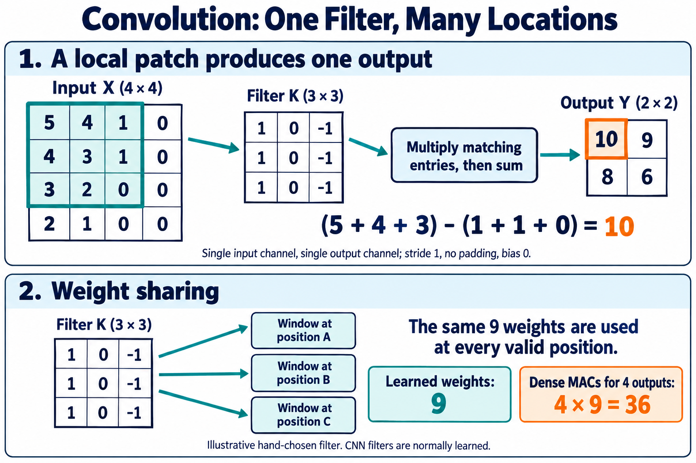

# 🖼️ B1. 이미지의 작은 패턴을 계산하기 — Convolution·Filter·Weight Sharing

> 2026-10-28 로컬 백업의 학습자료입니다. 본문의 ResNet-56 등 과거 프로젝트 예시는 당시 기록이며, 현재 구현 기준은 [프로젝트 README](../../README.md)의 ResNet-20·ZedBoard입니다.

> CNN 기초 B1 · Rev2.0 · 의미 설명 → 용어 → 수식 순서로 읽는다.

> <b>CNN은 주변 값의 관계를 작은 Filter로 계산하고, 같은 Filter를 여러 위치에 적용해 공간적인 Representation을 만드는 Neural Network다.</b>
> 
> 핵심 아이디어는 Local Connectivity와 Weight Sharing이다.

| 개념 | 결정하는 것 | 사용하는 이유 |
| --- | --- | --- |
| <b>Local Connectivity</b> | 출력 한 위치가 입력의 어느 영역을 볼 것인가 | 가까운 위치의 관계를 계산하고 연결 수를 제한 |
| <b>Weight Sharing</b> | 여러 위치에서 같은 Weight를 사용할 것인가 | 같은 종류의 패턴을 위치마다 같은 기준으로 계산 |

Filter는 이 계산에 사용하는 Weight 묶음이고, Convolution은 이를 여러 위치에 적용하는 연산이다.

이 장에서는 입력·출력 Channel이 각각 하나인 작은 예제로 계산을 따라간다.

4×4 입력과 3×3 Filter의 계산, 위치별 Weight Sharing, Parameter 9개와 36 MAC의 구분. AI 생성 교육용 개념도다. Input과 Filter는 곱·합 연산의 두 입력이며, Filter가 이미지를 변환받는 순차 단계라는 뜻은 아니다. 그림의 Weight 9개는 예제에서 사람이 정한 값이다.

# 1. 왜 이미지 전체를 한 번에 연결하지 않는가?

Fully Connected Layer에서는 출력 하나를 만들 때 입력 전체를 사용할 수 있다. 하지만 입력과 출력이 많아지면 Weight 수도 커진다.

이미지에서는 가까운 Pixel 사이의 관계가 중요한 단서가 된다. 밝기 차이, 경계, 작은 무늬는 주변 값들을 조합해 계산할 수 있다.

또한 비슷한 패턴이 이미지의 여러 위치에 나타날 수 있다.

CNN은 이런 성질을 반영해 <b>작은 영역을 먼저 계산하고, 같은 계산 기준을 여러 위치에서 사용한다.</b> [D2L의 CNN 구조 설명](https://d2l.ai/chapter_convolutional-neural-networks/why-conv.html)

## 용어

- <b>CNN — Convolutional Neural Network</b>: Convolution을 주요 구성 요소로 사용하는 Neural Network.
- <b>Local Connectivity</b>: 출력 하나가 입력의 제한된 주변 영역과 연결되는 구조.
- <b>Local Patch</b>: 입력에서 선택한 작은 공간 영역.

## 수학적 의미

Fully Connected 계산은 입력 전체를 조합한다.

$$
y_j=\sum_i w_{j,i}x_i+b_j
$$

Local Connectivity에서는 해당 출력 위치와 연결된 영역 $P_j$만 사용한다.

$$
y_j=\sum_{i\in P_j}w_{j,i}x_i+b_j
$$

아직 이 식만으로는 Weight Sharing까지 적용한 것은 아니다. <b>작은 영역을 본다는 것과 같은 Weight를 공유한다는 것은 별개의 조건이다.</b>

# 2. Filter — 작은 Weight 묶음을 왜 사용하는가?

A2에서는 왼쪽 밝기에서 오른쪽 밝기를 빼면 두 위치의 차이를 드러낼 수 있음을 봤다.

이를 2차원 영역으로 확장해보자. 왼쪽 열에는 $+1$, 가운데 열에는 $0$, 오른쪽 열에는 $-1$을 곱해 더한다.

이 Weight 묶음은 ‘왼쪽 열의 합 − 오른쪽 열의 합’을 계산한다.

<b>Filter를 사용하는 이유는 주변 값들의 어떤 조합에 반응할지 학습 가능한 계수로 표현하기 위해서다.</b>

## 용어

- <b>Filter / Kernel</b>: 작은 영역에 적용하는 Weight 묶음.
- <b>Kernel Size</b>: 공간 방향의 Filter 크기.
- <b>Response</b>: Filter를 적용해 얻은 반응값.

이번 장은 입력·출력 Channel이 하나씩이므로 Filter 하나를 2차원 배열로 나타낸다. 다중 Channel에서의 구성은 B2에서 확장한다.

## 수학적 의미

$$
K=
\begin{bmatrix}
1&0&-1\\
1&0&-1\\
1&0&-1
\end{bmatrix}
$$

$$
\operatorname{Shape}(K)=(3,3)
$$

왼쪽이 상대적으로 밝으면 양수, 오른쪽이 상대적으로 밝으면 음수가 나올 수 있다. 영역 전체의 밝기가 같으면 결과는 0이다.

이 Filter는 의미를 설명하기 위해 사람이 정한 예제다. <b>일반적인 CNN에서는 Filter의 Weight를 Training으로 학습한다.</b> 학습된 Filter가 항상 사람이 이름 붙일 수 있는 특징 하나에 대응하는 것은 아니다.

# 3. Convolution — 작은 영역에서 출력 하나를 어떻게 만드는가?

현재 입력 영역과 Filter의 대응하는 위치끼리 곱하고, 그 결과를 모두 더한다.

이 계산으로 해당 출력 Channel의 <b>한 위치에 값 하나</b>를 만든다.

즉 3×3 Filter를 한 위치에 적용한다는 것은 출력 아홉 개를 만드는 것이 아니라, 입력 아홉 개를 조합해 출력 하나를 만드는 것이다.

## 용어

- <b>Convolution</b>: 이 장에서는 작은 Filter를 위치별로 적용하는 CNN의 곱·합 연산.
- <b>Window</b>: 현재 계산에서 읽는 입력 영역.
- <b>Sliding Window</b>: 입력 영역의 위치를 옮겨가며 계산하는 방식.

Window는 입력 데이터이고 Filter는 Weight다.

## 수학적 의미

Stride 1, Padding 없음, 입력·출력 Channel이 하나인 경우는 다음과 같다.

$$
Y[i,j]
=
b+
\sum_{u=0}^{K_h-1}
\sum_{v=0}^{K_w-1}
K[u,v]X[i+u,j+v]
$$

$i,j$는 출력 위치이고, $u,v$는 Filter 내부 위치다.

딥러닝에서 Convolution이라고 부르는 이 연산은 엄밀히는 Filter를 뒤집지 않는 <b>Cross-correlation</b>이다. 이 장에서도 Filter를 뒤집지 않는다. [D2L의 이미지 연산 설명](https://d2l.ai/chapter_convolutional-neural-networks/conv-layer.html)

> <b>추후 연결할 보충자료 — Convolution과 Cross-correlation</b>
> 
> 수학적 정의에서 Filter를 뒤집는 이유와 딥러닝의 표기 관례, 학습된 Weight를 가져올 때 방향을 유지해야 하는 이유를 설명한다. 보충자료 링크는 추후 추가한다.

# 4. 숫자로 따라가기 — 입력 영역 하나에서 반응 하나로

다음 4×4 입력을 사용하자.

$$
X=
\begin{bmatrix}
5&4&1&0\\
4&3&1&0\\
3&2&0&0\\
2&1&0&0
\end{bmatrix}
$$

앞의 Filter를 왼쪽 위 3×3 영역에 적용한다. Bias는 0이며, 아직 ReLU와 Normalization은 적용하지 않는다.

## 의미

Filter가 선택한 조합에 대해, 이 입력 영역이 어떤 반응을 내는지 계산한다.

## 용어

- <b>Element-wise Multiplication</b>: 대응하는 Element끼리 곱하는 계산.
- <b>Reduction Sum</b>: 여러 곱의 결과를 더해 하나의 합으로 만드는 계산.
- <b>Pre-activation Output</b>: Activation Function을 적용하기 전의 출력.

## 수학적 의미

$$
\begin{aligned}
Y[0,0]
={}&(5\times1+4\times0+1\times(-1))\\
&+(4\times1+3\times0+1\times(-1))\\
&+(3\times1+2\times0+0\times(-1))\\
={}&10
\end{aligned}
$$

이 Filter에서는 다음처럼 읽을 수 있다.

$$
Y[0,0]=(5+4+3)-(1+1+0)=10
$$

10은 이 계산의 반응값이다. 고양이일 확률이나 특정 물체의 존재 여부를 직접 뜻하지 않는다.

# 5. Feature Map — 왜 여러 위치에서 계산하는가?

패턴이 이미지의 어느 위치에 나타났는지도 이후 판단에 유용하다.

따라서 Filter를 한 번만 적용하는 대신, 입력 영역을 이동하며 각 위치의 반응을 계산한다. 결과를 출력 위치에 맞춰 배열하면 Feature Map이 된다.

<b>Convolution은 위치별 반응을 만들어, 다음 Layer가 다시 공간적 관계를 계산할 수 있게 한다.</b>

## 용어

- <b>Feature Map</b>: 위치별 반응을 담은 공간 배열. 여기서는 출력 Channel 하나의 배열을 뜻한다.
- <b>Output Position</b>: 계산 결과가 배치되는 출력 좌표.

## 수학적 의미

같은 Filter를 네 위치에 적용하면 다음과 같다.

| 출력 위치 | 계산 | 결과 |
| --- | --- | --- |
| $Y[0,0]$ | $(5+4+3)-(1+1+0)$ | 10 |
| $Y[0,1]$ | $(4+3+2)-(0+0+0)$ | 9 |
| $Y[1,0]$ | $(4+3+2)-(1+0+0)$ | 8 |
| $Y[1,1]$ | $(3+2+1)-(0+0+0)$ | 6 |

$$
Y=
\begin{bmatrix}
10&9\\
8&6
\end{bmatrix}
$$

이번에는 3×3 Filter가 4×4 입력 안에 완전히 들어가는 시작 위치가 네 곳이므로 출력은 2×2다.

중요한 네 값을 자동으로 선택했다는 뜻이 아니라, <b>설정된 위치마다 계산한 결과</b>다.

# 6. Weight Sharing — 왜 같은 Filter를 여러 위치에 사용하는가?

비슷한 경계나 무늬는 이미지의 왼쪽에도 오른쪽에도 나타날 수 있다.

각 위치에서 서로 다른 Weight를 학습하면, 같은 종류의 패턴도 위치별로 따로 배워야 한다. Weight Sharing은 여러 위치에 같은 Filter를 적용해 같은 기준으로 반응을 계산하도록 한다.

<b>Weight Sharing의 목적은 위치에 걸쳐 계산 기준을 공유하고, 학습할 Parameter 수를 줄이는 것이다.</b>

## 용어

- <b>Weight Sharing</b>: 여러 계산 위치에서 동일한 학습 Parameter를 사용하는 것.
- <b>Locally Connected Layer</b>: 작은 영역에 연결하되, 위치별로 다른 Weight를 사용할 수 있는 Layer.
- <b>Parameter Count</b>: 학습 가능한 값의 개수.

## 수학적 의미

이번 예제에서 출력 네 개를 만드는 방식을 비교하자. Bias는 제외한다.

| 연결 방식 | 출력 하나가 보는 입력 | Weight 수 |
| --- | --- | --- |
| Fully Connected | 전체 16개 | $16\times4=64$ |
| Local Connectivity만 적용 | 해당 영역의 9개 | $9\times4=36$ |
| Local Connectivity + Weight Sharing | 해당 영역의 9개 | $9$ |

이번 Convolution에서는 출력 위치가 바뀌어도 다음 Filter를 그대로 사용한다.

$$
K_{\text{position }1}
=
K_{\text{position }2}
=
K
$$

서로 다른 Weight 네 벌이 아니라, 같은 학습 Parameter를 네 위치에서 사용한다.

다만 이 연결 제약 때문에 세 방식이 표현하는 함수가 모두 같아지는 것은 아니다.

> <b>추후 연결할 보충자료 — 패턴 이동과 출력 이동의 관계</b>
> 
> Translation Equivariance와 Invariance를 구분하고, Weight Sharing·경계 처리·Stride·후속 연산이 위치 변화에 어떤 영향을 주는지 설명한다. 보충자료 링크는 추후 추가한다.

# 7. Parameter 수와 계산량 — Weight가 적으면 계산도 한 번인가?

Weight를 공유해도 각 위치의 입력값은 다르므로 곱·합을 다시 수행해야 한다.

<b>Parameter 수는 보관하고 학습할 계수의 수이고, MAC 수는 그 계수를 사용해 수행하는 계산의 수다.</b>

## 용어

- <b>MAC — Multiply-Accumulate</b>: 곱한 값을 누적해서 더하는 계산.
- <b>Weight Reuse</b>: 같은 Weight를 여러 계산에서 사용하는 것.
- <b>Dense MAC Count</b>: 0인 Weight를 건너뛰는 최적화 없이 계산한 MAC 수.

## 수학적 의미

이번 예제에서는 다음과 같다.

$$
\text{Weight Count}=3\times3=9
$$

$$
\text{Dense MAC Count}
=
2\times2\times3\times3=36
$$

같은 Weight 9개를 출력 네 위치에서 사용한다.

Bias와 후처리 비용은 제외했고, Filter의 0을 건너뛰는 별도 최적화도 가정하지 않았다.

하드웨어에서 병렬 공급을 위해 Weight를 물리적으로 복제할 수는 있다. 그래도 Model 관점에서는 동일한 Parameter를 공유하는 것이다.

# 8. Stride와 Padding — 어디에서 계산할 것인가?

Convolution은 Filter뿐 아니라 <b>어떤 위치에서 계산할지, 경계 밖을 어떻게 처리할지</b>도 정해야 한다.

Stride는 적용 위치 사이의 간격이다. Padding은 입력 경계 밖을 정한 규칙으로 확장하는 방법이다.

## 용어

- <b>Stride</b>: Window의 시작 위치를 옮기는 간격.
- <b>Padding</b>: 입력 경계 밖을 확장하는 규칙과 양.
- <b>Zero Padding</b>: 경계 밖의 값을 실제 값 0으로 두는 방식.

## 수학적 의미

Dilation이 1이고 양쪽 Padding이 같을 때 출력 높이는 다음과 같다.

$$
H_{\text{out}}
=
\left\lfloor
\frac{H_{\text{in}}+2P_h-K_h}{S_h}
\right\rfloor+1
$$

너비도 같은 방식으로 계산한다.

| 입력 | Filter | 한쪽 Padding | Stride | 출력 |
| --- | --- | --- | --- | --- |
| 4×4 | 3×3 | 0 | 1 | 2×2 |
| 4×4 | 3×3 | 1 | 1 | 4×4 |
| 4×4 | 3×3 | 0 | 2 | 1×1 |

Padding은 원래 이미지 바깥의 내용을 복원하는 것이 아니다. 바깥 값을 어떻게 가정할지 정하는 것이다.

Quantized Tensor에서 실제 0의 코드는 Zero-point다. Zero-point가 128인 규약에서는 코드 128로 Zero Padding한다.

> <b>추후 연결할 보충자료 — 출력 좌표와 경계 조건</b>
> 
> Stride·Padding별 Window 위치, 비대칭 Padding, Dilation과 same 규약, 경계에서의 계산값을 그림으로 설명한다. 보충자료 링크는 추후 추가한다.

# 9. 작은 영역만 보면 큰 모양은 어떻게 다루는가?

첫 Layer가 작은 영역을 보더라도, 다음 Layer는 앞에서 만든 반응들의 주변 영역을 다시 본다.

그 반응 하나가 이미 여러 원본 Pixel을 반영하므로, Layer를 쌓으면 원본 입력에서 참고할 수 있는 영역이 넓어진다.

<b>작은 Filter는 주변 관계를 계산하는 출발점이고, 여러 Layer는 그 관계들을 다시 조합한다.</b>

## 용어

- <b>Receptive Field</b>: 특정 출력값에 영향을 줄 수 있는 입력 영역.
- <b>Hierarchical Representation</b>: 앞 단계의 표현을 조합해 다음 단계의 표현을 만드는 구조.

## 수학적 의미

Stride 1, Dilation 1인 3×3 Convolution을 두 번 적용하면 내부 출력의 이론적인 Receptive Field는 다음과 같다.

$$
3+(3-1)=5
$$

즉 원본 입력의 5×5 영역에 의존할 수 있다.

이는 두 Layer가 항상 하나의 5×5 Filter와 같다는 뜻은 아니다. 중간 Activation과 Channel 조합 등에 따라 다른 변환이 된다.

> <b>추후 연결할 보충자료 — Receptive Field가 넓어지는 과정</b>
> 
> 여러 Layer의 위치 대응, Stride와 Dilation의 영향, 이론적인 영향 범위와 실제 영향 강도의 차이를 설명한다. 보충자료 링크는 추후 추가한다.

# 10. 가속기에서는 무엇을 재사용할 수 있는가?

Convolution을 실행하려면 입력 영역과 Filter 값을 곱셈기에 공급하고, 출력 하나가 완성될 때까지 Partial Sum을 유지해야 한다.

이웃한 Window에는 겹치는 입력이 있고, 여러 위치에서는 같은 Weight를 사용한다. 이 재사용을 메모리 구조에 반영할 수 있다.

## 용어

- <b>Input Reuse</b>: 겹치는 Window 등에서 같은 입력값을 다시 사용하는 것.
- <b>Line Buffer</b>: 입력의 행 데이터를 보관하는 Buffer.
- <b>Window Buffer</b>: 현재 작은 영역의 값을 보관하는 Buffer.
- <b>Partial Sum</b>: 출력 하나를 완성하기 전의 누적 합.

## 수학적 의미

가로로 한 칸 떨어진 두 3×3 Window가 공유하는 입력 위치는 다음과 같다.

$$
3\times2=6
$$

이번 예제에서는 입력 6개를 다음 Window에서도 다시 사용한다.

| 재사용 대상 | 의미 |
| --- | --- |
| Weight | 같은 Filter를 여러 출력 위치에 적용 |
| Input | 겹치는 Window에서 같은 위치의 값을 재사용 |
| MAC 자원 | 같은 계산기로 여러 항과 위치를 처리 |
| Partial Sum | 필요한 항을 모두 더할 때까지 유지 |

Weight Sharing은 Model의 구조적 규칙이고, Buffer를 활용한 재사용은 이를 실행하는 구현 선택이다.

> <b>추후 연결할 보충자료 — Sliding Window를 하드웨어로 만들기</b>
> 
> Line Buffer·Window Buffer, 입력 순서와 좌표, Partial Sum 초기화, 계산기 재사용과 병렬 실행을 연결한다. 보충자료 링크는 추후 추가한다.

# 11. 다음 B2에서는 무엇을 확장하는가?

이번 장은 입력·출력 Channel이 하나씩인 경우였다.

RGB 입력에는 위치마다 세 Channel이 있고, 중간 Tensor에는 더 많은 Channel이 있을 수 있다.

일반적인 groups=1 Convolution에서는 출력 Channel 하나를 만들 때 <b>여러 입력 Channel의 기여를 모두 더한다.</b> 출력 Channel을 여러 개 만들려면 서로 다른 Filter 묶음을 사용한다.

[관련 Notion 문서](https://app.notion.com/p/407f0c4baec981eeb9d9d03b5f6df291)에서는 이를 다음 질문으로 확장한다.

- RGB 세 Channel은 어떻게 하나의 출력 Channel로 결합되는가?
- 출력 Channel 16개를 만들려면 Filter는 어떻게 구성되는가?
- Weight Shape의 각 Axis는 무엇을 의미하는가?
- 한 출력값이 완성되려면 어느 범위까지 누산해야 하는가?

Filter를 공간적으로 이동하는 계산과, 입력 Channel들의 기여를 합치는 계산을 구분해서 살펴본다.

# 12. 의미를 확인하는 질문

1. Window와 Filter는 무엇이 다른가?
2. 단일 입력·출력 Channel에서 3×3 Filter를 한 위치에 적용하면 출력값은 몇 개 생기는가?
3. Local Connectivity와 Weight Sharing은 어떻게 다른가?
4. 이번 예제의 Weight 수와 Dense MAC 수는 각각 얼마인가?
5. 같은 Filter를 사용하면 최종 분류 결과도 위치 변화에 항상 같아지는가?
6. 작은 Filter를 여러 Layer에 걸쳐 적용하면 더 넓은 입력을 참고할 수 있는 이유는 무엇인가?

답의 핵심

Window는 현재 입력 영역이고 Filter는 적용할 Weight 묶음이다. 한 위치에서는 출력 하나를 만든다. Local Connectivity는 연결할 영역을 제한하고, Weight Sharing은 위치별 계산 계수를 공유한다. 예제의 Weight는 9개, Dense MAC은 36이다. 같은 Filter를 사용해도 경계·Stride·후속 연산 때문에 최종 분류의 위치 불변성이 자동으로 보장되지는 않는다. 뒤 Layer가 앞 Layer의 공간적 반응을 다시 조합하므로 원본 기준의 Receptive Field가 넓어진다.

# 프로젝트와의 연결

현재 우선 대상은 ResNet-56·CIFAR-10이다.

이 장의 입력과 Filter는 계산 원리를 위한 교육용 예제다. 실제 Model의 Channel 수와 Layer 설정은 기준 코드에서 확인하고, Bit 폭·Buffer·인터페이스는 하드웨어 설계 단계에서 정한다.

# 참고자료

- [D2L — From Fully Connected Layers to Convolutions](https://d2l.ai/chapter_convolutional-neural-networks/why-conv.html): Local Connectivity와 Weight Sharing의 배경.
- [D2L — Convolutions for Images](https://d2l.ai/chapter_convolutional-neural-networks/conv-layer.html): 작은 직접 연산과 Cross-correlation.
- [D2L — Padding and Stride](https://d2l.ai/chapter_convolutional-neural-networks/padding-and-strides.html): 경계 처리와 출력 크기.
- [D2L — Multiple Input and Multiple Output Channels](https://d2l.ai/chapter_convolutional-neural-networks/channels.html): 다음 B2의 다중 Channel 계산.
- [PyTorch Conv2d](https://docs.pytorch.org/docs/stable/generated/torch.nn.Conv2d.html) · [공식 GitHub conv.py](https://github.com/pytorch/pytorch/blob/main/torch/nn/modules/conv.py): 입력·Weight·출력 규약을 확인할 참고 구현.
- [ResNet 원 논문](https://arxiv.org/abs/1512.03385): 이후 살펴볼 Residual CNN 구조의 배경.
- 본문의 배열·Filter·Parameter 비교와 계산량은 직접 구성한 교육용 예시다.
