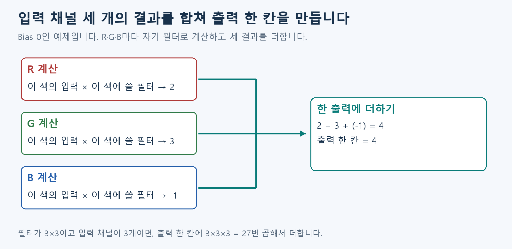

# B2. 여러 채널 합치기

B1에서는 입력 묶음 하나를 계산했습니다. 이번에는 여러 묶음을 합칩니다.

## 여러 Channel은 함께 계산해 출력 하나를 만듭니다

RGB 사진에는 R·G·B 세 묶음의 값이 있습니다. **각 채널에 쓸 필터로 계산한 뒤 그 결과를 더합니다.** R·G·B에 곱하는 필터 값은 서로 다를 수 있습니다.

한 출력에서 R 쪽 계산 결과가 2, G가 3, B가 -1이면 2+3-1=4입니다. 입력 Channel이 바뀌어도 새 출력을 만드는 것이 아니라 같은 출력에 더하는 중입니다.

입력 Channel이 3개이고 필터가 3×3이면 출력 한 칸을 만들 때 3×3×3=27번 곱하고 그 결과를 더합니다. 다른 출력 Channel을 만들 때는 다른 필터 묶음을 씁니다.

**입력 Channel은 합쳐지고, 출력 Channel은 서로 다른 계산 결과로 남습니다.** 이 둘을 구분하면 됩니다.

## 그림으로 이어 보기

Bias를 0으로 둡니다. 세 색에서 나온 2·3·−1을 합쳐 출력 한 칸 4를 만듭니다.

## 다음 개념

[B3. 반응을 후보별 점수로 모으기](B3.md)

복습·관련 실습 찾기

[학습 목차](../basic_track.md) · 이론을 읽은 뒤 [실습 S1](../learning/S1.md)

수식과 기존 기록: Notion B2 상세 설명
