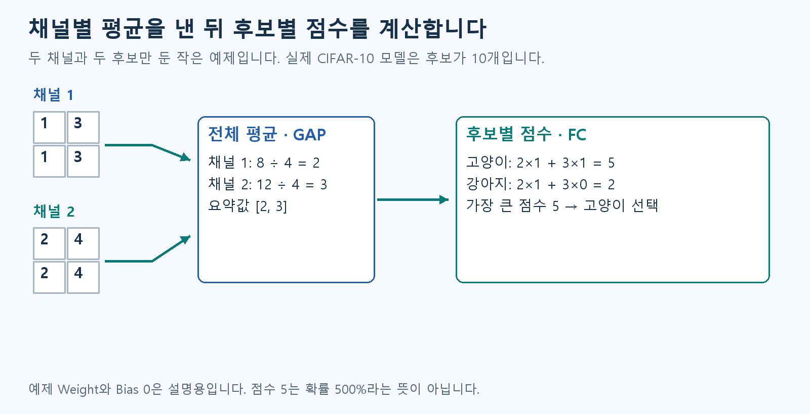

# 🎯 B3. 공간의 반응을 분류 점수로 — Pooling·GAP·FC

B2에서 만든 여러 출력 채널을 마지막 점수로 모읍니다.

## 이미지 곳곳의 반응을 정답 후보별 점수로 모읍니다

**Conv가 찾은 반응을 요약하고, 그 요약값으로 고양이·자동차 같은 후보별 점수를 만듭니다.** A3에서 본 후보별 점수를 만드는 마지막 부분입니다.

- Pooling: 가까운 값들을 최댓값·평균 등으로 요약합니다.
- 전체 평균(GAP, Global Average Pooling): Channel마다 공간 전체를 평균 내어 값 하나를 만듭니다.
- 완전 연결 층(FC, Fully Connected): 그 값들을 곱하고 더해 클래스별 점수를 냅니다.
- Logit: 확률로 바꾸기 전의 클래스 점수.
- Argmax: 가장 큰 점수의 위치를 고르는 것.

예를 들어 점수가 고양이 5, 강아지 2이면 고양이를 고릅니다. 점수 5가 확률 500%라는 뜻은 아닙니다. A4에서 벌점을 매길 때 썼던 확률은 Softmax라는 계산으로 얻습니다. 점수들을 합계가 100%인 양수 확률로 바꾸며, 큰 점수에 더 큰 확률을 줍니다.

CIFAR-10은 32×32 사진을 고양이·자동차 등 10종류로 나눈 자료입니다. 우리 모델은 마지막에 이 10종류의 점수를 냅니다. 이제 입력부터 예측까지 한 흐름으로 이어집니다.

## 그림으로 이어 보기

작은 예로 끝까지 이어 봅시다. 두 채널의 평균은 각각 2와 3입니다. 설명용 Weight를 고양이 [1,1], 강아지 [1,0], Bias를 0으로 두면 점수는 5와 2입니다. 더 큰 점수인 고양이를 고릅니다. 실제 모델의 10개 후보를 2개로 줄여 설명한 예입니다.

## 다음 개념

[A7. 깊은 계산에서 값의 크기 조정하기](A7.md)

복습·관련 실습 찾기

[학습 목차](../basic_track.md) · 이론을 읽은 뒤 [실습 S1](../learning/S1.md)

수식과 기존 기록: [Notion B3 상세 설명](https://app.notion.com/p/407f0c4baec981259881f8492bfb6a92)
