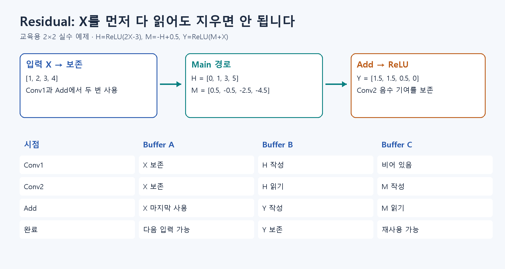

# 🔀 B4. 이전 표현에 변화를 더하기 — ResNet Block과 Shortcut

## Residual은 원래 값에 변화를 더합니다

여러 계산을 묶은 블록(Block) 안에서 길이 두 갈래로 나뉩니다. 입력 X를 그대로 보내는 길이 Shortcut 또는 Skip, Conv로 바꾸는 길이 Main입니다. Conv로 계산한 결과를 F(X)라고 이름 붙이면 **출력은 X+F(X)**입니다. 우리 Block은 그 뒤 ReLU도 적용합니다.

문장을 전부 새로 쓰는 대신 필요한 부분을 고치는 모습에 비유할 수 있습니다. 다만 학습된 모델이 언제나 입력을 그대로 둔다는 뜻은 아닙니다.

회로에서는 **원래 X가 Add에 도착할 때까지 남아 있어야 합니다.** Conv1이 읽기를 마쳤다고 지우면, 원래 값을 보내는 길에서 쓸 숫자가 없어집니다. 값을 잠시 보관하는 메모리를 버퍼(Buffer)라고 합니다.

두 경로의 크기와 숫자 단위도 맞아야 합니다. 크기가 바뀌는 블록에서는 원래 값을 보내는 길도 크기를 맞춥니다. 예를 들어 한 칸 걸러 읽어 가로·세로를 줄이고, 부족한 채널은 0으로 채웁니다.

한 길은 계산하고, 다른 길은 원래 값을 보냅니다. 마지막에 같은 위치끼리 더합니다. AI 생성 구조 예시이며 현재 모델의 상세 규칙은 B5를 따릅니다.

개념을 읽은 뒤 [확인 실습 S2](../learning/S2.md)에서 계산해 봅니다.

수식과 기존 기록: [Notion B4 상세 설명](https://app.notion.com/p/407f0c4baec98114b0e8fccad9a3f3a3)
