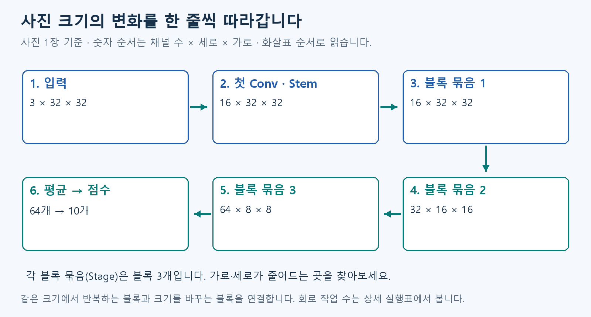
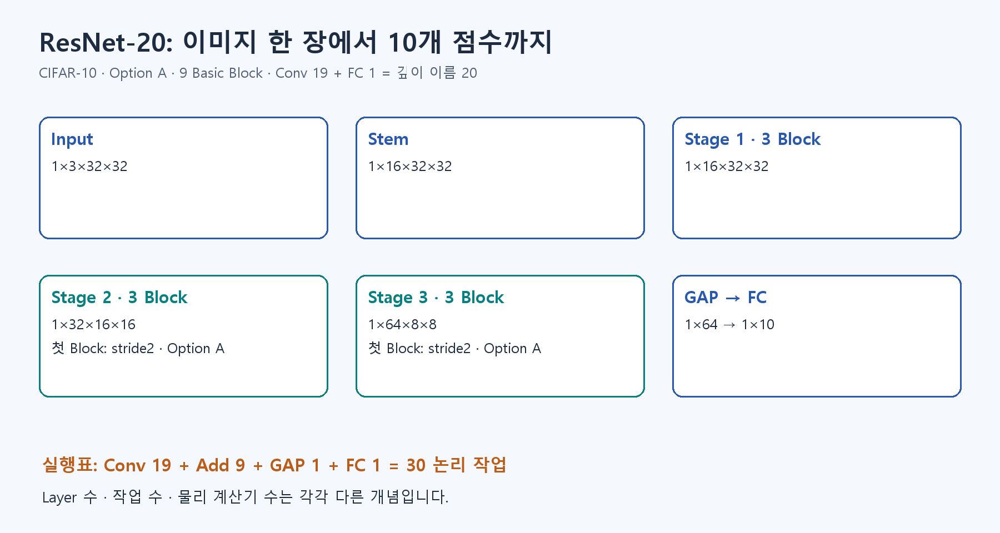

# 🗺️ B5. ResNet-20 전체 흐름 — Shape·9 Block·30 작업·계산량

B4의 블록을 여러 개 연결해 모델 전체를 보겠습니다.

## ResNet-20 전체를 한 번 봅니다

ResNet-20은 **원래 값에 계산 결과를 더하는 블록을 여러 번 연결한 모델**의 이름입니다.

**사진 → 첫 Conv → 블록 묶음 1·2·3 → 채널별 평균 → 후보별 점수** 순서입니다.

- **Stem:** 맨 처음의 Conv입니다. 그림의 입구라고 보면 됩니다.
- **Block:** B4에서 본 두 경로를 가진 계산 묶음입니다.
- **Stage:** 같은 출력 크기를 쓰는 블록 묶음입니다. 여기서는 묶음마다 블록이 3개입니다.

아래 크기는 A1의 **채널 수 × 세로 × 가로** 순서이며 사진 1장 기준입니다.

| 위치 | 크기 | 어떻게 달라지나요? |
| --- | --- | --- |
| 사진 입력 | 3×32×32 | 빨강·초록·파랑 값으로 시작 |
| Stem·Stage1 | 16×32×32 | 16가지 계산 결과를 만듦 |
| Stage2 | 32×16×16 | 가로·세로는 절반, 채널은 두 배 |
| Stage3 | 64×8×8 | 다시 가로·세로는 절반, 채널은 두 배 |
| 전체 평균(GAP) | 64개 | 채널마다 8×8 값을 평균 냄 |
| 마지막 점수 계산(FC) | 10개 | 정답 후보 10종류의 점수를 냄 |

20이라는 이름은 Conv 19개와 마지막 FC 1개를 센 것입니다. 블록은 9개입니다. 회로에서 실제로 나눠 실행할 작업 수는 뒤의 상세 실행표에서 따로 셉니다. 층 수가 곧 회로 계산기 수는 아닙니다.

처음에는 위 표에서 사진 크기가 언제 줄어드는지만 따라가 보세요. 저장 용량과 실제 모델 파일을 확인하는 표는 아래 상세 설명에 있습니다.

## 그림으로 이어 보기

윗줄은 왼쪽에서 오른쪽, 아랫줄은 오른쪽에서 왼쪽으로 읽습니다. 32×32가 16×16, 8×8로 줄어드는 곳을 찾으세요.

## 다음 개념

[A6. 정수와 눈금으로 저장하기](A6.md)

복습·관련 실습 찾기

[학습 목차](../basic_track.md) · 이론을 읽은 뒤 [실습 S1](../learning/S1.md)

이전 상세 그림·추가 용어 — 필요할 때 펼치기

작업 수와 구현 세부 용어를 함께 담은 이전 그림입니다. 읽는 순서와 크기는 본문의 새 도식·표를 기준으로 보세요.

수식과 기존 기록: [Notion B5 상세 설명](https://app.notion.com/p/407f0c4baec981699098e71ca989426b)
