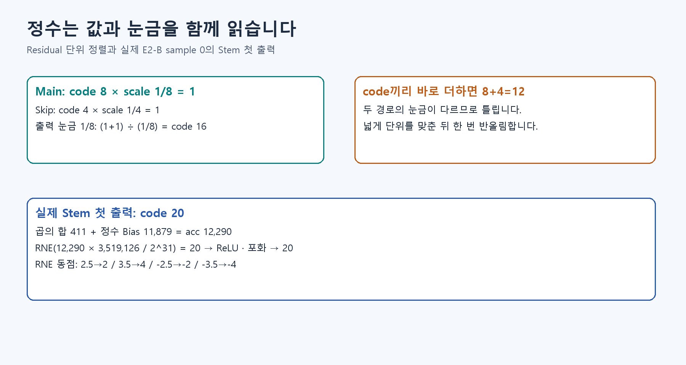

# 🔢 D1. 회로에서 숫자의 의미 지키기 — Signed·Fixed-point·Bit Width·Requantization

## 같은 비트라도 읽는 약속이 필요합니다

비트는 0 또는 1을 담는 자리입니다. 숫자를 회로로 옮길 때는 **부호·눈금·몇 비트로 계산할지** 정해야 합니다. ‘INT8’만으로 모든 규칙이 정해지지는 않습니다.

- Signed: 음수도 표현합니다.
- Bit Width: 숫자 하나를 담는 0·1 자리의 개수입니다.
- Accumulator: 곱한 값들을 모아 더하는 곳입니다.
- Requantization: 누산값을 출력 눈금으로 옮깁니다.

INT8은 8자리, INT32는 32자리로 표현하는 정수입니다. FP32는 소수를 표현할 수 있는 32비트 부동소수점 방식입니다.

입력은 8비트여도 여러 곱을 더한 합은 훨씬 클 수 있어 넓게 계산합니다. 예를 들어 100×100=10,000은 INT8 범위에 담을 수 없습니다. 중간 합을 넓은 INT32에 담고, 마지막에 출력 눈금으로 바꾼 뒤 반올림합니다. 허용 범위를 넘으면 끝값에 붙이는 포화도 적용합니다.

RNE는 가까운 정수로 반올림하고 정확히 중간이면 짝수로 갑니다. 2.5→2, 3.5→4입니다. 이 규칙을 소프트웨어와 회로가 똑같이 따라야 합니다.

개념을 읽은 뒤 [확인 실습 S3](../learning/S3.md)에서 계산해 봅니다.

수식과 기존 기록: [Notion D1 상세 설명](https://app.notion.com/p/407f0c4baec981b8ae88d705e9af515b)
