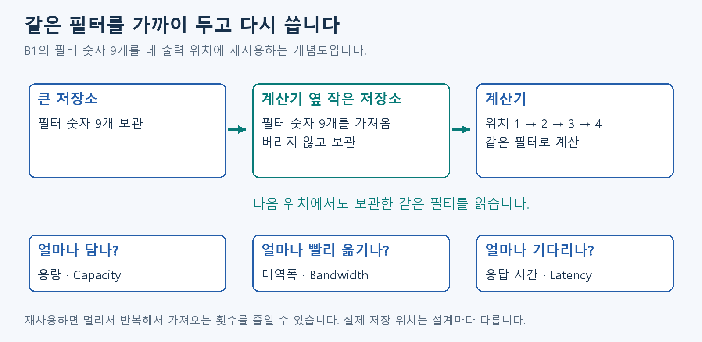

# D3. 계산할 값 보관하기

D2의 계산기가 계속 일하려면 필요한 값을 제때 받아야 합니다.

## 계산기 옆에 필요한 값을 준비해 둡니다

**메모리는 입력·Weight·중간 결과를 보관하는 곳입니다.** 계산기가 빨라도 값을 제때 주지 못하면 기다립니다. **주소(Address)는 저장 위치를 가리키는 번호**입니다. 값을 읽거나 쓸 때 이 번호로 위치를 지정합니다.

책상과 책장에 비유할 수 있습니다. 자주 쓰는 것은 가까이 두고, 큰 자료는 멀리 보관합니다. 회로도 작은 근처 메모리와 큰 외부 메모리를 나눠 씁니다.

- Capacity: 얼마나 담을 수 있나.
- Bandwidth: 일정 시간에 얼마나 옮길 수 있나.
- Latency: 요청한 값이 올 때까지 얼마나 기다리나.
- Reuse: 같은 값을 버리지 않고 다시 쓰기.

재사용하면 전송을 줄일 수 있습니다. 다만 그 값을 보관할 공간과 마지막 사용 시점도 알아야 합니다.

## 그림으로 이어 보기

B1의 필터 숫자 9개를 가까운 저장소에 두고 네 위치에서 다시 읽습니다. 그림에는 필터 이동만 표시했습니다.

## 다음 개념

[D5. 준비된 값을 전달하기](D5.md)

복습·관련 실습 찾기

[학습 목차](../basic_track.md) · 이론을 읽은 뒤 [실습 S4](../learning/S4.md)

이전 상세 그림·추가 용어 — 필요할 때 펼치기

아래는 Notion 상세 그림에 쓰이는 저장소 이름입니다. 본문의 재사용 개념을 이해한 뒤 필요한 때 읽습니다.

상세 그림에서 Register(레지스터)는 회로 가까이의 작은 저장 공간입니다. RAM은 읽고 쓸 수 있는 메모리, ROM은 읽기용으로 사용하는 메모리입니다. DDR은 FPGA 칩 바깥에 연결해 큰 저장소로 쓰는 메모리 종류입니다. Buffer(버퍼)는 종류보다 역할을 가리키는 말로, 계산에 필요한 값을 잠시 보관하는 공간입니다.

선택 보충 — 수식과 기존 기록: Notion D3 상세 설명
