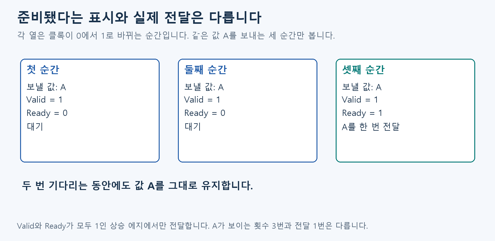
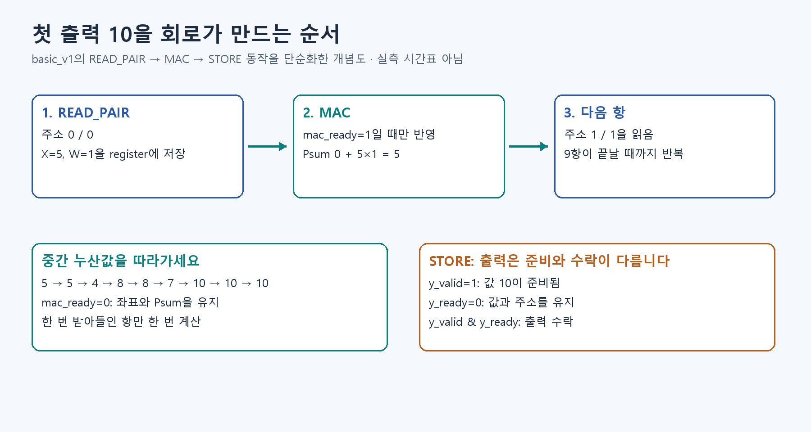

# D5. 준비된 값을 전달하기

D3에서 값을 준비했습니다. 이제 언제 전달된 것으로 셀지 정합니다.

## 준비된 것과 전달된 것은 다릅니다

**보내는 쪽도 준비되고 받는 쪽도 준비돼야 전달합니다.** 물건을 건네는 상황으로 생각하면 됩니다.

- Valid=1: 보낼 물건이 준비됐습니다.
- Ready=1: 지금 받을 수 있습니다.
- **상승 에지(Edge):** D2의 클록이 0에서 1로 바뀌는 순간입니다.
- 두 신호가 그 순간 모두 1이면 실제로 한 번 전달합니다.

Valid=1, Ready=0이면 아직 전달하지 않았습니다. 물건과 주소를 그대로 들고 기다립니다. 이 대기가 Stall입니다.

같은 값이 여러 클록 동안 보여도 전달은 한 번일 수 있습니다. **보인 횟수가 아니라 받아들인 횟수를 셉니다.** Reset은 진행 중 작업을 취소하고 정해진 초기 상태로 돌리는 신호입니다.

## 그림으로 이어 보기

각 칸은 서로 다른 상승 에지입니다. 세 번째 순간에만 두 준비 신호가 모두 1이므로 A가 한 번 전달됩니다.

## 이제 계산과 실습으로 확인하기

[S0. 작은 필터를 손과 코드로 계산하기](../learning/S0.md)

모델·정수·회로의 기본 이론을 읽었습니다. S0부터는 배운 계산을 직접 확인합니다.

복습·관련 실습 찾기

[학습 목차](../basic_track.md) · 이론을 읽은 뒤 [실습 S4](../learning/S4.md)

이전 상세 그림·추가 용어 — 필요할 때 펼치기

추가 신호와 제어 상태를 포함한 이전 그림입니다. 먼저 본문의 세 순간에서 전달 조건을 익힙니다.

그림의 Source는 보내는 쪽, Sink는 받는 쪽입니다. Payload는 함께 보내는 값과 주소이고, 이 한 묶음을 Token이라고도 부릅니다. Fire는 두 준비 신호가 맞아 실제로 전달되는 사건입니다. 이 설명은 양쪽이 같은 클록을 쓰는 경우입니다.

선택 보충 — 수식과 기존 기록: [Notion D5 상세 설명](https://app.notion.com/p/407f0c4baec981e1b9fafb21f2519ec2)
