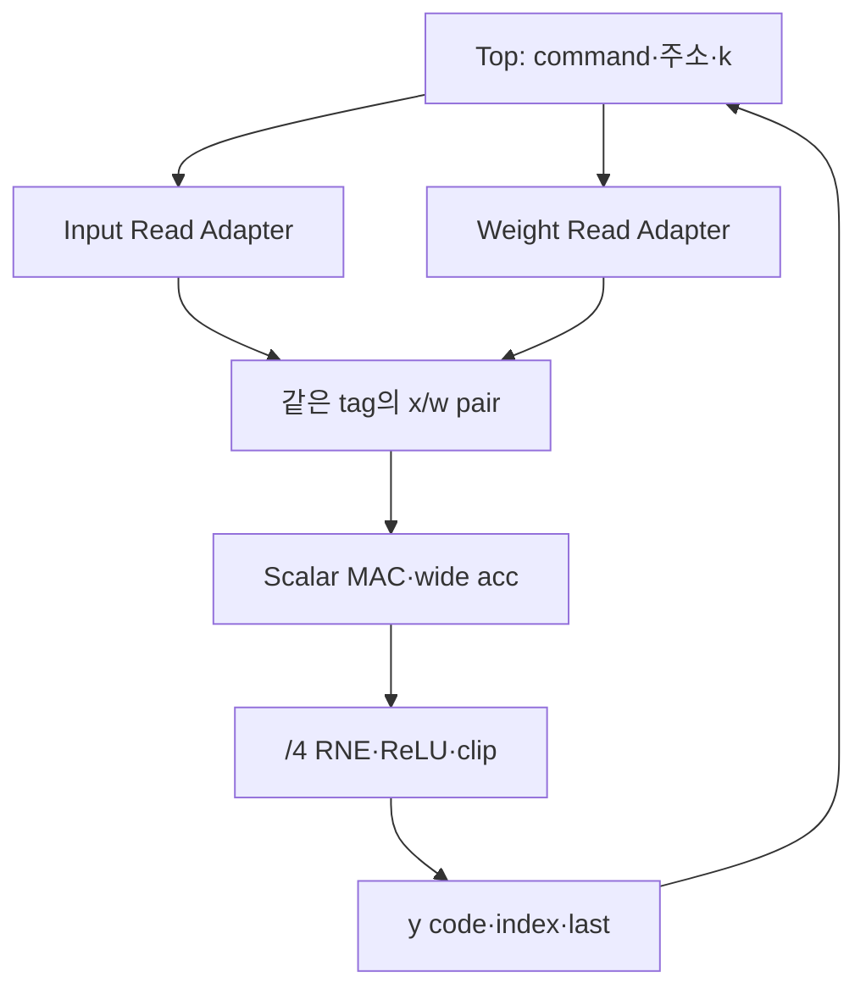

# 🧪 E12. 고정 Conv RTL을 구현하고 실행하기 — RAM·MAC·RNE·제어기·Testbench·실제 시뮬레이션

> 2026-11-02 복구한 과거 진단용 기록입니다. 현재 구현·보드 완료 상태와 구분합니다. [이관 안내](README.md)

출처: [Notion 원문](https://app.notion.com/p/408f0c4baec98145bdf3c4aa78a2969d?pvs=204)

> <b>\[심화·기본 실습 뒤 참고\] 현재 기준은 ResNet-20 + CIFAR-10 · ZedBoard다.</b>
> 
> [관련 Notion 문서](https://app.notion.com/p/40cf0c4baec98145b57af4780d20c752)을 먼저 따른다. 이 장의 기존 ResNet-56 수치·인공 벡터·Python/RTL 실행 기록은 해당 예제·버전의 증거다. 실제 모델 정수 연결과 보드 실행의 완료로 확대하지 않는다. 기본 단계는 S0\~S6이며, 이 장의 G번호가 있으면 장 내부 단계다.

> ResNet-56 실습 설계 E12 · Rev1.0 · 실제 RTL 구성 → 요청/응답/MAC 클록 → 출력·완료 → Testbench → 실행 결과·파일 → 다음 검증 범위 순서로 읽는다.

> <b>E11의 작은 고정 Conv를 실제 SystemVerilog로 구현하고 Verilator로 실행했다.</b>
> 
> 정상 job 70회·reset 취소 5회와 단독 module 시험을 수행했다. 기본 vector의 출력뿐 아니라 요청 주소·tag·wide acc·last·대기 중 payload·완료 순서를 비교했다. 실제 FPGA 합성·timing·보드·ResNet checkpoint는 아직 검증하지 않았다.

<b>프로젝트 기준:</b> 최종 목표는 ResNet-56 + CIFAR-10이며 보드·최종 정밀도·clock·병렬도는 미정이다. 이번 RTL은 \[2,4,4\]→\[2,2,2\]의 진단용 고정 Conv다. 실제 Stem shape·Residual·DMA·전체 모델을 지원하는 IP가 아니다.

<b>이전·연결:</b> [관련 Notion 문서](https://app.notion.com/p/408f0c4baec98163a0b1f3f41d8bae5c) · [관련 Notion 문서](https://app.notion.com/p/407f0c4baec981c689c7df20e687719b) · [관련 Notion 문서](https://app.notion.com/p/407f0c4baec9818ab2fff957cf34f24d)

<b>실행 파일:</b> [E12 RTL·Testbench·로그·파형 ZIP](../../../historical/e12-e21/archives/e12_conv_v0.zip)

[원본 첨부 문서](../../../historical/e12-e21/attachments/E12_RTL_and_Testbench.md)

첨부 Markdown에는 파일별 전체 source와 실행 결과를 넣었다. ZIP에는 원래 파일 구조·실행 스크립트·VCD도 포함했다. 아래 본문은 그 구현에서 중요한 동작과 관측 지점을 설명한다.


# 0. 이번에 실제로 만든 범위

| 항목 | 구현·시험 범위 |
| --- | --- |
| 입력 | N=1·CHW \[2,4,4\]·signed INT8 |
| Weight | OIHW \[2,2,3,3\]·signed INT8 |
| Conv | 3×3·stride1·padding0·groups1·dilation1 |
| 출력 | CHW \[2,2,2\], 8개 signed INT8 code |
| 누산 | output당 18항·bias 한 번·32-bit acc |
| 후처리 | /4 RNE ties-to-even·선택 ReLU·포화 |
| 제어 | 한 job·한 요청 쌍·한 output씩·완료 응답 보관 |
| RAM | 같은 clock의 native synchronous read 모델 |
| Reset | 동기 active-high·진행 취소·old valid/pending 제거 |

Input/weight/bias를 job 중 변경하지 않는 계약이다. <code>prepared</code>는 외부 wrapper가 preload·reset 상태에 맞게 관리한다. Top 안에 CPU preload driver·DMA·전체 load-valid 관리기를 구현한 것은 아니다.

# 1. RTL 파일 네 개와 Top의 연결

| 파일 | 역할 |
| --- | --- |
| read\_hold.sv | 요청 tag 보관·동기 RAM 응답 capture·소비 전 HOLD |
| mac\_scalar.sv | signed product·bias/psum·마지막 곱 포함 결과 HOLD |
| postprocess4.sv | /4 RNE·ReLU·INT8 clip·output HOLD |
| conv\_fixed\_top.sv | 고정 좌표·주소·pairing·command/response FSM |



첫 구현은 두 native read 경로의 요청을 같은 edge에 발행한다. 두 응답이 모두 유효하고 tag가 맞을 때 MAC에 한 항을 전달한다. 임의 latency·여러 outstanding·prefetch를 지원하는 범용 엔진으로 만들지는 않았다.

# 2. 주소 생성은 고정 Shape에서 시작한다

출력 index의 bit는 co·oy·ox에 대응하고, k=0\~17에서 ci·ky·kx를 구한다. Stride1·padding0이므로 입력 좌표는 iy=oy+ky, ix=ox+kx다.

| 항목 | 계산·범위 |
| --- | --- |
| output index | (co×2+oy)×2+ox, 0\~7 |
| input 주소 | (ci×4+iy)×4+ix, 0\~31 |
| weight 주소 | co×18+k, 0\~35 |
| 요청 tag | output index 3-bit와 k 5-bit를 묶은 8-bit |

Kernel 좌표는 작은 case 구문으로 만들었다. 실제 RTL의 폭·확장을 명시해 lint의 truncation/expansion 경고를 해결했고, 최종 RTL-only <code>-Wall</code> lint는 통과했다.

Top의 주소 요청 counter와 MAC 수락 counter를 testbench에서 따로 관측한다. 주소를 발행했다고 그 항이 이미 누산됐다고 세지 않는다.

# 3. 요청→RAM 응답→MAC 수락의 실제 순서

아래는 이번 wrapper의 한 항에 대한 순서다. 항상 ready인 RAM·같은 clock·정한 native read latency를 전제로 한다.

| Edge | 사건 | Edge 뒤 상태 |
| --- | --- | --- |
| E0 | x/w 요청 수락·RAM read | Adapter WAIT\_RAM·tag 보관·RAM data 갱신 |
| E1 | Adapter가 RAM data capture | 두 응답 valid·data/tag 보관 |
| E2 | 같은 tag의 두 응답을 MAC이 수락 | psum 갱신·Adapter 공간 해제 |
| E3 | 다음 항 요청 가능 | 다음 k의 주소·tag 사용 |

Adapter는 downstream이 아직 받지 않으면 응답을 HOLD한다. RAM의 output wire를 바로 MAC input처럼 사용하는 구조가 아니다. 한 항이 끝나기 전 다음 native 요청을 무제한으로 발행하지 않는다.

이 순서가 모든 RAM IP의 latency를 대표하지는 않는다. 추가 output register·다른 clock·변동 응답 경로를 사용하면 wrapper와 시험을 다시 정해야 한다.

# 4. MAC은 마지막 곱이 포함된 값을 보관한다

실제 RTL의 핵심은 다음과 같다.

```verilog
wire signed [15:0] product = x*w;
wire signed [31:0] extended_product = {{16{product[15]}},product};
wire signed [31:0] acc_next = (first ? bias : psum) + extended_product;
```

<code>term_valid && term_ready</code>에서만 psum을 바꾼다. First에서는 bias를 한 번 반영하고 ci 전환에서는 기존 psum을 유지한다. Last에서는 기존 psum이 아니라 이번 product까지 더한 acc\_next를 결과 register에 넣는다.

MAC 단독 시험은 K=1의 first/last 동시 항과 gap을 둔 K=18 두 사례를 포함했다. 결과를 바로 소비하지 않고 보관하는 경우도 비교했다. Top의 Conv frontend 자체는 K=18로 고정돼 있다.

허용 범위 밖 bias의 제품 오류 처리·일반 overflow 검출기는 구현하지 않았다. 현재 계약은 bias를 포함한 결과가 INT32 범위에 드는 입력을 사용한다. 임의의 32-bit bias에 항상 안전하다고 일반화하지 않는다.

# 5. 음수 /4 RNE를 Shift와 구분한다

RTL은 arithmetic shift로 floor 몫을 구하고 low 2-bit remainder와 몫의 홀짝으로 RNE를 보정한다. ReLU·INT8 포화는 그 뒤 수행한다.

| 입력 acc | /4 RNE | ReLU off INT8 결과 |
| --- | --- | --- |
| 10 | 2 | 2 |
| 14 | 4 | 4 |
| −10 | −2 | −2 |
| −14 | −4 | −4 |
| 512 | 128 | 127 |
| −516 | −129 | −128 |

Testbench의 기준 함수는 부호를 분리하고 절댓값의 몫/나머지로 계산한다. RTL의 shift/low-bit 식을 그대로 복사한 기준만 사용하는 것을 피했다. INT32 양끝 값과 ReLU on 사례도 단독 후처리 시험에 포함했다.

# 6. Command와 출력·응답의 수락을 구분한다

| 상태 | 동작 |
| --- | --- |
| IDLE | prepared이고 reset이 아니면 command 수락 |
| ISSUE | 현재 항의 x/w 요청 쌍 발행 |
| WAIT\_PAIR | 두 응답·tag·MAC ready를 확인해 한 항 전달 |
| WAIT\_Y | 마지막 항 이후 acc·후처리·y 수락 대기 |
| RESP | 최종 y 수락 뒤 완료 응답 보관 |

Bias·ReLU mode는 command fire 때 latch한다. Testbench는 job 중 외부 설정 값을 바꿔도 현재 작업에 영향을 주지 않는지 확인했다.

별도 대기 command 시험에서는 다음 command valid를 busy 중부터 유지하고, 이전 응답을 소비한 뒤 실제 ready/fire가 될 때까지 기다렸다. 이 경우 첫 job의 설정과 다음 job의 설정이 섞이지 않는지 검사했다.

마지막 y가 막히면 index·last·code를 유지하며 RESP로 가지 않는다. 응답이 막혀 있는 RESP에서는 busy가 0이어도 cmd\_ready는 0이다. 이번 완료 경계는 Core의 y sink까지 전달된 경계이며 외부 DDR/DMA/CPU 가시성 완료가 아니다.

# 7. 기본 두 Job에서 실제 관측한 출력

| output index | ReLU off job 0 | ReLU on job 1 |
| --- | --- | --- |
| 0 | 10 | 10 |
| 1 | 12 | 12 |
| 2 | 19 | 19 |
| 3 | 21 | 21 |
| 4 | −5 | 0 |
| 5 | −7 | 0 |
| 6 | −14 | 0 |
| 7 | −16·last=1 | 0·last=1 |

Wide acc도 <code>[39,48,75,84,−19,−28,−55,−64]</code>와 비교했다. 최종 class 선택이나 checksum만 검사한 것이 아니라 각 output의 수치·좌표·마지막 표시를 직접 비교했다.

# 8. Testbench가 확인한 항목

| 관측 | 검사 내용 |
| --- | --- |
| Request | 144개 x/w 주소·범위·요청 tag·순서 |
| Term | MAC 수락 144개·output/k tag |
| Wide acc | output마다 독립 내적 기준과 일치 |
| Output | code·index·last·누락/중복·ReLU mode |
| Stall | 미수락 y payload·응답 유지 |
| Command | prepared 전 거부·설정 latch·합법적인 다음 command 대기 |
| Done | 8개 y·8개 acc·144항 전 완료 금지 |
| Reset | ISSUE·RAM pending·중간 누산·y HOLD·응답 HOLD에서 취소·재시작 |

Driver는 주로 falling edge에서 입력을 바꾸고 monitor는 rising edge의 실제 fire를 센다. RAM read는 rising edge의 nonblocking assignment로 모델링했다. Reset된 작업은 정상 완료로 세지 않는다.

실패는 <code>$fatal</code>로 종료하도록 만들었다. VCD 파일 생성이나 <code>$display</code> 한 줄만으로 통과를 판단하지 않고, 실제 비교기·정상 종료·test count를 확인한다.

# 9. 실제 실행 결과와 계수 해석

```txt
PASS jobs=70 cancelled=5 accepted_terms=10245 accepted_outputs=568
hold_checks=603 post_cases=11 mac_cases=3 read_cases=1
```

| 시험 묶음 | 실행 수 |
| --- | --- |
| 기본 vector·ReLU off/on | 2 job |
| 무작위 입력·weight·bias·출력 대기 | 60 job |
| 포화 pattern | 1 job |
| 정상 대기 command·연속 설정 분리 | 2 job |
| Reset 후 정상 재시작 | 5 job |
| 정상 완료 합 | 70 job |
| Reset 취소 | 별도 5 job |
| 후처리 단독 | 11 case |
| MAC 단독 | 3 case |
| Read Adapter 단독 | 1 case |

정상 완료 output은 70×8=560개다. 전체 accepted\_outputs=568에는 마지막 응답 소비 전에 reset으로 취소한 작업의 output 8개가 추가돼 있다. 전체 term 수도 취소 작업에서 이미 수락한 항을 포함한다. 이를 정상 완료 job으로 더하지 않는다.

실행 seed는 testbench의 2026이다. 이 결과는 기록한 source/tool 설정에서의 선택 시험이며 모든 seed·모든 합법 입력의 exhaustive 검증은 아니다.

# 10. 실행 방법과 도구 식별

ZIP을 풀고 Verilator·GCC C++20·make·Python 3가 있는 환경에서 다음처럼 실행한다.

```bash
bash run.sh
```

다른 경로의 Verilator를 사용하면 다음처럼 지정한다.

```bash
VERILATOR=/path/to/verilator bash run.sh
```

스크립트는 Python reference→RTL-only lint→elaboration/C++ 생성→build→RTL simulation·VCD 순서로 실행한다. 사용한 Python wheel의 C++ 표준/PCH 기본값 문제를 해결하기 위해 C++20과 GCC PCH include 설정을 명시했다. 상세 명령은 run.sh와 build 로그에 있다.

| 도구 식별 | 실제 기록 |
| --- | --- |
| 설치 distribution | PyPI verilator 5.48.0 |
| version 출력 | rev vUNKNOWN-built20260516-4e853d8 |
| simulation banner | Verilator 5.49 |
| C++ compiler·Python | toolchain.json에 실제 실행 환경 기록 |
| source identity | source\_sha256.json에 RTL·TB·reference·script hash |

Distribution 표기와 실제 banner가 달라 둘 다 보존했다. 새 환경에서 버전을 숨기고 동일 실행이라고 가정하지 않는다. [Verilator 설치 안내](https://verilator.org/guide/latest/install.html)에서 사용 환경에 맞는 설치·빌드 조건을 확인한다.

Testbench의 10 ns clock·시뮬레이션 종료 시간·Host에서 simulator가 소비한 wall time은 FPGA 성능 측정이 아니다. Target·clock constraint·RAM/DSP 매핑·배치배선·보드 clock을 아직 확인하지 않았다.

# 11. 파형에서 먼저 볼 경계

| 확인 순서 | 신호 |
| --- | --- |
| 작업 시작 | prepared·cmd\_valid/ready·bias/Mode latch |
| 요청 | x\_ram\_en/addr·w\_ram\_en/addr·dbg\_req\_tag |
| 응답 | 각 Adapter state·rsp valid/data/tag |
| 누산 | dbg\_term\_fire·k·product·psum·acc\_next |
| 후처리 | dbg\_acc\_fire/data·qy·index·last |
| 역압 | y\_valid/ready·유지된 payload |
| 종료·취소 | rsp\_valid/ready·busy·rst·다음 작업 |

<code>results/conv_fixed.vcd</code>는 GTKWave 등으로 볼 수 있다. 첫 output을 골라 request tag→term→acc→y를 따라가고, 마지막 output에서는 stall 동안 완료가 앞서 나오지 않는지 확인한다. 파형 전체를 먼저 펼치기보다 scoreboard의 첫 불일치 tag를 기준으로 좁힌다.

# 12. E11 요구사항에 어떤 증거를 추가할 수 있는가?

| 요구사항 | 이번 실행에서 얻은 근거 |
| --- | --- |
| NUM-01/02 | 통합 wide acc/code·MAC 단독·RNE/포화 경계 |
| ADDR-01 | 고정 shape의 요청 주소·tag·144항/8출력 |
| MEM-01 | 고정 native latency·Read Adapter 단독 HOLD/tag |
| IF-01 | MAC gap·결과 HOLD·y stall·응답 backpressure |
| DONE-01 | 마지막 y 수락 전 성공 금지·응답 보관 |
| RESET-01 | 5개 위치의 취소·old valid 제거·preload 재준비·재시작 |
| JOB-01 | 현재 설정 latch·대기 command·연속 작업 분리 |

이번 source revision의 선택 testcase를 실제 RTL로 실행한 증거가 생겼다. E11의 모든 directed 조합·범위·coverage가 완전히 충족됐다고 자동으로 G1 전체를 닫지는 않는다. Test 목록·실제 source hash·로그·관측 한계와 함께 현재 통과 범위를 기록한다.

# 13. 남아 있는 한계와 다음 확장

| 미검증·미지원 | 다음에 확인할 것 |
| --- | --- |
| 4-state X/Z·초기화 전파 | 해당 실행 모델·simulator와 reset/미초기화 시험 |
| 임의 read latency·독립 응답 순서 | Adapter 계약·tag·pending·credit 확장 |
| 실제 Stem shape·padding | Cin3/Cout16·32×32·K27·Nout16384의 주소/정수 비교 |
| Residual·Transition·전체 모델 | E4\~E8의 buffer·상수·가변 작업 계약 |
| DMA·AXI·cache·CDC | 실제 wrapper/driver·시스템 완료·오류 복구 |
| 합성·RAM/DSP·STA·보드 | 실제 target·constraint·report·실측 |
| 실제 checkpoint·accuracy | E1/E2/E9의 source·전처리·양자화 상수·dataset |

Verilator의 실행 모델과 이번 RAM 모델의 조건 안에서 확인한 결과다. Vendor BRAM의 모든 mode·read-during-write·다른 clock·외부 pending 취소까지 입증한 것은 아니다. 현재 tag mismatch는 정상 범위 밖이며 제품용 오류 CSR·복구 처리는 후속 범위다.

<b>다음 단계:</b> [E13](E13.md)에서 고정 Conv의 수치·수락·완료 기준을 유지하면서 Stem과 같은 shape와 padding1을 실제 RTL로 확장·실행했다. 정상5회·reset 취소5회·작은 shape 회귀2회의 source·전체 기준값·로그·부분 파형을 연결했다. 실제 checkpoint·합성·보드 검증과 구분해 읽는다.
