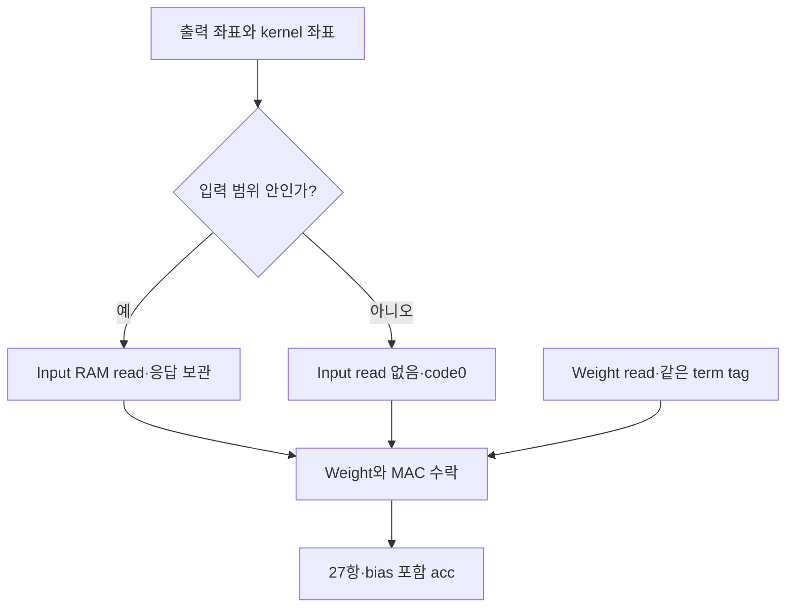

# 🧩 E13. 실제 Stem 크기로 확장하기 — Padding1·주소·Counter·전체 RTL 비교

> 2026-11-02 복구한 과거 진단용 기록입니다. 현재 구현·보드 완료 상태와 구분합니다. [이관 안내](README.md)

출처: Notion 원문

> <b>\[심화·기본 실습 뒤 참고\] 현재 기준은 ResNet-20 + CIFAR-10 · ZedBoard다.</b>
> 
> 관련 Notion 문서을 먼저 따른다. 이 장의 기존 ResNet-56 수치·인공 벡터·Python/RTL 실행 기록은 해당 예제·버전의 증거다. 실제 모델 정수 연결과 보드 실행의 완료로 확대하지 않는다. 기본 단계는 S0\~S6이며, 이 장의 G번호가 있으면 장 내부 단계다.

> ResNet-56 실습 설계 E13 · Rev1.0 · Padding의 의미 → 용어·개수 → 주소·RTL → 전체 비교 → 실행 자료 → 다음 Block 순서로 읽는다.

> <b>작은 Conv가 맞았어도 실제 크기의 Stem이 맞았다고 볼 수는 없다.</b>
> 
> E12 Core를 확장해 Stem과 같은 \[3,32,32\]→\[16,32,32\] shape의 전체 16,384개 출력을 실제 RTL로 비교했다. 이번 핵심은 padding1·긴 K/Nout·주소와 counter 폭이다. 정상 완료5회·reset 취소5회, E12 shape 회귀2회가 통과했다.

<b>프로젝트 기준:</b> ResNet-56 + CIFAR-10. 실제 checkpoint·BN folding·채널별 multiplier·accuracy를 연결한 것은 아니다. /4 RNE·INT8은 완전히 지정한 진단용 수치 계약이다. 보드·clock·병렬도·최종 정밀도는 미정이다.

<b>이전·연결:</b> [E12](E12.md) · 관련 Notion 문서

<b>실행 자료:</b> [E13 RTL·Testbench·기준값·로그·부분 파형 ZIP](../../../historical/e12-e21/archives/e13_stem.zip)

[원본 첨부 문서](../../../historical/e12-e21/attachments/E13_RTL_and_Testbench.md)


# 0. 먼저 한 출력의 입력 Window를 생각한다

Padding1은 입력 주위에 0이 있다고 정하고 Conv를 계산하는 규칙이다. 물리 RAM에 테두리를 복사해 저장해야 한다는 뜻은 아니다. 이번 구현은 좌표가 입력 범위 밖이면 Input read를 막고 MAC에 code0을 넣는다.



Padding도 이번에는 하나의 논리 term으로 처리한다. 해당 Weight를 읽고 counter/tag를 진행하되 x만0이다. 따라서 input read 수와 MAC term 수가 같지 않다. Zero 생략 최적화와 혼동하지 않는다.

# 1. 새 용어와 달라진 크기

| 용어 | 의미 | 이번 값 |
| --- | --- | --- |
| Stem | 모델 입력을 첫 feature로 바꾸는 Conv 구간 | Cin3→Cout16 |
| Shape | 각 tensor 축의 크기 | X CHW\[3,32,32\], Y CHW\[16,32,32\] |
| Padding | 범위 밖 입력을 지정 code로 해석 | 사방1·zero point0 |
| K | 한 output에 포함하는 논리 곱 항 수 | 3×3×3=27 |
| Nout | 한 job의 output 수 | 16×32×32=16,384 |
| Tag | output과 그 안의 k를 구분하는 표식 | \{index16,k16\} |
| Static parameter | 빌드 시 고정하는 구성 | Cin/Cout/H/W/PAD |

Shape는 elaboration parameter다. CPU가 runtime descriptor를 써서 크기를 바꾸는 IP로 확장한 것은 아니다. 실제로 검증한 parameter 조합은 Stem과 E12의 작은 Conv 두 개다.

# 2. 의미를 식으로 고정한다

Kernel3·stride1·dilation1·groups1에서 출력 길이는 다음과 같다.

$$
H_o=H+2P-2,\qquad W_o=W+2P-2
$$

$$
i_y=o_y+k_y-P,\qquad i_x=o_x+k_x-P
$$

$$
x_{\mathrm{term}}=\begin{cases}X[c_i,i_y,i_x] & 0\le i_y<H,\ 0\le i_x<W\\0 & \text{otherwise}\end{cases}
$$

$$
a=b[c_o]+\sum_{c_i,k_y,k_x}x_{\mathrm{term}}\,W[c_o,c_i,k_y,k_x]
$$

이후는 E12와 같은 <code>/4 RNE → 선택 ReLU → signed INT8 saturation</code>이다. 여기서는 모든 zero point가0이므로 padding code도0이다. Zero point가 다른 비대칭 양자화에서는 이 규칙을 그대로 가져가지 않는다.

# 3. 모서리·가장자리·내부를 숫자로 나눠 본다

입력과 Weight를 모두1, bias0으로 두면 서로 다른 padding 위치를 쉽게 확인할 수 있다.

| 위치 | 채널당 유효 kernel 수 | Cin3의 acc | /4 RNE code |
| --- | --- | --- | --- |
| 모서리 (0,0) | 4 | 12 | 3 |
| 모서리 제외 가장자리 (0,1) | 6 | 18 | 4 |
| 내부 (1,1) | 9 | 27 | 7 |

18/4=4.5는 RNE의 tie-to-even으로4다. 모든 위치를27로 계산하면 padding 처리가 빠졌을 가능성이 있고, 음수 좌표를 unsigned 주소로 잘라 RAM을 읽으면 다른 데이터가 섞일 수 있다.

| 전체 job 계수 | 값 |
| --- | --- |
| 모서리 output | 4×16=64 |
| 비모서리 가장자리 output | 120×16=1,920 |
| 내부 output | 900×16=14,400 |
| 논리 term·Weight read | 16,384×27=442,368 |
| 실제 Input read | 16×3×94²=424,128 |
| Padding term | 442,368−424,128=18,240 |

94는 한 축에서 모든 출력 위치가 유효 입력을 참조하는 총횟수 <code>2+30×3+2</code>다. 위 계수는 Python과 RTL monitor 양쪽에서 확인했다. 논리 term 수가 실제 FPGA cycle 수를 뜻하지는 않는다.

# 4. 주소와 counter를 확장한다

| 항목 | 규칙 |
| --- | --- |
| X 주소 | (ci×H+iy)×W+ix, 범위 안일 때만 read |
| W 주소 | co×(Cin×9)+k |
| Y index | (co×Ho+oy)×Wo+ox |
| K 진행 | kx→ky→ci의 중첩 counter |
| 출력 진행 | ox→oy→co의 중첩 counter |
| Tag | \{16-bit output index,16-bit k\} |

RTL에 runtime <code>/</code>·<code>%</code>를 넣지 않고 중첩 counter로 좌표를 만든다. 곱셈에 쓰인 H/W/K는 static parameter다. 합성기가 어떤 회로와 RAM으로 구현하는지는 아직 확인하지 않았다.

이 구현의 주소/index 포트는16-bit다. Stem의 마지막 output index는16,383이며 정상 output 개수는16,384다. 같은 숫자가 아니다. TB의 count는 해당 종료값을 담는 integer로 따로 관리한다. Parameter만 바꾸면 무제한 크기를 지원하는 것은 아니다.

<b>음수 좌표 처리:</b> iy/ix는 signed32-bit로 비교한다. 주소 cast 결과가 존재하더라도 padding이면 x\_ram\_en=0이므로 그 주소로 Input RAM을 읽지 않는다. TB는 padding 위치의 read 억제와 범위 안의 실제 주소를 모두 검사한다.

# 5. Padding term의 요청·응답을 결합한다

| Term 종류 | Input 경로 | Weight 경로 | MAC 수락 조건 |
| --- | --- | --- | --- |
| 유효 입력 | Native read→Adapter HOLD | Native read→Adapter HOLD | 두 응답 valid·tag 일치·MAC ready |
| Padding | read 없음·x=0 | Native read→Adapter HOLD | Weight valid·padding 표시·MAC ready |

Padding 표시는 요청 수락 때 pad\_q에 보관한다. 이후 다른 좌표의 상태와 섞지 않는다. 한 output의 마지막 term을 MAC이 수락한 뒤에는 후처리/y 수락까지 기다린다.

Tag mismatch를 제품용 오류 응답으로 변환하는 CSR·복구기는 이번 범위가 아니다. 현재는 정상 요청에서 발생하지 않아야 하는 조건으로 시험한다.

# 6. 실제 파일과 재사용 관계

| 파일 | 역할 |
| --- | --- |
| <code>rtl/conv3x3_core.sv</code> | Static shape·padding·주소·pairing·job FSM |
| <code>rtl/read_hold.sv</code> | E12의 같은-clock synchronous read Adapter 재사용 |
| <code>rtl/mac_scalar.sv</code> | E12의 signed product·INT32 acc 재사용 |
| <code>rtl/postprocess_index.sv</code> | RNE/포화 규칙 유지·16-bit index·Nout별 last |
| <code>reference/make_vectors.py</code> | 전체 acc/code와 geometry 계수 생성 |
| <code>sim/tb_stem.sv</code> | 두 shape·주소/tag·수치·stall·완료·reset 비교 |

Read Adapter는 request edge의 RAM 갱신 뒤 다음 edge에 data를 capture한다. 한 요청의 응답을 소비하기 전 다음 요청을 무제한으로 발행하지 않는다. 임의 latency·CDC·동시에 여러 pending을 지원하는 엔진은 아니다.

# 7. 실제 RTL로 실행한 시험

| 시험 | 결과 |
| --- | --- |
| Ones·padding 위치별 기대값 | Stem 전체 job1회 PASS |
| Signed random·bias | Stem 전체 job1회 PASS |
| 동일 random·ReLU on | Stem 전체 job1회 PASS |
| −128/127 입력·Weight·포화 | Stem 전체 job1회 PASS |
| Reset 뒤 전체 재시작 | Stem 전체 job1회 PASS |
| Reset 취소 | Padding pending·유효 read pending·중간 dot·y HOLD·응답 HOLD, 5회 |
| E12 shape 회귀 | ReLU off/on 2회 PASS·각8output |

매 job에서 request 주소/tag·실제 Input read 억제·term 순서·wide acc·각 output code/index/last를 확인했다. Stall 중 payload와 응답을 유지하고 마지막 y 수락 전에 완료를 내지 않는지 검사했다. Command에서 latch한 bias/ReLU가 live 설정 변화에 영향을 받지 않는지도 확인했다.

Python은 좌표 loop로 전체 기대값을 생성하고 RNE를 부호/절댓값/몫/나머지로 계산한다. RTL의 counter와 arithmetic-shift 식을 그대로 복사한 기준만 사용하는 방식은 피했다.

# 8. 실행 로그를 정확히 해석한다

```txt
PASS tiny=0 jobs=5 cancelled=5 accepted_terms=2654253
accepted_outputs=98304 real_reads=2544786 padding_terms=109469
hold_checks=27832
PASS tiny=1 jobs=2 cancelled=0 accepted_terms=288 accepted_outputs=16
```

Stem 정상 output은5×16,384=81,920개다. 전체 accepted\_outputs=98,304에는 마지막 응답 소비 전에 취소한 작업의16,384개도 포함된다. held y에서 취소한 작업의 미수락 output은 이 수에 들어가지 않는다. Term/read/padding 전체 계수에도 취소 전에 이미 수락한 항이 포함된다.

Reset은 memory 전체0 초기화가 아니다. 이번 TB는 prepared를 내리고 old valid가 나오지 않는지 확인한 뒤 새 입력·설정으로 재준비했다. 부분 결과를 완료 tensor로 취급하지 않는다.

# 9. 재실행과 파형

ZIP의 <code>e13_stem</code> 폴더에서 실행한다.

```bash
VERILATOR=/path/to/verilator bash run.sh
```

| 근거 | 위치 |
| --- | --- |
| 전체 회귀 결과 | <code>results/simulation_0.log</code>, <code>simulation_1.log</code> |
| RTL-only -Wall lint·생성·빌드 | <code>results/lint_*</code>, <code>elaboration_*</code>, <code>build_*</code> |
| 전체 기준값 | <code>reference/stem/job*/</code>, <code>reference/tiny/job*/</code> |
| 첫 구간 파형 | <code>results/stem_first_window.vcd</code> |
| 도구·source identity | <code>results/toolchain.json</code>, <code>source_sha256.json</code> |

VCD는 별도 실행의 처음40μs만 담았다. <code>TRACE WINDOW ONLY</code>는 파형 확인용 종료이며 전체 회귀 PASS와 구분한다. GTKWave에서는 state→좌표/pad\_q→RAM enable→tag→MAC→acc→y 순서로 본다.

사용한 PyPI distribution은 verilator5.48.0, binary version 문자열은 <code>rev vUNKNOWN-built20260516-4e853d8</code>, simulation banner는5.49였다. 서로 다른 표기를 로그에 보존했다. C++20/GCC PCH 옵션은 이번 환경에 맞춘 설정이며, 도구 바이너리는 ZIP에 포함하지 않았다.

# 10. 이번 증거가 넓힌 범위와 남은 범위

| 구분 | 현재 상태 |
| --- | --- |
| 작은 고정 Conv | E12와 새 Core의 선택 회귀 통과 |
| Stem 크기·padding1·K27·Nout16,384 | 이번 source·vector의 실제 RTL 비교 통과 |
| 실제 Stem checkpoint 정수 일치·accuracy | 미검증 |
| 다른 parameter·모든 seed·overflow 임의 bias | 별도 검증 필요 |
| FPGA 합성·BRAM mode·DSP·STA·보드 | 미검증 |
| DMA·AXI·CDC·전체 모델 | 미구현/미검증 |

10ns TB clock이나 Host simulation 시간은 FPGA 성능 측정이 아니다. 합법적인 bias 범위 안에서 overflow가 없다는 수치 계약을 사용했고, 제품용 범위 검사/오류 처리를 구현한 것은 아니다. Verilator의 실행 모델에서 얻은 증거이므로 4-state X/Z 검증도 별도다.

# 11. 의미를 확인하는 질문

1. Padding1이면 반드시 RAM에0테두리를 저장해야 할까?
2. 442,368항인데 Input read가424,128회여도 올바를까?
3. 음수 좌표를 unsigned16-bit로 바꾼 뒤 RAM을 읽어도 될까?
4. 실제 Stem과 shape가 같으면 실제 checkpoint 정수 일치도 끝난 것일까?

<details>
<summary>답의 핵심</summary>

1. 아니다. 범위 밖을 판정하고 MAC input에0을 넣을 수 있다.
2. 이번 계약에서는 그렇다.18,240padding항에는 input read가 없다.
3. 안 된다. 범위 판정·read enable을 함께 지켜야 한다.
4. 아니다. 현재는 진단용 Weight/bias/수치 규칙의 RTL 시험이다.

</details>

<b>보충자료:</b> 실제 checkpoint·채널별 multiplier/shift·다른 RAM latency·FPGA synthesis report는 해당 산출물이 준비되면 연결한다.

<b>다음 단계:</b> [E14](E14.md)에서 Conv Core를 두 번 순차 실행하고 X를 shortcut까지 보존하는 Identity Block을 구현·검증했다. Buffer 수명·중간값·Add·완료 경계와 실제 로그를 연결했다.
