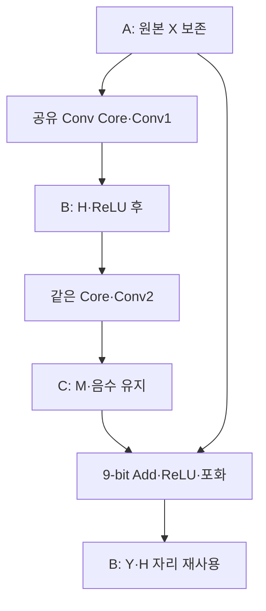

# 🔗 E14. Identity Residual Block을 실행하기 — X 보존·Buffer 재사용·9-bit Add·전체 RTL 비교

> 2026-11-02 복구한 과거 진단용 기록입니다. 현재 구현·보드 완료 상태와 구분합니다. [이관 안내](README.md)

출처: [Notion 원문](https://app.notion.com/p/408f0c4baec98179972adbb9e8f4789e?pvs=204)

> <b>\[심화·기본 실습 뒤 참고\] 현재 기준은 ResNet-20 + CIFAR-10 · ZedBoard다.</b>
> 
> [관련 Notion 문서](https://app.notion.com/p/40cf0c4baec98145b57af4780d20c752)을 먼저 따른다. 이 장의 기존 ResNet-56 수치·인공 벡터·Python/RTL 실행 기록은 해당 예제·버전의 증거다. 실제 모델 정수 연결과 보드 실행의 완료로 확대하지 않는다. 기본 단계는 S0\~S6이며, 이 장의 G번호가 있으면 장 내부 단계다.

> ResNet-56 실습 설계 E14 · Rev1.0 · Block의 의미 → Tensor 수명 → 수치 계약 → 순차 RTL → 중간값 비교 → 실제 실행 → 다음 Transition 순서로 읽는다.

> <b>Residual Block은 Conv를 두 번 계산하는 것에 더해, 원본 X를 Add까지 보존하고 다음 단계의 시작을 안전하게 연결하는 작업이다.</b>
> 
> E13의 Conv Core 하나를 Conv1·Conv2에 순차 재사용하는 실제 RTL을 작성했다. 작은 Block과 Stage1의 \[16,32,32\] 전체 Block을 실행하고, H·M·Y와 두 Conv의 wide acc를 각각 비교했다. 작은 Block 정상7회·reset 취소5회, 전체 크기 Block 정상2회가 통과했다.

<b>프로젝트 기준:</b> ResNet-56 + CIFAR-10의 같은 shape Identity Block을 대상으로 한다. 수치 계약은 /4·공통 activation scale의 진단용 예제다. 실제 checkpoint·채널별 multiplier·BN folding·accuracy를 검증한 것은 아니며, stride2/Option A Transition은 다음 작업이다.

<b>이전·연결:</b> [E13](E13.md) · [E12](E12.md) · [관련 Notion 문서](https://app.notion.com/p/407f0c4baec981f28d6dc166bb6c1c80)

<b>실행 자료:</b> [E14 RTL·Testbench·기준값·로그·부분 파형 ZIP](../../../historical/e12-e21/archives/e14_residual.zip)

전체 RTL·Testbench·기준값·로그·부분 파형은 위 ZIP에 포함했다.


# 0. 계산 흐름을 먼저 본다



Conv1을 끝냈다고 X를 덮어쓰면 shortcut이 사라진다. Conv2가 H를 다 읽기 전에 H 자리에 Y를 쓰면 Conv2 입력을 망가뜨린다. 따라서 첫 구현은 각 Conv의 전체 저장과 response가 끝난 뒤 다음 단계로 진행한다.

두 갈래 화살표가 있어도 두 계산기가 동시에 실행될 필요는 없다. 이번 구현은 Conv1→Conv2→Add 순서로 실행한다. 처리량 최적화보다 데이터 의존성을 직접 확인할 수 있는 기준을 먼저 만든다.

# 1. Tensor와 Buffer의 이름을 구분한다

| 이름 | 의미 | 실제 RTL 배열 |
| --- | --- | --- |
| X | Block 입력·shortcut 원본 | <code>xmem</code>, 물리 A |
| H | Conv1·재양자화·ReLU 결과 | <code>amem</code>, 물리 B |
| M | Conv2·재양자화 결과·Add 전 Main | <code>fmem</code>, 물리 C |
| Y | Add·ReLU·포화 후 Block 결과 | <code>amem</code>, 물리 B 재사용 |

RTL의 amem이라는 파일 안 변수명과 개념도의 물리 A는 같은 이름이 아니다. 문서에서는 Tensor X/H/M/Y와 역할 A/B/C를 우선해 읽는다.

| 실행 단계 | 읽기 | 쓰기 | 아직 보존할 값 |
| --- | --- | --- | --- |
| 준비 | 외부 preload | A=X·W1·W2 | X·Weight·bias |
| Conv1 | A=X·W1 | B=H | X는 Add 때문에 유지 |
| Conv2 | B=H·W2 | C=M | X·진행 중 H·M |
| Add | A=X·C=M | B=Y | 읽어 확보하기 전 X/M |
| 완료 | 외부 sink가 Y 수락 | B의 최종 Y 저장 완료 | B=다음 입력 후보 |

이번 Top은 B에 Y를 실제로 저장한다. 다음 Block의 물리 buffer 역할을 자동으로 회전시키는 전체 모델 allocator는 아직 구현하지 않았다. 반복 job은 같은 X/W를 다시 사용해 H와 Y를 재생성하는 시험이다.

# 2. 같은 INT8이라도 더하기 전에 단위를 정한다

| 용어 | 이번 계약 |
| --- | --- |
| Activation scale | X/H/M/Y 모두 같은 S |
| Zero point | 모든 activation·weight 0 |
| Weight scale | 두 Conv 모두1/4 |
| Bias 단위 | 해당 accumulator 단위 S/4 |
| Requantization | 각 Conv acc/4·RNE·signed INT8 포화 |
| Conv1 활성화 | ReLU 적용 |
| Conv2 활성화 | Add 전 ReLU 없음 |

Weight scale이1/4이면 곱·누산 단위는 S/4이고 이를 다시 activation 단위S로 바꾸는 code 비율이1/4다. 이처럼 단위를 완전히 정했기 때문에 M code와 X code를 그대로 넓혀 더할 수 있다.

E4의 /2 설명 예제와 이번 /4 구현 vector는 서로 다른 진단용 계약이다. 실제 모델의 모든 activation scale이 같다는 가정으로 일반화하지 않는다. 실제 checkpoint를 연결할 때는 E2의 multiplier/shift·반올림·clip 경계를 다시 적용해야 한다.

# 3. 연산 순서를 수식으로 고정한다

$$
H=\operatorname{sat8}\!\left(\operatorname{ReLU}\!\left(\operatorname{RNE}(a_1/4)\right)\right)
$$

$$
M=\operatorname{sat8}\!\left(\operatorname{RNE}(a_2/4)\right)
$$

$$
t=\operatorname{sext9}(M)+\operatorname{sext9}(X),\qquad
Y=\operatorname{sat8}\!\left(\operatorname{ReLU}(t)\right)
$$

M은 이 계약에서 이미 INT8로 포화한 값이다. Wide Conv2 acc와 shortcut을 더한 뒤 한 번만 양자화하는 다른 구현과 같은 계산이라고 가정하지 않는다.

| 예 | 올바른 순서 | 잘못 바꾸면 |
| --- | --- | --- |
| M=−4·X=6 | ReLU(−4+6)=2 | M에 먼저 ReLU하면6 |
| M=127·X=127 | 9-bit sum254→포화127 | 8-bit 합은−2로 wrap될 수 있음 |
| M=−128·X=−128 | 9-bit sum−256→ReLU0 | 8-bit wrap 결과와 경계 의미가 달라짐 |

Signed INT8 두 값의 합은−256\~254이므로9-bit가 필요하다. 실제 RTL은 두 피연산자를 각각 sign extension한 뒤 더한다.

```verilog
wire signed [8:0] add_wide =
    {main_q[7],main_q} + {skip_q[7],skip_q};
```

# 4. 하나의 Core에 두 작업을 연결한다

| Top 상태 | 하는 일 | 다음 단계 조건 |
| --- | --- | --- |
| IDLE | 준비된 Block command 수락·두 bias 배열 latch | cmd fire |
| START1 | Core에 Conv1 command 제시·ReLU on | Core cmd ready |
| RUN1 | X/W1 read·H를 B에 write | Core response 수락 |
| START2 | 같은 Core에 Conv2 command 제시·ReLU off | Core cmd ready |
| RUN2 | H/W2 read·M을 C에 write | Core response 수락 |
| ADD\_ISSUE | X/M의 같은 index read | 다음 clock |
| ADD\_WAIT | 확보한 두 code의9-bit 합·ReLU·포화 | result register 완성 |
| ADD\_HOLD | y/index/last 보관·sink 대기 | y fire 때 B write |
| RESP | 마지막 Y 전달·local write 뒤 완료 보관 | rsp fire |

Core의 response가 나오기 전에는 다음 Conv를 시작하지 않는다. Core는 마지막 output이 B/C에 수락된 뒤 response를 낸다. 이번 memory write는 y fire edge에서 local register array에 완료되는 모델이며, 외부 bus write 응답을 생략해도 되는 일반 규칙은 아니다.

Command fire에서 bias1/2를 한꺼번에 latch한다. TB는 이후 live bias를 바꿔도 Conv2가 잘못된 새 설정을 사용하지 않는지 확인했다.

# 5. Add의 주소·data·완료를 나눠 본다

| Edge | 사건 | 확보한 것 |
| --- | --- | --- |
| E0·ADD\_ISSUE | X\[i\]·M\[i\]의 synchronous read | skip\_q·main\_q |
| E1·ADD\_WAIT | 9-bit 합과 후처리 | result\_q·유효 y |
| E2 이후·ADD\_HOLD | sink 준비까지 보관 | code/index/last 불변 |
| y fire edge | sink 수락과 B\[i\] write | 해당 Y 저장 완료 |
| 마지막 fire 다음 | RESP 진입 | Block Core 경계 완료 |

이번에는 Add read도 같은 index의 두 memory에서 동시에 확보한다. 독립 bus 응답의 순서가 바뀌는 환경을 위한 tag queue·outstanding credit는 구현하지 않았다.

최종 y가 stall이면 B의 해당 Y write도 기다린다. RESP는 마지막 수락 뒤에만 나온다. CPU가 DDR에서 결과를 읽어도 된다는 DMA·cache 경계의 완료는 별도다.

# 6. Preload·실행·Reset의 소유권

| 인터페이스 | 계약 |
| --- | --- |
| load\_sel | 0=X·1=W1·2=W2 |
| load\_we && load\_ready | 유효 element 주소에8-bit write |
| prepared | 외부가 X/W1/W2/bias 준비 완료를 보증 |
| cmd\_ready | IDLE·prepared·load\_we0·reset0 |
| load\_ready | IDLE·cmd\_valid0·reset0 |
| busy·RESP | preload 금지·진행 중 데이터 고정 |
| Reset | 제어/valid 취소·배열 데이터 전체 삭제 아님 |

같은 edge에 preload와 command를 수락하지 않는다. 내부 load-valid tracker·빠진 Weight 검출기·오류 CSR는 이번 범위가 아니다. 사용자는 유효 범위와 preload 완료를 지켜야 한다.

Reset으로 취소한 작업의 B/C에는 부분 결과가 남을 수 있다. 외부는 prepared를 내리고 유효 데이터를 재준비해야 한다. 이번 시험은 재시작 전에 preload를 수행했으며, 부분 H/M/Y를 다음 Block 입력으로 넘기지 않는다.

# 7. 실제 크기와 저장량을 먼저 계산한다

| 구성 | 작은 Block | Stage1과 같은 전체 Block |
| --- | --- | --- |
| X/H/M/Y shape | \[2,4,4\] | \[16,32,32\] |
| 한 tensor 원소 | 32 | 16,384 |
| K | 18 | 144 |
| 한 Conv 논리 항 | 576 | 2,359,296 |
| 두 Conv 논리 항 | 1,152 | 4,718,592 |
| A/B/C activation payload | 96bytes | 48KiB |
| W1+W2 payload | 72bytes | 4,608bytes |

Activation payload는 INT8 세 영역의 논리 합이다. bias/register/Adapter/FIFO/정렬·RAM primitive 예약량은 별도다. Synthesis report 없이48KiB가 곧 FPGA BRAM 실제 사용량이라고 말하지 않는다.

Full configuration은 E13의 Cin3 Stem과 다르게 Cin16/Cout16·K144다. 같은 Core를 복사했다고 검증을 생략하지 않고 이 주소 범위와 긴 누산을 실제 실행했다.

# 8. 중간값을 모두 비교하는 Testbench

| 관측 | 비교 내용 |
| --- | --- |
| Conv1·Conv2 request | 주소·padding read 억제·tag·순서·정확한 항 수 |
| MAC·acc | term tag·두 Conv의 각 wide acc |
| H | Conv1 ReLU/양자화 뒤 전체 code·index |
| M | Conv2의 음수 포함 전체 code·index |
| Add | X/M 같은 index pairing·9-bit 경계 vector |
| Y | 전체 code/index/last·stall 유지·누락/중복 |
| Local write | y fire 뒤 다음 falling edge에서 B\[i\] 확인 |
| Buffer 수명 | 종료 시 X 보존·B=Y·C=M 전 원소 확인 |
| 완료 | 두 Conv drain·N개 Y·마지막 local write 뒤 response |
| 재시작 | 연속 job·동일 X/W 재사용·5위치 reset 취소 |

Python이 acc1/H/acc2/M/Y를 각각 저장하고 RTL monitor가 각 경계에서 비교한다. Class나 checksum 하나만 맞는지 확인하는 시험이 아니다.

<b>기준 파일 무결성:</b> 모든 <code>$readmemh</code> 전에 파일을 열 수 있는지 검사해 없으면 즉시 <code>$fatal</code>로 종료한다. 전체 크기 시험 준비 중 발견한 경로 공백 문제를 수정한 뒤 전체 회귀를 다시 실행했다. 파일 읽기 warning과0 초기값으로 만든 결과는 통과 근거로 사용하지 않는다.

# 9. 어떤 입력을 실행했는가?

| Vector | 드러내려는 오류 |
| --- | --- |
| W1 중심+4·W2 중심−4 | H=max(X,0), M=−H·Y=0; Conv2 뒤 잘못된 ReLU 검출 |
| Signed random·채널별 bias | 일반 주소·누산·중간 feature·설정 분리 |
| X127·중심 Weight+4 | H127·M127·Add254→127 포화 |
| X−128·Conv2 bias−1024 | M−128·Add−256→ReLU0 |
| 반복 job | 이전 B=Y를 새 H로 완전히 다시 쓰는지 |
| Reset5위치 | Conv1·Conv2·Add read 후·y HOLD·응답 HOLD 취소 |

Full \[16,32,32\]에서는 첫 두 vector를 각각 전체 Block으로 실행했다. 작은 Block에서는4개 수치 vector·반복 실행·reset 후 복구를 실행했다. Full size의 모든 reset 위치·모든 random seed를 전수 검증했다고 일반화하지 않는다.

# 10. 실제 실행 결과

```txt
PASS full=0 jobs=7 cancelled=5 accepted_terms=12114 accepted_outputs=256
hold_checks=114 negative_main_checks=29 local_write_checks=256
PASS full=1 jobs=2 cancelled=0 accepted_terms=9437184 accepted_outputs=32768
hold_checks=10893 negative_main_checks=12098 local_write_checks=32768
```

| 구성 | 정상 완료 | 별도 reset 취소 | 정상 Y 수 |
| --- | --- | --- | --- |
| C2·H4 | 7 Block | 5 Block | 224 |
| C16·H32 | 2 Block | 0 | 32,768 |

작은 Block의 정상 output은7×32=224개다. 전체 accepted\_outputs=256에는 완료 응답 전에 reset으로 취소한 작업의32개가 포함된다. Term 계수에도 취소 전에 수락한 항이 들어간다. 정상 완료 job과 별도 취소 job을 더해 성공 수를 부풀리지 않는다.

Full size는 각 job의 H/M/Y16,384개와 두 Conv의 acc를 비교했다. 선택 vector와 source revision의 RTL 동작 증거이며 실제 모델 accuracy나 배치배선 timing 증거는 아니다.

# 11. 파일과 재실행

ZIP의 <code>e14_residual</code> 폴더에서 실행한다.

```bash
VERILATOR=/path/to/verilator bash run.sh
```

| 파일 | 내용 |
| --- | --- |
| <code>rtl/residual_block.sv</code> | 공유 Core·A/B/C·job 순서·Add·출력/완료 |
| <code>rtl/conv3x3_core.sv</code> 등4개 | E13과 동일 source·두 parameter 구성으로 재검증 |
| <code>sim/tb_residual.sv</code> | small/full 전체 중간값·수명·reset 비교 |
| <code>reference/*/job*/</code> | 입력·두 Weight/bias·acc1/H/acc2/M/Y |
| <code>results/simulation_0/1.log</code> | 전체 회귀 결과 |
| <code>results/small_block_window.vcd</code> | 별도 실행의 처음100μs 파형 |
| <code>results/source_sha256.json</code> | source·vector hash |

필요 도구·사용 버전·C++20/PCH 설정은 README와 toolchain.json에 기록했다. 전체 회귀는 trace 없이 실행하고 부분 VCD는 별도 실행했다. <code>TRACE WINDOW ONLY</code>를 전체 PASS로 세지 않는다. 도구 binary·생성된 C++ object·실행 파일은 배포 ZIP에서 제외했다.

# 12. 이 단위에서 멈추는 이유와 다음 순서

| 다음 작업 | 새로 검증할 계약 |
| --- | --- |
| E15 Transition·Option A | stride2·서로 다른 입력/출력 shape·channel zero padding·shortcut 주소 |
| 실제 수치 상수 연결 | checkpoint/BN fold·perchannel multiplier/shift·Add 단위 정렬 |
| 모델 실행기 | 여러 Block의 descriptor·물리 buffer 역할 회전·GAP/FC |
| FPGA/SoC | 합성·RAM 포트·STA·전송·오류 복구·보드 측정 |

이번 E14의 Identity Block은 독립된 검증 단위로 비교를 끝내고 기록한다. Transition은 입력/출력 크기와 shortcut 규칙이 달라지므로 같은 문서에 가볍게 덧붙이지 않고 다음 검증 단위로 분리한다.

<b>미검증 범위:</b> 4-state X/Z·임의32-bit bias overflow·임의 RAM latency·read-during-write mode·CDC·버스 오류·DMA/cache·FPGA 합성/BRAM/STA/보드·실제 checkpoint/accuracy. Behavioral memory의 시뮬레이션 결과를 실제 memory inference와 동일하게 보지 않는다.

# 13. 의미를 확인하는 질문

1. Conv1이 끝나면 A의 X를 Conv2 결과로 덮어써도 될까?
2. M과 X가 모두 INT8이면 scale을 몰라도 더할 수 있을까?
3. Conv2 뒤 ReLU를 추가해도 Add 결과는 같을까?
4. B가 H였다가 Y가 되는 안전한 시작점은 언제일까?
5. 마지막 y가 나왔지만 ready0이면 Block 완료인가?

<details>
<summary>답의 핵심</summary>

1. 안 된다. Add가 원본 X를 다시 읽는다.
2. 아니다. 이번에는 공통 scale·zero point 계약을 명시했기 때문에 가능하다.
3. 아니다. 음수 Main과 양수 shortcut의 상쇄가 달라진다.
4. Conv2의 필요한 H read와 내부 pending이 모두 끝난 뒤다. 이번에는 전체 Core response 뒤로 잡았다.
5. 아니다. 정한 sink 수락과 local write 완료까지 기다린다.

</details>

<b>보충자료:</b> 실제 checkpoint 정수 상수·Option A 주소표·FPGA RAM 포트/합성 report·DMA 완료 검증은 해당 산출물이 준비되면 연결한다.

<b>다음 단계:</b> [E15](E15.md)에서 stride2·Option A의 수치/주소/buffer 계약과 Python 기준 검산을 정리했다. Transition RTL 실행은 별도 후속 단계이며 Identity RTL 통과와 구분한다.
