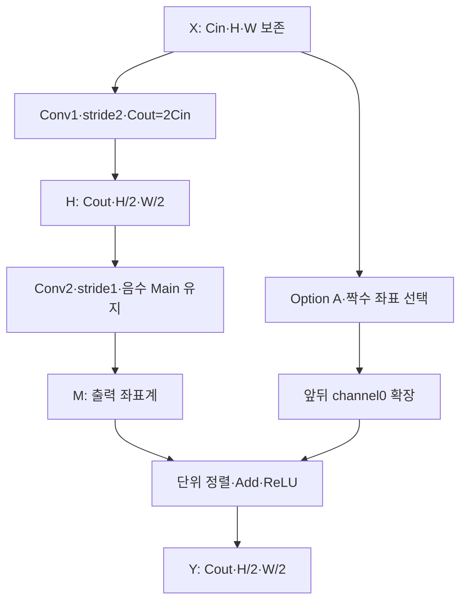

# 🔀 E15. Transition 규약을 고정하기 — Stride2·Option A·주소 변환·Buffer·기준 검산

> 2026-11-02 복구한 과거 진단용 기록입니다. 현재 구현·보드 완료 상태와 구분합니다. [이관 안내](README.md)

출처: [Notion 원문](https://app.notion.com/p/408f0c4baec98185a3baff740c2449e3?pvs=204)

> <b>\[심화·기본 실습 뒤 참고\] 현재 기준은 ResNet-20 + CIFAR-10 · ZedBoard다.</b>
> 
> [관련 Notion 문서](https://app.notion.com/p/40cf0c4baec98145b57af4780d20c752)을 먼저 따른다. 이 장의 기존 ResNet-56 수치·인공 벡터·Python/RTL 실행 기록은 해당 예제·버전의 증거다. 실제 모델 정수 연결과 보드 실행의 완료로 확대하지 않는다. 기본 단계는 S0\~S6이며, 이 장의 G번호가 있으면 장 내부 단계다.

> ResNet-56 실습 설계 E15 · Rev1.0 · Transition의 의미 → Shape·용어 → 주소·수식 → 작은 예제 → Buffer·제어 → 기준 검산 → RTL 작업 순서

> <b>Transition은 Main과 Shortcut을 같은 출력 좌표계로 바꾼 뒤 더하는 Block이다.</b>
> 
> 공간 길이는 절반, 채널은 두 배가 된다. Main은 stride2 Conv로 바꾸고 Option A는 X의 짝수 공간 좌표를 선택한 뒤 channel 앞뒤를0으로 확장한다. 출력 index를 그대로 X 주소로 쓰면 다른 값을 더하게 된다.

<b>실행 상태:</b> 작은 Transition 100개·1,600개 최종 출력을 두 Python 계산 방식으로 비교했다. 두 실제 Stage 전환 크기는 모든 Conv 주소/tag·범위·padding·shortcut 대응을 열거해 확인했다. Transition RTL 작성·compile·simulation은 아직 수행하지 않았다. E14의 Identity RTL 통과 범위를 확장해서 해석하지 않는다.

<b>이전·연결:</b> [E14](E14.md) · [관련 Notion 문서](https://app.notion.com/p/407f0c4baec981f28d6dc166bb6c1c80)

<b>프로젝트 기준:</b> ResNet-56 + CIFAR-10·E4에서 정한 Option A. 진단용 수치 계약은 E14의 /4 RNE·INT8·공통 activation scale·zero point0을 유지한다. 실제 checkpoint·채널별 scale·accuracy·합성·보드는 미검증이다.

[원본 첨부 문서](../../../historical/e12-e21/packages/e15_reference/source_attachment.md)

첨부에는 실행한 Python 전체 코드와 실제 JSON 결과를 넣었다. Python 3에서 코드 부분을 저장해 실행하면 같은 검사를 재현할 수 있다.

# 0. 두 경로가 무엇을 바꾸는지 먼저 본다

Option A에는 학습 Weight가 없다. 그러나 주소 계산·X read·zero token 생성·Main과의 pairing·역압 처리는 필요하다. Projection의 1×1 Conv와 다른 연산이므로 임의로 교체하지 않는다.

# 1. Identity와 달라지는 계약

| 항목 | E14 Identity | 이번 Transition |
| --- | --- | --- |
| Cin→Cout | C→C | C→2C |
| Conv1 stride | 1 | 2 |
| Conv2 stride | 1 | 1 |
| 공간 길이 | 유지 | 절반 |
| Shortcut | 같은 좌표 X | X\[:,::2,::2\]·channel 앞뒤0 |
| Add index | 같은 shape끼리 | 변환된 Shortcut과 Main끼리 |

| 구간 | X | H·M·Y | Conv1 K | Conv2 K |
| --- | --- | --- | --- | --- |
| 작은 검산 | \[2,4,4\] | \[4,2,2\] | 18 | 36 |
| Stage 1→2 | \[16,32,32\] | \[32,16,16\] | 144 | 288 |
| Stage 2→3 | \[32,16,16\] | \[64,8,8\] | 288 | 576 |

K는 한 output의 논리 곱 항 수다. Conv1과 Conv2의 입력 채널 수가 달라 K도 달라진다. 두 작업에 같은 K 종료값을 쓰지 않는다.

# 2. Stride2를 Window의 이동으로 이해한다

Kernel3·padding1·dilation1에서 다음과 같다.

$$
H_o=\left\lfloor\frac{H+2P-3}{S}\right\rfloor+1
$$

$$
i_y=S o_y+k_y-P,\qquad i_x=S o_x+k_x-P
$$

Conv1은 S=2, Conv2는 S=1이다. 짝수 H/W에서 Conv1 출력 길이는 정확히 절반이다. 이번 범위는 짝수 공간 길이와 짝수 Cin의 두 배 채널 전환으로 제한한다.

| Conv1 출력 좌표 | 입력 kernel 중심 | 입력 window 범위 |
| --- | --- | --- |
| (0,0) | (0,0) | y=−1\~1·x=−1\~1 |
| (0,1) | (0,2) | y=−1\~1·x=1\~3 |
| (1,0) | (2,0) | y=1\~3·x=−1\~1 |

Stride2는 2×2 평균이나 모든 이웃의 합이 아니다. 학습된3×3 kernel을 두 칸씩 이동하는 Conv다. Option A의 공간 선택도 평균을 내지 않는다.

# 3. Option A의 channel 배치를 고정한다

출력 채널의 앞뒤에 Cin/2개씩0을 둔다. 중앙 Cin개 채널만 X에서 읽는다.

$$
S[c_o,o_y,o_x]=
\begin{cases}
X[c_o-C_{in}/2,\ 2o_y,\ 2o_x] & C_{in}/2\le c_o<3C_{in}/2\\
0 & \text{otherwise}
\end{cases}
$$

| 전환 | 앞 zero channel | X를 읽는 중앙 channel | 뒤 zero channel |
| --- | --- | --- | --- |
| 2→4 | 0 | 1\~2 | 3 |
| 16→32 | 0\~7 | 8\~23 | 24\~31 |
| 32→64 | 0\~15 | 16\~47 | 48\~63 |

채널0을 어디에 붙이는지는 모델 계약이다. 뒤에만 Cin개를 붙이는 방식은 이번 E4 규칙과 다르다. 비대칭 양자화에서는 실수0의 code가 해당 zero point이므로 byte0을 무조건 채우지 않는다.

# 4. 작은 X 하나로 Shortcut 전체를 계산한다

X의 첫 채널을1\~16, 두 번째 채널을101\~116의 행 우선4×4로 놓는다. 짝수 좌표 (0,0)·(0,2)·(2,0)·(2,2)만 가져온다.

| Shortcut 출력 채널 | 2×2를 행 순서로 펼친 값 |
| --- | --- |
| co0 | 0,0,0,0 |
| co1 ← X channel0 | 1,3,9,11 |
| co2 ← X channel1 | 101,103,109,111 |
| co3 | 0,0,0,0 |

X를 별도 작은 tensor로 복사하지 않고 이 주소를 Add 시점에 직접 읽을 수 있다. Zero channel에서는 X read 없이 정한 zero code를 생성한다.

# 5. 출력 offset과 입력 주소를 분리한다

CHW element 주소를 사용한다. Byte 폭·base·bus 주소 변환은 wrapper의 별도 계약이다.

$$
a_Y=(c_o H_o+o_y)W_o+o_x
$$

$$
a_X=((c_o-C_{in}/2)H+2o_y)W+2o_x
$$

두 번째 식은 중앙 channel에서만 사용한다. Zero channel에서 음수 channel index를 잘라 RAM 주소로 내보내지 않는다.

Stage 1→2의 S\[8,1,2\]는 X\[0,2,4\]다. 출력 offset은2,066이지만 X offset은68이다. 서로 같은 주소가 아니다.

| Add token 필드 | 의미 |
| --- | --- |
| output index·co/oy/ox | Main과 Shortcut이 합쳐질 목적지 |
| skip\_is\_zero | X read가 필요한지 |
| skip source address | 중앙 channel에서만 유효 |
| job/generation·index tag | 다른 작업·좌표의 응답 결합 방지 |
| code·단위 | Add에 사용할 값과 수치 계약 |

# 6. Main·Shortcut의 수치 경계

E14와 같은 진단용 계약을 사용한다.

$$
H=\operatorname{sat8}(\operatorname{ReLU}(\operatorname{RNE}(a_1/4)))
$$

$$
M=\operatorname{sat8}(\operatorname{RNE}(a_2/4)),\qquad
Y=\operatorname{sat8}(\operatorname{ReLU}(\operatorname{sext9}(M)+\operatorname{sext9}(S)))
$$

X/H/M/S/Y의 scale은 공통 S, zero point0, Weight scale1/4로 정했다. 실제 모델에서 다르면 Main·Shortcut의 출력 단위 정렬이 추가된다. Conv2 뒤 Add 전 ReLU는 넣지 않는다.

Zero channel의 출력도 항상0인 것은 아니다. Shortcut이0이어도 Main이7이면 Add 후 Y는7이다. “zero channel”을 최종 Y를0으로 강제하는 mask로 구현하면 틀린다.

# 7. Buffer 수명과 capacity

E14처럼 A=X·B=H·C=M으로 시작하고 Conv2 drain 뒤 B를Y로 재사용한다.

| 전환 | A의 X | B의 H/Y | C의 M | INT8 payload 합 |
| --- | --- | --- | --- | --- |
| 16×32×32→32×16×16 | 16KiB | 8KiB | 8KiB | 32KiB |
| 32×16×16→64×8×8 | 8KiB | 4KiB | 4KiB | 16KiB |

물리 slot을 각각16KiB로 예약했다면 논리 tensor가 줄어도 예약량48KiB는 그대로일 수 있다. Weight·bias·계수·pending register·RAM primitive 정렬량은 표에 포함하지 않았다.

| 단계 | 반드시 지킬 조건 |
| --- | --- |
| Conv1 | A 전체 보존·B에 Cout/Ho/Wo 기준으로 저장 |
| Conv2 | B read·C write·Cin=Cout 전환 후 K 재설정 |
| Add | C index와 Option A의 목적지 tag 결합 |
| B 재사용 | Conv2의 H read와 pending이 모두 drain된 뒤 |
| 완료 | 마지막 Y 수락·저장·정한 write 응답 완료 뒤 |
| Reset | 취소된 부분 결과의 valid 폐기·새 generation 분리 |

# 8. 실제 Python 검산 결과

| 검사 | 범위·결과 |
| --- | --- |
| 작은 수치 시험 | seed15015·100 Block·각16output·총1,600output PASS |
| Conv 기준 비교 | 범위 조건 read 방식과 명시적0테두리 배열 방식의 H/M 비교 |
| Shortcut 기준 비교 | 공간 slicing+channel concatenation과 직접 source 주소 방식 비교 |
| 두 Stage 전환 | 전체 Conv 주소/tag·범위·padding·Shortcut 열거 PASS |
| RTL·RAM timing·stall/reset | 이번 장에서는 미실행 |

두 수치 방식은 같은 RNE 함수를 공유한다. 따라서 이번 비교만으로 RNE 자체를 독립 검증했다고 주장하지 않는다. 또한 큰 shape는 주소 열거만 수행했으며 전체 checkpoint 수치 비교가 아니다.

| 실제 계수 | Stage 1→2 | Stage 2→3 |
| --- | --- | --- |
| Conv1 논리 term | 1,179,648 | 1,179,648 |
| Conv1 실제 X read | 1,131,008 | 1,083,392 |
| Conv1 padding term | 48,640 | 96,256 |
| Conv2 논리 term | 2,359,296 | 2,359,296 |
| Conv2 실제 H read | 2,166,784 | 1,982,464 |
| Conv2 padding term | 192,512 | 376,832 |
| Shortcut 실제 X read | 4,096 | 2,048 |
| Shortcut zero token | 4,096 | 2,048 |
| 최종 output | 8,192 | 4,096 |

논리 MAC 수가 같아도 경계 위치와 padding read 수는 다를 수 있다. 이 계수는 FPGA cycle·성능·전송량 실측이 아니다. Padding term은 Weight와 논리 누산 항을 유지하고 Input read만 생략하는 정책으로 센다.

# 9. 다음 RTL 구현 작업표

| 변경 위치 | 구현할 것 | 처음 확인할 시험 |
| --- | --- | --- |
| Conv 주소 생성 | Static stride1/2·출력 길이·좌표 확대 | 첫/끝 window·음수 좌표 |
| Conv 작업 선택 | Conv1 Cin→2Cin, Conv2 2Cin→2Cin | K144/288 및 K288/576 종료 |
| Weight·bias 선택 | 다른 channel 수·두 작업 상수 보관 | 채널 경계·live 설정 변화 |
| Option A read | 중앙 주소·zero token·같은 목적지 tag | co7→8·23→24 등 경계 |
| Add pairing | 독립 Main/Skip 유효·수락·보관 | 한쪽 응답 지연·y stall |
| Buffer·완료 | 다른 logical length·drain·B 재사용 | last stall·응답 대기·반복 job |
| Reset | 각 pending/zero 경로 취소 | old tag 폐기·재준비 |

E14의 C 하나를 쓰는 같은 shape Core를 단순히 C=32로 바꾸면 Cin16→Cout32 Conv1을 표현하지 못한다. 단계별 Cin/Cout/H/W/stride와 memory capacity를 명시해야 한다. 범용화하면서 Core를 두 개 복제할지 공유할지도 자원·검증 범위와 함께 결정한다.

# 10. 의미를 확인하는 질문

1. Option A는 2×2 average pooling인가?
2. 앞 zero channel이면 Main 결과도 버려야 할까?
3. Output index2,066을 X 주소로 그대로 써도 될까?
4. E14의 RTL이 통과했으니 Transition도 통과한 것일까?

답의 핵심

1. 아니다. 짝수 좌표를 선택하고 채널을0으로 확장한다.
2. 아니다. Main+0의 결과를 유지한다.
3. 아니다. 예제에서는 입력 offset68로 변환한다.
4. 아니다. 다른 shape·stride·K·shortcut 경로의 RTL 실행 증거가 필요하다.

<b>보충자료:</b> 실제 checkpoint·채널별 scale·Transition RTL source/파형·FPGA RAM/합성 report는 산출물이 준비되면 연결한다.

<b>다음 단계:</b> [E16](E16.md)에서 이 규약의 stride2 Conv·Option A·Add를 실제 RTL로 구현하고 acc/H/M·Shortcut·Y·저장/완료를 비교했다. 두 static Core를 순차 실행한 구조이며 선택 시험 범위·로그·남은 한계는 E16에 기록했다.
