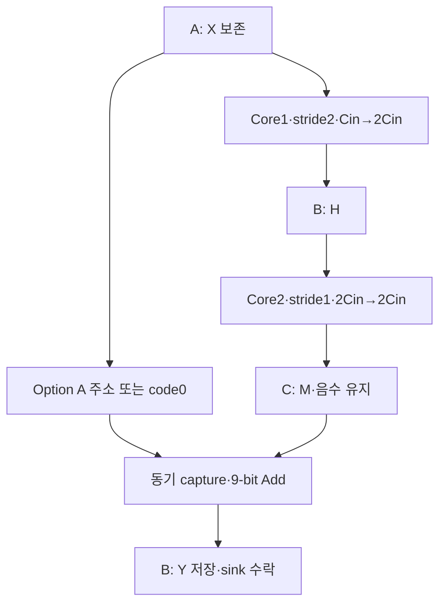

# 🧪 E16. Transition RTL을 실행하기 — Stride2·Option A·두 Core·중간값·완료 검증

> 2026-11-02 복구한 과거 진단용 기록입니다. 현재 구현·보드 완료 상태와 구분합니다. [이관 안내](README.md)

출처: Notion 원문

> <b>\[심화·기본 실습 뒤 참고\] 현재 기준은 ResNet-20 + CIFAR-10 · ZedBoard다.</b>
> 
> 관련 Notion 문서을 먼저 따른다. 이 장의 기존 ResNet-56 수치·인공 벡터·Python/RTL 실행 기록은 해당 예제·버전의 증거다. 실제 모델 정수 연결과 보드 실행의 완료로 확대하지 않는다. 기본 단계는 S0\~S6이며, 이 장의 G번호가 있으면 장 내부 단계다.

> ResNet-56 실습 설계 E16 · Rev1.0 · 구현 범위 → 두 Conv 연결 → Option A read → Add·저장·완료 → 실제 결과 → 재실행·남은 범위

> <b>E15의 Transition 기준을 실제 SystemVerilog로 구현하고 Verilator에서 실행했다.</b>
> 
> 작은 Transition 정상7회·reset 취소5회와 두 Stage 전환의 전체 크기 각1회가 통과했다. 두 큰 시험에서 총7,077,888개 누산 항·12,288개 최종 출력을 비교했고 acc1/H/acc2/M·Shortcut·저장·완료 경계도 확인했다.

<b>프로젝트 기준:</b> ResNet-56 + CIFAR-10의 Option A·진단용 /4 RNE·공통 activation scale·zero point0. 실제 checkpoint/BN folding·채널별 multiplier·accuracy·합성·보드 검증은 아직 수행하지 않았다.

<b>이전·연결:</b> [E15](E15.md) · [E14](E14.md)

<b>실행 자료:</b> [E16 RTL·Testbench·전체 기준값·로그·부분 파형 ZIP](../../../historical/e12-e21/archives/e16_transition.zip)

ZIP에는 실행 스크립트·Python 기준 생성기·전체 hex vector·source hash를 포함했다. 생성된 C++ object·실행 파일·도구 binary는 제외했다.


# 0. 이번 구현에서 무엇을 확인하려는가?

Transition은 서로 다른 shape의 두 Conv와 Shortcut 변환을 연결해야 한다. E14처럼 Cin=Cout인 Core 하나에 채널 값만 바꾸면 첫 Conv의 Cin→2Cin을 표현하지 못한다.

| 구성 | Conv1 | Conv2 | Option A·Y |
| --- | --- | --- | --- |
| 작은 시험 | \[2,4,4\]→\[4,2,2\], S2·K18 | \[4,2,2\]→\[4,2,2\], S1·K36 | \[4,2,2\], 16output |
| Stage 1→2 | \[16,32,32\]→\[32,16,16\], S2·K144 | \[32,16,16\]→같은 shape, S1·K288 | 8,192output |
| Stage 2→3 | \[32,16,16\]→\[64,8,8\], S2·K288 | \[64,8,8\]→같은 shape, S1·K576 | 4,096output |

S는 이 표에서 stride, K는 output당 논리 곱 항 수다. 채널 수·출력 길이·K를 각각 검사한다.

# 1. 두 Core를 순차 실행하는 기준 구조



<b>물리 Conv Core는 두 개다.</b> 서로 다른 static parameter로 각각 elaboration하고 RUN1→RUN2로 순차 실행한다. 이 결과를 “MAC 하나를 두 작업에 공유했다”는 자원 증거로 해석하지 않는다. 실제 RAM/DSP 개수도 합성 report가 나오기 전에는 확정하지 않는다.

첫 구현은 shape 선택 오류와 수치·순서 오류를 분리하기 위해 이 구조를 사용했다. 추후 하나의 runtime-configurable Core로 합치면 설정 latch·counter 폭·두 작업 경계·회귀 시험을 다시 확인해야 한다.

# 2. Conv Core에서 바꾼 부분

| 변경 | 실제 동작 |
| --- | --- |
| STRIDE static parameter | 1 또는2를 빌드 시 지정 |
| 출력 길이 | kernel3·PAD1에 맞춰 계산 |
| Window 좌표 | iy=oy×STRIDE+ky−PAD, ix도 동일 |
| 두 K | Core1=Cin×9, Core2=2Cin×9 |
| 출력 index | 두 Core 모두 Transition의 Cout×Ho×Wo |
| Padding | Input read 억제·MAC x=0·Weight/논리 term 유지 |

$$
H_o=\left\lfloor\frac{H+2P-3}{S}\right\rfloor+1,\qquad
i_y=S o_y+k_y-P
$$

출력 length의 나눗셈은 static parameter 식이다. 실행 중 좌표 분해를 위해 일반 divider를 넣은 구조와 구분한다. 실제 합성 회로는 미확인이다.

검증한 입력 공간은4/32/16, 출력 공간은2/16/8의 power-of-two 정사각형이다. 다른 크기·odd shape·동적 stride를 지원한다고 일반화하지 않는다. 주소·index 포트16-bit, k/tag 하위16-bit의 범위도 지켜야 한다.

# 3. Shortcut은 목적지 index에서 원본 주소를 만든다

| Stage 1→2의 co | 동작 |
| --- | --- |
| 0\~7 | skip\_q=0·X read 없음 |
| 8\~23 | X\[co−8,2oy,2ox\] read |
| 24\~31 | skip\_q=0·X read 없음 |

Stage 2→3은 중앙 co16\~47에서 X\[co−16,2oy,2ox\]를 읽고 나머지는0이다.

$$
a_X=((c_o-C_{in}/2)H+2o_y)W+2o_x
$$

출력 add\_index에서 co/oy/ox를 shift·mask로 분리한다. 이 방식은 이번 power-of-two 길이에 맞춘 구현이다. 중앙 channel 범위일 때만 source 주소를 사용한다. Zero channel에서는 계산된 주소 bit가 존재해도 배열을 읽지 않는다.

예를 들어 Stage 1→2의 S\[8,1,2\]는 X\[0,2,4\], input offset68이다. 목적지 offset2,066을 그대로 source 주소로 사용하지 않는다.

# 4. Main·Shortcut은 같은 Add 좌표로 확보한다

| 상태 | 경계 |
| --- | --- |
| ADD\_ISSUE | 같은 add\_index의 M read·Option A X read 또는0 생성 |
| ADD\_WAIT | 확보한 main\_q/skip\_q를9-bit로 넓혀 합산·ReLU·포화 |
| ADD\_HOLD | y code/index/last를 보관·ready 대기 |
| y fire | 외부 sink 수락과 B\[index\] local write |
| 마지막 fire 뒤 RESP | 완료 응답 보관·새 command 거부 |

이번에는 두 경로를 같은 clock의 local memory read 단계에서 동시에 capture한다. 가변 latency 응답 두 개를 임의 순서로 받는 tag FIFO/credit queue는 구현하지 않았다. 따라서 이번 pairing 통과는 이 고정 capture 구조의 증거다.

$$
H=\operatorname{sat8}(\operatorname{ReLU}(\operatorname{RNE}(a_1/4)))
$$

$$
M=\operatorname{sat8}(\operatorname{RNE}(a_2/4)),\qquad
Y=\operatorname{sat8}(\operatorname{ReLU}(\operatorname{sext9}(M)+\operatorname{sext9}(S)))
$$

Conv2 뒤 Add 전에는 ReLU를 넣지 않는다. INT8 두 값의 합은−256\~254이므로9-bit로 보존한다. Shortcut zero channel은 Main을 버리는 mask가 아니다. M=7·S=0이면 Y=7이어야 한다.

모든 activation scale이 같고 zero point0이라는 진단 계약이다. 실제 per-channel 계수를 연결할 때에는 수치 단위 정렬과 양자화 경계를 다시 지정해야 한다.

# 5. Buffer와 설정의 수명을 지킨다

| 공간 | 크기 | 보존 조건 |
| --- | --- | --- |
| A=X | Cin×H×W | Conv1 뒤에도 Add까지 보존 |
| B=H→Y | 2Cin×Ho×Wo | Conv2 drain 뒤에만 Y로 재사용 |
| C=M | 2Cin×Ho×Wo | Add가 필요한 값을 확보할 때까지 |
| W1/W2 | 각각 다른 Cin/Cout | job 중 변경 금지 |
| bias1/bias2 | 각 Cout개 | 외부 command 수락 때 두 배열 latch |

X·W1·W2는 load\_sel0/1/2로 preload한다. load\_we&&load\_ready에서만 유효 element 주소에 쓴다. Command와 load를 같은 edge에 수락하지 않고 busy/RESP 동안 load를 막는다.

prepared는 외부가 누락 없이 준비됐음을 보증하는 입력이다. 내부 load-valid tracker·부족한 Weight 오류 검출기·제품용 오류 CSR는 구현하지 않았다.

Reset은 제어·valid·진행 취소다. Memory 배열 전체를 지우지 않으며 취소된 부분 H/M/Y는 완료 tensor가 아니다. TB는 prepared를 내리고 재준비한 뒤 재시작했다.

# 6. 실제로 비교한 경계와 Vector

| 검사 | 기준·관측 |
| --- | --- |
| 요청 | 두 Conv의 source/weight 주소·padding·tag·순서 |
| 누산 | term tag·acc1/acc2의 모든 wide 결과 |
| 중간값 | H·M의 모든 INT8 code/index |
| Option A | Python 공간 slicing+channel0 연결의 skip과 capture 값 일치 |
| 출력 | Y code/index/last·누락/중복·stall 유지 |
| 저장 | 각 y fire 뒤 B write·종료 시 X 보존/B=Y/C=M |
| 완료 | 두 Conv drain·마지막 Y 수락 뒤 response |
| 설정 | command 뒤 live bias 변화가 현재 작업에 영향 없음 |

Python은 좌표 loop와 부호/절댓값 RNE로 전체 hex 기대값을 만든다. RTL은 nested counter·shift/lowbit RNE를 사용한다. 모든 seed·모든 합법 입력의 exhaustive 검증은 아니다.

| 작은 Vector·시험 | 확인 목적 |
| --- | --- |
| 중앙 Main=−ReLU(Shortcut) | Conv2 뒤 잘못된 ReLU 검출 |
| Signed random·bias | 주소·중간값·음수·일반 Add |
| 127+127=254 | 넓은 Add 후 INT8 포화 |
| −128−128=−256 | 넓은 음수 합·ReLU |
| 동일 X/W 반복 | 이전 B=Y를 새 H로 덮어쓰는 순서 |
| Reset5위치 | Conv1·Conv2·Add read·held Y·held response 취소 |

두 큰 shape는 각각 signed-random vector1개를 전체 실행했다. 큰 shape의 모든 reset 위치를 시험한 것은 아니다. 작은 reset의 Add read/held Y 사례는 첫 zero channel 구간이며 중앙 X read 취소의 추가 directed 시험은 후속 범위다.

# 7. 실제 실행 결과와 계수 해석

| 구성 | 정상 완료 | 별도 reset 취소 | 정상 최종 Y |
| --- | --- | --- | --- |
| 작은 Transition | 7 | 5 | 112 |
| Stage 1→2 | 1 | 0 | 8,192 |
| Stage 2→3 | 1 | 0 | 4,096 |

```txt
PASS full=0 jobs=7 cancelled=5 accepted_terms=8946 accepted_outputs=128
hold_checks=91 negative_main_checks=10 local_write_checks=128
zero_tokens=64 skip_reads=64

PASS full=1 jobs=1 cancelled=0 accepted_terms=3538944 accepted_outputs=8192
hold_checks=2722 negative_main_checks=1178 local_write_checks=8192
zero_tokens=4096 skip_reads=4096

PASS full=2 jobs=1 cancelled=0 accepted_terms=3538944 accepted_outputs=4096
hold_checks=1391 negative_main_checks=531 local_write_checks=4096
zero_tokens=2048 skip_reads=2048
```

작은 시험의 정상 output은7×16=112개다. 전체 accepted\_outputs=128에는 완료 응답 전에 reset으로 취소한 작업의16개가 포함된다. 수락한 term과 zero/read 계수에도 취소 전 token이 포함되며 정상 완료 횟수에 더하지 않는다.

각 큰 shape는 Conv1 1,179,648항·Conv2 2,359,296항, 합계3,538,944항을 비교했다. 두 shape의 합은7,077,888항이다. 논리 항 수나 Host simulation 시간은 FPGA 성능이 아니다.

모든 readmemh 전에 파일 open을 확인하고 기준 파일이 없으면 즉시 실패한다. 실제로 파일 하나를 잠시 감춰 missing reference 실패를 확인한 뒤 복원했다. 기준값을 읽지 못한0 초기값을 통과 근거로 사용하지 않는다.

# 8. 파일과 재실행

ZIP의 <code>e16_transition</code> 폴더에서 실행한다.

```bash
VERILATOR=/path/to/verilator bash run.sh
```

| 파일 | 내용 |
| --- | --- |
| <code>rtl/transition_block.sv</code> | 두 Core·preload·Option A·Add·저장·제어 |
| <code>rtl/conv3x3_core.sv</code> | static stride1/2·주소·tag·MAC 연결 |
| <code>sim/tb_transition.sv</code> | small/Stage12/Stage23 비교·stall·reset |
| <code>reference/*/job*/</code> | X·W1/W2·bias·acc1/H/acc2/M·skip·Y |
| <code>results/simulation_0/1/2.log</code> | 전체 회귀 로그 |
| <code>results/small_block_window.vcd</code> | 별도 small 실행의 처음100μs |
| <code>results/source_sha256.json</code> | source·vector identity |
| <code>results/toolchain.json</code> | 사용 도구 식별 |

파형의 TRACE WINDOW ONLY는 부분 구간 확인용 종료다. 전체 회귀 PASS와 구분한다. GCC C++20·make·Python3·Verilator가 필요하며 wheel 환경에 맞춘 PCH 설정은 README에 기록했다. 사용 distribution5.48.0·binary version 문자열과 simulation banner5.49를 모두 보존했다.

# 9. 다음 작업과 미검증 범위

이번 source와 선택 vector에서 Transition의 실제 RTL 실행 증거를 얻었다. E12\~E16의 진단용 /4 계약이 실제 모델의 양자화 상수와 같다는 뜻은 아니다.

다음은 채널별 multiplier/shift와 Add 전 scale 정렬을 고정하고 RNE·중간 폭·clip 위치의 정수 일치를 확인한다. 실제 checkpoint 연결에는 상수의 source/version 확인이 필요하다.

<b>미검증·후속 보충자료:</b> 실제 checkpoint/accuracy·per-channel 상수·물리 Core 공유·비 power-of-two shape·중앙 Shortcut read pending reset·임의 응답 latency·bus/CDC/DMA/cache·4-state X/Z·bias overflow 오류 처리·FPGA 합성/BRAM mode/STA/보드·성능 실측. 각 증거가 준비되면 연결한다.

<b>후속 구현:</b> [E17](E17.md)에서 채널별 계수·공통 분모 Add·RNE·Zero-point를 독립 RTL unit으로 검증했다. E16 전체 Conv/Transition 연결 시험은 후속 범위이며 unit 실행 증거와 구분한다.
