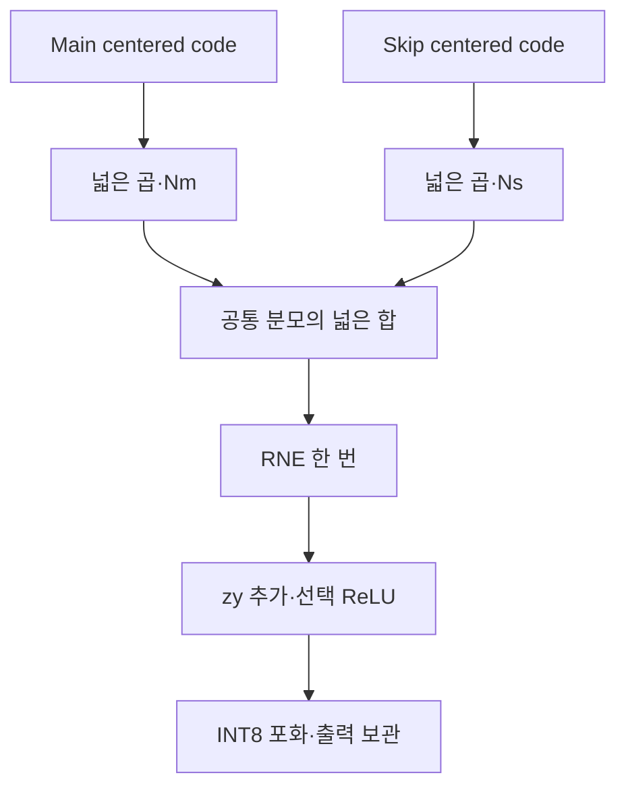

# 🔢 E17. 채널별 정수 후처리를 실행하기 — Multiplier·Shift·RNE·Zero-point·Add 단위 정렬

> 2026-11-02 복구한 과거 진단용 기록입니다. 현재 구현·보드 완료 상태와 구분합니다. [이관 안내](README.md)

출처: [Notion 원문](https://app.notion.com/p/408f0c4baec9817b96cafc78ab33ad55?pvs=204)

> <b>\[심화·기본 실습 뒤 참고\] 현재 기준은 ResNet-20 + CIFAR-10 · ZedBoard다.</b>
> 
> [관련 Notion 문서](https://app.notion.com/p/40cf0c4baec98145b57af4780d20c752)을 먼저 따른다. 이 장의 기존 ResNet-56 수치·인공 벡터·Python/RTL 실행 기록은 해당 예제·버전의 증거다. 실제 모델 정수 연결과 보드 실행의 완료로 확대하지 않는다. 기본 단계는 S0\~S6이며, 이 장의 G번호가 있으면 장 내부 단계다.

> ResNet-56 실습 설계 E17 · Rev1.0 · 눈금 변환의 의미 → 용어·수식 → Add 순서 → RTL 폭·수락 → 실제 시험 → 통합 작업

> <b>Requantization은 단순히 비트를 버리는 것이 아니라, 누산 결과를 다음 Tensor의 눈금으로 옮기는 계산이다.</b>
> 
> 고정 /4를 대신할 Multiplier·Shift·Zero-point·ReLU 후처리와 공통 분모 Residual Add를 독립 RTL 모듈로 구현했다. 실제 Verilator에서7,508개 vector와 stall·reset 취소/복구를 비교했다. E16 Conv·Transition에 연결한 전체 통합 시험은 아직 아니다.

<b>프로젝트 기준:</b> ResNet-56 + CIFAR-10. 실제 checkpoint·Calibration·Scale 추출·상수 근사 생성·Accuracy 평가는 수행하지 않았다. 이번 계수는 명시한 진단용 정수 계약이다.

<b>이전·연결:</b> [E16](E16.md) · [관련 Notion 문서](https://app.notion.com/p/407f0c4baec981ce8fbbff09a0c4c3ee)

<b>실행 자료:</b> [E17 RTL·Testbench·전체 vector·로그·부분 파형 ZIP](../../../historical/e12-e21/archives/e17_requant.zip)


# 0. 같은 acc라도 Channel마다 결과가 달라질 수 있다

기존 E12\~E16은 모든 채널에 /4라는 동일한 비율을 적용했다. Per-output-channel Weight scale을 사용하면 accumulator의 단위가 채널마다 달라지므로 출력으로 바꾸는 비율도 달라진다.

| 용어 | 이번 의미 |
| --- | --- |
| Scale | 정수 code 한 칸이 나타내는 실제 크기 |
| Requantization | accumulator/branch 단위에서 출력 단위로 변환 |
| Multiplier N | 비율의 정수 분자·unsigned16 |
| Right Shift r | 비율의 분모2\^r·0\~31 |
| RNE | 가장 가까운 정수·정확히 절반이면 짝수 |
| Zero-point z | 실수0에 해당하는 정수 code |
| Centering | code에서 zero-point를 뺀 값 |
| Saturation | 최종 code를−128\~127로 제한 |

같은 acc20에1/4를 곱하면5,3/2를 곱하면30이다. Channel ID만 맞고 계수가 이전 채널의 것이면 결과는 틀린다.

# 1. Conv 후처리의 단위를 고정한다

입력 scale sx, 출력 채널별 Weight scale sw,o, 출력 scale sy라면 이상적인 비율은 다음과 같다.

$$
M_o=\frac{s_xs_{w,o}}{s_y}\approx\frac{N_o}{2^{r_o}}
$$

Bias가 accumulator 단위로 이미 포함된 a에 대해:

$$
u=\operatorname{RNE}\left(\frac{aN_o}{2^{r_o}}\right),\qquad q=u+z_y
$$

ReLU를 사용하면 q=max(q,zy), 그 뒤 signed INT8 saturation을 적용한다. 실수0의 code가 zy이므로 비영 Zero-point에서 ReLU 기준을 무조건 code0으로 잡으면 안 된다.

이번 RTL은 N0\~65,535·r0\~31이다. 음수 N·음수 shift·범위 밖 계수는 지원하지 않는다. 비율이 항상1보다 작다는 가정은 없으며 N3/r1로1.5를 표현할 수 있다.

# 2. 이상적 비율과 실제 정수 계수

| 계산 | 결과 |
| --- | --- |
| acc15·이상적 비율0.3 | RNE(4.5)=4 |
| acc15·N77/r8 | RNE(1,155/256)=5 |

RTL은 실제로 내보낸 N/r을 따라야 하므로 이번 기대값은5다. 이상적 비율의4와 다르다고 RTL 실패로 판단하지 않는다. 반대로 정수 일치가 됐다고 계수 근사의 Accuracy 영향이 사라지는 것도 아니다.

| Channel | 진단 계수 N | r | 비율 |
| --- | --- | --- | --- |
| 0 | 1 | 2 | 0.25 |
| 1 | 77 | 8 | 약0.30078125 |
| 2 | 3 | 1 | 1.5 |
| 3 | 65,535 | 31 | 약0.0000305171 |

TB는 이4개 계수를 Channel ID와 함께 번갈아 입력한다. RTL 내부 coefficient RAM은 없다. 호출자가 해당 채널의 올바른 계수를 token에 붙여야 한다.

# 3. Add 전에 두 경로의 눈금을 맞춘다

Main code8·scale1/8과 Skip code4·scale1/4는 각각 실수1이다. 출력 scale1/8이면 합의 code는16이다. Code8+4=12로 바로 더하면 틀린다.

$$
u_m=q_m-z_m,\qquad u_s=q_s-z_s
$$

$$
\frac{s_m}{s_y}\approx\frac{N_m}{2^r},\qquad
\frac{s_s}{s_y}\approx\frac{N_s}{2^r}
$$

$$
v=u_mN_m+u_sN_s,\qquad
q_y=\operatorname{sat8}\left(\operatorname{RNE}(v/2^r)+z_y\right)
$$

이번 예제는 Nm1·Ns2·r0이므로8×1+4×2=16이다. ReLU를 쓰면 saturation 전 max(q,zy)를 추가한다.

공통 분모는 상수 생성 단계의 계약이다. 두 branch의 기존 shift 중 큰 값을 택하고 분자를 늘리면16-bit 범위를 넘을 수 있다. 이번 모듈은 적합한 N/r을 자동 생성하지 않는다. Exporter가 표현 범위·근사 오차를 확인한 계수를 입력해야 한다.

# 4. 한 번 반올림하는 위치를 보존한다



| 연산 | 결과 |
| --- | --- |
| 두 항이 각각0.5·합친 뒤 RNE | RNE(1)=1 |
| 각각 RNE한 뒤 합 | 0+0=0 |
| 5/8을 한 번 RNE | 1 |
| 5/2를 RNE하고 다시 /4·RNE | 0 |

Branch마다 먼저 반올림·clip한 뒤 더하는 구조와 넓은 합산 후 한 번 변환하는 구조는 일반적으로 같은 계산이 아니다.

E16의 M은 Conv2에서 이미 /4·INT8 포화한 값이었다. 이번 Add 경로에 그 M을 넣을지, Conv2 wide acc를 직접 넣을지는 다음 통합에서 결정해야 한다. 입력의 단위·계수·clip 경계를 함께 고정하고 Integer Reference와 맞춘다.

# 5. 실제 RTL의 폭과 signed 규칙

| 경계 | 구현 폭·계약 |
| --- | --- |
| Main·Skip 입력 | signed32·이미 centering된 값 |
| N | unsigned16→앞에0을 붙인 signed17 |
| 각 곱 | signed49 |
| 합산 | 각 곱 sign extension→signed64 |
| RNE·zy 추가 | signed64 |
| zy·출력 | signed8 |
| metadata | Channel16·last1 |

허용 입력에서 각 곱의 절댓값은2\^47 미만이고 두 곱의 합도2\^48 미만이다.64-bit는 이 합과 zy 추가를 담는다. 이 범위 계산은 모듈에 들어오기 전 Conv INT32 accumulator의 overflow 안전성을 보장하지 않는다.

양수 N을 signed16으로 바로 해석하면32,768 이상에서 음수가 된다. 이번 구현은 앞에0을 붙인 signed17로 곱한다.

Zero-point도 넓은 signed 변수로 명시적으로 확장한다. Concatenation이 비교식에 섞이면서 unsigned 비교가 되지 않게 한다. 실제 초기 시험에서 이 문제를 발견해 수정하고 전체 회귀를 재실행했다.

| 회귀 사례 | 올바른 결과 |
| --- | --- |
| a512·N1·r2·zy−128·ReLU on | u128→q0→max(0,−128)=0 |

이 사례에서 code0은 실수0을 뜻하지 않는다. 실수0의 code는−128이다.

# 6. 음수 RNE와 Shift0

RTL은 arithmetic shift로 floor 몫을 구하고 하위 r-bit remainder·몫의 홀짝으로 RNE를 보정한다. Python은 절댓값의 몫/나머지와 부호 복원을 사용한다.

| 입력·비율 | RNE |
| --- | --- |
| 10/4 | 2 |
| 14/4 | 4 |
| −10/4 | −2 |
| −14/4 | −4 |

r0에서는 정수를 그대로 사용하고 remainder/half 처리를 건너뛴다. r−1에 해당하는 shift를 실행하지 않는다. 지원 shift의 최댓값은31이다.

단순 right shift만으로는 음수·동점 RNE가 완성되지 않는다. 계수0·양끝 signed32 값·N65,535도 시험에 넣었다.

# 7. Token·설정·결과를 함께 수락한다

| 인터페이스 | 동작 |
| --- | --- |
| in\_valid&&in\_ready | 값·N/r·mode·zy·Channel·last를 한 token으로 수락 |
| 출력 보관 | 계산한 code/Channel/last를 register에 저장 |
| out\_valid&&out\_ready | 해당 결과 전달 |
| out\_valid&&!out\_ready | code/Channel/last 유지·새 입력 거부 |
| Reset | 보관된 token 취소·out\_valid 제거 |

수락한 결과가 stall 중일 때 live 값·계수·metadata를 바꿔도 이미 저장된 결과가 변하지 않는지 비교했다. 상위 Producer는 미수락 token을 valid로 제시했다면 수락까지 자기 payload를 유지해야 한다.

이번 unit은1-entry 구조이며 in\_ready=!out\_valid&&!rst다. Output 소비와 새 Input 수락을 같은 edge에 겹치는 최적화는 없다. 조합 곱·합·RNE의 timing이나 처리 주파수는 합성 전이므로 판단하지 않는다.

Channel·last를 보관하지만 Tensor 완료 response를 만들지는 않는다. Frame count·Conv 완료·저장 완료와의 연결은 상위 제어기의 책임이다.

# 8. 실제 실행한 시험과 결과

| 시험 묶음 | 범위 |
| --- | --- |
| 기존 /4 회귀 | acc−1,024\~1,024·N1/r2·2,049개 |
| signed·계수·Shift 경계 | INT32 양끝·N0/1/77/65,535·r0/1/2/3/8/15/31 |
| Zero-point·ReLU | zy−128/−5/0/7/127·음수·동점·포화 |
| Add·반올림 순서 | Scale 정렬8+4→16·0.5+0.5→1·5/8→1 |
| 무작위 | seed17017·5,000개·4채널 계수 순환 |
| 제어 | 출력 stall·live 설정 변화·held result reset 취소·재시작 |

```txt
REFERENCE PASS vectors=7508 divide4_regression=2049 seed=17017
PASS vectors=7508 accepted=7510 outputs=7509 cancelled=1 hold_checks=15015
```

기준 vector7,508개 외에 reset 복구 출력1개를 더 비교해 outputs=7,509다. 취소한 token1개가 accepted에는 들어가므로 accepted=7,510이다. 취소를 성공 output으로 더하지 않는다.

모든 수락 출력의 code·Channel·last를 기대값과 비교했다. 기준 파일 누락·형식 오류도 각각 simulator가 즉시 실패하는지 음성 시험하고 원본을 복구했다.

이번 결과는 독립 unit의 선택 시험이다. E16 전체 Conv/Transition의 변경 후 회귀·계수 RAM·계수 교체 시점·실제 모델 정수 일치·Accuracy까지 통과한 것은 아니다.

# 9. 파일과 재실행

ZIP의 e17\_requant 폴더에서 실행한다.

```bash
VERILATOR=/path/to/verilator bash run.sh
```

| 파일 | 내용 |
| --- | --- |
| rtl/requant\_join.sv | Requant/Add·RNE·Zero-point·ReLU·포화·token 보관 |
| reference/make\_vectors.py | 무제한 Python 정수로 vector 생성 |
| reference/vectors.txt | 값·계수·mode·metadata·기대 code |
| sim/tb\_requant.sv | 실제 결과·stall·reset 비교 |
| results/simulation.log | 전체 회귀 |
| results/reference\_errors.log | 누락/형식 오류 실패 경로 확인 |
| results/first\_window.vcd | 별도 실행의 처음10μs |
| results/source\_sha256.json | source/vector identity |

파형의 TRACE WINDOW ONLY는 부분 실행이며 전체 PASS와 구분한다. 사용한 Verilator distribution5.48.0·binary version 문자열·banner5.49와 C++20/PCH 설정을 README/toolchain.json에 보존했다.

# 10. 다음 통합에서 확정할 것

| 항목 | 필요한 결정·검증 |
| --- | --- |
| Main 경계 | INT8 M인지 wide acc인지·기존 clip 유지 여부 |
| Per-channel 상수 | Channel 축·N/r/zy·버전·hash·범위 |
| Coefficient fetch | RAM latency·Channel tag·stall·old config 폐기 |
| Option A | Source zero point를 centering한0의 전달 |
| Add | 공통 분모·중간 폭·RNE 횟수·출력 clip |
| Top 회귀 | 작은 Conv→Identity→Transition·중간값·완료·reset |
| 실제 모델 | Calibration·계수 근사·Accuracy·checkpoint provenance |

<b>보충자료:</b> 실제 checkpoint 상수·Exporter·계수 RAM·E16 통합 파형·FPGA synthesis/STA·모델 Accuracy는 산출물이 준비되면 연결한다. 현재 RTL은 음수 multiplier·left shift·임의 affine centering·독립 branch rounding·bus/CDC/DMA를 구현하지 않았다.

# 11. 의미를 확인하는 질문

1. Per-channel이면 Channel ID만 출력에 붙이면 충분할까?
2. ReLU 기준은 항상 정수0일까?
3. 두 branch를 각각 반올림한 합과 넓게 합친 뒤 반올림한 값은 같을까?
4. Unit 통과로 실제 모델 Accuracy도 검증됐을까?

<details>
<summary>답의 핵심</summary>

1. 아니다. 값·Bias·Multiplier·Shift·Channel의 대응이 맞아야 한다.
2. 아니다. 해당 출력의 실수0 code인 zy가 기준이다.
3. 아니다.0.5+0.5의 예에서1과0으로 달라진다.
4. 아니다. 상수 생성·전체 통합·실제 입력 평가가 별도로 필요하다.

</details>

<b>다음 단계:</b> [E18](E18.md)에서 이 unit을 Option A Transition의 두 Conv·Add 경계에 연결했다. /4 호환·Channel 계수·작업 snapshot·수치/수락/완료 회귀를 실제 RTL로 확인했으며, Identity/Stem Top·실제 checkpoint 상수·coefficient RAM은 후속 범위다.
