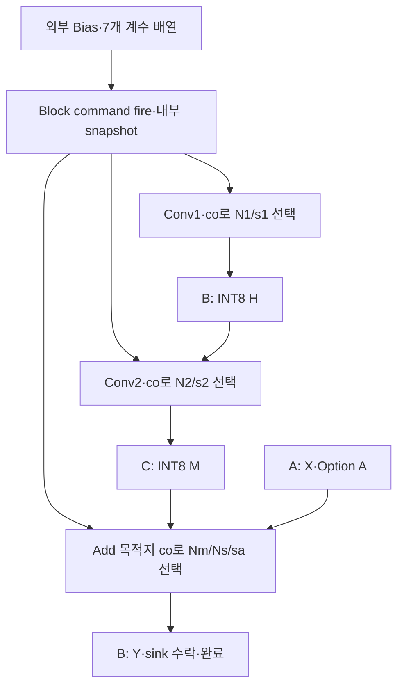

# 🔗 E18. 계수 Table을 Transition에 연결하기 — Command Snapshot·채널 정합·/4 호환·통합 RTL 회귀

> 2026-11-02 복구한 과거 진단용 기록입니다. 현재 구현·보드 완료 상태와 구분합니다. [이관 안내](README.md)

출처: [Notion 원문](https://app.notion.com/p/408f0c4baec98156a295f1523ed9fc81?pvs=204)

> <b>\[심화·기본 실습 뒤 참고\] 현재 기준은 ResNet-20 + CIFAR-10 · ZedBoard다.</b>
> 
> [관련 Notion 문서](https://app.notion.com/p/40cf0c4baec98145b57af4780d20c752)을 먼저 따른다. 이 장의 기존 ResNet-56 수치·인공 벡터·Python/RTL 실행 기록은 해당 예제·버전의 증거다. 실제 모델 정수 연결과 보드 실행의 완료로 확대하지 않는다. 기본 단계는 S0\~S6이며, 이 장의 G번호가 있으면 장 내부 단계다.

> ResNet-56 실습 설계 E18 · Rev1.0 · 통합 경계 → 계수 수명 → Channel 대응 → /4 호환 → 실제 회귀 → 다음 모델 연결

> <b>E17의 독립 후처리 unit을 E16의 두 Conv와 Residual Add에 실제로 연결했다.</b>
> 
> Block command에서 계수 table을 보관하고, 채널에 맞는 N/r을 선택해 H·M·Y를 생성한다. 작은 Transition 정상9회·reset 취소6회, 두 Stage 전환 전체 크기 각2회의 RTL 비교가 통과했다.

<b>범위:</b> ResNet-56 + CIFAR-10의 진단용 Option A Transition. Zero-point0·Conv2의 INT8 M 저장 경계를 유지한다. E14 Identity Top·E13 Stem Top은 이번에 변경하거나 회귀하지 않았다. 실제 checkpoint·Calibration 상수·Accuracy·FPGA 합성/보드는 미검증이다.

<b>이전·연결:</b> [E17](E17.md) · [E16](E16.md)

<b>실행 자료:</b> [E18 통합 RTL·Testbench·기준값·E16 baseline·로그·부분 파형 ZIP](../../../historical/e12-e21/archives/e18_integrated.zip)


# 0. 모듈을 연결하면 새로 생기는 문제

독립 unit의 계산이 맞아도 다른 Channel의 계수를 읽거나, Conv1을 시작한 뒤 바뀐 계수를 Conv2가 사용하면 Block 결과는 틀린다. 이번 통합은 수치뿐 아니라 값·계수·작업의 수명을 함께 고정한다.

| 용어 | 이번 구현의 의미 |
| --- | --- |
| Coefficient Table | 출력 Channel별 N·Right Shift 배열 |
| Command Snapshot | command 수락 edge에서 현재 배열을 내부 register로 복사 |
| Channel Alignment | 값이 속한 co로 해당 계수를 선택 |
| Numeric Boundary | H·M·Y를 어느 수치 규칙으로 저장할지 정한 경계 |
| Compatibility Regression | 기존 /4 설정에서 E16 기준값과 일치하는지 확인 |
| Varied Table | Channel마다 다르게 둔 진단용 계수 |

Varied table은 학습·Calibration에서 얻은 상수가 아니다. 산술·설정 전달을 검사하는 임의 정수 패턴이며 실제 모델의 일관된 Tensor scale을 보증하지 않는다.

# 1. 이번에 유지한 것과 바꾼 것

| 경계 | 유지한 계약 | 바뀐 계산 |
| --- | --- | --- |
| Conv1 | stride2·INT32 acc·ReLU·INT8 H | /4 대신 Channel별 N1/s1 |
| Conv2 | stride1·Add 전 ReLU 없음·INT8 M | /4 대신 Channel별 N2/s2 |
| Shortcut | Option A·중앙 X read·바깥 code0 | 변환된 skip을 Add unit으로 전달 |
| Add | M은 이미 INT8·Y는 ReLU/INT8 | Nm/Ns·공통 shift·합산 뒤 RNE |
| Buffer | A=X·B=H→Y·C=M | 저장 경계·수명 유지 |

<b>Conv2 wide acc와 Skip을 바로 합치는 fusion은 하지 않았다.</b> E16의 INT8 M 저장 위치를 유지했기 때문에 기존 /4 호환성을 명확히 비교할 수 있다.

E17 unit 자체는 비영 Zero-point도 지원하지만 이번 Top은 출력 Zero-point0을 사용한다. 모든 affine centering이 끝났다고 해석하지 않는다.

# 2. 계수와 Data가 만나는 위치



두 Conv Core는 여전히 서로 다른 static shape로 각각 생성해 순차 실행한다. E17 unit을 붙였다고 하나의 물리 MAC으로 공유된 것은 아니다.

계수는 RAM 요청·응답으로 fetch하지 않는다. 이번 구현은 전체 배열을 register로 보관하고 co로 선택한다. Variable-latency coefficient RAM의 pending·tag·credit·오류 처리는 별도 범위다.

# 3. Command에서 무엇을 고정하는가?

| 내부 배열 | 의미 |
| --- | --- |
| b1·b2 | Conv1/2의 Channel별 bias |
| n1·s1 | Conv1 재양자화 계수 |
| n2·s2 | Conv2 재양자화 계수 |
| nm·ns·sa | Add 두 분자·공통 Right Shift |

외부 cmd\_valid&&cmd\_ready에서 두 Bias 배열과7개 계수 배열을 함께 복사한다. 외부는 이 edge 전까지 준비한 설정을 안정적으로 제시해야 한다.

Conv1/2는 각각 내부 command를 수락할 때 자기 계수를 다시 보관한다. Conv2가 뒤늦게 시작해도 외부 live table을 직접 읽지 않는다.

| 시점 | 시험한 동작 |
| --- | --- |
| 외부 command 전 | vector의 실제 Bias/N/r 준비 |
| 외부 command 뒤 | 외부 계수 배열을0으로 바꿈·Bias도 다른 값으로 변경 |
| Conv2·Add 실행 | snapshot의 원래 계수로 결과 생성 |
| 다음 job command | 새로 준비한 table을 다시 수락 |

이 검사는 현재 작업의 설정 격리와 다음 작업의 설정 반영을 확인한다. Hardware double-bank·configuration version CSR·CRC·부분 table 갱신 프로토콜을 구현한 것은 아니다.

# 4. Channel과 output index를 구분한다

| 위치 | 계수 조회에 쓰는 값 | 결과 metadata |
| --- | --- | --- |
| Conv1/2 | 내부 출력 Channel counter co | 전체 output index·last |
| Add | add\_index에서 구한 목적지 co | add\_index·last |

E17 unit의 channel이라는16-bit metadata 포트는 이번 wrapper에서 전체 output index를 전달하는 데 사용했다. 실제 coefficient lookup은 co에서 수행한다. 이름이 channel이라고 그 포트값을 그대로 table 주소로 쓰지 않는다.

한 output이 stall하면 그 output의 co/index와 이미 계산한 code가 보관된다. 다음 output으로 진행하는 조건은 y fire다. 계수 선택과 결과 순서도 TB에서 전체 기대 index로 비교했다.

# 5. 통합한 수치 함수

각 Channel에 대해:

$$
H=\operatorname{sat8}\left(\operatorname{ReLU}\left(\operatorname{RNE}(acc_1N_1/2^{s_1})\right)\right)
$$

$$
M=\operatorname{sat8}\left(\operatorname{RNE}(acc_2N_2/2^{s_2})\right)
$$

$$
Y=\operatorname{sat8}\left(\operatorname{ReLU}\left(\operatorname{RNE}\left[\frac{MN_m+SN_s}{2^{s_a}}\right]\right)\right)
$$

S는 Option A로 만든 centered Skip이다. 이번에는 zero point0이며, M은 이미 INT8로 포화한 값이다. 양자화 경계가 달라지는 fusion과 구분한다.

| /4 호환 설정 | 값 |
| --- | --- |
| Conv1·Conv2 | N1=N2=1·s1=s2=2 |
| Add | Nm=Ns=1·sa=0 |
| Zero-point | 0 |
| Conv1·최종 Y | ReLU on |
| Conv2 M | ReLU off |

이 설정에서는 E16과 동일한 함수다. 내부 register·후처리 수락 경로가 달라져 cycle 순서는 달라질 수 있으므로 값·주소·수락·완료 조건을 비교했다. 동일 cycle 수나 성능을 주장하지 않는다.

# 6. 다른 계수로도 Channel 대응을 확인한다

| co mod4 | Conv1 N/r | Conv2 N/r | Add Nm/Ns/sa |
| --- | --- | --- | --- |
| 0 | 1/2 | 3/3 | 1/2/1 |
| 1 | 3/3 | 1/2 | 2/1/1 |
| 2 | 77/8 | 2/3 | 3/1/1 |
| 3 | 2/2 | 77/8 | 1/3/1 |

표의 N/r은 분자 N과 shift r의 쌍이다. 예를 들어77/8은77÷8이 아니라77/2\^8이다. Add는 M×Nm+S×Ns를 넓게 더한 뒤 한 번 반올림한다.

작은 shape의 두 varied job은 같은 계수 패턴을 반복해 작업 사이의 table 재준비도 확인했다. 큰 두 shape에서는 /4 baseline과 varied signed-random job을 각각1회 실행했다.

이 table을 실제 Tensor의 scale에서 유도하지 않았다. 실제 모델에 사용하려면 계수 근사·공통 분모·Channel 축·Bias 단위·clip 위치와 Calibration 정보를 함께 검증해야 한다.

# 7. 기존 결과와 무엇을 같다고 확인했는가?

Python이 /4 설정으로 새 기준값을 생성한 뒤, 보관한 E16 baseline의 다음 파일과 byte 단위로 비교한다.

| 비교 파일 | 경계 |
| --- | --- |
| acc1·acc2 | 두 Conv의 wide acc |
| middle | H |
| main | M |
| skip | Option A |
| output | 최종 Y |

작은4개 vector 세트와 Stage 1→2/Stage 2→3 각각1개, 총6개 baseline 세트를 비교했다. 그 기준값을 새 RTL의 모든 유효 output·중간값과 다시 비교했다.

기존 기대값을 새 RTL 결과로 덮어쓰지 않았다. ZIP의 baseline\_e16 폴더는 비교 기준이며, mismatch를 없애려고 수정할 파일이 아니다.

# 8. 실제 통합 회귀 결과

| 구성 | 정상 완료 | 별도 취소 | 정상 최종 Y |
| --- | --- | --- | --- |
| 작은 Transition | 9 | 6 | 144 |
| Stage 1→2 | 2 | 0 | 16,384 |
| Stage 2→3 | 2 | 0 | 8,192 |

두 큰 shape는 합계14,155,776개 논리 누산 항과24,576개 최종 출력을 비교했다. 이 수는 FPGA cycle이나 성능 실측이 아니다.

```txt
PASS full=0 jobs=9 cancelled=6 accepted_terms=11538 accepted_outputs=164
hold_checks=110 local_write_checks=164 zero_tokens=84 skip_reads=80

PASS full=1 jobs=2 cancelled=0 accepted_terms=7077888 accepted_outputs=16384
hold_checks=5418 local_write_checks=16384 zero_tokens=8192 skip_reads=8192

PASS full=2 jobs=2 cancelled=0 accepted_terms=7077888 accepted_outputs=8192
hold_checks=2683 local_write_checks=8192 zero_tokens=4096 skip_reads=4096
```

작은 정상 output은144개다. accepted\_outputs164에는 응답 전 취소 작업의16개와 중앙 read 취소 전에 이미 수락한 zero-channel output4개가 포함된다. 취소는 정상 완료 횟수에 넣지 않는다.

zero\_tokens/skip\_reads는 최종 Y가 수락될 때의 Shortcut 종류를 세는 TB 계수다. 특히 취소 시험에서는 실제 RAM read 요청 수와 같다고 해석하지 않는다.

| 검사 | 실제 확인 |
| --- | --- |
| 두 Conv | 주소·Weight 주소·padding·tag·term 순서 |
| 수치 | acc1/H/acc2/M·Option A·Y |
| 설정 | Channel별 N/r·command snapshot·live 설정 변경 |
| 흐름 | y payload/index/last 유지·최종 y stall·응답 보관 |
| 저장 | X 보존·B=Y·C=M·매 y fire의 B write |
| Reset | Conv1·Conv2·zero Add capture·held Y·held response·중앙 X capture |
| 재시작 | 재준비·old valid 제거·정상 복구 |

추가한 중앙 X capture reset은 E16에서 남겨 둔 작은 shape의 선택 시험이다. 두 큰 shape의 모든 reset 위치·모든 seed를 전수 검증한 것은 아니다.

# 9. 재실행과 근거 파일

ZIP의 e18\_integrated 폴더에서 실행한다.

```bash
VERILATOR=/path/to/verilator bash run.sh
```

| 파일 | 역할 |
| --- | --- |
| rtl/transition\_block.sv | table snapshot·두 Core·Option A·Add·저장·완료 |
| rtl/conv3x3\_core.sv | Channel 계수 capture·E17 후처리 연결 |
| rtl/requant\_join.sv | E17과 동일 source·넓은 곱/합·RNE·포화 |
| reference/<i>/job</i>/ | 입력·Weight/Bias·7개 계수·모든 기대값 |
| baseline\_e16/ | 기존 비교 기준 vector |
| sim/tb\_transition.sv | 값·계수·주소·수명·reset 통합 비교 |
| results/simulation\_0/1/2.log | 전체 회귀 |
| results/small\_block\_window.vcd | 별도 small 실행의 처음100μs |
| results/source\_sha256.json | source/vector identity |

RTL-only -Wall lint와 세 구성의 생성·빌드·시뮬레이션을 수행했다. 기준 파일이 없으면 즉시 실패하며 실제 음성 시험에서 누락을 검출하고 파일을 복구했다.

부분 파형의 TRACE WINDOW ONLY는 전체 회귀 PASS가 아니다. 사용 도구 식별·C++20/PCH 설정은 README/toolchain.json에 보존했다. Simulator executable·생성 C++ object·도구 binary는 ZIP에서 제외했다.

# 10. 남은 모델 연결 단계

| 후속 항목 | 확인할 것 |
| --- | --- |
| 상수 패키지 | Tensor 축·N/r 범위·Bias 단위·shape·hash·version |
| Exporter | Calibration/Scale에서 실제 정수 상수 생성·근사 오차 |
| 실제 모델 | checkpoint 출처·전처리·정수 reference·Accuracy |
| 다른 Top | Identity·Stem의 wrapper 연결·각 회귀 |
| Coefficient RAM | latency·주소/tag·부분 준비·version 전환 |
| Hardware | 물리 Core 공유·합성·BRAM/DSP·STA·보드·전송 |

이번 결과는 Option A Transition의 진단용 통합 증거다. 실제 checkpoint/Accuracy·비영 Zero-point centering·임의 shape/latency·bus/DMA/cache/CDC·4-state X/Z·INT32 overflow 오류 처리·FPGA 합성/보드/성능은 미검증이다.

<b>보충자료:</b> 실제 상수 manifest·Exporter 검증·coefficient RAM 파형·FPGA report는 산출물이 준비되면 연결한다.

# 11. 의미를 확인하는 질문

1. Conv1이 끝난 뒤 외부 table을 바꾸면 현재 Conv2도 새 값을 써야 할까?
2. E17의 channel 포트에 이번 wrapper가 담은 것은 무엇일까?
3. /4 기준값이 같으면 cycle 수도 같다고 할 수 있을까?
4. 진단용 varied table 통과가 실제 Calibration 상수의 타당성을 보장할까?

<details>
<summary>답의 핵심</summary>

1. 아니다. 현재 Block은 command에서 보관한 설정을 끝까지 사용한다.
2. 전체 output index다. 실제 계수 조회 Channel co는 별도로 선택한다.
3. 아니다. 이번에는 값·수락·완료 계약을 비교했다.
4. 아니다. 실제 Tensor 단위와 상수 생성·Accuracy를 별도로 확인한다.

</details>

<b>다음 단계:</b> [E19](E19.md)에서 이 상수를 Manifest 패키지로 묶고 Python으로 Shape/축/범위/Hash/누산 bound·오류 거부·Snapshot 생성을 검증했다. 실제 모델 상수 생성과 RTL Loader 연결은 별도 후속 단계다.
