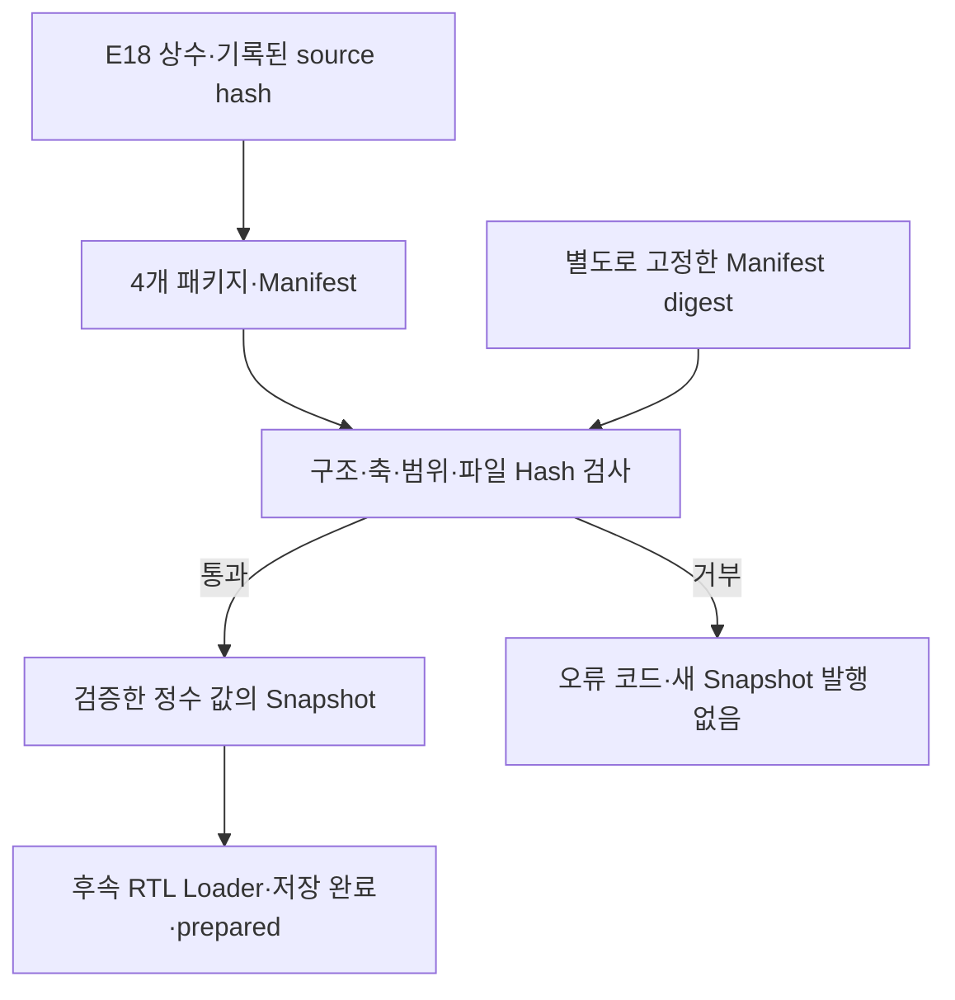

# 📦 E19. 상수 패키지를 실행 전에 검증하기 — Manifest·Channel 축·Hash·누산 범위·Preload Snapshot

> 2026-11-02 복구한 과거 진단용 기록입니다. 현재 구현·보드 완료 상태와 구분합니다. [이관 안내](README.md)

출처: [Notion 원문](https://app.notion.com/p/408f0c4baec981b69c50c063af294790?pvs=204)

> <b>\[심화·기본 실습 뒤 참고\] 현재 기준은 ResNet-20 + CIFAR-10 · ZedBoard다.</b>
> 
> [관련 Notion 문서](https://app.notion.com/p/40cf0c4baec98145b57af4780d20c752)을 먼저 따른다. 이 장의 기존 ResNet-56 수치·인공 벡터·Python/RTL 실행 기록은 해당 예제·버전의 증거다. 실제 모델 정수 연결과 보드 실행의 완료로 확대하지 않는다. 기본 단계는 S0\~S6이며, 이 장의 G번호가 있으면 장 내부 단계다.

> ResNet-56 실습 설계 E19 · Rev1.0 · 상수 패키지의 의미 → Manifest·축·표현 → 검증 순서 → Preload Snapshot → 실제 시험 → RTL 연결 범위

> <b>RTL에 넣을 숫자가 맞으려면, 값뿐 아니라 Shape·Channel 축·수치 규칙·파일 버전도 함께 맞아야 한다.</b>
> 
> E18에서 검증한 상수로4개 패키지를 만들고 실행 전 Python 검사기를 구현했다. 정상44개 상수 파일·70,488개 원소가 통과했고, 잘못 만든30개 사례는 예상 오류로 거부했다. 검증한 정수 값으로4개 Software Preload Snapshot도 생성했다.

<b>실행 범위:</b> 이번 장은 Python 패키지 생성·검증·Snapshot 생성 단계다. 새 RTL simulation·실제 FPGA preload·checkpoint 추론·Accuracy 평가는 수행하지 않았다. E18의 진단용 상수와 기존 RTL 실행 증거를 사용하며 실제 학습 모델 상수로 표시하지 않는다.

<b>이전·연결:</b> [E18](E18.md) · [E17](E17.md)

<b>실행 자료:</b> [E19 Manifest·상수 패키지·검사기·Preload JSON·시험 결과 ZIP](../../../historical/e12-e21/archives/e19_constants.zip)


# 0. 파일 이름만 맞으면 생기는 오류

Weight와 Bias 파일이 각각 존재해도 서로 다른 revision이면 잘못된 계산이 된다. Shift32를5-bit 포트에 잘라 넣으면0으로 바뀔 수 있고, Channel 축을 다르게 펼치면 값의 개수와 dtype이 맞아도 다른 계산을 한다.

| 확인할 대상 | 단독 확인으로 부족한 이유 |
| --- | --- |
| 파일 존재 | 일부 상수 누락·이전 파일 혼입 가능 |
| 원소 수 | 축 순서·같은 크기의 Channel permutation은 남음 |
| dtype | 논리 범위와 저장 word 폭이 다를 수 있음 |
| SHA256 | 기록한 byte와 같은지 확인할 뿐 숫자의 의미를 증명하지 않음 |
| Manifest | 파일과 함께 바꾸면 내부 Hash를 다시 맞출 수 있음 |
| 정수 Reference | 실제 RTL의 수락·저장·reset까지 대신 검증하지 않음 |

이번 검사기는 지원하는 계약과 맞지 않는 패키지를 거부하고, 검증된 값만 다음 소프트웨어 단계로 넘기는 역할을 한다.

# 1. 용어와 패키지의 구성

| 용어 | 의미 |
| --- | --- |
| Package | 함께 사용해야 하는 상수 파일과 Manifest 묶음 |
| Manifest | Shape·역할·축·dtype·개수·수치 계약·Hash를 적은 설명서 |
| Schema Version | Manifest 형식의 버전 |
| Target | 패키지가 따라야 할 RTL 수치·Shape 계약 |
| Provenance | 어느 source·case·생성기에서 나온 자료인지의 기록 |
| Pinned Digest | 승인된 Manifest의 digest를 별도로 고정한 값 |
| Preload Snapshot | 검증한 정수 목록·target·source·Manifest digest를 보관한 소프트웨어 산출물 |



마지막 RTL Loader 연결은 이번에 구현하지 않았다. Snapshot 파일이 만들어졌다고 E18의 prepared 입력이 자동으로1이 되지는 않는다.

# 2. 실제로 만든4개 패키지

| 패키지 | E18 source case | Shape | 상수 원소 수 |
| --- | --- | --- | --- |
| small\_compat | small/job1 | Cin2·H4→Cout4·H2 | 252 |
| small\_varied | small/job4 | Cin2·H4→Cout4·H2 | 252 |
| stage12\_varied | stage12/job1 | Cin16·H32→Cout32·H16 | 14,112 |
| stage23\_varied | stage23/job1 | Cin32·H16→Cout64·H8 | 55,872 |

각 패키지의11개 역할은 Weight1/2·Bias1/2·N1/N2/Nm/Ns·s1/s2/sa다. 입력 이미지와 기대 output은 실행 시 입력·Reference이므로 이 상수 역할 목록과 구분한다. ZIP에는 source 감사용 vector snapshot도 별도로 포함했다.

생성에 앞서 E18 파일 bytes가 기록된 source hash와 같은지 확인했다. Manifest의 source에는 diagnostic·revision·case·생성기 digest를 기록한다. 검사기 자체가 이 기록을 외부 학습 서버나 서명으로 인증하는 것은 아니다.

# 3. Manifest는 계산의 경계도 적는다

| 항목 | 이번 고정값 |
| --- | --- |
| schema\_version | 정수1 |
| target | e18\_transition\_diag\_v1 |
| 지원 Cin/H | (2,4)·(16,32)·(32,16) |
| Cout | 2×Cin |
| Conv1/Conv2 stride | 2/1 |
| Padding | 1 |
| Rounding | RNE ties-to-even |
| Zero-point | 0 |
| Conv1 | Requant→ReLU→INT8 saturation |
| Conv2 | Requant→INT8 saturation·M 저장 |
| Add | INT8 M·Option A→wide sum→RNE 한 번→ReLU→saturation |
| 설정 수락 | Block command에서 전체 table snapshot |

같은 파일을 “Conv2 wide acc를 저장한다”는 다른 RTL에 넣으면 dtype·Add 단위·메모리 크기가 달라진다. 이 경우 기존 target에 억지로 맞추지 않고 계약·Schema·검사기를 함께 바꿔야 한다.

이번 검사기는 범용 모델 형식이 아니다. 명시한 E18 진단 계약만 지원한다. 아직 결정하지 않은 모델 정책을 유연한 기본값으로 조용히 통과시키지 않는다.

# 4. Channel 축과 저장 표현

| 역할 | 논리 dtype | Shape·축 | 파일의 저장 word |
| --- | --- | --- | --- |
| Weight1 | signed INT8 | \[Cout,Cin,3,3\]·OIHW·O축0 | 2자리 hex |
| Weight2 | signed INT8 | \[Cout,Cout,3,3\]·OIHW·O축0 | 2자리 hex |
| Bias1/2 | signed INT32 | \[Cout\]·O축0 | 8자리 hex |
| N1/N2/Nm/Ns | unsigned16 | \[Cout\]·O축0 | 32-bit word·8자리 hex |
| s1/s2/sa | unsigned5 | \[Cout\]·O축0 | 32-bit word·8자리 hex |

파일은 logical row-major의 text hex다. Packed binary의 CPU byte endianness와 혼동하지 않는다. 음수 signed 값은 해당 저장 폭의 two's-complement로 해석한다.

예를 들어 N의 저장 word가32-bit여도 논리 허용 범위는0\~65,535다. Shift도32-bit hex에 담지만0\~31만 허용한다. 파일을 읽을 수 있다는 이유로 하위 bit만 잘라 포트에 넣지 않는다.

$$
\mathrm{count}=\prod_i\mathrm{shape}_i
$$

$$
\mathrm{SHA256}(\mathrm{actual\ file\ bytes})
=\mathrm{manifest.file.sha256}
$$

size\_bytes는 줄바꿈을 포함한 실제 text 파일 bytes다. count와 같은 값이 아니다. 논리 payload 크기·text 저장 크기·FPGA RAM 예약량을 각각 구분한다.

# 5. 실행 전 검증 순서

| 순서 | 검사 |
| --- | --- |
| 1 | Manifest bytes를 한 번 읽고, 지정한 pinned digest와 비교 |
| 2 | JSON parse·중복 key·지원 version/target 확인 |
| 3 | Shape·stride·수치 경계·source 형식 확인 |
| 4 | 정확한11개 역할·dtype·저장 폭·Shape·layout·출력 Channel 축 확인 |
| 5 | 상대 경로·중복 경로·파일 존재·symlink 확인 |
| 6 | 실제 bytes의 길이와 Hash 확인 |
| 7 | hex 구문·word 폭·실제 원소 수 확인 |
| 8 | N/Shift 논리 범위·signed 값 decode |
| 9 | Weight·Bias 기반의 보수적 INT32 누산 범위 확인 |
| 10 | 같은 검증 메모리의 값으로 Snapshot 발행 |

Manifest digest 계산과 JSON 해석은 같은 bytes를 사용한다. 각 상수도 한 번 읽은 bytes를 Hash·decode에 함께 사용한다. Snapshot을 만들 때 hex 파일을 다시 열어 검증 이후의 다른 값으로 바꾸지 않는다.

알 수 없는 물리 파일이 패키지 디렉터리에 더 있어도 Manifest에 없는 역할로 로드하지 않는다. 모든 디렉터리 내용이 승인된 파일이라는 의미는 아니다.

# 6. Bias와 Weight로 누산 위험을 미리 제한한다

출력 Channel o의 Weight 집합에 대해:

$$
B_o=128\sum_k|w_{o,k}|
$$

$$
-2^{31}\le b_o-B_o,\qquad b_o+B_o<2^{31}
$$

signed INT8 입력의 절댓값을 최대128로 잡은 보수적 bound다. 어떤 prefix 누산의 절댓값도 전체 절댓값 합을 넘지 않으므로 초기 Bias를 더한 중간 누산도 이 범위 안으로 제한한다.

Padding0인 항이나 실제 Activation 범위가 더 좁은 경우는 과대평가할 수 있다. 따라서 통과하면 이번 signed8 MAC 조건의 충분조건이 되지만, 거부됐다고 실제 모든 입력에서 반드시 overflow한다는 뜻은 아니다. 더 좁은 입력 bound를 쓰려면 그 가정과 증거도 계약에 넣어야 한다.

이 검사는 실제 모델의 전처리·zero-point 보정·다른 곱셈 폭·미지원 RTL까지 보증하지 않는다.

# 7. Hash 검증과 올바른 모델은 다른 문제다

| 확인 방식 | 얻는 근거 | 남는 문제 |
| --- | --- | --- |
| 파일 Hash만 | 파일과 Manifest가 내부적으로 일치 | 둘을 함께 수정하면 다시 맞출 수 있음 |
| 별도 Manifest digest | 승인된 Manifest와 같은 bytes | 원래 승인 자료의 수치 타당성은 별도 |
| Schema·범위 검사 | 지원 target의 형식·수치 제약에 부합 | 같은 축 안의 잘못된 Channel 순서 등 |
| Reference·RTL 비교 | 특정 입력·상수·구현의 값과 동작 | 실제 모델 Accuracy·모든 입력 검증 |

실제 시험에서도 N 값을 허용 범위 내에서 바꾸고 파일 Hash와 Manifest를 함께 갱신하면, 외부 pin이 없는 구조 검사는 통과했다. 이는 의도적으로 확인한 한계다. 원래 Manifest digest를 별도로 고정한 검사는 같은 변경을 MANIFEST\_HASH 오류로 거부했다.

ZIP의 expected\_manifests.json은 재현 시험용 기준값이다. build\_packages.py는 이를 다시 생성한다. 패키지와 pin을 같이 재생성하는 절차를 독립적인 신뢰 기준이나 전자서명으로 부르지 않는다.

배포본을 확인할 때에는 승인된 release에서 digest를 따로 보관하고, 패키지를 rebuild하지 않은 상태로 검증한다. 실제 checkpoint·Channel 순서·Scale 일관성은 Exporter/Reference·Accuracy 검증으로 확인한다.

# 8. 검증된 값을 Preload Snapshot으로 만든다

prepare\_preload.py는 외부에서 지정한 Manifest digest를 필수로 받고, 검증 결과의 정수 목록으로 JSON을 만든다. 임시 파일을 완성한 뒤 같은 출력 경로에 원자적으로 교체한다.

| 경우 | 소프트웨어 동작 |
| --- | --- |
| 검증 통과 | source·target·Manifest digest·정수 목록을 새 Snapshot에 기록 |
| 검증 실패 | nonzero 종료·새 Snapshot 발행 안 함 |
| 기존 출력이 있었음 | 기존 파일은 그대로 유지 |
| 후속 소비자 | exit status·현재 작업의 target/digest/generation 확인 필요 |

실패 뒤에 남아 있는 이전 Snapshot은 현재 작업의 성공 산출물이 아니다. 파일 존재만 보고 hardware start를 내면 안 된다.

JSON에는 signed8 Weight·signed32 Bias를 부호 있는 정수로, 계수는 범위를 확인한 양수로 담는다. 실제 RTL 포트로 보낼 때의 bit encoding·element 주소·write handshake·저장 응답과 prepared 관리는 후속 Loader의 책임이다.

이 단계는 CPU/AXI/DMA 전송이나 FPGA memory commit을 수행하지 않았다.

# 9. 실제 시험 결과

```txt
PASS packages=4 negative_rejections=30
pinned_prepare_failure_preserves_output=True
```

| 정상 검사 | 결과 |
| --- | --- |
| 패키지 | 4개 PASS |
| 상수 파일 | 44개 PASS |
| 상수 원소 | 70,488개 |
| Software Snapshot | 4개 생성 |
| 새 RTL simulation | 이번 장에서는 미실행 |

| 잘못 만든 사례 | 검사 결과 |
| --- | --- |
| version/target·bool을 숫자로 사용 | 거부 |
| Rounding·Zero-point·Conv2 저장 경계 변경 | 거부 |
| Shape·출력 Channel 축·layout 변경 | 거부 |
| dtype·저장 폭·count·파일 Shape·size 오류 | 거부 |
| 누락 역할·누락 파일·비정상 경로 | 거부 |
| 파일 bit 변경·원래 Hash 유지 | HASH 거부 |
| N65,536·Shift32·Hash도 갱신 | RANGE 거부 |
| Bias 큰 값·Hash도 갱신 | ACC\_BOUND 거부 |
| 잘못된 hex·word 폭·실제 원소 부족 | 거부 |
| JSON 중복 key | 거부 |
| 파일/Manifest를 일관되게 변경·원래 pin 적용 | MANIFEST\_HASH 거부 |

전체30개 음성 사례는 예상한 오류 code까지 확인했다. 잘못된 패키지를 Snapshot으로 만들려 할 때 실패하고 기존 출력이 변경되지 않는지도 시험했다.

파일과 Manifest를 함께 수정하고 pin 없이 통과한 한계 실험은30개 거부 성공 수에 넣지 않았다. 검사기의 범위를 설명하는 별도 결과로 기록했다.

# 10. 재실행과 파일

Python3 표준 라이브러리만 사용한다. ZIP의 e19\_constants 폴더에서 재현 시험을 실행한다.

```bash
bash run.sh
```

배포 패키지의 구조만 검사하거나, 독립적으로 보관한 digest를 사용할 때:

```bash
python3 validate_package.py packages/small_varied
python3 validate_package.py packages/small_varied TRUSTED_MANIFEST_SHA256
python3 prepare_preload.py packages/small_varied preloads/reviewed.json TRUSTED_MANIFEST_SHA256
```

TRUSTED\_MANIFEST\_SHA256은 승인된64자리 실제 digest로 교체해야 한다. 첫 명령에는 pin이 없으므로 내부 일관성 검사만 수행한다.

| 파일 | 역할 |
| --- | --- |
| packages/\*/manifest.json | 실제 Manifest |
| packages/\*/constants/ | 11개 역할의 상수 |
| validate\_package.py | Schema·값·파일·bound 검사 |
| prepare\_preload.py | 검증 메모리 값의 Snapshot 생성 |
| build\_packages.py | E18 진단 자료에서 재현 패키지 생성 |
| test\_packages.py | 정상·음성·한계 시험 |
| preloads/ | 생성한4개 Software Snapshot |
| results/validation.json | 개별 시험과 거부 code |
| results/summary.json | 실행 범위와 집계 |
| source\_e18/ | source 감사용 snapshot |

source\_e18의 기존 생성기는 감사 자료이며 E19의 실행 entry point가 아니다. E19 재현은 run.sh를 사용한다.

# 11. 다음 RTL 연결에서 필요한 것

| 후속 단계 | 확인할 계약 |
| --- | --- |
| Snapshot 소비 | 현재 job의 target/digest·허용 revision 확인 |
| Loader | Weight/Bias/계수 역할별 주소·bit encoding·write 수락 |
| 준비 상태 | 전체 write·응답 확인 전 prepared0 |
| Command | 검증·로딩 성공한 설정만 수락 |
| 실패·Reset | 부분 적재·old snapshot·old valid 폐기 |
| 최종 비교 | 같은 Manifest의 Reference·RTL 수치·완료·재시작 |

<b>보충자료:</b> 실제 checkpoint Exporter·Calibration/Scale source·Manifest release 관리·RTL Loader 파형·FPGA memory 적재 report는 준비되면 연결한다. 이번 검사는 인증/서명 시스템·실제 모델 Accuracy·FPGA 합성/보드·임의 모델 형식의 검증을 대신하지 않는다.

# 12. 의미를 확인하는 질문

1. N의 파일 word가32-bit이면65,536도16-bit 포트에 넣어도 될까?
2. SHA256이 맞으면 Channel 순서도 올바른가?
3. 실패한 뒤 이전 Preload JSON이 남아 있으면 현재 작업을 시작해도 될까?
4. package validator PASS가 새 RTL simulation PASS인가?

<details>
<summary>답의 핵심</summary>

1. 안 된다. 논리 범위는unsigned16이며 잘라 넣기 전에 거부한다.
2. 아니다. 승인 자료와 의미·축·Reference를 함께 확인해야 한다.
3. 안 된다. 종료 상태와 현재 Manifest/job 정합이 필요하다.
4. 아니다. 이번 장은 소프트웨어 검증과 Snapshot 생성이다.

</details>

<b>다음 단계:</b> [E20](E20.md)에서 검증된 메모리 정수값을 native Write stream으로 바꾸고 RTL Loader·Commit·prepared·Generation과 오류/reset을 실행 검증했다. 실제 Bus/FPGA 적재와 전송 무결성은 후속 범위다.
