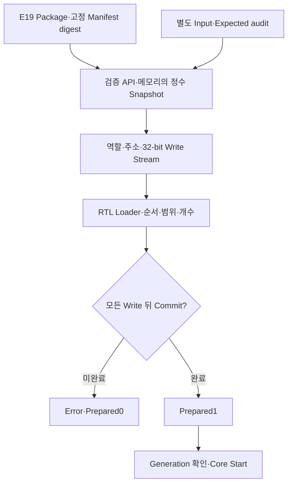

# 📥 E20. 검증 상수를 RTL에 적재하기 — Loader·Commit·Prepared·Generation·오류와 Reset

> 2026-11-02 복구한 과거 진단용 기록입니다. 현재 구현·보드 완료 상태와 구분합니다. [이관 안내](README.md)

출처: [Notion 원문](https://app.notion.com/p/408f0c4baec98170a565ffa82639d4da?pvs=204)

> <b>\[심화·기본 실습 뒤 참고\] 현재 기준은 ResNet-20 + CIFAR-10 · ZedBoard다.</b>
> 
> [관련 Notion 문서](https://app.notion.com/p/40cf0c4baec98145b57af4780d20c752)을 먼저 따른다. 이 장의 기존 ResNet-56 수치·인공 벡터·Python/RTL 실행 기록은 해당 예제·버전의 증거다. 실제 모델 정수 연결과 보드 실행의 완료로 확대하지 않는다. 기본 단계는 S0\~S6이며, 이 장의 G번호가 있으면 장 내부 단계다.

> ResNet-56 실습 설계 E20 · Rev1.0 · 적재의 의미 → Software/RTL 경계 → Loader 순서 → Prepared·Generation → 오류·Reset → 실제 시험 → 다음 전송 단계

> <b>검사된 파일이 있다는 사실과, Core가 필요한 모든 값을 실제로 받았다는 사실은 다르다.</b>
> 
> E19의 검증된 정수 값을 ordered write stream으로 바꾸고, E18 Transition 앞에 RTL Loader를 연결했다. 전체 적재와 Commit이 끝나기 전에는 prepared를 올리지 않는다. 작은 정상4회·실행 취소2회, 두 Stage 전환 각1회가 통과했으며 잘못된 적재/명령10건도 거부했다.

<b>프로젝트 기준:</b> ResNet-56 + CIFAR-10·진단용 Option A Transition. 실제 checkpoint·Accuracy·FPGA 합성/보드 적재·AXI/APB/DMA 전송은 미검증이다. 이번 write는 같은 clock의 native ready/valid와 local synchronous memory/register 모델이다.

<b>이전·연결:</b> [E19](E19.md) · [E18](E18.md)

<b>실행 자료:</b> [E20 Loader·통합 RTL·Software Bridge·상수·기준값·로그·부분 파형 ZIP](../../../historical/e12-e21/archives/e20_loader.zip)


# 0. 무엇을 확인한 뒤 시작해야 할까?

| 확인 단계 | 의미 |
| --- | --- |
| Package 검증 | 파일·Shape·축·범위·Hash가 채택한 계약과 맞음 |
| Write 수락 | Loader가 특정 역할·주소·값을 받은 edge |
| Local 저장 | 이번 모델의 memory/register가 그 edge에서 갱신됨 |
| Commit | 모든 역할의 기대 원소를 적재했음을 확인 |
| Prepared | 이 transaction을 시작할 수 있는 준비 상태 |
| Start | 같은 Generation의 command가 Core로 전달됨 |
| 완료 | 마지막 Y 수락·저장 뒤 응답까지 처리됨 |

파일 검사 PASS만으로 prepared=1을 내면 적재가 빠진 메모리의 과거 값으로 실행할 수 있다. 반대로 prepared를 한 번 올린 뒤 계속 유지하면 reset·다음 입력·다른 package의 경계를 구분하기 어렵다.

# 1. Software와 RTL의 책임을 나눈다



Software Bridge는 E19 validator가 반환한 메모리 정수 목록을 사용한다. 외부 JSON의 status=PASS 문자열만 믿고 쓰지 않는다. E19의 package와 고정 digest를 다시 확인하고, Input/Expected vector도 별도 E18 audit hash와 비교한다.

이번 fixture의 pin과 audit 목록은 재현 기준이다. 패키지·pin을 함께 수정하는 상황까지 인증하는 시스템은 아니다.

| 검사 | 담당 |
| --- | --- |
| JSON·Manifest Hash·dtype·축·누산 bound | Software |
| Begin의 Cin/H와 고정 RTL instance 일치 | RTL |
| 역할·주소 순서·길이·전송 값 범위 | RTL |
| host\_validated의 진실성 | 신뢰하는 Host/Driver의 책임 |
| 전송된 bytes가 digest와 실제로 같은지 | 이번 RTL에서는 재검증하지 않음 |

<b>RTL의 Manifest digest는 식별 label이다.</b> Hardware SHA256 검사기나 인증 증명으로 사용한 것이 아니다. 범위 안의 Weight/Bias가 전송 중 바뀌면 이번 ordered count만으로는 잡지 못한다. 실제 전송 무결성·readback·checksum은 별도 설계다.

# 2. 이번 적재 프로토콜

| 단계 | 인터페이스·조건 |
| --- | --- |
| Begin | host\_validated·digest·Generation·Cin/H 수락 |
| Write | wr\_valid&&wr\_ready에서 역할·주소·data 수락 |
| Commit | commit\_valid&&commit\_ready에서 전체 적재 확인 |
| Start | cmd\_valid&&cmd\_ready에서 Generation 검사 |
| Run | 적재·새 Begin 금지·Y 처리 |
| Response | 응답 보관·소비 후 IDLE·prepared0 |

우선순위는 Begin→Commit→Write다. Commit을 동시에 제시하면 Write는 그 edge에 수락되지 않는다. Host는 미수락 payload를 유지하고 transaction을 순차적으로 처리해야 한다.

Begin은 실행 중이 아닌 LOAD/READY/ERROR에서도 현재 준비를 버리고 새 적재를 시작할 수 있다. RUN/RESP에서는 begin\_ready=0이다. RESP에서 계산은 끝났더라도 이전 응답이 남아 있으므로 바로 새 적재를 허용하지 않는다.

# 3. 12개 역할을 정해진 순서로 보낸다

| Role ID | 내용 | 원소 수 |
| --- | --- | --- |
| 0 | Input X | Cin×H×H |
| 1 | Weight1 | Cout×Cin×9 |
| 2 | Weight2 | Cout×Cout×9 |
| 3·4 | Bias1·Bias2 | 각각 Cout |
| 5·6 | N1·N2 | 각각 Cout |
| 7·8 | Nm·Ns | 각각 Cout |
| 9·10·11 | s1·s2·sa | 각각 Cout |

E19의11개 상수 역할에 실행 입력 X를 더해12개 역할이다. 입력 이미지의 실제 전처리·dataset provenance를 이번 진단 vector가 대신하지 않는다.

각 역할은 주소0부터 마지막 element까지1씩 증가한다. 역할을 끝내면 다음 역할의 주소0으로 이동한다.

```txt
Input[0] → Input[1] → ... → Input[NX−1]
→ Weight1[0] → ... → Weight2 → Bias → N/Shift → Commit
```

전체 bitmap 없이 expected\_role/expected\_addr로 진행을 확인한다. 이 단순화를 위해 임의 순서 Write·중복 주소 덮어쓰기·중간 재전송은 지원하지 않는다. 오류가 나면 새 Begin으로 처음부터 다시 적재한다.

# 4. Element 주소와 전송 encoding

| 역할 | 32-bit data에 넣는 것 |
| --- | --- |
| Input·Weight | signed8의 raw two's-complement8-bit·상위24-bit0 |
| Bias | raw32-bit two's-complement |
| Multiplier N | 0\~65,535 |
| Shift | 0\~31 |

주소는 byte address가 아니라 역할별 element index다. Host가 Weight−2를 보내려면 이번 transport에서는32'h000000FE를 사용한다.32'hFFFFFFFE는 상위24-bit가0이 아니므로 거부한다. Bias−2는32'hFFFFFFFE가 맞다.

잘못된 역할·주소·범위의 Write는 Core로 전달하지 않는다. 계수가 포트 폭에 맞게 잘려 우연히 유효한 값으로 바뀌기 전에 거부한다.

| 실제 stream | Write 수 |
| --- | --- |
| 작은 호환/varied | 각각284 |
| Stage 1→2 varied | 30,496 |
| Stage 2→3 varied | 64,064 |

위 수는 원소별 적재 횟수다. AXI burst 수·대역폭·FPGA 소요 시간으로 해석하지 않는다.

# 5. 마지막 Write와 Commit을 구분한다

모든 Write가 끝나도 Loader는 LOAD에 머문다. Commit에서 expected\_role=12인지 확인한 뒤 READY로 간다.

$$
prepared=(state=READY)\land\neg reset
$$

Partial Commit이면 ERROR로 간다. Error 뒤에는 일부 memory가 채워져 있더라도 prepared=0이다.

이번 local memory/register는 Write fire edge에서 갱신된다. 마지막 Write 뒤 별도 Commit과 Start edge를 거치므로 계수·Weight가 반영된 뒤 Core command를 수락한다. E18은 그 command에서 Bias/계수 table을 snapshot한다.

외부 bus의 write response가 아직 pending인 시스템에 이 완료 규칙을 그대로 적용할 수는 없다. 실제 Driver/Bus Adapter는 응답·오류·outstanding drain을 추가해야 한다.

# 6. Generation과 Manifest label

| 필드 | 이번 용도 |
| --- | --- |
| active\_digest | Begin에서 보관한256-bit Manifest 식별값 |
| active\_generation | Begin에서 보관한32-bit 작업 식별값 |
| cmd\_generation | 시작하려는 작업의 식별값 |
| Generation mismatch | command를 오류로 소비·Core에는 전달하지 않음 |

Command handshake와 실제 Core 시작은 구분한다. Generation이 틀린 command도 거부 결과를 내기 위해 수락하지만, dbg\_core\_cmd\_fire는 발생하지 않는다.

이 비교는 값이 다른 오래된 command를 잡는다. Generation의 단조 증가·중복 사용 금지·reset을 넘어선 고유성은 RTL이 강제하지 않는다. Fixture는 case를 구분하는100\~103을 재적재 뒤 다시 사용할 수 있다.

따라서 같은 ID를 재사용한 과거 command까지 모두 막았다고 말하지 않는다. Production Host의 ID 수명·대기 command 폐기·pending 전송 drain 정책이 필요하다. 이번 Write token에는 개별 Generation tag도 없다.

# 7. 오류와 Reset의 처리

| Code | 의미 |
| --- | --- |
| 1 | Host가 검증하지 않았다고 표시 |
| 2 | 역할·순서 오류 |
| 3 | 주소·주소 진행 오류 |
| 4 | Input/Weight의 상위 bit 또는 N/Shift 범위 오류 |
| 5 | 전체 적재 전 Commit |
| 6 | Start Generation 불일치 |
| 7 | Cin/H가 고정 instance와 다름 |

Error는 새 Begin 또는 Reset까지 유지된다. ERROR에서는 prepared·Core 시작·Y·성공 응답이 나오지 않는지 검사했다.

Reset은 Loader와 Core의 제어·valid·진행 상태를 취소한다. Memory 배열 전체를 지우지는 않는다. 따라서 reset 뒤에는 새 Begin·전체 적재·Commit이 필요하다.

정상 완료 응답을 소비한 뒤에도 IDLE·prepared0으로 돌아간다. 같은 Input/상수를 그대로 반복 실행하는 재사용 명령은 이번 wrapper에 넣지 않았다. 다음 job도 다시 적재한다.

# 8. 실제로 실행한 시험

| 구성 | 정상 완료 | 실행/응답 취소 | 정상 Y |
| --- | --- | --- | --- |
| 작은 Transition | 4 | 2 | 64 |
| Stage 1→2 | 1 | 0 | 8,192 |
| Stage 2→3 | 1 | 0 | 4,096 |

작은 시험은 호환·varied 적재와 reset 후 재적재 복구를 포함한다. 별도로 적재 중 reset1회와 오류 transaction10건을 확인했다.

| 오류 시험 | 결과 |
| --- | --- |
| host\_validated0 | Code1·Core 시작 없음 |
| 잘못된 H | Code7 |
| Input 대신 Weight부터 전송 | Code2 |
| Input 주소1부터 시작 | Code3 |
| Input data256 | Code4 |
| 한 원소만 적재하고 Commit | Code5 |
| 같은 Input 주소 중복 | Code3 |
| N65,536 | Code4 |
| Shift32 | Code4 |
| 정상 적재 후 과거 Generation Start | Code6·Core 시작 없음 |

Software에서도 Manifest 변경·Input audit 변경의2개 실패 사례를 실행했다. Bridge가 nonzero 종료하고 Write stream을 발행하지 않는지 확인했다. run.sh는 이 단계가 실패하면 simulator 실행으로 진행하지 않는다.

# 9. 정상 적재 후 계산은 E18과 같은가?

검증된 package의 정수값을 stream으로 바꾸고 Loader를 통해 memory/register에 넣었다. TB가 계수 wire를 직접 설정해 우회하지 않는다.

| 경계 | 비교 |
| --- | --- |
| 요청 | 두 Conv 주소·Weight 주소·tag·padding |
| 누산 | term 순서·acc1·acc2 |
| 중간값 | H·M·Option A Skip |
| 출력 | Y·index·last·stall payload 유지 |
| 저장 | X 보존·B=Y·C=M·각 y fire 뒤 B write |
| 준비·시작 | Commit 전 command ready0·올바른 identity로만 Core 시작 |
| 완료 | 마지막 Y 수락·local write 뒤 응답 |
| 취소·복구 | old valid 제거·새 적재 뒤 재실행 |

전체 크기 두 job은 합계7,077,888개 누산 항·12,288개 최종 출력을 비교했다. 선택 vector에서 Loader를 거친 값의 계산 일치 증거이며 실제 checkpoint나 FPGA timing 증거는 아니다.

```txt
PASS full=0 jobs=4 cancelled=2 rejected_transactions=10 reset_during_load=1
accepted_terms=4329 accepted_outputs=80 hold_checks=38 local_write_checks=80

PASS full=1 jobs=1 cancelled=0 accepted_terms=3538944 accepted_outputs=8192
hold_checks=2799 local_write_checks=8192

PASS full=2 jobs=1 cancelled=0 accepted_terms=3538944 accepted_outputs=4096
hold_checks=1353 local_write_checks=4096
```

작은 정상 Y는4×16=64개다. accepted\_outputs80에는 성공 응답을 소비하기 전에 reset으로 취소한 작업의16개가 포함된다. accepted\_terms에도 취소 전 수락한 항이 들어간다. 취소를 정상 완료 수에 더하지 않는다.

전체 크기에서 모든 Loader 오류·reset 위치를 전수 시험한 것은 아니다. 작은 shape의 selected control 시험과 큰 shape의 정상 경로 시험을 구분한다.

# 10. 재실행과 근거 파일

ZIP의 e20\_loader 폴더에서 실행한다.

```bash
VERILATOR=/path/to/verilator bash run.sh
```

| 파일 | 역할 |
| --- | --- |
| rtl/loaded\_transition.sv | 순서/주소/범위·Commit·prepared·Generation gate |
| rtl/transition\_block.sv 등 | E18 계산 경로 |
| software/validate\_package.py | E19 검사기 |
| software/build\_vectors.py | 검증 정수값→Write stream·메타데이터 |
| software/packages/ | 실제 상수 package |
| software/audit\_e18/ | Input·Expected 감사용 vector |
| vectors/\*/writes.txt | 실제 TB 적재 stream |
| vectors/\*/metadata.json | Manifest digest·Generation·역할·길이 |
| sim/tb\_loader.sv | Loader·계산·오류·취소 통합 비교 |
| results/simulation\_0/1/2.log | 전체 RTL 회귀 |
| results/bridge\_errors.json | Software 거부 결과 |
| results/small\_window.vcd | 별도 small 실행의 처음100μs |

부분 파형의 TRACE WINDOW ONLY는 전체 회귀 PASS가 아니다. RTL-only -Wall lint와 세 구성의 생성·빌드·simulation을 수행했다. 도구 식별·source/vector hash는 results와 README에 보존했다.

# 11. 현재 경계와 다음 단계

| 아직 없는 것 | 추가 검증 |
| --- | --- |
| 실제 Bus Adapter·Driver | MMIO 주소·접근 폭·Write response·오류 |
| 전송 무결성 | Readback/checksum·digest와 실제 적재값의 연결 |
| 비동기·동시 pending | CDC·ID·순서·취소·drain |
| Production Generation | ID 재사용·reset·대기 command 폐기 정책 |
| 실제 checkpoint | Exporter·전처리·계수 provenance·Accuracy |
| FPGA | 합성·BRAM/DSP·STA·보드·성능 |

<b>보충자료:</b> MMIO/Bus 전송·write acknowledgement·readback·실제 board preload report는 산출물이 준비되면 연결한다. Native 시뮬레이션의 local write 완료를 외부 DDR/DMA/CPU 가시성 완료와 같다고 보지 않는다.

# 12. 의미를 확인하는 질문

1. Manifest 검사가 통과하면 FPGA memory도 적재된 것일까?
2. 모든 원소를 보냈지만 Commit 전이면 시작해도 될까?
3. digest를 RTL register에 보관하면 전송값의 SHA256도 확인한 것일까?
4. Generation 비교만으로 reset을 넘어선 모든 replay를 막을까?

<details>
<summary>답의 핵심</summary>

1. 아니다. 실제 Write 수락·저장·응답이 별도로 필요하다.
2. 이번 규약에서는 안 된다. Commit 뒤 prepared가 올라간다.
3. 아니다. 현재 digest는 Host가 전달한 식별 label이다.
4. 아니다. ID 고유성·재사용·pending 폐기 정책까지 필요하다.

</details>

<b>다음 단계:</b> [E21](E21.md)<br />32-bit custom MMIO endpoint의 Register map·응답 유지·두 층의 오류·Active identity Readback을 구현하고 실제 RTL 시험으로 연결했다. 실제 APB/AXI bridge는 후속 범위다.
