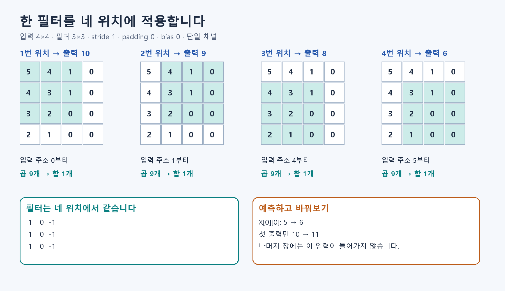

# S0. 작은 Conv를 손과 코드로 계산하기

이 페이지는 **이론을 읽은 뒤 확인하는 실습**입니다.

## 먼저 이해할 내용

사진을 숫자로 읽기 → Weight는 곱하는 값 → Conv는 작은 필터의 곱·합.

[A1](../fundamentals/A1.md) → [A2](../fundamentals/A2.md) → [B1](../fundamentals/B1.md)

전체 흐름을 아직 읽지 않았다면 [먼저 전체 설명](theory_first.md)부터 읽습니다. 개념을 이해한 뒤 아래 계산과 실습을 진행합니다.



이번에는 **3×3 필터 한 개로 출력 네 개를 만드는 이유**만 이해하면 됩니다. Python만 필요하며 GPU나 데이터 다운로드는 필요 없습니다. 시간은 첫 실습 약 10~20분을 예상하되, 답을 설명할 수 있는지를 기준으로 넘어갑니다.

## 먼저 예측하기

입력은 4×4, 필터는 3×3이며 한 칸씩 이동합니다. 필터가 들어갈 위치는 가로 2개 × 세로 2개입니다. 왼쪽 열에는 +1, 가운데에는 0, 오른쪽에는 -1을 곱합니다.

첫 출력은 `(5+4+3)-(1+1+0)=10`입니다. 나머지 창도 같은 방법으로 계산해 보세요. X[0][0]을 5에서 6으로 바꾸면 네 출력이 모두 달라질까요?

## 실행하고 관찰하기

저장소 최상위 폴더에서 실행합니다.

```bash
python -m exercises.conv_walkthrough
python -m exercises.step_up conv
```

첫 실행은 `Y=[10,9,8,6]`, 36 MAC입니다. 두 번째는 원본 배열을 바꾸지 않고 입력 변경을 실험합니다. `after_X00_plus_1`은 `[11,9,8,6]`입니다.

`results/basic/conv_trace.csv`의 첫 아홉 행을 보세요. 입력 주소는 `0,1,2,4,5,6,8,9,10`, 누산값은 `5,5,4,8,8,7,10,10,10`입니다. **누산값(Psum)은 지금까지 더한 중간 합**입니다.

## 한 번 더 바꿔보기

```python
from copy import deepcopy
from exercises.conv_walkthrough import X, W, conv_trace
changed = deepcopy(X)
changed[0][1] += 1
print(conv_trace(changed, W)[0])
```

출력부터 예측한 뒤 실행하세요. 필터에서 이 입력에 곱하는 값이 창마다 다릅니다.

## 확인하고 넘어가기

- 출력 네 개와 첫 출력의 아홉 입력 주소를 설명한다.
- Weight 9개를 네 위치에 재사용하므로 Dense MAC은 36회라고 설명한다.
- 입력을 바꾼 실험에서 기대값과 실제값, 이유를 한 줄씩 적는다.

<toggle>
답과 막혔을 때 확인할 것

추가 실험의 답은 `[10,10,8,6]`입니다. X[0][1]은 첫 창에서는 Weight 0, 두 번째 창에서는 Weight +1과 만납니다. 명령을 찾지 못하면 `exercises/` 폴더가 있는 저장소 최상위인지 확인하세요. 이 실습의 Weight는 사람이 정한 예제이며 학습된 모델이 아닙니다.
</toggle>


## 다음 단계

[S1로 이동](S1.md)
