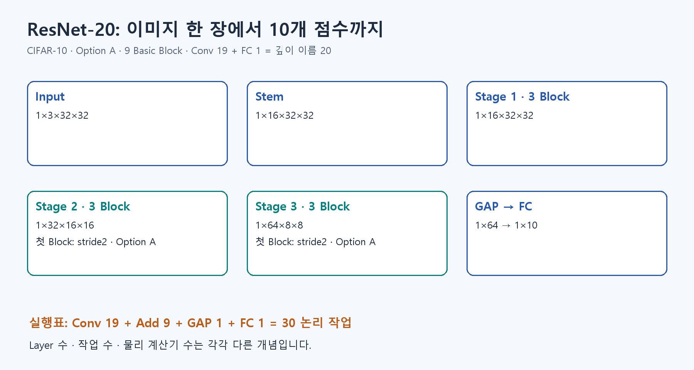

# S1. 실제 이미지 한 장과 분류 점수 보기

이 페이지는 **이론을 읽은 뒤 확인하는 실습**입니다.

## 먼저 이해할 내용

학습과 추론 구분 → Layer 연결 → 클래스 점수 → Loss와 정확도 구분.

[A0](../fundamentals/A0.md) → [A2](../fundamentals/A2.md) → [A3](../fundamentals/A3.md) → [A4](../fundamentals/A4.md) → [A5](../fundamentals/A5.md) → [B3](https://app.notion.com/p/407f0c4baec981259881f8492bfb6a92)

전체 흐름을 아직 읽지 않았다면 [먼저 전체 설명](theory_first.md)부터 읽습니다. 개념을 이해한 뒤 아래 계산과 실습을 진행합니다.



이번에는 **고양이 이미지가 10개 점수로 바뀌는 것**을 직접 확인합니다. PyTorch·NumPy·Pillow와 공개 체크포인트가 필요합니다. [Colab 첫 예측 노트북](https://colab.research.google.com/github/tsi03048/resnet20-accel/blob/main/notebooks/E1_E2_resnet20_reference.ipynb)을 권합니다. 로컬 첫 준비는 `python -m pip install -r requirements.txt`입니다.

## 먼저 예측하기

입력 `[1,3,32,32]`에서 1은 이미지 수, 3은 RGB 채널, 32×32는 크기입니다. 출력 `[1,10]`의 10은 이미지 크기가 아니라 클래스별 점수 개수입니다. 가장 큰 점수의 위치를 선택하는 것이 Argmax입니다.

## 먼저 한 장만 실행하기

```bash
python -m model.first_prediction --device cpu
```

동결한 실제 CIFAR-10 sample 0 입력으로 **지금 모델 추론을 다시 실행**합니다. 전체 데이터셋을 받거나 10,000장을 평가하지 않습니다. 필요한 참고 코드와 checkpoint가 없으면 처음 준비할 때 네트워크가 필요합니다.

`results/learning/first_prediction/image.png`를 열고, `prediction.json`의 `label`, `prediction`, `logits`를 보세요. 기준 sample은 정답 cat, 예측 cat, 점수 Shape `[1,10]`입니다. 클래스 순서는 JSON의 `classes`에 있습니다. Logit은 Softmax 전 점수이므로 음수일 수 있습니다.

## 바꿔서 생각하기

노트북에서 점수 하나를 복사한 배열의 다른 클래스 값보다 크게 바꾼 뒤 Argmax를 계산하세요. 이것은 **점수 선택 규칙 실험**이며 모델을 재학습한 결과가 아닙니다. 원본 파일을 덮어쓰지 않습니다.

## 전체 평가는 그다음

한 장 예측을 설명한 뒤 필요할 때만 실행합니다.

```bash
python -m model.run_reference --device auto --e1-only
```

전체 Test 10,000장 평가에는 데이터 다운로드와 추가 실행 시간이 듭니다. 한 장 성공을 전체 정확도라고 기록하지 않습니다. PTQ 후보 실험은 S3 뒤에 진행합니다.

## 확인하고 넘어가기

입력 이미지·정답·예측·10개 점수를 함께 보관하고, ‘정답은 평가에 쓰고 추론 자체에는 입력하지 않는다’를 설명하세요. 클래스 3을 ‘세 배 큰 값’이 아니라 cat의 위치 번호로 읽을 수 있으면 다음으로 갑니다.


## 다음 단계

[S2로 이동](S2.md)
