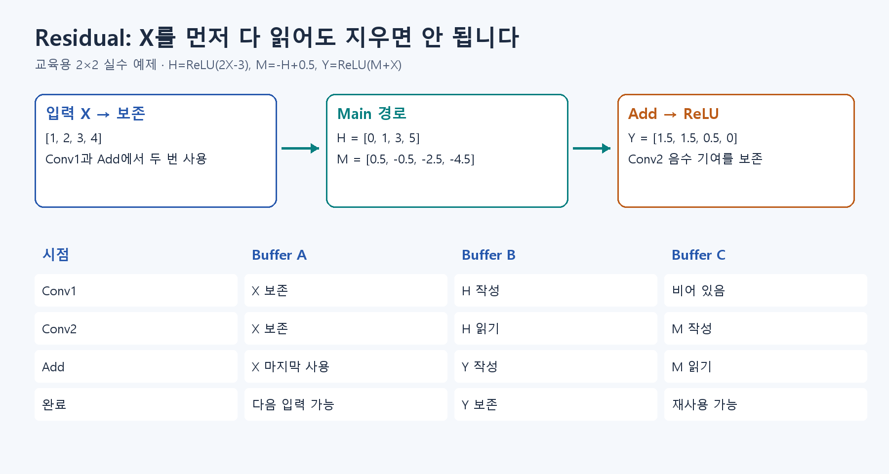

# S2. 학습 한 번과 Residual 두 경로 따라가기

이 페이지는 **이론을 읽은 뒤 확인하는 실습**입니다.

## 먼저 이해할 내용

예측·채점·갱신 → 새 문제로 평가 → 원래 X에 변화 더하기.

[A4](../fundamentals/A4.md) → [A5](../fundamentals/A5.md) → [A7](../fundamentals/A7.md) → [B4](https://app.notion.com/p/407f0c4baec98114b0e8fccad9a3f3a3)

전체 흐름을 아직 읽지 않았다면 [먼저 전체 설명](theory_first.md)부터 읽습니다. 개념을 이해한 뒤 아래 계산과 실습을 진행합니다.



학습은 Weight를 바꾸는 과정이고, 추론은 정해진 Weight로 입력을 계산하는 과정입니다. 이번에는 **작은 학습 한 번**과 **두 경로에서 같은 X를 쓰는 이유**를 나누어 확인합니다.

## 1. Weight가 어떻게 바뀔지 예측하기

`x=2, w=0.5, b=0.5`일 때 `ReLU(wx+b)=1.5`, 목표는 2입니다. Loss는 `(1.5-2)^2=0.25`입니다. Weight의 Gradient가 -2라면 `w -= 0.1*(-2)` 후 값은 커질까요, 작아질까요?

```bash
python -m exercises.step_up learn
```

새 Weight는 0.7, Bias는 0.6, 예측은 2입니다. 이 한 예제에서 Loss가 0이 된 결과를 실제 이미지 학습 성능으로 확대하지 않습니다.

## 2. 입력을 두 번 쓰는 이유 예측하기

2×2 입력을 펼치면 X=`[1,2,3,4]`입니다. Main 경로는 `H=ReLU(2X-3)`, `M=-H+0.5`이고, 출력은 `Y=ReLU(M+X)`입니다. Conv1이 X를 다 읽었다면 X 저장 공간을 지워도 될까요?

```bash
python -m exercises.step_up residual
```

H=`[0,1,3,5]`, M=`[0.5,-0.5,-2.5,-4.5]`, Y=`[1.5,1.5,0.5,0]`입니다. `wrong_extra_ReLU`와 비교하세요. Conv2 뒤에 ReLU를 추가하면 음수 기여가 사라져 결과가 달라집니다.

## 바꿔보기

아래 예제를 새 셀에서 실행하기 전에, `relu=True`가 어디에 추가됐는지 그림에서 짚으세요.

```python
x = [1, 2, 3, 4]
h = [max(0, 2*v-3) for v in x]
main = [-v+0.5 for v in h]
print([max(0, max(0, m)+v) for m, v in zip(main, x)])
```

## 확인하고 넘어가기

- Gradient 계산과 Weight 갱신을 구분한다.
- 원래 Y와 잘못된 Y=`[1.5,2,3,4]`가 다른 이유를 설명한다.
- X를 Add까지 보관해야 하며, H와 Y는 사용 시점이 겹치지 않을 때 같은 Buffer를 재사용할 수 있다고 설명한다.

학습/평가 데이터 분리와 일반화는 A5에서 필요한 절을 읽습니다. 첫 보드 실습에서는 학습 회로를 구현하지 않습니다.


## 다음 단계

[S3로 이동](S3.md)
