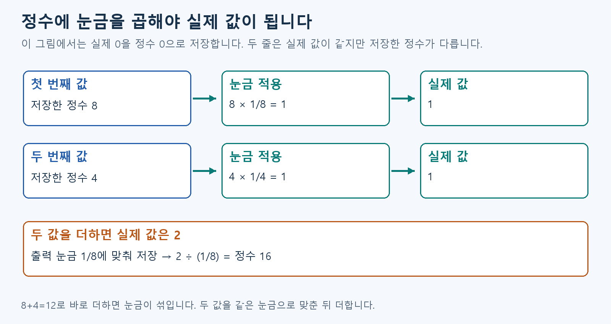
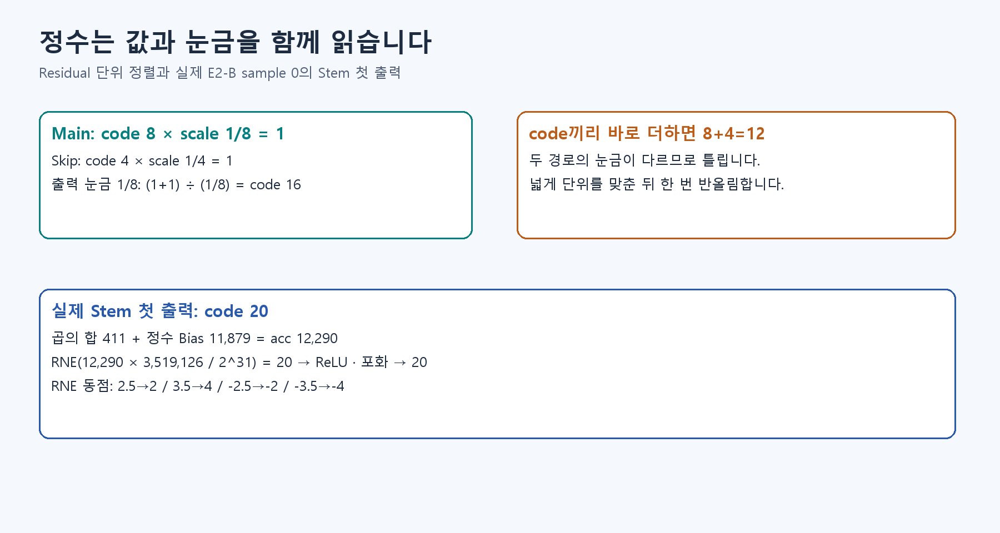

# S3. 정수 code의 눈금과 반올림 확인하기

## 이번에 확인할 개념

정수 code와 눈금 → 더하기 전 단위 맞추기 → 반올림·포화.

[A6](../fundamentals/A6.md) → [D1](../fundamentals/D1.md)

A6의 눈금과 D1의 반올림 규칙을 사용합니다. 이번에 새로 나오는 **Golden은 비교할 정답으로 미리 저장해 둔 결과**입니다.


앞부분의 작은 예제는 Python만 있으면 됩니다.

## 이번 실습에서 알아낼 것

저장한 정수와 실제 값을 구분하고, 다른 눈금의 두 값을 맞춰 더합니다. 작은 예제의 16을 설명한 뒤 실제 모델의 중간값도 같은 규칙으로 재현되는지 확인합니다.

## 먼저 예측하기

Main code 8의 Scale은 1/8이고, Skip code 4의 Scale은 1/4입니다. 둘 다 실제 값은 1입니다. 출력 Scale을 1/8로 정했다면 합의 출력 code는 12일까요, 16일까요?

```bash
python -m exercises.step_up quant
```

정답은 16입니다. `8+4=12`는 서로 다른 눈금을 그대로 더한 잘못된 계산입니다. D1의 RNE 규칙을 음수에도 적용해 봅니다. `-2.5→-2`, `-3.5→-4`를 확인하세요.



## 결과 이름 읽기

`results/learning/quant.json`의 lessons → quant를 봅니다. correct_code=16은 맞춘 눈금의 합, wrong_raw_sum=12는 일부러 눈금을 무시한 비교값입니다. wrong이라는 항목이 있다고 실행에 실패한 것은 아닙니다. nearest_even은 2.5→2, 3.5→4, −2.5→−2, −3.5→−4의 반올림 결과입니다.

## 작은 예제가 예상과 다르면

| 결과 | 먼저 확인할 계산 |
| --- | --- |
| 12가 나옴 | 저장한 정수끼리 바로 더했습니다. 8×1/8과 4×1/4를 각각 실제 값으로 읽습니다. |
| 2가 나옴 | 실제 값의 합입니다. 출력에 저장할 정수는 2÷(1/8)=16입니다. |
| −2.5가 −3으로 바뀜 | 정확히 중간일 때 가까운 짝수를 택하는 RNE인지 봅니다. −2가 짝수입니다. |

먼저 눈금, 다음 더하기, 마지막 반올림 순으로 확인합니다.

## 한 값을 바꿔보기

아래 함수의 첫 두 숫자는 더할 정수 8과 5입니다. 다음 1과 2는 출력 눈금에 맞추는 배수입니다. 마지막 0은 추가로 나누지 않는다는 뜻입니다. 먼저 `8×1+5×2=18`을 계산한 뒤 실행합니다.

```python
from quant.integer_math import aligned_add
print(aligned_add(8, 5, 1, 2, 0))
```

Skip code만 4→5로 바꿉니다. 출력 눈금이 더 촘촘하므로 결과는 16→18입니다.

## 실제 모델 정수 기준 한 장 재현

NumPy를 설치한 뒤 실행합니다. [E2-B 노트북](https://colab.research.google.com/github/tsi03048/resnet20-accel/blob/main/notebooks/E2B_integer_reference.ipynb)에서도 가능합니다.

```bash
python -m pip install numpy
python -m quant.replay_e2b --backend numpy
```

정상 기준은 입력을 포함한 61곳에서 총 552,084개 숫자를 비교하고, 예측이 `3(cat)`인 것입니다. 3은 0부터 센 고양이 후보 번호입니다. 이미 준비된 상수와 Golden으로 현재 소프트웨어 계산을 재현하는 것입니다.

### 실제 모델 결과는 이렇게 읽습니다

| 출력 이름 | 기대값 | 뜻 |
| --- | --- | --- |
| status | PASS | 저장한 정답과 현재 계산이 모두 같음 |
| tensor_count | 61 | 입력을 포함해 비교한 숫자 묶음 61곳 |
| compared_elements | 552084 | 그 묶음들에서 비교한 숫자 총개수 |
| prediction / class_name | 3 / cat | 가장 큰 점수의 후보 번호와 이름 |
| rtl_compared | false | 이번 실행은 소프트웨어 비교 |

이 명령은 결과를 화면에 출력합니다. 화면을 복사해 기록하거나 노트북의 `results/e2b_student_replay.json`을 보관합니다. 저장소에 원래 들어 있던 전체 평가 파일과 구분합니다.

실행 전 오류의 hash는 파일 내용의 식별값, identity는 파일 묶음의 이름·버전 정보, shape는 숫자 배열의 크기입니다. 해당 항목부터 배포본과 비교합니다. 계산 중 `first mismatch: 이름`이 나오면 그 이름이 처음 다른 비교 지점입니다. 입력·상수·반올림 규칙 순으로 확인하고, 불일치를 없애려고 Golden을 수정하지 않습니다.

## 정확도 탐색은 선택 실습

FP32는 소수를 표현하는 32비트 계산 방식입니다. E2-A는 원본의 소수 계산 위에서 정수 눈금의 효과를 시험하는 단계이고, E2-B는 실제 정수 Weight·Bias·반올림 규칙을 고정한 비교 기준입니다. E2-A 전체 실험은 노트북의 선택 셀에서 실행합니다. 눈금을 정하는 학습 사진 1,000장과, 그 사진들과 겹치지 않는 설정 비교용 학습 사진 1,000장으로 먼저 설정을 고르고 선택한 하나만 따로 남겨 둔 시험 사진(Test)으로 평가합니다.

현재 채택은 음수도 담는 8비트 정수(signed INT8)입니다. 눈금은 관찰한 최솟값과 최댓값을 이용하는 minmax 방식으로 정했습니다. 실제 규칙은 E2-B v1을 따르고, RTL은 해당 정수 경계와 정확히 비교합니다.

## 확인하고 넘어가기

code 8·Scale 1/8의 실제 값, 왜 눈금을 맞추지 않은 합 12가 틀리는지, 음수 RNE 두 예제를 설명하세요. 재현 PASS와 실제 FPGA 통과를 구분해 기록합니다.


<details>
<summary>실제 모델 계수 그림 — 선택 S5에서 이어 보기</summary>

아래 큰 곱셈값(multiplier)과 나누는 자리 수(shift)는 실제 Stem 예제입니다. S5에서 파일과 첫 출력 계산을 설명한 뒤 다시 봅니다.


</details>

## 다음 단계

[S4로 이동](S4.md)
