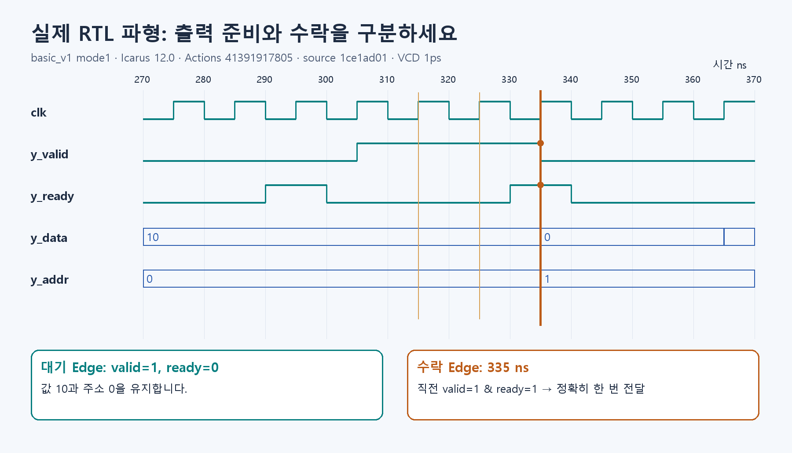

# S4. 대기와 수락을 실제 RTL 파형에서 찾기



**같은 값이 여러 번 보여도 실제 전달은 한 번일 수 있습니다.** 이번에는 정상·대기·Reset·고의 오류의 차이를 확인합니다.

## 먼저 Python으로 수락 규칙 확인

```bash
python -m exercises.step_up handshake
```

`Valid=1 & Ready=1`인 상승 Edge에서만 수락합니다. A가 세 Edge에 보여도 수락은 E2 한 번입니다. 결과는 A→B→C이며 E5의 C는 대기합니다.

## RTL 실행 준비

Ubuntu/WSL에 Icarus Verilog와 선택적으로 GTKWave가 필요합니다. 설치가 어려우면 [자동 시험](https://github.com/tsi03048/resnet20-accel/actions)에서 Basic track checks의 basic-evidence를 받아 먼저 읽을 수 있습니다. **기존 로그 열람과 본인 재실행을 구분**하세요.

```bash
bash tb/basic_v1/run.sh
```

Mode0은 정상, Mode1은 대기, Mode2는 진행 중 Reset입니다. Mode3은 기대값 10을 11로 일부러 바꾸므로 simulator가 실패해야 전체 시험이 성공입니다.

## 그림에서 세 지점 찾기

위 그림은 source `1ce1ad01`의 실제 Mode1 VCD를 그린 것입니다. 315ns와 325ns 상승 Edge에서는 `y_valid=1, y_ready=0`이므로 출력 10과 주소 0을 유지합니다. 335ns Edge 직전 두 신호가 1이므로 그 Edge에서 한 번 수락합니다. Edge 뒤 값이 바뀌는 것은 정상입니다. 다른 RTL 버전의 ns 값을 정답처럼 재사용하지 않습니다.

## 직접 파형 열기

```bash
gtkwave results/basic_rtl/mode1.vcd
```

처음에는 clk·y_valid·y_ready·y_addr·y_data 다섯 개만 추가합니다. 수락을 찾은 뒤 dut의 term_idx·psum·mac_ready·mac_fire를 추가해 첫 출력의 아홉 항을 따라가세요. 전체 신호를 한꺼번에 펼칠 필요는 없습니다.

## 바꿔서 확인하기

새 Python 셀에서 S4 표의 E5 Ready를 1로 바꿨다고 가정하면 C는 어느 Edge에서 전달될까요? 기존 E6에서도 Valid를 그대로 1로 두면 C가 또 전달됩니다. Source는 수락 뒤 다음 Token 또는 Valid=0으로 진행해야 합니다.

## 확인하고 넘어가기

출력 네 값·36 MAC·수락 주소 순서, 대기 중 값 유지, Reset 뒤 새 작업을 확인합니다. 로그와 본인 파형 표시를 보관하고, ‘대기는 보존, Reset은 취소’라고 설명하세요. 아직 FPGA 합성이나 보드 검증은 아닙니다.


## 다음 단계

[S6로 이동](S6.md) · 실제 계수 연결은 [선택 S5](S5.md)
