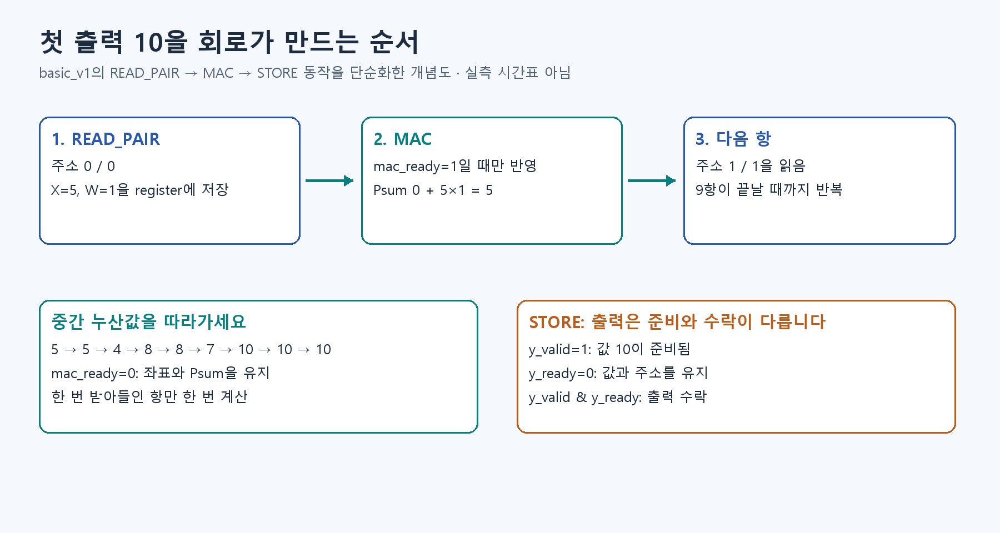

# S5. 선택: 작은 Conv에서 실제 모델 Stem으로 넓히기



이 단계는 **실제 모델 계수와 정수 Golden을 RTL에 연결하는 선택 경로**입니다. 작은 Conv 보드 실행이 목표라면 S4 뒤 S6으로 바로 갑니다.

## 달라지는 것부터 확인

작은 예제는 입력 1채널·출력 1채널, 4×4→2×2입니다. 실제 ResNet-20 Stem은 `[1,3,32,32]→[1,16,32,32]`, stride1·padding1입니다. 출력 하나에 27항을 누산하고 출력은 16,384개입니다.

정수 패키지·61경계 Golden·전체 Test 91.70% 소프트웨어 검증은 준비돼 있습니다. RTL 실행의 최신 증거는 진행 현황의 해당 revision·로그를 확인하세요. Stem 하나의 통과를 Residual·전체 모델·보드 통과로 확대하지 않습니다.

## 먼저 소프트웨어 기준 재현

**실제 Stem RTL은 통과했습니다.** [따라하기](../stem_e2b_rtl.md)에서 적재 순서·주소·첫 code 20 계산을 읽고,
Ubuntu/WSL에서 `bash tb/stem_e2b_v1/run.sh`를 실행하세요. 같은 실제 이미지로 완료 5작업을 비교했으며,
누산값 81,920개·출력 code 81,920개 불일치가 없습니다. [고정 실행 증거](https://github.com/tsi03048/resnet20-accel/actions/runs/41396748645)를 확인하세요.

```bash
python -m quant.replay_e2b --backend numpy
```

`reference/e2b_v1/stem_vectors/`에는 input·weight·bias·multiplier·shift와 기대 누산·출력이 있습니다. 첫 출력의 `411+11879=12290`, 후처리 code 20을 S3 그림과 대응시키세요.

## 단계별 비교 과제

1. 입력·Weight 주소 하나와 Padding code 0을 설명한다.
2. 출력 code뿐 아니라 INT32 누산값도 Golden과 비교한다.
3. 정상 뒤 Stall·Reset·오류 거부를 같은 source로 시험한다.
4. Stem이 통과한 뒤 Identity Block의 두 경로와 Add 단위 정렬로 넓힌다.

## 확인하고 넘어가기

패키지 식별·비교한 Shape·소스 revision·실행 로그·불일치 수를 남기세요. 실제 비교가 없으면 NOT_RUN으로 적습니다. E13·E14의 이전 합성 벡터 시험과 E2-B 실제 계수 비교를 구분합니다.


## 실제 Stem 실행

[E13-B 적재→시작→정수 비교](../stem_e2b_rtl.md)에서 `bash tb/stem_e2b_v1/run.sh`를 실행합니다. 실제 sample 0 완료 5작업, 누산·출력 각각 81,920개 불일치 0의 [기준 실행](https://github.com/tsi03048/resnet20-accel/actions/runs/41396748645)을 확인하세요.


## 실제 Residual Block 실행

[실제 정수 L1.0 따라하기](../residual_e2b_rtl.md)에서 `bash tb/residual_e2b_v1/run.sh`를 실행하세요. X를 보존하고 Conv2의 음수를 유지한 뒤 서로 다른 Main/Skip 단위를 맞춰 더합니다. 같은 sample 0로 완료 5 Block, Conv acc 163,840개·H/M/Y 245,760개·Add wide 81,920개 불일치 0입니다. 다음은 Stem→Block 연속 실행과 Transition입니다.

## 다음 단계

[S6로 이동](S6.md)
