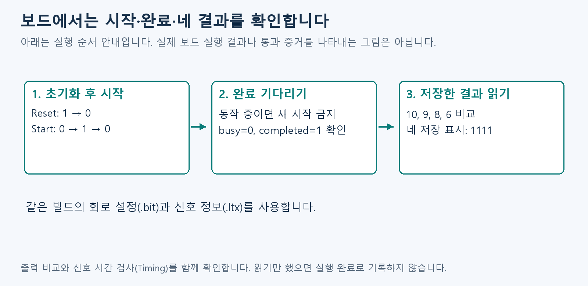
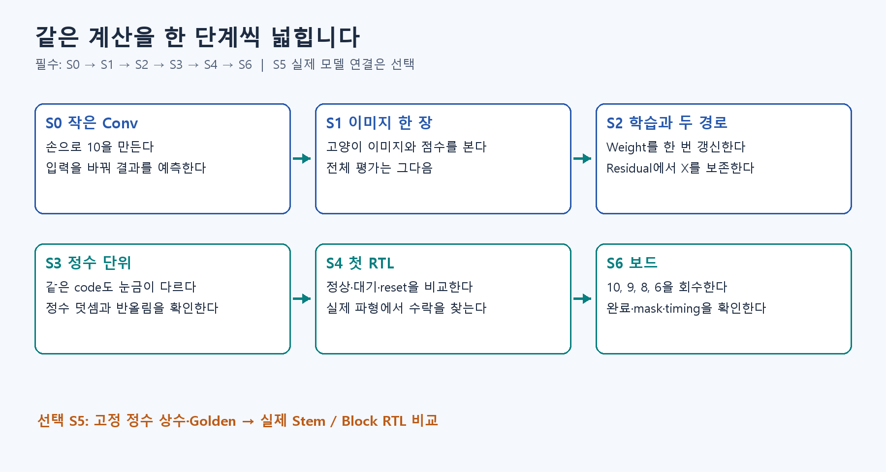

# S6. ZedBoard에서 네 결과를 확인하기

## 이번에 확인할 개념

D2·D3·D5에서 배운 계산·저장·전달 규칙을 실제 보드에서 확인합니다. 새 도구와 보드 절차는 아래에서 설명합니다.

[D2](../fundamentals/D2.md) → [D3](../fundamentals/D3.md) → [D5](../fundamentals/D5.md)

## 이번 실습에서 알아낼 것

시뮬레이션에서 확인한 작은 Conv가 실제 보드에서도 끝까지 실행되는지 봅니다. 시작 → 완료 → 네 결과 저장 → 값 비교 순으로 읽고, Reset 뒤 다시 실행해 같은 결과가 나오는지 확인합니다.

## 보드 실행에 필요한 이름

- **FPGA:** 내부 회로 연결을 설정할 수 있는 칩입니다. ZedBoard는 그 칩이 달린 보드이고, Vivado는 회로를 만들고 보드에 넣는 도구입니다.
- **합성:** RTL 코드를 실제 회로 부품과 연결로 바꾸는 과정입니다. Timing 검사는 신호가 정해진 시간 안에 도착하는지 확인합니다.
- **part·핀:** part는 칩의 정확한 모델명, 핀은 외부와 연결되는 단자입니다. JTAG는 PC에서 보드에 설정을 보내고 상태를 보는 연결 방식입니다.
- **VIO:** PC 화면에서 회로의 입력 신호를 바꾸고 출력 신호를 읽는 도구입니다. Hardware Manager는 Vivado에서 보드를 연결해 다루는 화면입니다.
- **.bit·.ltx:** .bit는 칩에 넣을 회로 설정, .ltx는 관찰할 신호 정보입니다. 같은 실행에서 만든 두 파일을 함께 써야 신호를 바르게 읽을 수 있습니다.

먼저 출력 네 값과 완료 신호를 어디서 읽을지 확인한 뒤 명령을 실행합니다.


기본 과제의 마지막은 **작은 Conv의 10·9·8·6을 ZedBoard에서 회수해 비교하는 것**입니다. 이 문서는 준비 절차이며 실제 보드 실행 결과를 대신하지 않습니다.

## 시작 전 세 가지

- S4의 현재 RTL 시험이 통과했는지 확인한다.
- ZedBoard와 Vivado, 전원·JTAG USB를 준비한다.
- `board/README.md`의 part·핀·VIO 연결을 읽는다. 기준은 `xc7z020clg484-1`이다.

## 한 단계씩 실행

```bash
vivado -mode batch -source board/zedboard/build_basic.tcl
```

오류가 없으면 생성된 **같은 빌드의 .bit와 .ltx**를 Hardware Manager에서 선택합니다. VIO에서 초기화 신호 Reset을 1→0, 시작 신호 Start를 0→1→0으로 바꾸며 각 값을 적용(commit)합니다. 여기서 commit은 화면의 값을 보드에 보내는 동작입니다. 동작 중을 뜻하는 Busy가 1이면 새 Start를 보내지 않습니다.

probe는 관찰할 신호에 붙인 이름입니다. 아래 표에서 probe_in0부터 순서대로 찾습니다.

| 관찰 | 기대값 |
| --- | --- |
| probe_in0~3 | 음수도 표시하는 10진수로 10,9,8,6 |
| probe_in4 | 완료 후 2진수 01: 동작 중(busy)=0, 완료(completed)=1 |
| probe_in5 | 네 결과의 저장 여부를 나타내는 2진수 1111. 각 1이 한 결과 저장 완료 |

입력과 Weight는 미리 값이 정해진 읽기용 메모리(ROM)에 들어 있습니다. 이 기본 실습은 외부 파일을 따로 넣지 않고 시작 신호로 실행합니다.

위 표의 신호 이름을 아래 순서에 대응시키세요. 이 그림은 실행 안내이며 보드 통과 결과가 아닙니다.



## 화면은 완료부터 읽습니다

1. probe_in4가 2진수 01인지 봅니다. 실행 중 표시 10과 구분합니다.
2. probe_in5가 1111인지 봅니다. 네 칸 모두 이번 결과를 저장했다는 뜻입니다.
3. probe_in0→3을 10진수로 읽어 10→9→8→6과 비교합니다.
4. 세 조건을 한 화면에 남긴 뒤 Reset·재실행을 확인합니다.

## 예상과 다르면 여기부터 봅니다

| 보이는 상태 | 먼저 확인할 곳 |
| --- | --- |
| 보드가 안 보이거나 신호 이름이 다름 | 전원·JTAG 연결, 선택한 장치, 같은 빌드의 .bit·.ltx인지 확인합니다. |
| 시작해도 완료되지 않음 | Reset을 0으로 돌렸는지, Start 0→1→0을 각각 적용했는지 봅니다. busy=1인 동안 새 시작을 반복하지 않습니다. |
| 완료는 1인데 저장 표시가 1111이 아님 | 네 결과가 모두 저장되지 않았습니다. VIO 신호 연결과 같은 버전의 회로인지 확인합니다. |
| 저장 표시는 맞는데 값이 다름 | 먼저 10진수 표시와 probe 순서 0→3을 확인하고, 같은 소스의 S4 결과와 비교합니다. |
| 결과는 맞지만 Timing 검사 실패 | 숫자 비교와 별개의 문제입니다. timing 보고서의 위반 경로를 확인한 뒤 수정·재빌드합니다. |
| Reset 후 예전 값처럼 보임 | 먼저 저장 표시와 completed가 0인지 봅니다. 새 시작 후 네 저장 표시가 다시 1이 되어야 새 결과입니다. |

보드가 없으면 이 단계는 준비까지 진행하고 NOT_RUN(아직 실행하지 않음)으로 기록합니다. 화면에서 읽은 상태와 직접 실행한 결과를 구분해 둡니다.

## 바꿔서 확인하기

정상 완료 뒤 Reset하면 네 결과의 저장 표시(mask)와 완료 신호가 0으로 돌아가는지 보세요. 다시 Start하면 같은 네 값이 나와야 합니다. 이 재실행까지 기록합니다.

## 제출하고 마무리하기

보드 출력 캡처·코드 버전·Vivado 버전·보드 버전·회로 자원 사용량(utilization)과 신호 시간 검사(timing) 보고서를 보관합니다. 출력만 맞고 Timing이 실패하면 S6을 PASS로 적지 않습니다. Setup/Hold는 값을 저장하는 순간의 앞뒤로 신호가 안정적인지, pulse-width는 신호가 충분한 시간 동안 유지되는지를 확인합니다. 미제약 경로는 시간 조건을 지정하지 않아 검사가 빠질 수 있는 연결이므로 함께 검토합니다.

100MHz는 초당 1억 번의 클록을 목표로 설정한 조건입니다. 실제 처리 성능이나 전체 모델의 분류 성공을 뜻하지 않습니다. 합성·보드 없이 읽기만 마쳤다면 아직 실행하지 않았다는 뜻의 NOT_RUN으로 적습니다.

기본 과제를 마치면 S5에서 실제 모델 전체로 넓힐 수 있습니다. 그다음에는 임시 저장 공간을 줄이거나 데이터 전송을 빠르게 하는 방법을 봅니다. 시스템을 제어하는 프로세서(CPU) 대신 메모리 전송을 맡는 장치가 DMA이며, 아래 심화 자료에서 다룹니다.


<details>
<summary>실습 전체 순서 복습</summary>

이전 전체 실습 안내 그림입니다. 보드의 실행 순서는 위 설명과 새 그림을 따릅니다.


</details>

## 다음 단계

[심화 자료 찾기](../notion_map.md)
