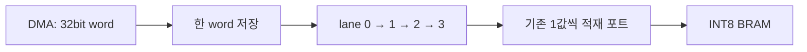

# E8-F. INT8 네 개를 한 word에 묶어 DMA 전송량 줄이기

[E8-E의 PS·DDR·DMA](ps_ddr_dma.md) 다음 선택 확장입니다. 이번 작업은 보드 없이 수행했습니다. **정밀도는 그대로 INT8이며 전송 word 하나에 값4개를 담습니다.** 실제 보드 실행·DDR 초기화는 NOT_RUN입니다.

## 1. 무엇을 줄였나요?

이전 전송 형식은 8bit 입력·Weight에도 32bit 공간을 하나씩 썼습니다. 이번에는 값4개를 32bit word 하나에 넣습니다. Bias·N·shift는 계속 32bit 값 하나씩 보냅니다. E2-B 상수와 61경계의 Golden은 그대로입니다.

| 실제 파일에서 계산한 항목 | 이전 R201 | 새 R202 |
| --- | ---: | ---: |
| 입력 패킷 bytes | 12,300 | 3,084 |
| Weight 패킷 bytes | 1,073,356 | 268,348 |
| bias·N·shift 패킷 합계 bytes | 8,412 | 8,412 |
| 이미지당 MM2S 합계 bytes | **1,094,068** | **279,844** |
| MM2S 전송 word 수, header 포함 | 273,517 | 69,961 |
| 논리 payload 값 개수 | 273,502 | 273,502 |
| S2MM 점수 응답 bytes | 64 | 64 |

이미지당 **814,224bytes, 74.42%**의 MM2S 전송량을 줄였습니다. [파일·클록 비교 결과](../results/ps_dma_packed_comparison.json)에서 실제 패킷 길이를 확인합니다. Weight BRAM 용량·모델의 정수 눈금은 바꾸지 않았습니다.

## 2. 네 값은 어떤 순서로 들어가나요?

입력 code `[-1, -128, 1, 127]`의 byte 표현은 아래와 같습니다.

| 순서 | 0 | 1 | 2 | 3 |
| --- | --- | --- | --- | --- |
| signed INT8 | −1 | −128 | 1 | 127 |
| byte | `ff` | `80` | `01` | `7f` |
| word 안의 비트 | 7:0 | 15:8 | 23:16 | 31:24 |

DDR의 byte 순서는 `ff 80 01 7f`, 32bit word 표기는 **`0x7f0180ff`**입니다. 회로는 아래 byte부터 하나씩 꺼내 기존 적재 포트에 보냅니다. 부호와 계산값은 이후 기존 INT8 회로가 해석합니다. 위 예시는 입력 시험에 쓰며, 기존 Weight의 −128 거부 규칙도 유지합니다.

## 3. 논리 개수와 전송 길이를 구분하기

새 입력 패킷은 `[magic=0x52323032, kind, 논리 값 개수, body...]`입니다. magic과 제어 ID 모두 R202입니다. 최종 응답은 E8-E와 같은 R20R 형식의 64bytes입니다. 시작 주소·종류 순서·결과 tag 규칙도 유지합니다.

| kind | 내용 | header의 논리 개수 | body 전송 words | header 포함 bytes |
| --- | --- | ---: | ---: | ---: |
| 0 | 입력 | 3,072 | 768 | 3,084 |
| 1 | Weight | 268,336 | 67,084 | 268,348 |
| 2 | bias | 698 | 698 | 2,804 |
| 3 | N | 698 | 698 | 2,804 |
| 4 | shift | 698 | 698 | 2,804 |

입력·Weight 길이는 4의 배수이므로 TKEEP는 항상 `0xf`이며, TLAST는 마지막 **전송 word**에 붙습니다. header에 67,084를 Weight 개수로 쓰면 오류입니다. DMA에 요청하는 길이는 header까지 포함한 **bytes**입니다.

새 `+0x44` 레지스터는 header를 포함한 수신 전송 words, 기존 `+0x14`는 코어에 전달한 논리 값 개수를 셉니다. 정상 적재 뒤 각각 **69,961**과 **273,502**인지 확인합니다. `+0x00` ID가 `0x52323032`여야 새 ARM 프로그램을 실행합니다. 같은 R202의 bit·ELF·패킷을 사용하세요.

## 4. word를 붙잡고 byte를 꺼내는 회로



word를 받은 뒤에는 해당 byte가 실제로 적재됐을 때만 lane과 주소를 늘립니다. 아직 남은 byte가 있으면 필요에 따라 TREADY를 내려 다음 word를 기다리게 합니다. 마지막 byte를 처리하면서 다음 word를 받을 수도 있습니다. 패킷의 마지막 word는 모두 꺼낸 뒤 다음 header로 넘어갑니다.

Reset은 저장 word의 valid·lane·수신 개수·준비 상태를 취소합니다. BRAM payload 자체를 0으로 지우지는 않습니다. 이후 BEGIN→완전 재적재를 해야 합니다. 숫자 오류가 생기면 나머지 패킷을 TLAST까지 비워 MM2S가 완료되게 하고, PS가 코어 오류를 확인하도록 했습니다. 오류 작업의 계산은 시작하지 않습니다.

## 5. 확인한 결과

| 시험 | 실제 기록 |
| --- | --- |
| 전체 정수 RTL | [실행 41445521393](https://github.com/tsi03048/resnet20-accel/actions/runs/41445521393), revision `85c13155`. 실제 0→1→0·Stall·8곳 Reset 회복 완료5회. 매회61경계·점수10개·예측 일치, 경계 원소 **2,760,420개 불일치0** |
| 적재 전체 읽기 검사 | 입력3,072bytes·Weight268,336bytes·계수2,094개 모두 일치. Weight BRAM 경계262,144와 마지막 구간도 확인 |
| 추가 lane Reset | 각 lane에서 0/1/2/3개를 저장한 시점의 Reset4회, word 저장과 soft Reset 동시 발생1회 확인. 합성 입력 패턴3,072bytes 재적재 일치 |
| 숫자 오류와 drain | Weight −128 오류 코드16을 먼저 확인한 뒤, 올바른 길이의 나머지 패킷을 TLAST까지 비우고 Reset. 전송 packet67,087words 확인 |
| 독립 재대조 | 내려받은 CSV274,506행을 Python으로 재비교. Vivado와 기능 시험의 활성 RTL 해시도 일치 |
| 실제 DMA IP | XSim의 AMD AXI DMA7.1에서 최대268,348bytes, 읽기/쓰기 버스트 각각2,097개, Stream Stall·전송 중 Reset·64byte 회복 통과. DDR/PS master는 BFM |
| ARM 실행 파일 | Cortex-A9 에뮬레이터에서 완료4회·계산 취소1회, DMA decode 오류·timeout·틀린 점수·stale tag 검출. DMA/코어 레지스터는 소프트웨어 모델 |
| Python 검사 | 이전 R201 payload와 R202를 풀어낸 전체 값의 일치까지 포함해 **49개 통과** |
| 실물 보드 | **NOT_RUN**. 이번에는 연결 없이 진행했으며 실제 PS·DDR·DMA 동작은 관측하지 않음 |

RNE Fraction2,000개·정수 곱셈512개·signed argmax, 잘못된 패킷8종·고의 Golden 오류4종·overflow 오류 응답도 다시 통과했습니다. 실제 사진은 Test0/1 두 종류입니다. 추가 Reset 시험의 합성 패턴을 실제 사진 종류에 더하지 않습니다.

증거: [전체 RTL](../results/ps_dma_packed_rtl_actual.json), [실행·해시](../results/ps_dma_packed_rtl_evidence.json), [추가 Reset](../results/ps_dma_packed_reset_actual.json), [DMA IP](../results/ps_dma_packed_ip_actual.json), [ARM 모델](../results/ps_dma_packed_arm_emulation.json).

### 전체 시스템 100 MHz 재검사

Vivado2025.1·`xc7z020clg484-1`, 실제 PS7·DDR 인터페이스·GP0·HP0·DMA를 포함한 `system_wrapper`입니다. 기존 Avnet ZedBoard Revision D 설정을 사용합니다. bitstream·XSA 생성까지 완료했습니다.

| 배선 후 항목 | 결과 |
| --- | ---: |
| LUT | 4,432 / 53,200 (8.33%) |
| FF | 5,706 / 106,400 (5.36%) |
| BRAM Tile | 87.5 / 140 (62.50%) |
| DSP | 0 / 220 |
| WNS / TNS | +0.571ns / 0ns |
| WHS / THS | +0.033ns / 0ns |
| 제약 검사 | 12종 모두0 |
| 배선 | 9,413/9,413, 오류0 |
| DRC | Error0, 생성 IP Warning16건·Advisory4건 보존 |

[원본 시스템 보고서](../results/ps_dma_packed_system_actual.json)와 `results/ps_dma_packed_system/reports/`를 확인합니다. Hold 여유는33ps로 작습니다. 사용자 false-path·multicycle·주기 완화는 추가하지 않았고, 생성 IP 제약과 경고도 보존합니다. 경고 종류와 PS/DDR 설정은 E8-E 설명을 함께 읽으세요.

### 왜 전체 추론 속도가 4배가 되지는 않나요?

현재 코어의 적재 포트는 한 클록에 값 하나를 받고, 계산 구조도 그대로입니다. 정상 0→1→0의 계산 클록은 이전과 새 버전 모두 **266,085,373클록/회**로 같았습니다. 이번에 확인한 효과는 DDR 전송량·패킷 크기·버스트 수 감소입니다. 실제 보드의 전체 지연·FPS·소비전력은 측정하지 않았습니다.

## 6. 보드 없이 따라 실행하기

저장소/ZIP 루트에서 시작합니다. 첫 명령은 증거와 해시를 검사하며 Vivado·시뮬레이터·보드를 실행하지 않습니다.

```powershell
python -m tools.check_packed_delivery
python -m pip install numpy
python -m tools.ps_dma_packed_vectors --export
& ./board/zedboard/ps_dma_packed/build_software.ps1
& ./board/zedboard/ps_dma_packed/run_packed_reset.ps1
& ./board/zedboard/ps_dma_packed/run_dma_ip_sim.ps1
& ./board/zedboard/ps_dma_packed/run_system.ps1
```

기본 도구 위치는 `C:/Xilinx/2025.1`입니다. 다른 설치는 `-VivadoPath`·`-Gcc`를 지정합니다. 영문 임시 경로에서 실행하고 소스 해시와 결과를 `build/`의 새 실행 폴더에 보관합니다. 시스템 결과를 보관할 때는 다음처럼 실행합니다.

```powershell
python -m tools.summarize_ps_packed_system --run build/zedboard_ps_packed_runs/ps_날짜_식별자
```

전체 RTL 비교는 Linux/WSL의 NumPy·Verilator·C++·make 환경에서 실행합니다. GPU·재학습·CIFAR 원본 다운로드는 필요 없습니다.

```bash
bash tb/ps_dma_v2/run.sh
```

ARM 프로그램의 소프트웨어 모델 시험은 별도입니다.

```powershell
python -m pip install unicorn pyelftools
python -m tools.ps_dma_packed_arm_emulate
```

실습 ZIP의 `platform_packed/output/`에는 같은 실행의 bit·XSA·PS 초기화 파일·DCP가 있고 `build/ps_dma_packed_software/`에는 ARM ELF가 있습니다. 실제 보드를 연결한 뒤에는 E8-E의 revision·JTAG 설정과 캐시 설명을 읽고 다음 명령을 사용합니다. 현재 이 실물 절차는 NOT_RUN입니다.

```powershell
& ./board/zedboard/ps_dma_packed/run_board.ps1 -RunDirectory ./platform_packed -Python python
```

## 7. 본인 기록과 질문

1. 32bit word `0x7f0180ff`에서 먼저 저장되는 입력 code는 무엇인가요?
2. Weight header 개수268,336과 body 전송 word 수67,084가 다른 이유는 무엇인가요?
3. 마지막 packed word의 byte가 남아 있을 때 다음 header를 바로 처리하면 어떤 오류가 나나요?
4. 전송량은74.42% 줄었는데 코어 계산 클록은 같은 이유를 설명하세요.
5. Reset 뒤 BRAM 값이 남아 있어도 새 작업에 섞이지 않게 하는 상태는 무엇인가요?

날짜·실행 명령·source/bit/ELF/패킷 해시, 실제 전송 bytes와 논리 값 개수, 정상·Stall·Reset·오류 결과, Used/Available·Setup/Hold·원본 경고를 기록하세요. 배포 증거 열람·본인 재실행·실물 보드 실행을 구분합니다.

다음 선택 확장: [E8-G MAC 파이프라인](pipelined_mac.md). 같은 R202 전송 규약으로 계산 클록을 줄이고 전체 정수·시스템 배선을 다시 검증합니다. 위 E8-F 수치는 당시 측정 이력으로 보존합니다.
