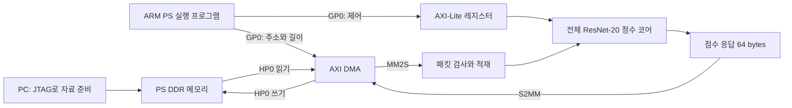

# E8-E. PS·DDR·AXI DMA로 전체 모델에 자료를 넣고 점수 회수하기

[E8-D](full_fpga_v2.md)의 정수 계산 코어를 실제 ZedBoard 시스템에 연결합니다. 이 문서는 [S6](learning/S6.md) 이후의 선택 확장입니다. 작은 Conv 기본 과제를 전체 모델 과제로 바꾸지는 않습니다.

**완료한 것:** 시스템 회로·100 MHz 배치배선·bitstream/XSA 생성, 전체 정수 RTL 전송 시험, 실제 DMA IP 시뮬레이션, ARM 실행 파일의 소프트웨어 모델 시험입니다. **실물 보드는 연결하지 않았으므로 PS 실행·DDR 초기화·실제 DMA 결과는 NOT_RUN입니다.**

## 1. 먼저 알아둘 이름

| 이름 | 이번 실습에서 하는 일 |
| --- | --- |
| PS | Zynq 안의 ARM CPU 쪽입니다. 실행 순서를 정하고 상태를 읽습니다. |
| PL | 우리가 만든 CNN 회로와 DMA·AXI 연결 회로가 놓이는 쪽입니다. |
| DDR | 보드의 큰 메모리입니다. 입력·Weight·계수를 먼저 보관하고 결과도 받습니다. |
| AXI 주소 전송 | 주소를 지정해서 레지스터나 메모리를 읽고 씁니다. |
| AXI-Lite | 짧은 제어 레지스터를 읽고 쓰는 규약입니다. |
| AXI-Stream | 주소 없이 순서대로 데이터를 전달합니다. VALID와 READY가 함께 1일 때 한 번 전달됩니다. |
| DMA | CPU가 데이터마다 직접 옮기는 대신, 주소와 길이를 받아 DDR와 회로 사이를 전송합니다. |
| MM2S / S2MM | 각각 메모리→Stream, Stream→메모리입니다. |
| TLAST / TKEEP | 패킷의 마지막 전송인지, 어느 byte가 유효한지 표시합니다. |

CPU는 제어용 **GP0**, DMA는 DDR 접근용 **HP0**를 사용합니다. 모든 PL 연결은 PS의 FCLK0 100 MHz 한 클록으로 동작합니다.



JTAG는 먼저 DDR에 자료와 ARM 프로그램을 넣는 데 사용합니다. 이후 **PS 프로그램이 DMA를 요청하고, DMA가 Weight·입력을 코어의 BRAM으로 전송**합니다. 결과도 DMA로 DDR에 쓴 뒤 PS가 확인합니다. 운영체제·SD 카드·BSP 설치 없이 시작하는 첫 구성입니다. UART 연결은 선택이며 점수는 JTAG로 회수합니다.

## 2. 어디에 무엇이 저장되나요?

기준은 Avnet ZedBoard 보드 정의 1.5의 **하드웨어 Revision D**, `xc7z020clg484-1`입니다. 생성된 PS 설정은 512 MiB DDR, `MT41J128M16 HA-15E`, DDR 533.333313 MHz입니다. 이는 생성 설정이며 실제 DDR 초기화 성공을 측정한 값은 아닙니다. 다른 보드 revision은 해당 보드의 DDR·MIO 설정을 먼저 확인합니다.

| 주소/범위 | 역할 |
| --- | --- |
| `0x40400000`, 64 KiB 창 | DMA 제어 레지스터 |
| `0x43c00000`, 4 KiB 창 | CNN 제어 레지스터 |
| `0x00000000~0x1fffffff` | DMA가 접근하도록 연결한 PS DDR/Low OCM 주소 구간 |
| `0x00100000~0x001fffff` | ARM 프로그램·데이터·스택 예약 |
| `0x02000000`, `0x02004000` | sample 0/1 입력 패킷 |
| `0x02010000` | Weight 패킷 |
| `0x02120000`, `0x02124000`, `0x02128000` | bias·N·shift 패킷 |
| `0x02200000`, 64 bytes | S2MM 최종 응답 |
| `0x03000000`, 512 bytes 예약 | PS 실행 상태와 완료한 4회 결과 |

주소는 **byte 단위**입니다. `+4`는 32bit 값 하나 다음 위치입니다. 모든 패킷 시작 주소는 64byte에 정렬했고 영역이 겹치지 않도록 검사합니다. 위 DDR 주소는 이 단독 프로그램의 예약입니다.

## 3. 입력 패킷과 결과 패킷

첫 구현은 이해하기 쉽게 숫자 하나를 little-endian 32bit word 하나에 넣습니다. INT8도 아래 byte만 사용하고 나머지는 0입니다. 음수 INT8의 byte 표현은 유지하되 32bit로 부호 확장하지 않습니다. Bias는 signed INT32의 2의 보수 표현을 그대로 보냅니다.

입력 패킷: `[magic=0x52323031, kind, payload 개수, payload...]`. **패킷 하나마다 별도 MM2S 전송을 요청**해서 마지막 payload에만 TLAST가 붙게 합니다. TKEEP는 매번 `0xf`입니다.

| 순서/kind | payload | payload words | header 포함 전송 bytes |
| --- | --- | ---: | ---: |
| 0 | 입력 | 3,072 | 12,300 |
| 1 | Weight | 268,336 | 1,073,356 |
| 2 | bias | 698 | 2,804 |
| 3 | N | 698 | 2,804 |
| 4 | shift | 698 | 2,804 |
| 합계 | | 273,502 | 1,094,068 |

Weight 자체는 268,336 bytes이며, 여기서는 전송 형식 때문에 약 4배의 DDR 공간·전송량을 씁니다. 코어의 Weight BRAM 용량이 4배로 늘어난 것은 아닙니다. DMA 길이 레지스터 폭을 **23bit**로 설정했습니다. 기본 길이 한도를 확인하지 않고 1 MiB 패킷을 보내면 잘리거나 거부될 수 있습니다. SG·DRE는 사용하지 않습니다.

결과는 한 번의 S2MM으로 받는 **16 words = 64 bytes**입니다.

| word 위치 | 의미 |
| --- | --- |
| 0 | 응답 magic `0x52323052` |
| 1 | 작업 tag: 예전 응답을 새 응답으로 오인하지 않도록 확인 |
| 2 | 상태: 성공 0, 코어 오류는 `0x80000000 | fault_code` |
| 3 | 예측 class 번호 |
| 4~13 | class 0~9의 signed INT32 점수 |
| 14~15 | 계산 클록 수의 하위·상위 32bit |

음수 점수·동점 규칙·눈금은 E2-B v1 그대로입니다. 점수는 공통 눈금 `2^-16`이며 softmax 확률이 아닙니다. 계산 클록 수는 DDR 적재 시간을 포함하지 않습니다. 시뮬레이션 값이나 정적 타이밍으로 보드 FPS를 주장하지 않습니다.

## 4. PS 프로그램의 실행 순서

1. DMA와 CNN 제어를 Reset합니다. 작업 tag를 쓰고 BEGIN을 요청합니다.
2. **64byte S2MM 수신을 먼저 준비**합니다.
3. 입력→Weight→bias→N→shift를 각각 MM2S로 전송합니다. 길이는 bytes입니다. 각 DMA 완료·오류를 확인합니다.
4. 적재 개수·prepared·오류 상태를 확인한 뒤 START를 요청합니다.
5. S2MM 완료를 기다리고 magic·tag·상태·예측·점수10개를 확인합니다.
6. 0→1→0을 실행합니다. 추가 작업을 계산 중 취소하고 **DMA와 CNN을 모두 Reset**한 뒤 sample 1을 완전히 재적재해 확인합니다.

현재는 매 작업마다 Weight·계수를 다시 적재합니다. 입력을 계산 중 덮어쓰거나 중간 Golden을 넣지 않습니다. 잘못된 kind·길이·TKEEP·TLAST·숫자 범위는 오류로 기록하고 START를 막습니다. 부분 적재나 부분 응답이 있던 작업은 그대로 이어가지 않고 Reset→완전 재적재합니다.

AXI-Lite는 주소(AW)와 데이터(W)가 다른 순서에 도착해도 각각 저장합니다. B/R 응답은 READY가 올 때까지 유지합니다. 예약 주소·잘못된 명령·busy 중 BEGIN/START는 SLVERR로 거부합니다.

핵심 레지스터: `+0x00` ID, `+0x04` 명령(1 BEGIN, 2 START, 4 RESET), `+0x08` 상태, `+0x0c` tag, `+0x10` 오류, `+0x14` 적재 words, `+0x18` 응답 words. 상태의 bit 0/1/2/3/4/5/6/7은 각각 load_complete/rx_enabled/prepared/busy/tx_active/done/error/result_valid입니다. `+0x40`은 시험용 계산·trace 일시정지이며 평소에는 0입니다.

### 캐시는 왜 주의해야 하나요?

HP0는 CPU 캐시와 자동으로 일치하는 포트가 아닙니다. CPU가 썼다고 생각한 값이 캐시에만 있으면 DMA는 DDR의 이전 값을 읽을 수 있습니다. 이번 독립 실행 프로그램은 PS Reset 후 시작하고 **MMU·L1 D/I 캐시를 끈 상태**로 동작하며, DMA 요청·회수 사이에 DSB를 사용합니다. 캐시를 켜는 후속 프로그램은 MM2S 전에 소스 clean/flush, S2MM 뒤에 목적지 invalidate와 정렬·버퍼 소유권 규칙을 추가해야 합니다. DSB만으로 캐시 정리를 대신하지 않습니다.

## 5. 실제로 확인한 범위

| 시험 | 결과와 범위 |
| --- | --- |
| 전체 정수 RTL + 전송 BFM | [실행 41437155870](https://github.com/tsi03048/resnet20-accel/actions/runs/41437155870), revision `26078c0e`. 실제 0→1→0·Stall·Reset 회복 완료5회, 매회61경계·점수·예측 일치. 경계 원소 2,760,420개 불일치0. PS 주소 전송과 DDR 기반 DMA Stream은 시험 모델이며 CPU·DDR PHY 모델이 아님 |
| Reset 8곳 | 부분 header·부분 Weight·계수 읽기·순차 곱셈·순차 반올림·Stem·Transition·부분 S2MM 응답 취소, sample 1 회복 |
| 오류 시험 | 잘못된 패킷8종, AW/W 세 순서·byte strobe·응답 유지·미완료 AXI 요청 Reset, overflow 오류 응답, 고의 Golden 오류4종 |
| 독립 CSV 재대조 | 내려받은 첫 정상 입력의 274,506행을 Python으로 다시 비교. 실제 시스템과 시험의 활성 RTL SHA256도 일치 |
| 실제 AMD AXI DMA IP | XSim에서 1,073,356byte loopback, DDR 주소 버스트 8,386개씩 읽기/쓰기, Stream stall·전송 중 Reset 후 64byte 재실행 통과. DDR 메모리·PS master는 BFM, CNN 계산·CPU 부팅 시험은 아님 |
| 실제 ARM ELF의 에뮬레이션 | Cortex-A9 명령 실행, DMA/코어 레지스터는 소프트웨어 모델. 완료4회·계산 취소1회, DMA decode 오류·timeout·틀린 점수·stale tag 검출 통과 |
| 학생용 XSDB 스크립트 | 디버거 명령을 모의 처리해 패킷6개+ELF 적재 순서와 signed/decimal 결과72words 회수 형식 검사. 보드 접근 없음 |
| Python 검사 | 기존 검사와 결과 오판 방지 검사를 포함한 46개 통과 |
| 실물 ZedBoard | **NOT_RUN**. 현재 연결되지 않아 DDR 초기화·PS 실행·실제 DMA·점수 회수를 아직 관측하지 않음 |

RNE Fraction 2,000개·정수 곱셈512개·signed argmax 시험도 이번 RTL 빌드에서 다시 통과했습니다. 실제 사진은 Test 0/1 두 종류입니다. 전체 Test 10,000장 RTL 정확도 평가는 별도입니다.

### 전체 시스템 Vivado 2025.1 결과

이번 top은 `system_wrapper`이며 실제 PS7·AXI DMA·제어/메모리 interconnect와 코어를 포함합니다. FCLK0는 100 MHz입니다. 이전 OOC 전용 입력 지연 LUT와 입출력 시간 가정은 사용하지 않고 실제 내부 연결을 배치·배선했습니다. 사용자 false-path·multicycle·주기 완화는 추가하지 않았으며 생성 IP의 제약을 사용합니다.

| 배선 후 항목 | 결과 |
| --- | ---: |
| LUT | 4,296 / 53,200 (8.08%) |
| FF | 5,625 / 106,400 (5.29%) |
| BRAM Tile | 87.5 / 140 (62.50%) |
| DSP | 0 / 220 |
| WNS / TNS | +0.255 ns / 0 ns |
| WHS / THS | +0.017 ns / 0 ns |
| WPWS / TPWS | +3.750 ns / 0 ns |
| 제약 검사 | 12종 모두 0 |
| 배선 | 9,153 / 9,153, 오류0 |
| DRC | Error0; IP 관련 Warning16건·Advisory4건 보존 |

LUT RAM 185개는 DMA·연결 IP의 FIFO 등을 포함하며 CNN Weight·계수는 계속 BRAM입니다. Hold 여유는 17 ps로 작습니다. 시스템 변경 후에는 다시 측정해야 합니다.

경고를 숨기거나 오류를 낮추지 않았습니다. `PDCN-1569`는 생성 IP LUT 핀3건, `REQP-1839/1840`은 DMA/프로토콜 변환기의 비동기 Reset을 가진 레지스터와 RAM 제어12건, `RTSTAT-10`은 부하 없는 net1건입니다. 실제 DMA IP 전송·Reset 시험은 통과했지만 이 시험이 전체 시스템의 모든 Reset 시점이나 실물 DDR를 검증한 것은 아닙니다. 원본 DRC를 함께 읽고 보드 시험에서 전송 중 Reset→재적재를 확인합니다.

원본: [시스템 결과](../results/ps_dma_system_actual.json), [RTL 결과](../results/ps_dma_rtl_actual.json), [DMA IP 시험](../results/ps_dma_ip_actual.json), [ARM 에뮬레이션](../results/ps_dma_arm_emulation.json), [실물 상태](../results/ps_dma_board_actual.json).

## 6. 보드 없이 재실행하기

저장소/ZIP 루트에서 시작합니다. 첫 명령은 배포 증거와 해시를 검사할 뿐, Vivado·시뮬레이터·보드를 실행하지 않습니다.

```powershell
python -m tools.check_ps_delivery
python -m pip install numpy
python -m tools.ps_dma_vectors --export
& ./board/zedboard/ps_dma/build_software.ps1
& ./board/zedboard/ps_dma/run_system.ps1
& ./board/zedboard/ps_dma/run_dma_ip_sim.ps1
```

Vivado·Vitis의 기본 경로는 `C:/Xilinx/2025.1`입니다. 다른 위치는 스크립트의 `-VivadoPath`·`-Gcc`를 지정합니다. 한글 경로 문제를 피하도록 영문 임시 폴더에서 실행하고 결과를 `build/`의 새 실행 폴더에 가져옵니다. 시스템 보고서는 다음처럼 보관합니다.

```powershell
python -m tools.summarize_ps_system --run build/zedboard_ps_runs/ps_날짜_식별자
```

RTL 전체 비교는 Linux/WSL의 NumPy·Verilator·C++·make 환경에서 실행합니다. GPU·재학습·CIFAR 원본 다운로드는 필요 없습니다.

```bash
bash tb/ps_dma_v1/run.sh
```

ARM 소프트웨어 모델 시험만 재실행하려면 아래 명령을 사용합니다. 이는 보드 시험이 아닙니다.

```powershell
python -m pip install unicorn pyelftools
python -m tools.ps_dma_arm_emulate
```

## 7. 연결된 보드에서 실행할 때

배포 ZIP에는 `platform/output/`에 같은 실행의 `.bit`·`.xsa`·`ps7_init.tcl`·배선 DCP, `build/ps_dma_software/`에 ARM ELF, `reference/ps_dma_v1/`에 DDR 패킷이 있습니다. 파일 SHA256은 패키지 manifest와 결과 JSON에서 확인합니다. 새로 만든 회로와 예전 PS 초기화 파일을 섞지 않습니다.

1. 보드 revision D와 설명서의 JTAG 부팅 설정, 전원·JTAG 연결을 확인합니다. 이 스크립트는 PS를 Reset하고 해당 회로와 프로그램을 적재합니다.
2. 위 패킷 검사·소프트웨어 빌드를 마친 뒤, 저장소 루트에서 아래 명령을 실행합니다. 스크립트는 연결된 Cortex-A9 #0이 하나인지 확인합니다.
3. `results/board_ps_dma_날짜/`의 XSDB 로그·launch manifest·72word 보고서·검증 JSON을 보관합니다. 완료4회·0→1→0·Reset 회복1, 예측3→8→3→8와 점수10개/회를 확인합니다.

```powershell
& ./board/zedboard/ps_dma/run_board.ps1 -RunDirectory ./platform -Python python
```

본인이 새로 합성했다면 `-RunDirectory`에 `build/zedboard_ps_runs/ps_...`를 넣습니다. 실패하면 XSDB 로그와 PS 보고서의 stage·DMA 상태·코어 오류를 먼저 봅니다. Timeout을 정확도 실패나 정상 완료로 처리하지 않습니다. 물리 보드의 이 경로는 최종 점수·예측을 회수하며 내부 61경계는 RTL 시험에서 확인합니다.

## 8. 설명하고 제출하기

1. DDR의 주소와 코어 BRAM의 순번 주소는 어떻게 다른가요?
2. Weight가 268,336bytes인데 MM2S 길이가 1,073,356bytes인 이유는 무엇인가요?
3. S2MM을 먼저 준비하고 TLAST·tag를 확인해야 하는 이유는 무엇인가요?
4. 전송 중 Reset했을 때 DMA만, 또는 코어만 Reset하면 어떤 예전 데이터가 남을 수 있나요?
5. 이번에 PASS인 정적 타이밍·RTL·ARM 에뮬레이션·실제 보드 실행을 구분해 적어보세요.

본인 날짜·명령·도구 버전·보드 revision·소스와 bit/ELF 해시, 주소/길이, 정상·Reset 결과, 자원·Setup/Hold, 원본 보고서와 경고를 제출합니다. 열람·소프트웨어 모델·실물 실행을 구분하고 수행하지 않은 것은 NOT_RUN으로 남깁니다.

설정 근거: [Avnet 보드 정의](https://github.com/Avnet/bdf/tree/e9723b55a68b106fb4cdb645974d096cd3594a2a/zedboard/1.5), [ZedBoard 설명서](https://files.digilent.com/resources/programmable-logic/zedboard/ZedBoard_HW_UG_v2_2.pdf), [AMD DMA Simple mode](https://docs.amd.com/r/en-US/pg021_axi_dma/Direct-Register-Mode-Simple-DMA), [AMD DMA 공식 예제](https://github.com/Xilinx/embeddedsw/blob/master/XilinxProcessorIPLib/drivers/axidma/examples/xaxidma_example_simple_poll.c). 보드 정의의 Apache-2.0 원문 조건을 유지하며 프로젝트 라이선스는 팀 합의 전 보류입니다.
